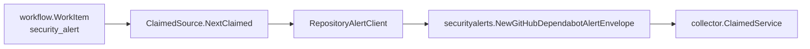

# securityalerts/alertruntime

This package runs hosted provider security-alert collection behind workflow
claims. The runtime accepts explicit targets, resolves credentials before
construction, and calls the provider client only for the claimed `scope_id`.
Each target is `repository`-scoped (validated against its `allowed_repositories`
allowlist) or `org`-scoped (validated to carry an `organization` and an
explicit `allowed_repositories` allowlist that bounds which repositories receive
fan-out facts).

The first provider is GitHub Dependabot alerts. Repository targets poll one
repository; org targets poll `GET /orgs/{org}/dependabot/alerts` and fan the
response out into per-repository facts whose `scope_id` is derived from each
alert's source repository (`security-alert:github:<owner>/<repo>`), so a single
org target produces the same per-repository fact shape as N repository targets.
`ClaimedSource` returns only `security_alert.repository_alert` facts from
`go/internal/collector/securityalerts`; reducer-owned impact/readiness truth
stays outside this package.
`ClaimedSource.PreflightProviderAccess` uses the same target map and provider
client to prove configured provider access before workflow claims are processed.
It makes one bounded provider request per target and never emits facts.

## Org-scope fan-out (#8805)

An org read is a window: GitHub pages the whole organization's open alerts
newest first, so `max_pages` x 100 alerts may hold few or none of a quiet
allowlisted repository's alerts. When the org read is truncated,
`collectTarget` hands off to `fanOutOrganization` (`org_fanout.go`), which reads
each allowlisted repository of the organization with
`ListRepositoryAlertsPages`, bounded by the same `max_pages`, sequentially in
allowlist order and capped at `maxOrganizationFanoutRepositories` (100) per
claim, starting at the fan-out cursor for an allowlist that fits (#8946,
`fanout_cursor.go`). The start moves forward through the allowlist, to the
repository after a failed read. A failed read at the last position closes the
lap: the start returns to the top and stays there until a claim reads every
repository or that last repository leaves the allowlist. A rate limit leaves
the start where the claim began. Several persistent stoppers therefore settle
in at most one stored generation per stopper plus one, then the committer
skips the unchanged generation, and the settled read set is never smaller than
the start-at-top set. A target with more than 100 same-org repositories is
collected as shards (#9019, below), so a claim over the cap is left only for a
leaf at the shard depth cap; it always starts at the top and reads the same
first 100, and `NewClaimedSource` logs one `security_alert.org_fanout_over_cap`
warning for it.
`NextClaimed` only computes the cursor. It travels on `TargetReadState`
(`FanoutStartRepository`, `FanoutNextRepository`, `FanoutLapRepository`) and commits with the
generation (migration 232, the `unread.Writer` in the commit transaction), so a
rollback or an unchanged-generation skip leaves it where it was.
`FanoutCursorReader` (implemented by `unread.CursorReader`) reads it at the
start of the next fan-out; a read error fails the claim as a retryable storage
failure (`cursorReadError`: message `security alert fan-out cursor read from
postgres failed`, operation `read_fanout_cursor`, no cause text), a missing
cursor starts at the top, and `NewClaimedSource` rejects a `ReadStateWriter`
without a reader. `mergeFanoutAlerts` merges the reads into the claim's generation and
org `scope_id`: a complete repository read replaces that repository's
org-window alerts, every other allowlisted repository keeps its org-window
alerts, and duplicates collapse on (repository, alert number). Fan-out alerts
are stamped with the requested repository, so their `repository_id` and stable
fact key match the org path. Per-repository coverage (`coverage.go`) stamps each
fact: a still-truncated read keeps `provider_open_alert_page_limit_reached`;
a failed, rate-limited, stopped, alerts-disabled, or capped repository adds
`org_repository_read_failed`, `org_repository_read_rate_limited`,
`org_repository_fanout_stopped`, `org_repository_alerts_disabled`, or
`org_repository_fanout_cap_reached`. Only a `not_found` read (this
includes the 403 the client marked `AlertsDisabled`: a JSON body saying
Dependabot alerts are disabled, no rate-limit signal, classified `not_found`
since #8947) lets the fan-out continue; the first read that fails any other
way (rate limit, other auth denied, 5xx, transport, terminal) stops it
(`fanoutFailureOutcome`). A repository-scope target that gets the same 403
fails as terminal `not_found`, not `auth_denied` (#8947), so readiness does not
blame a working credential. The claim still commits what it read and never
loops. Only a cancelled claim context fails the claim, with no partial
generation.
An allowlist with no repository of the organization fans out nothing: the
truncated org read is returned as a single read, with its truncated freshness
digest and no fan-out outcomes.
Fan-out facts carry a lowercase `repository_name`, because the per-repository
endpoint returns no repository object. The freshness digest includes each alert's
repository and the fan-out outcomes, so a changed outcome is a new refresh
boundary. Because of the repository field, org-scope digests differ from those
computed before #8805: each org target takes one extra generation after an
upgrade.

## Org-target shards and retirement (#9019)

`NewClaimedSource` expands every org target through `shard.Partition`
(`internal/scope/org/shard`, `shard_targets.go`). A target of at most 100
distinct same-org repositories keeps its configured `scope_id` and full
allowlist, exactly as before. A larger target becomes one runtime target per
shard: scope id `<scope_id>#shard-<bits>`, the shard's repositories as its
allowlist, and `ParentScopeID` set to the base `scope_id`, which
`ingestionScope` writes to `ingestion_scopes.parent_scope_id` for the
coordinator's retirement read. Each shard claim reads the org window, then fans
out only its own repositories; its read state and fan-out cursor are its own.
`PreflightProviderAccess` checks one shard per target, since every shard reads
the same org endpoint with the same credential. Shards of one target share the
work item's `FairnessKey`; one process claims one item at a time and replicas
claim distinct shard scopes.

A work item whose `acceptance_unit_id` is `shard.RetirementAcceptanceUnitID(scope_id)`
is a retirement (`retire.go`): the coordinator planned it for a scope of a
configured org target the partition no longer plans. The answer reads no
provider. It is an empty generation with `TrustedDeletion` (the only
attestation that passes the #7926 successor guard over a content-bearing
generation), the constant hint `RetirementFreshnessHint` (a replay is skipped as
unchanged), and a read state with `repositories_total = 0`, the marker the
coordinator's read skips. It fails retryable, committing nothing, for a scope
that is not part of a configured org target or that this collector's own
partition still plans. `TrustedDeletion` is set on retirement generations only.

Skew guard: a collector claimed the base `scope_id` of a sharded target without
the retirement marker is talking to a coordinator older than itself. It fails
the claim retryable with `ErrShardedTargetNeedsCoordinatorUpgrade` and logs
`security_alert.target_sharded_coordinator_skew`, instead of collecting a
partial allowlist under the base scope or retiring it. Upgrade the collector
and the API before the coordinator.

Signals, counts only: the `security_alert.observe` span of an org claim carries
`eshu.security_alert.shard.count`, `.shard.repositories`, and
`eshu.security_alert.retirement`; startup logs one
`security_alert.org_target_sharded` INFO per sharded target with
`shard_count`, `smallest_shard_repositories`, and `largest_shard_repositories`;
each retirement logs `security_alert.scope_retired` with `scope_id`,
`parent_scope_id`, `generation_id`, and `shard_count`.

## Org read state (#8943)

A fact exists only for a repository that has an alert, so a repository the
fan-out could not read, with no alert in the org window, leaves no trace in the
facts. Every org claim therefore also builds a `securityalerts.TargetReadState`
(`read_state.go`, `orgReadState`): the org stream's own truncation flag, the
number of allowlisted repositories of the organization, and each repository
whose fan-out outcome is not `complete` with the reason its facts carry
(`fanoutOutcomeReason`, or `provider_open_alert_page_limit_reached` for a
repository read that stopped at `max_pages`). `NextClaimed` hands it to
`SourceConfig.ReadStateWriter` and sets `CollectedGeneration.StateWriter`, so
the ingestion store writes it in the generation's commit transaction. Every org
generation commit writes the state whether or not the stream truncated, so the
read path can tell a complete read from a missing record; a claim skipped as
unchanged commits no generation and writes none (the active generation's record
still applies), and a repository target writes none.
`cmd/collector-security-alerts` wires the Postgres writer
(`storage/postgres/security/alerts/unread`). The read path reports an empty
answer for an unread repository as `target_incomplete` with the stored reason
(see [Provider Alert Parity](../../../../../docs/public/reference/security-intelligence-provider-alert-parity.md#org-read-state)).
The `security_alert.observe` span carries `eshu.security_alert.org_read_truncated`.
The org freshness digest includes a read-state marker (`orgReadState`), so each
org target commits one extra generation after the upgrade; without it a target
whose provider truth is unchanged would keep a generation with no record,
because an unchanged digest skips the commit. Repository-scope digests are
unchanged by that marker.

Every generation also records its target set (`TargetConfig.targetSet`,
#8838): the repository of a repository target, or the organization's
allowlisted repositories of an org target. The ingestion store writes it to
the generation payload, and the query read reports a requested repository
outside the latest committed set as `no_committed_generation`. The set's hash
is part of the freshness digest. Without it, an allowlist entry for a
repository with no alerts (or a `scope_id` reused for another repository)
would leave the digest unchanged, the commit would be skipped, and no
generation would ever record the repository. Every target, repository or org,
commits one extra generation after the upgrade; an unchanged set skips as
before (`TestTargetSetDrivesTheUnchangedGenerationDecision`).

Performance Evidence: one org claim sends at most
`max_pages` x (1 + min(allowlisted org repositories, 100)) alert-page requests
(plus one App token mint per listing call under `github_app`). A claim whose
org read is not truncated sends exactly the requests it sent before.
`TestClaimedSourceOrgFanoutReplaysProviderCassette` replays
`testdata/org_fanout_cassette.json` against the real `GitHubDependabotClient`
and pins the request count: 5 requests for a truncated two-page org read with
one complete and one two-page-truncated repository, and 3 requests when the
second repository read is rate limited (the third allowlisted repository is
never requested), 2 requests when the first repository read is a 403
with no rate-limit exhaustion signal, and 4 requests when the second of three repository
reads is the disabled-alerts 403 (the fan-out reads the third). The cassette is synthetic and GitHub-shaped, written
from GitHub's documented REST shape, not captured from GitHub. The
disabled-alerts 403 body is not in GitHub's REST reference; it rests on four
third-party implementations (see the cassette description).
`TestClaimedSourceStopsFanoutOnNonNotFoundFailure` pins the stop for
auth_denied, 5xx, terminal, and transport failures,
`TestClaimedSourceContinuesFanoutPastAlertsDisabledRepository` pins the
continue for the disabled 403, and
`TestClaimedSourceFailsClaimWhenContextCancelledDuringFanout` pins the
cancelled-claim path. `TestClaimedSourceBoundsFanoutRepositories` pins the
100-repository cap.

Observability Evidence: `eshu_dp_security_alert_truncated_reads_total`
(`provider`, `operation`) counts every truncated read, and
`eshu_dp_security_alert_org_fanout_repositories_total` (`provider`, `outcome`)
counts each fan-out repository outcome. Each fan-out read also records the
existing provider request, fetch-duration, and rate-limit instruments under its
own `security_alert.fetch` span, and the `security_alert.observe` span carries
`eshu.security_alert.org_fanout.repositories`, `.requested`, `.incomplete`,
`.rate_limited`, and `.stopped`. No label or attribute carries a repository or organization.
`TestClaimedSourceReportsRepositoryStillTruncatedAfterFanout` and
`TestClaimedSourceStopsFanoutOnRateLimit` assert the counters.

Operationally useful signals are emitted on the caller-provided telemetry
handle: provider request totals, emitted fact totals, rate-limit totals, fetch
duration histograms, and security-alert observe/fetch spans. Labels are bounded
to provider, status class, and fact kind.
The runtime uses shared collector SDK failure classes for status labels but
keeps Dependabot-specific rate-limit metadata on its local `ProviderFailure`
wrapper.

Security Review Evidence: target configuration must name a credential
environment shape (`token_env`, or `github_app` with the three App env
references) and an explicit repository allowlist before the runtime can
construct a provider client. The two shapes never mix, and a minted
installation token is never persisted on the target, in logs, in spans, or
in facts. Org-scoped targets require a non-empty
`allowed_repositories` allowlist at construction time; fan-out only emits facts
for repositories in that list, preserving the same private-data boundary that
per-repository targets enforce. Provider errors are mapped to bounded failure
classes, token-bearing source URLs are redacted by the envelope builder, metric
labels avoid repositories and package names, and provider alerts are emitted
only as `security_alert.repository_alert` source facts.

Observability Evidence: `TestClaimedSourceEmitsRepositoryAlertFactsOnly` proves
the runtime emits repository-alert source facts with redacted source URLs, while
`TestClaimedSourceReturnsBoundedFailureWithoutRepositoryOrToken` proves provider
failures do not expose tokens or repository names.
`TestClaimedSourceMarksProviderCoverageIncompleteWhenOpenAlertPagesAreTruncated`
proves a capped open-alert provider read marks emitted facts with
`source_freshness=partial`, `collection_coverage_state=incomplete`, the open
state filter, bounded pages fetched, and the incomplete reason instead of
looking complete.
`TestClaimedSourcePreflightProviderAccessIsBoundedAndRedacted` proves the
preflight path requests exactly one provider page and returns the bounded
`auth_denied` class without leaking token or repository values.
`TestNewClaimedSourceRejectsCredentialBearingAPIBaseURL` proves SDK base URL
validation rejects credential-bearing provider endpoints at construction time
without echoing the credential. `TestClaimedSourceClassifiesSDKHTTPError`
proves shared SDK HTTP failures still map to the runtime's bounded status
classes and terminal decision.

No-Regression Evidence: security-alert refreshes include a stable freshness
digest over the bounded Dependabot alert snapshot, provider pagination status,
and truncation state. `TestClaimedSourceSetsStableFreshnessHintForUnchangedAlerts`
proves unchanged provider snapshots keep the same digest across different
workflow generation IDs, allowing Postgres to skip no-op refreshes instead of
moving `active_generation_id` while reducer reconciliation drains.
`TestSecurityAlertFreshnessHintIgnoresProviderAlertOrder` proves the digest is
order-insensitive for provider result ordering, and
`TestSecurityAlertFreshnessHintChangesWhenProviderTruthChanges` proves provider
state changes still create a new freshness boundary.

Observability Evidence: this change reuses the existing collector commit
telemetry for skipped refreshes (`refresh_skipped=true` logs and
`RecordSkippedRefresh`) and the security-alert API/MCP `source_freshness` and
coverage summaries for partial provider reads. It does not add new metric
labels. The digest value is not emitted as a label, so alert, repository,
package, and URL values remain out of metrics.
Preflight provider requests reuse the existing `security_alert.observe` and
`security_alert.fetch` spans plus provider request and fetch-duration metrics
with provider and status-class labels only.
SDK adoption does not add metric labels or status payload fields.
