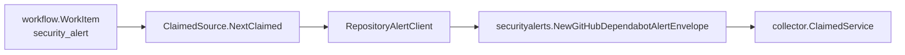

# securityalerts/alertruntime

This package runs hosted provider security-alert collection behind workflow
claims. The runtime accepts explicit targets, resolves credentials before
construction, and calls the provider client only for the claimed `scope_id`.
Each target is `repository`-scoped (validated against its `allowed_repositories`
allowlist) or `org`-scoped (validated to carry an `organization` and an
explicit `allowed_repositories` allowlist that bounds which repositories receive
fan-out facts).

The first provider is GitHub Dependabot alerts. Repository targets poll one
repository; org targets poll `GET /orgs/{org}/dependabot/alerts` and fan the
response out into per-repository facts whose `scope_id` is derived from each
alert's source repository (`security-alert:github:<owner>/<repo>`), so a single
org target produces the same per-repository fact shape as N repository targets.
`ClaimedSource` returns only `security_alert.repository_alert` facts from
`go/internal/collector/securityalerts`; reducer-owned impact/readiness truth
stays outside this package.
`ClaimedSource.PreflightProviderAccess` uses the same target map and provider
client to prove configured provider access before workflow claims are processed.
It makes one bounded provider request per target and never emits facts.

## Org-scope fan-out (#8805)

An org read is a window: GitHub pages the whole organization's open alerts
newest first, so `max_pages` x 100 alerts may hold few or none of a quiet
allowlisted repository's alerts. When the org read is truncated,
`collectTarget` hands off to `fanOutOrganization` (`org_fanout.go`), which reads
each allowlisted repository of the organization with
`ListRepositoryAlertsPages`, bounded by the same `max_pages`, sequentially in
allowlist order and capped at `maxOrganizationFanoutRepositories` (100) per
claim. `mergeFanoutAlerts` merges the reads into the claim's generation and
org `scope_id`: a complete repository read replaces that repository's
org-window alerts, every other allowlisted repository keeps its org-window
alerts, and duplicates collapse on (repository, alert number). Fan-out alerts
are stamped with the requested repository, so their `repository_id` and stable
fact key match the org path. Per-repository coverage (`coverage.go`) stamps each
fact: a still-truncated read keeps `provider_open_alert_page_limit_reached`;
a failed, rate-limited, or capped repository adds
`org_repository_read_failed`, `org_repository_read_rate_limited`, or
`org_repository_fanout_cap_reached`. The first rate-limited read stops the
fan-out; the claim still commits what it read and never loops. Only a cancelled
claim context fails the claim. The freshness digest includes each alert's
repository and the fan-out outcomes, so a changed outcome is a new refresh
boundary.

Performance Evidence: one org claim sends at most
`max_pages` x (1 + min(allowlisted org repositories, 100)) alert-page requests
(plus one App token mint per listing call under `github_app`). A claim whose
org read is not truncated sends exactly the requests it sent before.
`TestClaimedSourceOrgFanoutReplaysProviderCassette` replays
`testdata/org_fanout_cassette.json` against the real `GitHubDependabotClient`
and pins the request count: 5 requests for a truncated two-page org read with
one complete and one two-page-truncated repository, and 3 requests when the
second repository read is rate limited (the third allowlisted repository is
never requested). `TestClaimedSourceBoundsFanoutRepositories` pins the
100-repository cap.

Observability Evidence: `eshu_dp_security_alert_truncated_reads_total`
(`provider`, `operation`) counts every truncated read, and
`eshu_dp_security_alert_org_fanout_repositories_total` (`provider`, `outcome`)
counts each fan-out repository outcome. Each fan-out read also records the
existing provider request, fetch-duration, and rate-limit instruments under its
own `security_alert.fetch` span, and the `security_alert.observe` span carries
`eshu.security_alert.org_fanout.repositories`, `.requested`, `.incomplete`, and
`.rate_limited`. No label or attribute carries a repository or organization.
`TestClaimedSourceReportsRepositoryStillTruncatedAfterFanout` and
`TestClaimedSourceStopsFanoutOnRateLimit` assert the counters.

Operationally useful signals are emitted on the caller-provided telemetry
handle: provider request totals, emitted fact totals, rate-limit totals, fetch
duration histograms, and security-alert observe/fetch spans. Labels are bounded
to provider, status class, and fact kind.
The runtime uses shared collector SDK failure classes for status labels but
keeps Dependabot-specific rate-limit metadata on its local `ProviderFailure`
wrapper.

Security Review Evidence: target configuration must name a credential
environment shape (`token_env`, or `github_app` with the three App env
references) and an explicit repository allowlist before the runtime can
construct a provider client. The two shapes never mix, and a minted
installation token is never persisted on the target, in logs, in spans, or
in facts. Org-scoped targets require a non-empty
`allowed_repositories` allowlist at construction time; fan-out only emits facts
for repositories in that list, preserving the same private-data boundary that
per-repository targets enforce. Provider errors are mapped to bounded failure
classes, token-bearing source URLs are redacted by the envelope builder, metric
labels avoid repositories and package names, and provider alerts are emitted
only as `security_alert.repository_alert` source facts.

Observability Evidence: `TestClaimedSourceEmitsRepositoryAlertFactsOnly` proves
the runtime emits repository-alert source facts with redacted source URLs, while
`TestClaimedSourceReturnsBoundedFailureWithoutRepositoryOrToken` proves provider
failures do not expose tokens or repository names.
`TestClaimedSourceMarksProviderCoverageIncompleteWhenOpenAlertPagesAreTruncated`
proves a capped open-alert provider read marks emitted facts with
`source_freshness=partial`, `collection_coverage_state=incomplete`, the open
state filter, bounded pages fetched, and the incomplete reason instead of
looking complete.
`TestClaimedSourcePreflightProviderAccessIsBoundedAndRedacted` proves the
preflight path requests exactly one provider page and returns the bounded
`auth_denied` class without leaking token or repository values.
`TestNewClaimedSourceRejectsCredentialBearingAPIBaseURL` proves SDK base URL
validation rejects credential-bearing provider endpoints at construction time
without echoing the credential. `TestClaimedSourceClassifiesSDKHTTPError`
proves shared SDK HTTP failures still map to the runtime's bounded status
classes and terminal decision.

No-Regression Evidence: security-alert refreshes include a stable freshness
digest over the bounded Dependabot alert snapshot, provider pagination status,
and truncation state. `TestClaimedSourceSetsStableFreshnessHintForUnchangedAlerts`
proves unchanged provider snapshots keep the same digest across different
workflow generation IDs, allowing Postgres to skip no-op refreshes instead of
moving `active_generation_id` while reducer reconciliation drains.
`TestSecurityAlertFreshnessHintIgnoresProviderAlertOrder` proves the digest is
order-insensitive for provider result ordering, and
`TestSecurityAlertFreshnessHintChangesWhenProviderTruthChanges` proves provider
state changes still create a new freshness boundary.

Observability Evidence: this change reuses the existing collector commit
telemetry for skipped refreshes (`refresh_skipped=true` logs and
`RecordSkippedRefresh`) and the security-alert API/MCP `source_freshness` and
coverage summaries for partial provider reads. It does not add new metric
labels. The digest value is not emitted as a label, so alert, repository,
package, and URL values remain out of metrics.
Preflight provider requests reuse the existing `security_alert.observe` and
`security_alert.fetch` spans plus provider request and fetch-duration metrics
with provider and status-class labels only.
SDK adoption does not add metric labels or status payload fields.
