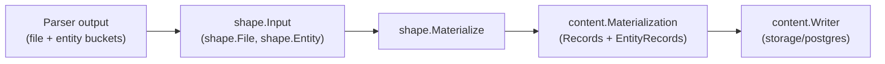

# Content Shape

## Purpose

`shape` converts parser-emitted file and entity payloads into the
`content.Materialization` rows that `content.Writer.Write` persists. It
centralizes the entity-bucket label mapping, `source_cache` snippet derivation,
and the byte limits that keep low-signal entity rows from bloating the content
store.

## Where this fits in the pipeline

The ingester or projector builds a `shape.Input` from parser output, calls
`Materialize`, and hands the result to a `content.Writer`.

## Ownership boundary

This package owns content shaping only:

- translating parser buckets into `content.EntityRecord` values
- deriving each entity's id via `content.CanonicalEntityIDWithMetadata` (which
  falls back to `content.CanonicalEntityID` outside its narrow manifest
  dependency gate)
- extracting `source_cache` snippets from parser source or file body
- preserving per-entity line, language, artifact, template, IaC, and metadata
  fields for the content store
- applying byte limits to oversized low-signal entities

It does not own graph writes, the Postgres schema, queue operations, or fact
loading. All of those belong to `internal/projector`, `internal/collector`, or
`internal/storage/postgres`.

## Exported surface

See `doc.go` for the godoc contract.

Input types:

- `Input` — top-level shaping request: `RepoID`, `SourceSystem`, `Files []File`.
- `File` — one parser-shaped file: `Path`, `Body`, `Digest`, `Language`,
  `ArtifactType`, `TemplateDialect`, `IACRelevant`, `CommitSHA`, `Metadata`,
  `Deleted`, `EntityBuckets map[string][]Entity`.
- `Entity` — one parser-shaped entity: `Name`, `LineNumber`, `EndLine`,
  byte-range pointers, `Language`, `ArtifactType`, `TemplateDialect`,
  `IACRelevant`, `Source`, `Metadata`, `Deleted`.

Entry point:

- `Materialize(input Input) (content.Materialization, error)` — walks every
  file in `Input.Files`, builds one `content.Record` per file, extracts all
  entity buckets in fixed order, derives `content.EntityRecord` values sorted
  by line number then label then name, and returns the assembled
  `content.Materialization`. Returns an error when `RepoID` is empty or any
  file `Path` is empty.

## Dependencies

- `internal/content` — `Materialization`, `EntityRecord`, `CanonicalEntityID`,
  `CanonicalEntityIDWithMetadata`. No other internal imports. No external
  imports beyond the standard library.

## Telemetry

None. Callers (ingester or projector workers) add duration and outcome metrics
around the `Materialize` call.

## Gotchas / invariants

- `contentEntityBuckets` order is fixed. Reordering the bucket list changes the
  persisted row sequence and produces diff churn in existing content-store rows.
  Add new buckets at the end.
- Being in the table does not mean every row reaches the graph. `variables` /
  `Variable` is registered here, in the collector twin and in the projector's
  `entityTypeLabelMap`, and a plain source variable still gets no node: the
  projector's canonical phase E skips plain `Variable` deliberately (by far the
  largest entity family on the corpus: 12,887 chunks, 21,515s of cumulative
  graph-write time). The reducer's semantic-entity path does write the narrower
  subset — Elixir module attributes and TSX component-type assertions — and it
  gets there from parsing `.ex` and `.tsx` files off disk, so those two shapes
  do become `Variable` nodes. Plain variables stay searchable through the
  content index. The set with no *source-local* writer is pinned by
  `canonicalEntityPhaseSkipOwners` in
  `go/internal/projector/canonical/unwritten_entity_labels_test.go` (#6206), so
  stranding another label, or re-enabling plain `Variable` projection, has to
  move that pin.
- The reverse also holds, and is checked here rather than in the projector:
  `TestEveryProjectorLabelHasASource` requires every label in
  `entityTypeLabelMap` to be produced by a bucket row or declared in
  `nonBucketProjectorLabels` with its fact source. Eighteen labels are legitimately
  non-bucket — the OCI and package-registry families, `Parameter`, `ShellCommand`
  — and they are named there. A nineteenth that nobody classifies is a registry
  entry no fact can ever reach.
- Terraform buckets cover authored configuration and parser evidence such as
  backends, imports, moved blocks, removed blocks, checks, lockfile providers,
  and declared PagerDuty module/tfvars evidence. Keep those labels in step with
  collector snapshot mapping and projector label mapping.
- `entityLabelForBucket` rewrites `Module` rows whose parser metadata carries
  `module_kind == "protocol_implementation"` to the `ProtocolImplementation`
  label. This handles Elixir `defimpl` blocks.
- `entitySourceCache` prefers the parser-supplied `Source` field for labels in
  `sourceFieldContainsCode`, then falls back to a file-body line range, then
  falls back to `item.Source` again for non-code labels. The distinction matters
  for IaC entity types that carry structured YAML rather than source code.
- `limitEntitySourceCache` truncates `Variable`, `SqlColumn`, and the six
  sibling SQL labels (`SqlTable`, `SqlView`, `SqlFunction`, `SqlTrigger`,
  `SqlIndex`, `SqlMigration`) snippets at 4096 bytes and the
  content-only GitHub Actions workflow `File` entity at 32 KiB, and
  writes `source_cache_truncated`, `source_cache_original_bytes`, and
  `source_cache_limit_bytes` into entity metadata so API clients can detect the
  cut. Truncation is UTF-8-safe (`truncateUTF8ByBytes`).
- `sourceCacheWithheld` makes `entitySourceCache` return an empty snippet when
  the parser set `source_cache_withheld: true` in `Entity.Metadata` (the pip
  constraints rows, #8821). The snippet is the raw line range of the file, which
  can hold text the parser scrubbed from the row's fields. Only the boolean
  `true` counts, the flag stays in the entity metadata, and the file body is
  unaffected.
- `entityEndLine` falls back in order: entity's own `EndLine`, next entity's
  `LineNumber - 1`, `startLine + 24` capped to total lines, then `startLine`
  when the body is empty. This means entities without an `EndLine` in the
  parser output get a bounded snippet rather than the rest of the file.
- Output ordering is deterministic: entities are sorted by line number, then
  label, then name before writing. Storage diffs stay stable across re-runs.
- `Materialize` mints each entity's id via
  `content.CanonicalEntityIDWithMetadata`, passing the cloned per-entity
  `Metadata` map used for the entity's other fields. For an in-scope manifest
  dependency Variable (npm, composer, cargo, gradle, maven, nuget, pypi, go,
  rubygems, pub, hex, sbt; non-lockfile, non-empty `section` in metadata) this
  mints a section-keyed, line-independent id via
  `content.CanonicalDependencyEntityID` instead of the legacy line-keyed
  `content.CanonicalEntityID` — see `internal/content/README.md`'s Gotchas
  section for the full gate and why it must not be widened casually.

## Dependency identity (#5357, extended by #5507)

`Materialize` and `internal/projector`'s `buildContentEntityRecord`
`entity_id` fallback share one identity rule via
`content.CanonicalEntityIDWithMetadata` so a manifest dependency Variable's
content-entity id is keyed by `(repoID, path, "variable", section, name[,
discriminator])` instead of the source line. This makes reordering
dependencies within a manifest section a no-op for identity — the previous
line-keyed scheme churned every dependency's id whenever an unrelated edit
shifted lines in the same section.

`#5357` proved this for `package.json`/`composer.json`, where `(section,
name)` alone is already unique (a JSON object key). `#5507` extended the
scheme to cargo, gradle, maven, nuget, pypi, go (gomod), rubygems, pub, and
hex, and `#8962` added sbt — for cargo, gradle, maven, nuget, pypi, go, and
sbt, `(section, name)` alone
is NOT always unique (see `content.dependencyIdentityDiscriminator`'s doc
comment for the concrete manifest feature each one's added discriminator
defends: Cargo package aliasing, Gradle same-coordinate-different-version,
Maven classifier/type, NuGet multi-targeting conditions, pypi extras/markers,
go's non-deduplicating `modfile.Parse` admitting the same module required
twice at different versions in an untidied go.mod, and sbt's repeatable
coordinate-at-a-different-version plus its unsuffixed `%`/`%%`/`%%%` names
kept apart by the cross-version label). Only rubygems, pub, and
hex need no discriminator: each one's own tooling or file format already
guarantees per-section name uniqueness. `swift` was deliberately left out of
scope — its only current producer (`Package.resolved`) is a lockfile, already
excluded by the condition below.

The gate is intentionally narrow: `metadata["config_kind"] ==
"dependency"` alone is also set by lockfile parsers
(`package-lock.json`, `composer.lock`, `Gemfile.lock`, `pubspec.lock`,
`mix.lock`, `packages.lock.json`, `Pipfile.lock`, `poetry.lock`,
`Package.resolved`, and other lockfile flavors), which legitimately repeat a
package name multiple times per section — nested transitive dependency trees
can carry the same name at different versions. Collapsing those under
`(path, section, name)` would silently merge distinct dependency versions
into one identity. See `content.CanonicalEntityIDWithMetadata`'s doc comment
in `internal/content/dependency_identity.go` for the exact five conditions.

## Related docs

- `go/internal/content/README.md` — the `Writer` port and `Materialization` shape
- `docs/public/architecture.md` — pipeline and Postgres content store role
- `docs/public/reference/local-testing.md`

## GitHub Actions workflow content entity (#5568)

`Materialize` creates one content-only `File` entity for a workflow only when
the repository-relative path is exactly
`.github/workflows/<name>.yml` or `.github/workflows/<name>.yaml` with a
non-empty `<name>`. The path gate rejects nested workflow subdirectories,
paths that merely contain the directory substring, non-YAML suffixes, and a
bare extension with no basename (`.github/workflows/.yml`). It is
deliberately independent of the parser's `artifact_type`: a valid workflow
that a broad YAML parser labels as an Ansible playbook remains reachable. The
gate is `ghactionsref.IsWorkflowPath`, one implementation shared with the
query-side GitHub Actions classifier
(`go/internal/query/entity/content/fallback/content_github_actions.go`'s
`isGitHubActionsArtifactPath`), so the two packages' path contracts are
literally the same code and cannot silently drift apart.

The entity identity is
`CanonicalEntityID(repo_id, relative_path, "File", basename-without-extension, 1)`.
Its persisted artifact type is the canonical `github_actions_workflow`, and its
source comes from the whole workflow file rather than a parser symbol bucket.
This package owns that content row only; it does not add a parser fact, graph
node, graph edge, or reducer projection.

Retraction follows the existing writer contract. A deleted or renamed old path
is represented by a tombstoned `content.Record`, which removes the old file and
its entities. A row carrying the legacy workflow artifact classification at a
now-ineligible path sets `Record.PurgeEntities`, which removes stale entities
without deleting the still-valid file. Eligible files participate in the
normal path-scoped stale-entity reap, whose keep-set contains the one fresh
canonical workflow entity id.

Workflow `source_cache` is hard-capped at 32 KiB using the shared UTF-8-safe
limiter. A truncated row carries `source_cache_truncated=true`, the original
byte count in `source_cache_original_bytes`, and `32768` in
`source_cache_limit_bytes`. Entity context treats that row as incomplete
relationship truth: `relationships_complete=false`,
`partial_reasons=["github_actions_source_cache_truncated"]`, and
`result_limits.truncated=true`. Multi-job workflow extraction walks jobs in
stable name order. Over-limit entity-context relationships are sorted before
the deterministic 50-row cap and retain the pre-cap count in
`result_limits.relationship_count`.
