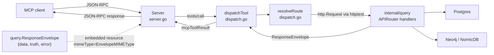
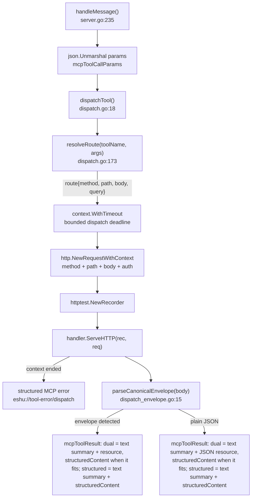

# internal/mcp

`mcp` owns Eshu's Model Context Protocol tool surface. It implements the MCP
server, JSON-RPC dispatcher, SSE session model, HTTP transport authentication
(issue #5168), and read-only tool registry. Tool dispatch uses the same `http.Handler` chain as
the HTTP API, so both surfaces return the same truth. Each request gets a
deterministic 30-second default deadline; handlers must still honor
`r.Context()` cancellation. Deadline and parent cancellation return an MCP error
result with structured content, plus an `eshu://tool-error/dispatch` JSON resource under the `dual` result shape.
`get_capability_catalog` is transport-only over `/api/v0/capabilities`; it preserves
the top-level built-in role, grant, and data-class catalog plus each capability's
matched permission family, action, scope levels, default roles, and sensitive-data marker.
`get_surface_inventory` is transport-only over `/api/v0/surface-inventory`; its
structured response preserves collector `collector_contract` provenance, so MCP
callers can trace fact kinds to projection/read consumers, proof gates, fixture
refs, and deterministic/provider-gated/optional-semantic truth profiles.

The dependency-neutral `toolcontract` and `routecontract` child packages own the
tool-definition and internal-request value shapes. `mcp.ToolDefinition` remains
an alias for source compatibility. Ordered registration, global route
membership, family adapters, dispatch, transport, authorization, timeouts,
response budgets, envelopes, and telemetry stay in root. The `relationships`
child package owns both its registrations and its pure, dependency-neutral
family route selection; `internal/query` retains validation and graph reads. The
`documentation` child owns its six registration definitions and the `cloud`
child the cloud inventory and runtime-drift pair; both families' routing stays
here. The `visualization` child owns registration and pure request selection,
while query derives packets. The `package/registry`, `cicd`, `code/owners`,
`access/posture`, `observability/coverage`, `container/image`, `supply/chain/impact`,
`supply/chain/evidence`, `alerts`, `admission/decisions`, `kubernetes`,
`infra/search`, `impact`, `code/flow`, `code/intel`, `content`, `code/dead`, `code/divergence`, `code/quality`, `entity/resolution`, `iac/management`, `infra/inventory`, `service/context`, and `replatforming`
children own only family membership and pure request selection; root keeps the matching `*Route` adapters and dispatch, and each family's definitions stay with their current owners. `content` owns `get_file_content`, `get_file_lines`, `build_evidence_citation_packet`, `search_file_content`, and `search_entity_content`; the last two share `contentSearchBody`, and `get_entity_content`'s registration stays grouped with these five in `tools_content.go` even though its routing lives in `entity/resolution`. The `ecosystem`
child owns the 23 ecosystem, repository-context, infrastructure-impact, and
change-planning registration definitions; their split routers stay here. The `ask` child
owns natural-language answer registration and pure request selection; global fanout and dispatch stay here, while query executes answers.
The `playbooks` child package owns the two query-playbook catalog registration
definitions; query-playbook routing and execution also stay here.
The `freshness` child package owns four freshness registration definitions.
Repository freshness routing stays in `dispatch_repositories.go`; generation,
repository-delta, and service-delta routing stays in `dispatch_freshness.go`.
The `investigation` child package owns two workflow and three evidence-packet
registration definitions. Workflow routing stays in
`dispatch_investigation_workflows.go`; packet routing stays in
`dispatch_investigation_packets.go`.
The `semantic` child package owns three semantic evidence and context-search
registration definitions. Evidence routing stays in
`dispatch_semantic_evidence.go`; search routing stays in
`dispatch_semantic_search.go`.
The `service` child package owns five service catalog, context, investigation,
and intelligence-report registration definitions. Catalog routing stays in
`dispatch_repositories.go` and `dispatch_service_catalog.go`; the other four
tools' request selection is owned by `service/context`, reached through the `serviceContextRoute` adapter in `dispatch_service_selector.go`.

## Where this fits in the pipeline

## Internal flow — one tool invocation

## Dispatch deadline evidence

No-Regression Evidence: issue #2469 adds a context-only MCP dispatch deadline
with no new graph, storage, queue, or HTTP query work. Baseline behavior was
the existing `dispatchTool` path calling `handler.ServeHTTP` with the caller
context and no dispatch deadline. After measurement on Go 1.26 covered
`go test ./cmd/mcp-server ./internal/query ./internal/mcp -count=1` and
`golangci-lint run ./...`; input shape was `list_indexed_repositories` routed
through the shared HTTP handler with a test override of 20ms and a parent
deadline case. Terminal row counts and queue counts are unchanged because the
patch does not query Postgres, NornicDB, Neo4j, or reducer queues. The change is
safe because success responses keep the same handler envelope, while timeout
and parent-cancellation paths stop before response parsing and return structured
MCP error content.

Observability Evidence: dispatch timeout and cancellation failures emit
`mcp tool dispatch context ended` with `tool`, `timeout`, and `err` fields. The
success path has No-Observability-Change: it preserves the existing
`dispatch tool` debug log and does not add spans, metrics, or extra per-row
logging.

## Dispatch response-size budget

Issue #3498 adds a tool-agnostic response-size budget at the dispatch boundary
(`dispatch_budget.go`). Every tool response passes through `dispatchTool`, so the
budget is enforced there once instead of per route. `applyResponseBudget`
measures the exact serialized MCP result against `defaultToolResponseByteBudget`
(256 KiB, ~64k tokens at the repo's conservative ~4-bytes-per-token heuristic).
A connection picks a result shape (`internal/mcp/result/shape`, #8800; `?shape=`,
`ESHU_MCP_RESULT_SHAPE`); the budget counts the result as sent in it and the limit does not move.
Under `structured`, successful non-object JSON or UTF-8 text becomes
`structuredContent.value`, with result-level `_meta.eshu/nonObjectEncoding`
(`json` or `text`) and one bounded summary. Raw JSON preserves numeric precision;
plain objects, canonical envelopes, typed timeout/cancellation errors, and all
`dual` results keep their layout. Generic dispatch failures under `structured`
that fit the budget carry `mcp_dispatch_error` in a
`{data:null,truth:null,error}` envelope. The bounded summary points to
`structuredContent.error`; the shared budget counts the complete result and
replaces oversized failures with `mcp_response_over_budget`. Unknown names use the bounded `unknown` tool label.
`dual`, the default, carries a text summary, `structuredContent`, and an embedded resource with the
complete envelope or plain JSON; when the copies exceed the budget but the resource-only result fits,
dispatch omits `structuredContent` and returns `isError=false`, so clients parse the resource's JSON
`text`. `structured` has no resource and never sets `ResourceOnly`. When the resource-only (`dual`)
or single-copy (`structured`) result still exceeds the budget, `find_code` and `search_entity_content` (budgetPagedTools) answer with the largest first run of whole rows that fits (`truncated=true`, `next_offset`, `budget_page`, `truth.truncated`, `truth.omissions`; #7725), except that a `rank_cursor` walk page keeps the first rows of its walk order and re-mints `rank_walk.next_cursor` through `rank.TrimWalk` instead of setting `next_offset` (#7746); every other tool, and a first row that is over budget alone, gets a small bounded canonical envelope (`error.code=mcp_response_over_budget`)
carrying `response_bytes`, `budget_bytes`, `estimated_tokens`, the tool name,
and narrowing guidance. Per-route token budgets such as the relationship-story
`token_budget` still apply first; this is the outer, tool-agnostic guard, the
response-size sibling of the dispatch deadline guard. See the
[response fallback decision](../../../docs/internal/design/7206-mcp-response-budget-fallback.md)
and [source_cache clip](../../../docs/public/reference/http-api/source-cache-clip.md).

No-Regression Evidence: this guard adds no I/O. Tests cover both wire shapes,
25-row secrets, oversized resources, disabled enforcement, and full evidence.

Observability Evidence: the resource-only path emits `mcp tool response resource
fallback` with `tool`, `response_bytes`, `emitted_bytes`, and `budget_bytes`.
Refusal emits `mcp tool response over budget` and returns budget accounting and
narrowing guidance in `error.details`. Per-tool `eshu_dp_mcp_response_bytes`,
`eshu_dp_mcp_response_resource_fallback_total`, `eshu_dp_mcp_response_budget_page_total` (log `mcp tool response budget page` carries `rows_returned`, `rows_available`), and
`eshu_dp_mcp_response_over_budget_total` (all four carry a bounded `shape` label, and the three budget log lines a `shape` field) distinguish the attempted size,
successful fallback, budget page, and refusal (see [MCP response-budget telemetry](../../../docs/public/reference/telemetry/mcp-response-budget.md)).

## Tool groups

See [tool groups and routes](tool-groups.md) for the registration groups,
representative HTTP route mappings, and route-specific dispatch notes.

## Exported surface

| Identifier | File | Notes |
|---|---|---|
| `Server` | `server.go:93` | MCP server struct; fields `handler`, `tools`, `surface`, `logger`, `sessions`, `transportAuth`. `tools` stays the profile-filtered registry; `surface` is applied only when `tools/list` is built |
| `NewServer` | `server.go:112` | constructs `Server`; calls `ReadOnlyTools()`; accepts `...ServerOption` (e.g. `WithTransportAuth`, `WithQueryProfile`, `WithToolSurface`, `WithRouterRanker`); `WithRouterRanker` (#8771, in `transport_auth.go`) sets the `find_tool` ranker builder, which `NewServer` runs once after every option over the profile-filtered tool list; `WithToolSurface` sets the process tool surface (advertisement only) and `Server.ToolSurfaceSummary` reports surface, tool count, and `tools/list` bytes for the startup log (see [tool-surface.md](tool-surface.md)) |
| `ServerOption` / `WithTransportAuth` | `transport_auth.go:24,28` | option that wraps the HTTP transport (`GET /sse`, `POST /mcp/message`) with a credential chain (#5168) |
| `Server.Run` (`Run`) | `server.go:190` | stdio transport; reads stdin, writes stdout; never authenticated (process/filesystem trust boundary) |
| `Server.RunHTTP` (`RunHTTP`) | `server.go:137` | HTTP+SSE transport; listens on `addr` |
| `ToolDefinition` | `types.go:12` | `Name`, `Description`, `InputSchema` |
| `ReadOnlyTools` | `types.go:15` | returns all registered tool definitions in stable order |

## SSE session model

The SSE transport lives in `server_sse.go`. `handleSSE` (`server_sse.go:70`)
creates an `sseSession` with a 64-element channel, sends an `endpoint` event
with the POST URL, then loops on the session channel and a 30-second keepalive
ticker. `handleHTTPMessage` (`server_sse.go:147`) routes responses to the
session channel when a `sessionId` query param is present and returns HTTP 202;
otherwise it returns the response directly with HTTP 200. The `surface` query parameter on both routes is described in [tool-surface.md](tool-surface.md).

The session channel lifecycle is mutex-guarded (`sseSession.send` /
`sseSession.shutdown`, `server_sse.go:39,57`). `handleHTTPMessage` captures the
session pointer before dispatch (to run the principal check) and reuses it to
deliver after a potentially slow `tools/call`; if the SSE client disconnects in
that window, `handleSSE`'s teardown calls `shutdown` (close-once under the
lock), and a later `send` observes `closed` and drops the message instead of
panicking on a closed channel. `send`/`shutdown` share the session mutex so the
closed-check and the channel op are atomic with respect to close.

## Transport authentication (#5168)

Before #5168 the HTTP transport leaked before auth ever ran: `GET /sse` and
`POST /mcp/message` were mounted with no middleware, so `initialize`,
`tools/list`, and `ping` enumerated the tool catalog and server metadata with
no credential (only `tools/call` was checked, and only incidentally, through
its internal `/api/v0` re-dispatch). `transport_auth.go` wraps the transport
routes with the credential middleware instead.

`NewServer` accepts `WithTransportAuth(middleware)`. The wiring
(`cmd/mcp-server/wiring.go`) passes the SAME credential chain that protects
`/api/v0/*` — shared token (`ESHU_API_KEY`), scoped token
(`ESHU_SCOPED_TOKENS_FILE`), and IdP bearer (`ESHU_AUTH_RESOURCE_URI`).
`authenticatedTransportHandler` (`transport_auth.go:94`) wraps both transport
routes. When a shared token (`ESHU_API_KEY`) is set, a credential-less request
gets a bare 401 with no catalog or server-info disclosure. A scoped-token-file
(`ESHU_SCOPED_TOKENS_FILE`) or OIDC-bearer (`ESHU_AUTH_RESOURCE_URI`)
deployment with the shared token unset is treated the same: `wireAPI`
(`cmd/mcp-server/wiring.go`) builds `transportAuth` with the SAME
enforcement-aware middleware and the SAME `authSourceConfigured` predicate as
the `/api/v0/*` handler, so the dev-mode-open branch of
`authMiddlewareWithRoutePolicy` (`internal/query/auth.go:210`, the
`if !authEnforcementConfigured` guard) is closed and a headerless request is
denied 401 rather than served open. Earlier this per-request gap was open for
scoped-only/OIDC-only deployments (only startup was gated); the
auth-headerless-bypass hardening (under #5161) closed it, and this transport
path now inherits that closure. When `transportAuth` is nil the wrap is a
pass-through, so the stdio path and any unauthenticated (demo/dev) deployment
are unchanged.

SSE sessions are bound to the credential that opened them:
`authPrincipalKey` (`transport_auth.go:182`) derives a stable per-credential
key from the request `AuthContext`, `handleSSE` stores it on the session, and
`handleHTTPMessage` rejects a `POST /mcp/message?sessionId=...` whose credential
resolves to a different principal with 403. An empty principal (transport auth
not configured) is never bound.

`peekMCPMethod` (`transport_auth.go`) buffers at most `mcpMethodPeekLimit`
(4 KiB) leading bytes to label the denial metric by JSON-RPC method before auth
runs, then reconstructs the full body for the authenticated handler — the
pre-auth buffer is bounded so an unauthenticated caller cannot amplify memory
with a giant body.

## Dependencies

Internal packages: `internal/buildinfo` (version string for `mcpInitializeResult`),
`internal/mcp/ask` (Ask Eshu registration and pure request selection),
`internal/mcp/cloud` (cloud inventory and runtime-drift tool registrations),
`internal/mcp/documentation` (documentation tool registration definitions),
`internal/mcp/ecosystem` (ecosystem, repository-context, infrastructure-impact,
and change-planning tool registrations),
`internal/mcp/freshness` (generation, repository, and service freshness tool
registrations),
`internal/mcp/investigation` (investigation workflow and evidence-packet tool
registrations),
`internal/mcp/playbooks` (query-playbook tool registration definitions),
`internal/mcp/relationships` (code-relationship and relationship-edge tool
registration definitions),
`internal/mcp/semantic` (semantic evidence and context-search tool registration
definitions),
`internal/mcp/service` (service catalog, context, investigation, and
intelligence-report tool registrations),
`internal/mcp/contract/route` (neutral argument/request values), `internal/mcp/contract/tool`
(neutral `ToolDefinition` registrations), and `internal/mcp/visualization` (visualization registration/request selection),
`internal/query` (`query.ResponseEnvelope`, `query.EnvelopeMIMEType`,
`query.AuthContextFromContext`, `query.AuthMode*`, the mounted `http.Handler`),
and `internal/telemetry` (`transport_auth_metrics.go` registers one counter
through the global meter). No direct dependency on storage drivers or facts.

## Telemetry

This package declares three metrics: the two budget metrics above and `eshu_dp_mcp_transport_auth_denied_total`,
a counter labeled by `mcp_method` (`initialize`, `tools/list`, `tools/call`,
`ping`, `sse`, `mcp_message`, `other`, `unknown`) and `reason`
(`unauthenticated`, `session_principal_mismatch`, and `route_policy` — a governance mode refusing an all-scope credential at the handshake, which is a configured refusal, not a credential to reset), registered through the
global meter in `transport_auth_metrics.go` (the same self-contained pattern
`internal/query/metrics/request.go` uses). It lets an operator see
catalog-enumeration and session-hijack attempts. Everything else — tool
dispatch spans and per-route latency/error metrics — is emitted by the
`internal/query` handlers that `dispatchTool` calls into. Structured log events:
`"mcp server started"` (with `transport`, `tools` count, and `tool_surface`, `server.go`),
`"sse session started"`, `"sse session closed"`, and `"sse session buffer full
or closed"` (`server_sse.go`). `dispatchTool` logs at debug level with tool
name, HTTP method, and path; status handling: [dispatch-status.md](dispatch-status.md).

## Operational notes

The `Accept: application/eshu.envelope+json` header is always set on internal
dispatch requests (`dispatch.go:42`). Handlers that check this header will
return the canonical envelope shape.

`normalizeQualifiedIdentifier`, owned by `service/context`, strips the `<type>:`
prefix from service identifiers before building path segments. If a new
service-context tool is added, apply this helper when the input may include a type qualifier.
`get_service_story` and `investigate_service` also forward canonical
`workload:*` inputs as the `service_id` query parameter so target-story and
investigation MCP readbacks do not fall back to name-only service matching.
When a caller starts from repository context, it can send `service_name` with
`repo`, `repository_id`, or `repo_id`; MCP forwards the repository selector as
the HTTP `repo` query parameter so the query handler owns the same
disambiguation path as API callers.

`get_service_context` requires the MCP `workload_id` argument. The value is
mapped into the HTTP service selector path after qualified identifier
normalization, so callers can pass either a canonical workload ID or a service
name as the `workload_id` value. A `service_name` argument remains scoped to
`get_service_story` and `investigate_service`; service context rejects that
unsupported selector shape before dispatch to avoid ServeMux redirects.

`contentSearchBody` normalises `repo_ids` to a single `repo_id` when only one
element is present. The function uses `firstString` to extract the first
element and sets `repo_id` rather than `repo_ids`.

## Extension points

- **Add a tool**: add a `ToolDefinition` to the matching `tools_*.go` file,
  add a route in `resolveRoute` or a route helper, and add a test in
  `tools_test.go` and `dispatch_test.go`. The `ReadOnlyTools` count test and
  the dispatch route test will both catch missing or mismatched entries.
- **Add an argument helper**: add to `dispatch.go` near `str`, `intOr`,
  and `boolOr`, or to `dispatch_args.go` near `stringSlice` for shared slice or
  identifier helpers. Keep the helpers side-effect-free.

## Gotchas / invariants

- Every tool name returned by `ReadOnlyTools` must have a matching route in
  `resolveRoute` or a route helper. A test in `tools_test.go` calls
  `resolveRoute` for every tool and fails if any returns an error.

- `parseCanonicalEnvelope` (`dispatch_envelope.go:15`) requires all three keys `data`,
  `truth`, and `error` to be present in the response JSON. A partial envelope
  falls back to the plain JSON path.

- Changing `ToolDefinition.Name` or `ReadOnlyTools` output is a breaking change
  for any MCP client that has cached tool names. Coordinate with the MCP guide
  and a version bump.

- The `Envelope` field of `dispatchResult` is populated by
  `parseCanonicalEnvelope` and rendered by `handleMessage`. When it is non-nil,
  a `dual` response is a two-block `mcpToolResult` with the envelope resource;
  `structured` is one text block plus `structuredContent`. Do not substitute
  the `query.EnvelopeMIMEType` string literal; use
  the constant.

- Plain JSON handler payloads are not canonical envelopes, but they still carry
  evidence. `dual` returns the payload as an `application/json` resource at
  `eshu://tool-result/payload` (plus `structuredContent`); `structured` in
  `structuredContent` alone. Do not collapse them to text-only summaries; that breaks API/MCP
  parity for handlers that have not adopted the canonical envelope shape yet.

## Text summaries

`summaries.go` and `summaries_families.go` build the human-readable text block
of `mcpToolResult`. `summarizeToolText` (envelope path) and
`summarizePlainToolText` (plain JSON path) route by tool name to a deterministic,
bounded summarizer for story, investigation, citation, and status/readiness
families, and fall back to the generic `summarizeEnvelope` /
`summarizePlainPayload` helpers for every other tool.

Rules these summarizers must hold:

- Read only from the already-parsed envelope/payload; never issue a new query.
- Be pure and deterministic given the input (no maps iterated for output, no
  time, no randomness).
- Stay within `maxSummaryLength`; clamp every embedded field with `clampField`.
- Lead with truth level + freshness when present; surface the error code +
  reason for errors and the truncation + missing/ambiguous counts for partial
  results.
- Never mutate the result while building a summary. The text block is a
  convenience layer; the available machine-readable copy or copies preserve
  the complete canonical envelope. `summaries_structured_invariance_test.go`
  asserts this for the ordinary two-copy shape.

## Related docs

- `docs/public/guides/mcp-guide.md` — client setup, tool usage, and story-first
  orchestration patterns
- `docs/public/reference/http-api.md` — underlying HTTP routes that every tool
  dispatches into
- `docs/public/architecture.md` — service boundary for the MCP runtime
- `go/cmd/mcp-server/README.md` — binary wiring, transport selection, and
  admin surface
