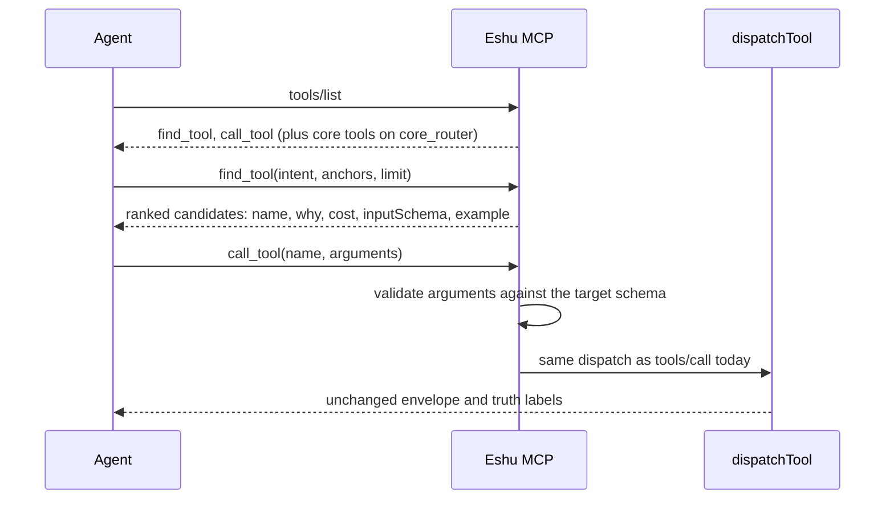

# MCP router contract

## Purpose

`router` holds the opt-in MCP router surface from epic #8752. With
`ESHU_MCP_TOOL_SURFACE=router`, `tools/list` advertises two tools, `find_tool`
and `call_tool`, instead of the full registry. This package defines the shared
contract the parallel lanes build against and the `Engine` that serves both
tools (#8757). A direct `tools/call` to any registered tool is unchanged, and a
`call_tool` result is byte-identical to the direct call it wraps.

## Ownership boundary

This package owns the contract (`Surface`, the two tool definitions, `Query`,
`Candidate`, `Anchors`, the `Ranker` interface, the `Dispatcher` function type,
the core tool-name list) and the `Engine` that serves `find_tool` and
`call_tool`: argument validation, the per-call credential filter, the playbook
match, recursion refusal, and the router telemetry. It does not rank (the
`Ranker` is injected), dispatch (the `Dispatcher` is injected), or read
configuration.

`internal/mcp` keeps `handleMessage`, `dispatchTool`, authorization, and
transport. Its `Server` embeds one `Host`. In the `tools/call` branch, a name
`Intercepts` accepts goes to `Host.Serve` instead of `dispatchTool`, with a
`Dispatcher` that returns exactly the rendered result a direct call gets, so a
routed `call_tool` is byte-identical to the direct call. The `RouteResolver` is
the root's own `resolveRoute`. The router tools are not in `ReadOnlyTools`.
This package must not import `internal/mcp` (import cycle), and a test enforces
that.

`internal/ask/catalog` owns the per-tool `Intents` and `Canonical` fields this
package ranks against. They are empty until the intent-curation lane fills them.

## Exported surface

- `Surface`, `SurfaceFull`, `SurfaceRouter`, `SurfaceCoreRouter`, `ParseSurface`
- `FindToolName`, `CallToolName`, `Tools`, `DefaultLimit`, `MaxLimit`
- `Anchors`, `Query`, `Candidate`, `Ranker`, `Dispatcher`
- `CoreToolNames`, `Advertise`
- `Host`, `Intercepts`
- `Engine`, `NewEngine`, `Config`, `Request`, `CallOutcome`, `ToolResult`,
  `Content`, `RouteResolver`
- `ValidateArguments`, `ValidateArgumentsDetail`, `FieldError`, `UnsupportedSchemaFeatures`,
  `ExampleArguments`, `RouteProbeArguments`

## Engine behavior

- `find_tool` ranks only tools that are in the query profile's visible list,
  are not `find_tool`, `call_tool`, or `ask`, and that the caller's credential
  can call. It re-checks the ranker's output, so a ranker that ignores
  `allowed` still cannot leak a tool. Without an `AuthContext` (stdio or
  `ESHU_MCP_ALLOW_UNAUTHENTICATED`) it does not filter and answers
  `access: {filtered: false, reason: "no_auth_context"}`. With no `Ranker`
  configured it answers `mcp_router_ranker_unavailable`.
- `find_tool` rejects an intent over `MaxIntentBytes` (4096), an anchor value
  over `MaxAnchorValueBytes` (256), and any anchor key other than `repo_id`,
  `service_id`, `workload_id`, or `environment`. The transport has no body cap
  and a ranker may echo anchors into every candidate's example, so these bounds
  keep one request from inflating its response.
- `call_tool` rejects a name over `MaxToolNameBytes` (128) with a fixed error
  that does not echo it and runs no edit distance. `ValidateArguments` returns
  at most `MaxFieldErrors` (20) errors and stops walking once it has them, cuts
  caller-supplied keys in a path at `MaxEchoBytes` (256), and reports no
  per-item errors for an array that fails `maxItems`. Error details carry
  `field_errors_truncated`, true only when errors were dropped
  (`ValidateArgumentsDetail`).
- An example call (in a `find_tool` candidate or a `call_tool` validation
  error) fills required properties, and for a tool whose route needs one of
  several optional selectors (`get_repo_summary`, `get_service_story`,
  `get_service_intelligence_report`) adds the first selector, in name order,
  that makes the route resolve. `Engine.Example` returns it.
- The ranker gets the caller's visible slice and the engine's entries map
  unchanged on every call, so it can cache an index keyed on them; the
  per-call credential filter travels in `allowed`.
- The credential filter refuses only what the API auth middleware always
  refuses: shared-key-only routes for every non-shared caller, and routes off
  the scoped-token allowlist for scoped bearers. Decisions the middleware takes
  from deployment policy are admitted here and enforced at dispatch.
- When a query playbook's title words cover the intent and every step is
  callable, `find_tool` attaches its plan; anchors that name a required input
  add the resolver's fully specified calls.
- `call_tool` looks targets up in the full registry, so a profile-hidden tool
  stays callable, as it is through `tools/call`. Errors use the
  `{data, truth, error}` envelope with codes `mcp_router_invalid_arguments`
  (with field errors, the input schema, and an example call),
  `mcp_router_unknown_tool` (with up to three close names), and
  `mcp_router_refused`.
- Validation mirrors dispatch where strict JSON schema would not: a JSON null
  for an optional property is absent, undeclared properties are ignored, a
  blank `date-time` is accepted, and `default` is never applied.

## Request flow

## Lane ownership

Change `Query`, `Candidate`, or `Ranker` only after commenting on epic #8752;
every lane codes against them.

| Issue | Lane | Owns |
| --- | --- | --- |
| #8753 | Scaffold: this contract and the empty catalog fields | `router/` types and definitions, `Annotation`/`Entry` type fields |
| #8754 | Intent phrases and canonical flags for every tool | new files in `internal/ask/catalog` |
| #8755 | Deterministic lexical ranker | a `Ranker` implementation in `router/rank/` |
| #8756 | Eval corpus and report-only gate | eval corpus and gate, written blind to the intents |
| #8757 | `find_tool` and `call_tool` dispatch, validation, telemetry | `handleMessage` intercept, validator, router telemetry |
| #8758 | `ESHU_MCP_TOOL_SURFACE` switch | env registry entry, `ServerOption`, `/mcp/message` `surface` override |
| #8759 | Core tool set from hosted call counts | `core.go` `coreToolNames` |
| #8760 | Hosted validation, assistant docs, default decision | docs and measurement |

## Telemetry

`eshu_dp_mcp_router_find_total{outcome}`, `eshu_dp_mcp_router_call_total{tool,outcome}`,
and `eshu_dp_mcp_router_target_rank`, plus the `mcp.router.find` and
`mcp.router.call` spans. See
[MCP Router Telemetry](../../../../docs/public/reference/telemetry/mcp-router.md).

## Known divergence from a direct call

`call_tool` validates against the advertised `inputSchema` with no tolerance; a
direct `tools/call` goes straight to the route builder. Five recorded classes
of call can succeed directly but are refused by `call_tool` with a field error
that names the schema's rule (arbiter ruling on #8757). The schemas stay as
they are, because widening them would change `tools/list` for the `full`
surface.

| Class | Direct call | `call_tool` | Handler evidence |
| --- | --- | --- | --- |
| A, undocumented alias | `search_entity_content` / `search_file_content` with `query` and no `pattern`; `resolve_entity` with the legacy `name`/`type` keys | `pattern` or `query` is required | `mcp/content` `contentSearchBody` sends `query` when `pattern` is absent; `mcp/entity/resolution` `resolveEntityBody` sends `name` |
| B, enum case | `execute_language_query` with `entity_type: "Function"` | `entity_type` must be one of the lowercase values | `query/language` `Handler.handleLanguageQuery` lowercases `entity_type` |
| D, off-enum list filter | `list_ci_cd_run_correlations` `outcome`, `list_sbom_attestation_attachments` `attachment_status`, `list_secrets_iam_*` `state` outside the enum | the filter must be one of the enum values | the list handlers pass the filter to the store, which matches no rows |
| E, wrong type defaulted | a wrong JSON type on one of the fields listed per tool, such as `list_indexed_repositories` `limit: "25"` | the field must have the schema type | dispatch's argument helpers (`routecontract` `Arguments.String`, `IntOr`, `BoolOr`, `StringSlice`; root `str`, `intOr`, `boolOr`) drop the value or use the default |
| F, handler-optional required field | `analyze_code_relationships` and `analyze_infra_relationships` without `query_type`, `build_evidence_citation_packet` without `handles`, `list_package_registry_packages` without `limit` | the field is required | the route sends an empty or default value and the handler serves it; each row cites its handler |

Class C is not a divergence: the handler answers 400 for the same call (each
row records the handler's message), or an empty path segment reaches no
handler at all.

`TestValidatorAcceptsEveryDispatchedArgumentMap` in the mcp root holds the
validator to every literal argument map in the dispatch tests and every map in
the catalog sweep corpus, except maps in a class. The classes are enumerated
tables, not keyword matches: `routed_call_divergence_tables_test.go` lists each
tool and field set with its evidence, and a rejection no row lists fails the
test (`TestDifferentialRefusesUnlistedRejections` seeds one of each kind). Each
class has a live witness, and A and B have pinning tests that fail once a
schema accepts the alias or case.

The rows came from a one-off probe. A runtime capture recorded every map
`resolveRoute` built across `go test ./internal/mcp`, and a throwaway test
replayed each rejected map's route against the real API router with nil
backends. A required-field row was replayed with the tool's catalog-sweep
arguments minus only those fields, so a 400 is attributed to the right field;
a call that got past validation (a 2xx, or a 5xx from the nil store) became a
class F or E row. Run on the commit that added the tables, the capture recorded
1346 distinct maps and 253 rejected: A 77, B 2, C 91, D 9, E 64, F 8, and the
2 seeded unlisted maps outside any class, by design. To repeat it, wrap
`resolveRoute` in `dispatch.go` to record each resolved map, and classify the
rejected ones with `classifyRejection` from a `TestMain`, through
`go test -overlay`.

## Gotchas / invariants

- `Tools` returns fresh definitions; mutating a result must not change a later
  call.
- `ParseSurface("")` is `full`. An unknown value is an error, never a silent
  fallback to `full`.
- `CoreToolNames` is empty until #8759. `core_router` advertises only the two
  router tools until then.
- `find_tool` needs an injected `Ranker`; the lexical ranker (#8755) is wired
  by the root in #8771. Until then `find_tool` answers the typed
  `mcp_router_ranker_unavailable` error, counted as
  `eshu_dp_mcp_router_find_total{outcome="error"}`.
- A new keyword, type, or format in a registered tool schema fails
  `TestRegisteredSchemasUseOnlyValidatedKeywords` in the mcp root until
  `ValidateArguments` implements it.
- `Ranker.Rank` must never return a tool for which `allowed` is false.

## Related docs

- [MCP package](../README.md)
- [MCP tool contract](../contract/tool/README.md)
- [Ask catalog](../../ask/catalog/README.md)

## Verification

From `go/`, run `go test ./internal/mcp/router/... ./internal/ask/catalog/...
-count=1` and `go vet ./internal/mcp/...`. From the repository root, run
`scripts/verify-package-docs.sh`.
