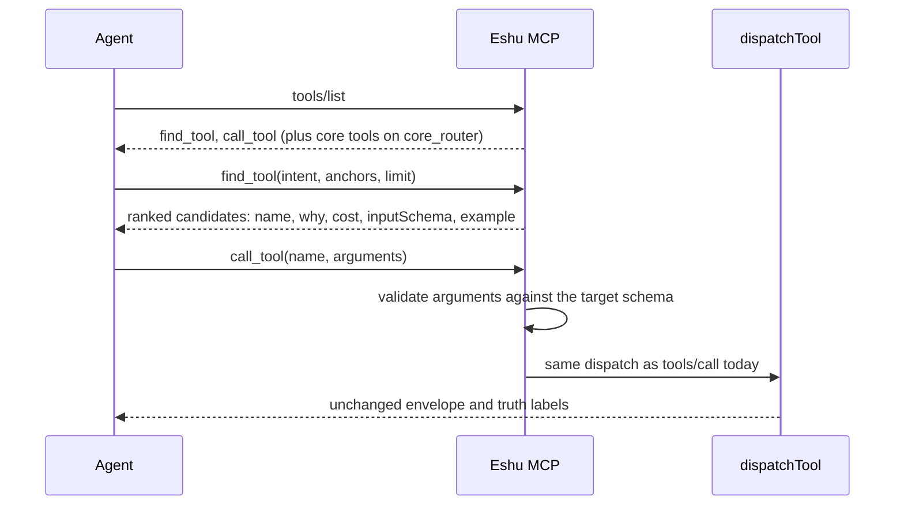

# MCP router contract

## Purpose

`router` holds the opt-in MCP router surface from epic #8752. With
`ESHU_MCP_TOOL_SURFACE=router`, `tools/list` advertises two tools, `find_tool`
and `call_tool`, instead of the full registry. This package defines the shared
contract the parallel lanes build against and the `Engine` that serves both
tools (#8757). A direct `tools/call` to any registered tool is unchanged, and a
`call_tool` result is byte-identical to the direct call it wraps.

## Ownership boundary

This package owns the contract (`Surface`, the two tool definitions, `Query`,
`Candidate`, `Anchors`, the `Ranker` interface, the `Dispatcher` function type,
the core tool-name list) and the `Engine` that serves `find_tool` and
`call_tool`: argument validation, the per-call credential filter, the playbook
match, recursion refusal, and the router telemetry. It does not rank (the
`Ranker` is injected), dispatch (the `Dispatcher` is injected), or read
configuration.

`internal/mcp` keeps `handleMessage`, `dispatchTool`, authorization, and
transport. Its `tools/call` branch hands `find_tool` and `call_tool` to the
`Engine` before `dispatchTool` and renders a dispatched `call_tool` with the
same renderers as a direct call. The router tools are not in `ReadOnlyTools`.
This package must not import `internal/mcp` (import cycle), and a test enforces
that.

`internal/ask/catalog` owns the per-tool `Intents` and `Canonical` fields this
package ranks against. They are empty until the intent-curation lane fills them.

## Exported surface

- `Surface`, `SurfaceFull`, `SurfaceRouter`, `SurfaceCoreRouter`, `ParseSurface`
- `FindToolName`, `CallToolName`, `Tools`, `DefaultLimit`, `MaxLimit`
- `Anchors`, `Query`, `Candidate`, `Ranker`, `Dispatcher`
- `CoreToolNames`, `Advertise`
- `Engine`, `NewEngine`, `Config`, `Request`, `CallOutcome`, `ToolResult`,
  `Content`, `RouteResolver`
- `ValidateArguments`, `FieldError`, `UnsupportedSchemaFeatures`,
  `ExampleArguments`, `RouteProbeArguments`

## Engine behavior

- `find_tool` ranks only tools that are in the query profile's visible list,
  are not `find_tool`, `call_tool`, or `ask`, and that the caller's credential
  can call. It re-checks the ranker's output, so a ranker that ignores
  `allowed` still cannot leak a tool. Without an `AuthContext` (stdio or
  `ESHU_MCP_ALLOW_UNAUTHENTICATED`) it does not filter and answers
  `access: {filtered: false, reason: "no_auth_context"}`. With no `Ranker`
  configured it answers `mcp_router_ranker_unavailable`.
- The credential filter refuses only what the API auth middleware always
  refuses: shared-key-only routes for every non-shared caller, and routes off
  the scoped-token allowlist for scoped bearers. Decisions the middleware takes
  from deployment policy are admitted here and enforced at dispatch.
- When a query playbook's title words cover the intent and every step is
  callable, `find_tool` attaches its plan; anchors that name a required input
  add the resolver's fully specified calls.
- `call_tool` looks targets up in the full registry, so a profile-hidden tool
  stays callable, as it is through `tools/call`. Errors use the
  `{data, truth, error}` envelope with codes `mcp_router_invalid_arguments`
  (with field errors, the input schema, and an example call),
  `mcp_router_unknown_tool` (with up to three close names), and
  `mcp_router_refused`.
- Validation mirrors dispatch where strict JSON schema would not: a JSON null
  for an optional property is absent, undeclared properties are ignored, a
  blank `date-time` is accepted, and `default` is never applied.

## Request flow

## Lane ownership

Change `Query`, `Candidate`, or `Ranker` only after commenting on epic #8752;
every lane codes against them.

| Issue | Lane | Owns |
| --- | --- | --- |
| #8753 | Scaffold: this contract and the empty catalog fields | `router/` types and definitions, `Annotation`/`Entry` type fields |
| #8754 | Intent phrases and canonical flags for every tool | new files in `internal/ask/catalog` |
| #8755 | Deterministic lexical ranker | a `Ranker` implementation under `router/` |
| #8756 | Eval corpus and report-only gate | eval corpus and gate, written blind to the intents |
| #8757 | `find_tool` and `call_tool` dispatch, validation, telemetry | `handleMessage` intercept, validator, router telemetry |
| #8758 | `ESHU_MCP_TOOL_SURFACE` switch | env registry entry, `ServerOption`, `/mcp/message` `surface` override |
| #8759 | Core tool set from hosted call counts | `core.go` `coreToolNames` |
| #8760 | Hosted validation, assistant docs, default decision | docs and measurement |

## Telemetry

`eshu_dp_mcp_router_find_total{outcome}`, `eshu_dp_mcp_router_call_total{tool,outcome}`,
and `eshu_dp_mcp_router_target_rank`, plus the `mcp.router.find` and
`mcp.router.call` spans. See
[MCP Router Telemetry](../../../../docs/public/reference/telemetry/mcp-router.md).

## Gotchas / invariants

- `Tools` returns fresh definitions; mutating a result must not change a later
  call.
- `ParseSurface("")` is `full`. An unknown value is an error, never a silent
  fallback to `full`.
- `CoreToolNames` is empty until #8759. `core_router` advertises only the two
  router tools until then.
- `find_tool` needs an injected `Ranker`; the lexical ranker (#8755) is wired
  by the root once it lands.
- A new keyword, type, or format in a registered tool schema fails
  `TestRegisteredSchemasUseOnlyValidatedKeywords` in the mcp root until
  `ValidateArguments` implements it.
- `Ranker.Rank` must never return a tool for which `allowed` is false.

## Related docs

- [MCP package](../README.md)
- [MCP tool contract](../contract/tool/README.md)
- [Ask catalog](../../ask/catalog/README.md)

## Verification

From `go/`, run `go test ./internal/mcp/router/... ./internal/ask/catalog/...
-count=1` and `go vet ./internal/mcp/...`. From the repository root, run
`scripts/verify-package-docs.sh`.
