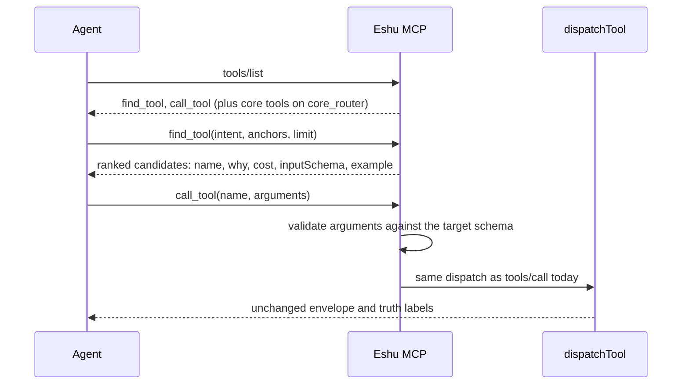

# MCP router contract

## Purpose

`router` holds the shared contract of the opt-in MCP router surface from epic
#8752. With `ESHU_MCP_TOOL_SURFACE=router`, `tools/list` advertises two tools,
`find_tool` and `call_tool`, instead of the full registry. This package fixes the
types and static definitions so the six parallel lanes build against one
contract. It changes no behavior: `tools/list` and `tools/call` are
byte-identical to before.

## Ownership boundary

This package owns types and static data only: the `Surface` selector, the two
tool definitions, `Query`, `Candidate`, `Anchors`, the `Ranker` interface, the
`Dispatcher` function type, and the (empty) core tool-name list. It does not
rank, validate arguments, dispatch, read configuration, or emit telemetry.

`internal/mcp` keeps `handleMessage`, `dispatchTool`, authorization, and
transport. It injects a `Dispatcher` and intercepts `find_tool` and `call_tool`
before `dispatchTool`; the router tools are not in `ReadOnlyTools`. This package
must not import `internal/mcp` (import cycle), and a test enforces that.

`internal/ask/catalog` owns the per-tool `Intents` and `Canonical` fields this
package ranks against. They are empty until the intent-curation lane fills them.

## Exported surface

- `Surface`, `SurfaceFull`, `SurfaceRouter`, `SurfaceCoreRouter`, `ParseSurface`
- `FindToolName`, `CallToolName`, `Tools`, `DefaultLimit`, `MaxLimit`
- `Anchors`, `Query`, `Candidate`, `Ranker`, `Dispatcher`
- `CoreToolNames`

## Request flow

## Lane ownership

Change `Query`, `Candidate`, or `Ranker` only after commenting on epic #8752;
every lane codes against them.

| Issue | Lane | Owns |
| --- | --- | --- |
| #8753 | Scaffold: this contract and the empty catalog fields | `router/` types and definitions, `Annotation`/`Entry` type fields |
| #8754 | Intent phrases and canonical flags for every tool | new files in `internal/ask/catalog` |
| #8755 | Deterministic lexical ranker | a `Ranker` implementation under `router/` |
| #8756 | Eval corpus and report-only gate | eval corpus and gate, written blind to the intents |
| #8757 | `find_tool` and `call_tool` dispatch, validation, telemetry | `handleMessage` intercept, validator, router telemetry |
| #8758 | `ESHU_MCP_TOOL_SURFACE` switch | env registry entry, `ServerOption`, `/mcp/message` `surface` override |
| #8759 | Core tool set from hosted call counts | `core.go` `coreToolNames` |
| #8760 | Hosted validation, assistant docs, default decision | docs and measurement |

## Telemetry

None. This package constructs in-memory data only. Router find outcomes, target
rank, and validation failures are emitted by the dispatch lane (#8757).

No-Observability-Change: the scaffold adds no runtime behavior, routing,
dispatch, authorization, or response shaping.

## Gotchas / invariants

- `Tools` returns fresh definitions; mutating a result must not change a later
  call.
- `ParseSurface("")` is `full`. An unknown value is an error, never a silent
  fallback to `full`.
- `CoreToolNames` is empty until #8759. `core_router` advertises only the two
  router tools until then.
- `Ranker.Rank` must never return a tool for which `allowed` is false.

## Related docs

- [MCP package](../README.md)
- [MCP tool contract](../contract/tool/README.md)
- [Ask catalog](../../ask/catalog/README.md)

## Verification

From `go/`, run `go test ./internal/mcp/router/... ./internal/ask/catalog/...
-count=1` and `go vet ./internal/mcp/...`. From the repository root, run
`scripts/verify-package-docs.sh`.
