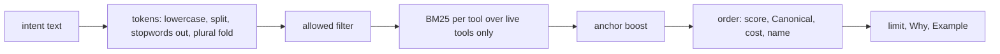

# MCP router lexical ranker

## Purpose

`rank` is the first ranker behind `find_tool` in the MCP router surface from
epic #8752. It turns a plain-language intent into the few tools that fit, and it
does so without a model: the same query on the same build returns the same
order, so a wrong pick can be reproduced and debugged. It implements
`router.Ranker` from the scaffold in `go/internal/mcp/router`.

## Ownership boundary

This package owns scoring, ordering, and the `Why` and `Example` text of each
`router.Candidate`. It does not own the `Ranker` contract (`router`), the
per-tool `Intents`, `Canonical`, and `Cost` data (`internal/ask/catalog`, #8754),
argument validation or dispatch (#8757), or the choice of surface (#8758). It
must not import `internal/mcp`; `TestRankDoesNotImportMCPRoot` enforces that.

## Exported surface

- `New(tools, entries)` builds the index once. Call it at server start.
- `(*Lexical).Rank` implements `router.Ranker`.
- `ErrNilAllowed` is returned when `allowed` is nil.

## How a query is scored

- **Fields and weights.** Intent phrases weigh 3, the tool name (split on `_`)
  weighs 2, and the description weighs 1. A tool's field-weighted term counts and
  length feed standard BM25 (`k1=1.2`, `b=0.75`).
- **Boilerplate.** Two rules apply to descriptions only; names and intents are
  never stripped. A sentence repeated verbatim in 3 or more descriptions is
  dropped. A template with a varying slot, like the scoped-token sentence
  ("Scoped tokens receive only chains whose every hop is in a granted
  repository ..."), is caught by flagging any run of 4 tokens shared by 3 or more
  descriptions and dropping the tokens it covers; the slot word stays. Both rules
  need a registry of at least 12 tools, so small fixtures keep their shared
  wording. BM25's IDF and a small stoplist cover the rest.
- **`allowed` first.** `Rank` calls `allowed` for every tool before scoring.
  Document frequencies and average length come from the allowed tools only, so a
  tool the caller cannot use never appears and never shifts a score. The
  boilerplate sets are a property of the registry build, not the caller.
- **Anchors prefer, they do not match.** For each supplied anchor (`repo_id`,
  `service_id`, `workload_id`, `environment`) whose property a tool's input schema
  accepts, the score is multiplied by 1.25. An anchor never adds a lexical match:
  an intent with no match returns nothing even when anchors are set.
- **Ties.** Scores are compared at 1e-9 resolution. Equal scores order by
  `Canonical` first, then cheaper `Cost` (low, moderate, high; a tool with no
  catalog entry counts as high), then tool name, then registry position.
- **`Why`.** One line quoting the tool's intent phrase or description sentence
  with the highest summed IDF of the matched query terms, or the tool name when
  only the name matched. It is cut at 160 runes on a word boundary.
- **`Example`.** Built from the input schema: required properties, properties
  with a `default`, and the anchors the query supplied that the tool accepts.
  Anchor properties carry the supplied value; other required properties use the
  schema default, the first enum value (`[]string` or `[]any`), or a type
  placeholder (`"<name>"`, `1`,
  `false`, `[]`, `{}`). A tool with no arguments gets `{}`. Values are cloned from
  the schema.

`Rank` reads only the first 2048 bytes of the intent and scores the first 32
distinct terms, so a hostile intent costs about what a normal one does.

An empty or all-stopword intent, an intent with no match, and `Limit` below 1
return no candidates and no error. `Limit` above `router.MaxLimit` is capped.
A nil `allowed` returns `ErrNilAllowed` rather than showing every tool.

## Index lifecycle

`New` tokenizes every tool once and keeps the tools slice and the entries map it
was built from. `Rank` reuses that index only when it is handed the same slice
(same backing array and length) and the same map (same map, same size). Identity
is the test, so a different slice or map is ranked from a fresh, uncached index
even when its names, descriptions, or entries look the same. Holding the map in
the index also keeps its address from being recycled for a different map while
the index lives.

What this guarantees: a `Rank` result always matches what a brand-new `New(...)`
would return for the inputs passed. What it does not detect: editing a slice
element or a map entry in place after `New`. The index then serves the text it
saw at `New`. Callers must not edit in place, and should keep one tools slice and
one entries map for the life of the server: `mcp.ReadOnlyTools()` builds a new
slice per call, so pass the same retained slice every time. A caller that passes
a new slice or map per request pays the full rebuild on every call.

The index is immutable, so concurrent `Rank` calls are safe.

## Performance

Benchmark Evidence: `BenchmarkRank163Tools` ranks one query over a synthetic
163-tool registry (3 intents per tool, 30-45 word descriptions) with a prebuilt
index. On the dev host (aarch64, 16 cores, Go 1.26) it runs about 44 microseconds
per op with 68 allocations and about 21.5 KB, against a target of under 1 ms.
`BenchmarkNew163Tools` measures the one-time build at about 5.8 ms. Rerun with
`go test ./internal/mcp/router/rank/ -run '^$' -bench . -benchmem` from `go/`.
The CI runner figure is NOT_CHECKED until the benchmark runs there.

## Telemetry

None here. Find outcomes, target rank, and validation failures are emitted by
the dispatch lane (#8757).

No-Observability-Change: this package scores and orders in-memory data. It adds
no I/O, routing, dispatch, authorization, or response shaping of its own.

## Gotchas

- Intents in `internal/ask/catalog` are empty until #8754. With no intents the
  ranker scores names and descriptions only, which is the baseline #8756 measures.
- A word that appears only in boilerplate cannot be matched by that boilerplate.
  A real word elsewhere in the same description still matches.
- Weights and the anchor boost are first guesses. Tune them against the #8756
  eval corpus, not by hand on a few queries.
- Anchors prefer; they do not filter. The scaffold contract says "prefer": a tool
  that does not accept a supplied anchor still appears, ranked lower.
- `Example` echoes the caller's real anchor value for any anchor property the
  tool accepts, so the example can be called as is. Other required properties
  get placeholders.
- Anchor values are not length-bounded here. The `find_tool` handler layer
  (#8757) must cap them before they reach `Rank` and `Example`. Only the intent
  is bounded in this package.
- Boilerplate stripping removes about 14.5% of description tokens on the real
  registry (a reviewer's measurement). Whether that helps or hurts accuracy is
  unvalidated until the #8756 eval harness exists.

## Related docs

- [MCP router contract](../README.md)
- [Ask catalog](../../../ask/catalog/README.md)

## Verification

From `go/`, run `go test ./internal/mcp/router/... -count=1`, then
`go test -race ./internal/mcp/router/... -count=1` and
`go vet ./internal/mcp/router/...`. From the repository root, run
`scripts/verify-package-docs.sh`.
