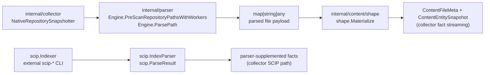
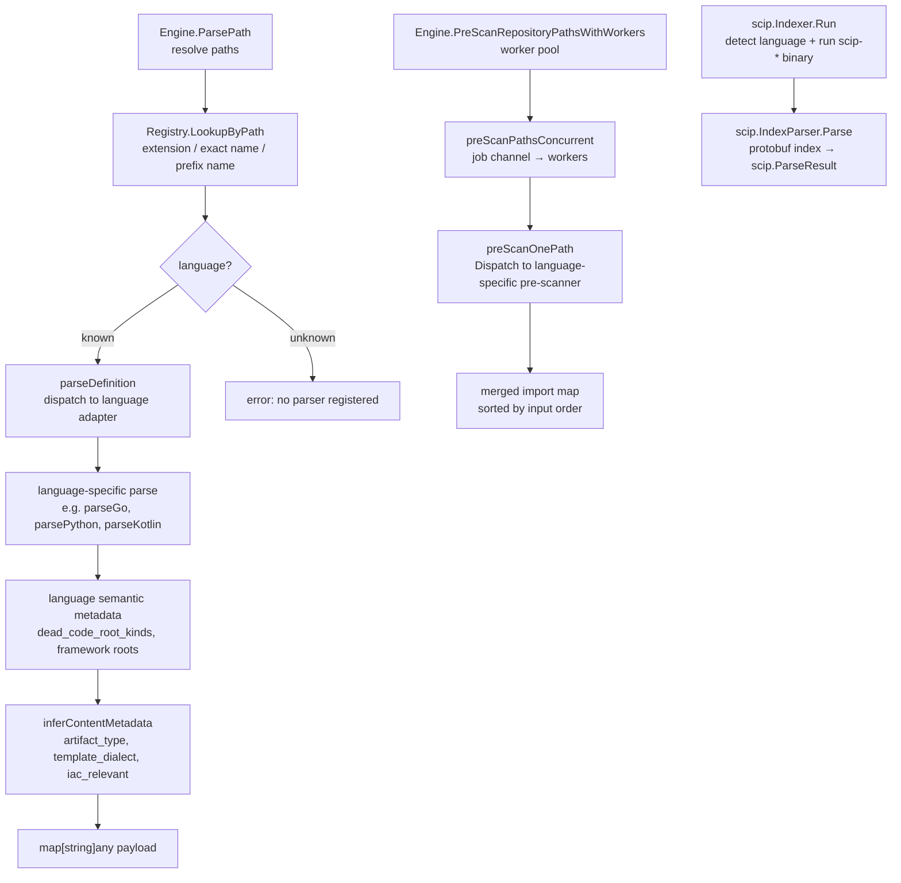

# Parser

## Purpose

`internal/parser` owns the native Go parser registry, language adapters,
import, re-export, and constructor receiver metadata, dead-code root metadata,
and SCIP reduction support used to extract source-level entities and metadata.
Parser changes must preserve fact truth: when a parser emits a new
entity, relationship, or metadata field, the relevant fixtures, fact contracts
in `internal/facts`, and downstream docs must move in lockstep. Parsers must
be deterministic given the same source bytes so retries and repair runs
converge.

`Options.EmitDataflow` is the opt-in value-flow gate. When enabled, capable
adapters may emit `dataflow_functions`, `taint_findings`,
`interproc_findings`, and, only with stable repository and package identity,
`dataflow_summaries`. The gate is off by default; direct parser callers without
durable identity must not emit summary rows with malformed FunctionIDs.

## Where this fits in the pipeline

## Internal flow

## Lifecycle / workflow

`Engine` is the single dispatch point for both parse and pre-scan operations.
`DefaultEngine()` constructs an engine from `DefaultRegistry()` and
`NewRuntime()`. `NewRuntime` allocates a thread-safe cache of tree-sitter
language handles; grammars are loaded on first use and reused across calls.

`Engine.ParsePath` resolves both `repoRoot` and `path` to absolute form, calls
`Registry.LookupByPath` to identify the language, then dispatches to the
registered `LanguageProvider` when present before falling back to built-in
wrappers. Language adapters live in their own subpackages (`internal/parser/<lang>`)
and share helper primitives via `internal/parser/shared` so child adapters never
import the parent dispatcher.

Each language adapter emits structured symbols, imports, calls, and bounded
reachability evidence (`dead_code_root_kinds`, receiver types, package-export
roots, embedded SQL, IaC/template buckets) according to its subpackage contract
and `docs/public/reference/dead-code-reachability-spec.md`. After the language
adapter returns, `content.Infer` (gated by `content.ShouldSkip`) sets
`artifact_type`, `template_dialect`, and `iac_relevant`, and the payload records
`repo_path`.

Specialized extraction helpers live beside their language packages:
- `internal/parser/dbtsql` extracts compiled dbt SQL lineage directly (no parent wrapper).
- `internal/parser/cloudformation` shares CloudFormation/SAM classification across JSON and YAML.
- `internal/parser/python` extracts executable `.ipynb` code cells into a temporary Python source view parsed through the standard Python path.
- `internal/parser/golang`, `java`, `javascript`, `json`, `yaml`, `groovy`, `dockerfile`, `ruby`, and `hcl` own their respective manifest, lockfile, metadata, and pre-scan helpers.

`Engine.PreScanRepositoryPathsWithWorkers` runs a lighter pre-scan pass that
extracts import names, package-level interface/type references, and referenced
symbol names across workers, then merges results in input order to produce a
deterministic cross-file import map before full parsing.

**SCIP path**: when `SCIP_INDEXER=1`, `true`, `yes`, or `on`, the collector
snapshotter groups selected files by language and package/workspace root, runs
the matching `scip-*` binary on `PATH` via `scip.Indexer.Run`, and parses the
protobuf index via `scip.IndexParser.Parse`. SCIP supplements native tree-sitter
output for Go, Python, TypeScript, JavaScript, Rust, Java, C, and C++; files
omitted from an index still complete through the native parser.

## Exported surface

- `Engine` — dispatch hub; constructed via `DefaultEngine()` or `NewEngine(registry, runtime)`
- `DefaultEngine()` — engine from the built-in registry and a fresh tree-sitter runtime
- `NewEngine(registry, runtime)` — engine from a provided `Registry` and `Runtime`
- `Engine.ParsePath(repoRoot, path, isDependency, options)` — parse one file;
  returns `map[string]any`
- `Engine.PreScanPaths(paths)` — import-map contract for collector prescan
- `Engine.PreScanRepositoryPaths(repoRoot, paths)` — repo-bounded prescan
- `Engine.PreScanRepositoryPathsWithWorkers(repoRoot, paths, workers)` — concurrent prescan
- `Engine.PreScanGoPackageSemanticRoots(repoRoot, paths)` — Go package semantic
  root contract for collector parser options
- `Registry` — immutable parser catalog
- `NewRegistry(definitions)` — builds an immutable registry; panics in
  `DefaultRegistry()` if the built-in definitions are invalid
- `DefaultRegistry()` — built-in catalog for this wave of supported languages
- `Registry.LookupByPath(path)` — extension / exact name / prefix name lookup;
  `.tfvars.json` routes to the `tfvars` definition, and Java metadata files under
  META-INF/services, META-INF/spring, and META-INF/spring.factories
  route to `java_metadata`
- `Registry.LookupByExtension(extension)` / `LookupByParserKey(parserKey)` — direct lookups
- `Registry.Definitions()` — cloned definitions in deterministic parser-key order;
  `ParserKeys()` and `Extensions()` return keys and extensions in sorted order
- `Definition` — `ParserKey`, `Language`, `Extensions`, `ExactNames`,
  `PrefixNames`, optional `LanguageProvider`, plus `Ecosystem` (ledger language
  key) and `Admission` (`AdmissionContentText` L1, `AdmissionStructuredFact` L2;
  L0 is the default for unbound names). The labels feed only the generated table
  in `docs/public/languages/admitted-files.md` (`AdmissionTableMarkdown`,
  `scripts/generate-parser-admission-doc.sh`), never lookup or `Registry.Fingerprint`.
- `LanguageProvider` — language-owned parse, pre-scan, and capability contract
- `Runtime` — tree-sitter language handle cache; `Language(name)` returns a
  cached `*tree_sitter.Language`
- `NewRuntime()` — constructs a fresh tree-sitter runtime
- `Options` — `IndexSource bool`, `VariableScope string`
- `internal/parser/scip` — SCIP protobuf index ingestion subpackage (moved out
  of this package's own exported surface): `scip.Indexer` runs an external
  `scip-*` CLI (fields: `LookPath`, `RunCommand`, `Timeout`);
  `scip.IndexParser` parses a SCIP protobuf index into `scip.ParseResult`;
  `scip.DetectProjectLanguage(paths, allowed)` picks the dominant SCIP-capable
  language by file extension count, filtered to the allowed set
- `ExtractDockerfileRuntimeMetadata(sourceText)` — exported utility for
  Dockerfile runtime metadata extraction
- `ExtractGroovyPipelineMetadata(sourceText)` — exported utility for Groovy
  pipeline metadata extraction

## Registered languages and tree-sitter support

| Language | Parser key | Extensions | Tree-sitter native |
| --- | --- | --- | --- |
| C | `c` | `.c` | yes |
| C# | `c_sharp` | `.cs`, `.csx` | yes |
| C++ | `cpp` | `.cc`, `.cpp`, `.cxx`, `.h`, `.hh`, `.hpp`, `.hxx` | yes |
| Dart | `dart` | `.dart` | yes |
| Dockerfile | `__dockerfile__` | `Dockerfile`, `Dockerfile.*` | — |
| Elixir | `elixir` | `.ex`, `.exs`, `mix.lock` | yes |
| Go | `go` | `.go` | yes |
| Go modules | `gomod` | `go.mod`, `go.sum`, `go.work` (exact filenames) | — |
| Groovy/Jenkinsfile | `groovy`, `__jenkinsfile__` | `.groovy`, `Jenkinsfile` | yes (metadata scanners remain bounded) |
| Haskell | `haskell` | `.hs` (`.lhs` stays unclaimed: the grammar has no literate mode) | yes |
| HCL/Terraform | `hcl`; `tfvars` | `hcl`: `.hcl`, `.tf`. `tfvars`: `.tfvars`, `.tfvars.json`, parsed by the hcl engine with language `hcl`, its own definition so a content-store policy governs only these files (#8833) | — |
| Java | `java` | `.java` | yes |
| Java metadata | `java_metadata` | META-INF/services/*, AutoConfiguration.imports, spring.factories | — |
| JavaScript | `javascript` | `.cjs`, `.js`, `.jsx`, `.mjs` | yes |
| JSON | `json` | `.json`, `.jsonc` | — |
| Kotlin | `kotlin` | `.kt`, `.kts` | yes |
| NuGet project | `nuget_project` | `.csproj` | — |
| Perl | `perl` | `.pl`, `.pm` | yes |
| PHP | `php` | `.php` | yes |
| Python | `python` | `.ipynb`, `.py`, `.pyi`, `.pyw` | yes |
| Raw text | `raw_text` | `.cnf`, `.cfg`, `.conf`, `.j2`, `.jinja`, `.jinja2`, `.tpl`, `.tftpl`; exact names `Puppetfile`, `Berksfile`, the version pins `.nvmrc`, `.node-version`, `.tool-versions`, `.python-version`, `.ruby-version`, `.java-version`, `.go-version`, `.sdkmanrc`, `.terraform-version`, `.swift-version`, `rust-toolchain`, `rust-toolchain.toml`, and the universal build and tool configuration names (`Makefile`, `.gitignore`, `tox.ini`, ... — full list in `docs/public/languages/admitted-files.md`); path rule `.mvn/extensions.xml` | — |
| Ruby | `ruby` | `.rb`, `Gemfile`, `Gemfile.lock` | yes for `.rb`; Bundler manifests scanned |
| Rust | `rust` | `.rs` | yes |
| Scala | `scala` | `.sc`, `.scala` | yes |
| SQL | `sql` | `.sql` | yes |
| Swift | `swift` | `.swift` | yes (tree-sitter AST walk) |
| TSX | `tsx` | `.tsx` | yes (TypeScript grammar) |
| TypeScript | `typescript` | `.cts`, `.mts`, `.ts` | yes |
| YAML | `yaml`; `yarnrc` | `yaml`: `.yaml`, `.yml`. `yarnrc`: `.yarnrc.yml` (exact name), parsed by the yaml engine with language `yaml`, its own definition so a content-store policy governs only this file (#8833) | — |

`—` is not a permanent-exception marker. Treat a parser or helper as a
permanent no-tree-sitter exception only when it appears in the "Permanent
parser exceptions (no tree-sitter migration)" section of `AGENTS.md`: YAML,
JSON, HCL/Terraform/Terragrunt, Go modules, node lockfiles, Python dependency
manifests, Maven, NuGet, Gradle DSL, sbt, CloudFormation/SAM, `dbtsql`,
`content`, raw text, SCIP, Dockerfile, and Java metadata. All other
`—` rows need design or migration follow-up; do not use the dash to exempt a
source-language adapter that has a runtime tree-sitter loader or language-owned
AST package.

### Kotlin and Swift symbol extraction

Kotlin uses a hybrid adapter: a line-oriented declaration scan emits the symbol
set, and a tree-sitter syntax index (`kotlin/tree_sitter_syntax.go`) supplements
it with end-of-declaration lines, multiline `class_context`, constructor
parameter property types, function arguments, and inheritance bases. Swift now
uses a single tree-sitter AST walk (`swift/ast_extract.go`) with no line scan.
Both adapters emit functions, classes, calls, and imports; the golden gates
`TestKotlinComprehensiveSymbolExtractionGate` and
`TestSwiftComprehensiveSymbolExtractionGate` pin the comprehensive-fixture
symbol set so a regression to empty extraction fails CI.

Kotlin emits `classes` (including `data`, `sealed`, `abstract`, `object`,
`companion object`, and `enum class`), `interfaces`, `functions` (with
`class_context`, `extension_receiver`, and `suspend`), secondary `constructor`
functions, `variables`, `imports`, and `function_calls`. Call extraction covers
receiver-qualified calls, chained calls, `this.` calls, constructor calls, and
unqualified bare calls (same-scope, top-level, and imported function calls).

Swift extraction (#3589) walks the tree-sitter AST once and emits `classes`
(including `actor`), `structs`, `enums`, `protocols`, `functions` (with `args`,
`class_context`, and `init`), `variables` (with `type`), `imports`, and
`function_calls` (with `inferred_obj_type`) directly from node ranges. Only
genuine `call_expression` nodes produce call rows, so the prior line-scan
false positives (enum case declarations, `mutating`/`override` declaration lines,
`private(set)` modifiers, and string interpolation) are gone, and real subscript,
initializer, and chained-method calls the scanner missed are now captured.
Members declared inside an `extension` block are attributed to the extended type:
the Swift grammar models `extension Foo { ... }` as a `class_declaration` whose
extended type is a `user_type` child, so the AST walk resolves the extended type
name and pushes an `extension` scope without emitting a duplicate type entity.
The Vapor `use:` route hint has no symbol-node form, so it is read as framework
evidence from call argument labels (documented permanent exception in `AGENTS.md`).

The Kotlin adapter does not retain a whole-function AST node at the symbol-append
site, so it stays on the cyclomatic-complexity pending list below until its
function bodies route through a tree-sitter node with a `shared.BranchNodeSet`.

## SCIP support

SCIP provides higher-fidelity cross-file symbol resolution for languages where
tree-sitter alone cannot reliably produce type-qualified call graphs. The SCIP
path in Eshu:

1. `scip.DetectProjectLanguage` scans file extensions to find the dominant
   SCIP-capable language (priority: Python, TypeScript, JavaScript, Go, Rust,
   Java, C++, C).
2. `scip.Indexer.Run` invokes the external binary (`scip-go`, `scip-python`,
   `scip-typescript`, `scip-rust`, `scip-java`, `scip-clang`) and returns the
   generated index path.
3. `scip.IndexParser.Parse` reads the protobuf index and returns `scip.ParseResult`
   for downstream fact emission.
4. SCIP definition payloads preserve the source `scip_symbol` on emitted
   functions, classes, and variables so reducers can build generation-stable
   symbol indexes without reconstructing monikers from names and paths.
5. SCIP results supplement — not replace — native tree-sitter output for the
   same repository.

SCIP defaults off. Set `SCIP_INDEXER=1`, `true`, `yes`, or `on` to enable
SCIP for `python,typescript,javascript,go,rust,java,cpp,c` when the required
external binary is available. Unset, unrecognized, `false`, `0`, `no`, and
`off` values keep native-only parsing. `SCIP_LANGUAGES` narrows the allowlist;
it does not remove native parser coverage for selected files outside the SCIP
index.

## Cyclomatic complexity coverage

Function entities carry a `cyclomatic_complexity` field consumed by the
`find_most_complex_functions` and `calculate_cyclomatic_complexity` query tools.
Real McCabe complexity is computed from the tree-sitter AST by the shared walker
`shared.CyclomaticComplexity`, driven by per-language `shared.BranchNodeSet`
tables. Complexity is `1` plus one for every decision point: each
`if`/`elif`, loop, `switch`/`match` case arm, exception handler (`catch`/`except`),
conditional (ternary) expression, and short-circuit boolean operator (`&&`, `||`,
and the language-specific `and`/`or`). The walk stops at nested function, lambda,
and type definitions so an inner closure does not inflate the enclosing function.

The catch-all arm is the implicit else, not a decision, so it is excluded: a
`switch` `default`, a Rust/Scala/Python bare wildcard `_` arm, and a switch or
match whose only arm is the catch-all all leave complexity at the base value.
The `BranchNodeSet` `defaultCaseKinds` field names the node kinds that double as
a `default`/wildcard arm (for example Java `switch_label`, C# `switch_section`,
C/C++ `case_statement`, Rust `match_arm`, Scala/Python `case_clause`); the walker
counts those nodes only for real case arms. A guarded wildcard (`_ if cond`)
still tests a condition, so it stays counted. Go needs no entry because its
grammar emits a distinct `default_case` node that is simply left out of the
branch kinds.

| Language | Complexity source | Status |
| --- | --- | --- |
| Go | AST walk (`golang.cyclomaticComplexity`) | real |
| Python | AST walk (`python.cyclomaticComplexity`) | real |
| C | AST walk (`c.cyclomaticComplexity`) | real |
| C++ | AST walk (`cpp.cyclomaticComplexity`) | real |
| Java | AST walk (`java.cyclomaticComplexity`) | real |
| C# | AST walk (`csharp.cyclomaticComplexity`) | real |
| Rust | AST walk (`rust.cyclomaticComplexity`) | real |
| Scala | AST walk (`scala.cyclomaticComplexity`) | real |
| Kotlin | `BranchNodeSet` table (`kotlin.kotlinCyclomaticComplexity`) | real |
| Ruby | `BranchNodeSet` table (`ruby.rubyCyclomaticComplexity`) | real |
| PHP | `BranchNodeSet` table (`php.phpCyclomaticComplexity`) | real |
| Swift | `BranchNodeSet` table (`swift.swiftCyclomaticComplexity`) | real |
| Perl | `BranchNodeSet` table (`perl.perlCyclomaticComplexity`) | real |
| Dart | `BranchNodeSet` table (`dart.dartCyclomaticComplexity`) | real |
| Groovy | `BranchNodeSet` table (`groovy.groovyCyclomaticComplexity`) | real |
| Elixir | macro-aware pass (`elixir.elixirCyclomaticComplexity`) | real |
| Haskell | per-equation pass (`haskell.haskellEquationDecisions`) | real |
| SQL | line/lexical adapter — no whole-function AST node | pending |
| JSON (`scripts`) | constant `1` | not source code (npm script strings) |
| SCIP definitions | `0` (unknown) | SCIP carries no statement AST; native parse supplies the real value |

Issue #3524 routed the nine lexical-adapter languages above (Kotlin, Ruby, PHP,
Swift, Perl, Dart, Groovy, Elixir, Haskell) through real McCabe scoring. Seven
use the shared `BranchNodeSet` table directly; Elixir and Haskell express control
flow as macro calls and pattern-match equations rather than dedicated grammar
nodes, so they carry a small dedicated pass instead of a table. Each language is
guarded by the #3488 golden-gate fixture in
`engine_cyclomatic_complexity_test.go` (straight-line = 1, branchy =
hand-counted).

SQL stays **pending** by design: its adapter is a bounded lexical/lineage scanner
that never retains a whole-function declaration subtree, and SQL routines (stored
procedures, functions) are not modeled as scorable function rows here, so there
is no AST node to feed `shared.CyclomaticComplexity`. Per issue #3524 the
decision is documented rather than faked — SQL emits no `cyclomatic_complexity`
field instead of a fabricated constant.

Languages marked **pending** emit no `cyclomatic_complexity` field, so they
resolve to `0` and are excluded by the ranking filter
(`WHERE coalesce(e.cyclomatic_complexity, 0) > 0`) rather than shown with a
misleading constant `1`. Adding a new tree-sitter language to the real set is one
`BranchNodeSet` table plus one call to `shared.CyclomaticComplexity` at the
function-append site.

## Dependencies

- `github.com/tree-sitter/go-tree-sitter` — `Runtime` and grammar dispatch
- Tree-sitter grammar bindings: C, C#, C++, Elixir, Go, Haskell, Java, JavaScript, Kotlin, PHP, Python, Rust, Scala, TypeScript
- Elixir grammar packaging uses the `github.com/eshu-hq/tree-sitter-elixir v0.3.5-eshu.1` fork (v0.3.5 grammar bytes with the corrected module path).
- PHP grammar packaging uses the official
  `github.com/tree-sitter/tree-sitter-php v0.24.2` module via its
  `bindings/go` `LanguagePHP` loader. Refresh by running
  `go get github.com/tree-sitter/tree-sitter-php@<version>` from `go/`, then
  `../scripts/go-test-run-guard.sh 57 TestDefaultEngineParsePathPHP -- ./internal/parser/... -count=1` (the `./...` suffix is required since issue #6062 relocated the `php_*_test.go` family into `internal/parser/php`; the guard fails on a partial match, which a bare `go test -run` would not).
- Kotlin grammar packaging uses
  `github.com/tree-sitter-grammars/tree-sitter-kotlin v1.1.0`, an MIT-licensed
  module with generated `bindings/go` sources and checked-in `src/parser.c` and
  `src/scanner.c`. Refresh by running
  `go get github.com/tree-sitter-grammars/tree-sitter-kotlin@<version>` from
  `go/`, then `go test ./internal/parser -run TestRuntimeParserLoadsKotlinGrammar -count=1`.
- `internal/parser/java` — typed Java metadata evidence extracted before parent
  payload assembly
- `internal/parser/javascript` — tsconfig import resolution and package.json
  root evidence used before parent payload annotation
- `internal/parser/python` — notebook source extraction before parent
  temporary-file parsing
- `internal/parser/golang` — embedded SQL evidence before parent payload
  assembly
- `internal/parser/groovy` — Jenkins/Groovy delivery metadata and lexical
  entity extraction before parent payload assembly
- `internal/parser/dockerfile` — Dockerfile stage and runtime metadata before
  parent payload assembly
- `internal/terraformschema` — provider schema assets consumed by the HCL adapter
- Standard library only for non-tree-sitter adapters

The parser package does not import `internal/projector`, `internal/reducer`,
`internal/storage`, `internal/query`, or `internal/collector`.

## Telemetry

The parser package does not emit metrics or spans directly. Parse timing is
recorded by the collector snapshotter via the `telemetry.FileParseDuration`
instrument (metric: `eshu_dp_file_parse_duration_seconds`). Parse
errors are surfaced in `collector snapshot stage completed` logs with
`stage=parse`.

## Single physical read per `ParsePath` call

`Engine.ParsePath` used to read one file's bytes twice: once inside the
dispatched language parser (`parseDefinition` → `shared.ReadSource`, or the
engine-local `readSource` for `raw_text`), then again for
`inferContentMetadata`. `ParsePath` now reads the file once up front and primes
a call-scoped cache (`shared.PrimeSource`/`shared.ClearSource`, keyed by
absolute path) that both `shared.ReadSource` and the engine-local `readSource`
consult before touching disk; the cache entry is cleared via `defer` before
`ParsePath` returns so it never leaks into a later parse of the same path. No
sub-package `Parse` signature changed, so every language's payload is served
the identical bytes it would have read itself — just from the cache instead of
a second `os.ReadFile`. If the priming read fails, nothing is cached and both
call sites fall back to their normal independent read-and-fail behavior, so
error handling is unchanged.

## Gated content-metadata inference

`content.ShouldSkip` (`content/gate.go`) gates `content.Infer`
(`content/infer.go`) inside `Engine.ParsePath` so plain source files with no
IaC, template, or Ansible signal skip the regex scans and resolve to zero
`content.Metadata{}`. The skip predicate checks every dot-suffix
(`content.SplitSuffixes`), known IaC/template path segments and basenames, and
path-independent Ansible playbook markers. `content.Infer` hoists marker scans
once per call and evaluates Terraform-marker probes lazily via
`lazyTFMarkerCheck` so path-only families (such as `.tf`/`.hcl`) run zero
marker regex scans. See `content/gate_test.go` and `content/infer_hoist_test.go`
for the generative equivalence and zero-scan contracts, and
`docs/public/contributing-language-support.md` for contributor rules.

## Operational notes

- `DefaultRegistry()` panics if the built-in `defaultDefinitions()` list
  contains a duplicate parser key, extension, or filename. This is a
  programming error, not an operational condition, and surfaces immediately on
  process start.
- `Runtime.Language(name)` caches tree-sitter grammar handles under a mutex.
  The first call per grammar loads the native grammar; subsequent calls return
  the cached handle. Do not call `NewRuntime()` per file — share one runtime
  across all parse calls.
- The SCIP binaries (`scip-go`, `scip-python`, etc.) must be on PATH for SCIP
  supplementation to run. `scip.Indexer.IsAvailable` checks the selected
  language binary first; if the binary is absent or the indexer/parser fails,
  the collector keeps the native parser output as the complete payload.

## Extension points

- `NewRegistry(definitions)` — build a custom registry for test suites or
  plugin-supplied language definitions; pass it to `NewEngine`
- `scip.Indexer.LookPath` and `scip.Indexer.RunCommand` — injectable seams for
  testing the SCIP path without external binaries
- `Registry.LookupByPath` — the discovery package's file matcher predicate
  is built from this lookup, so a custom registry produces a custom file
  matcher automatically
- `LanguageProvider` — custom registries can add parse/pre-scan behavior without
  editing the shared engine dispatch switches
- `internal/parser/goldenaudit` — helper package for source-authored golden
  graph fixtures. Use it when language-depth work needs to compare expected
  code graph nodes and edges against observed parser/reducer output without
  copying Eshu output into the expected fixture.

## Gotchas / invariants

- Parser output is a `map[string]any` keyed by convention (e.g. `functions`,
  `classes`, `imports`). There is no compile-time schema; callers in
  the collector's `buildParsedRepositoryFiles` and
  `shape.Materialize` consume keys by string. Adding a new key to a language
  adapter's output requires corresponding updates in `content/shape` and
  downstream fact contracts.
- `dead_code_root_kinds` is conservative reachability evidence, not a cleanup
  verdict. Language-specific root families (Go, JS/TS, Python, Java, Rust,
  C/C++, and others) are owned by each `internal/parser/<lang>` subpackage and
  documented in `docs/public/reference/dead-code-reachability-spec.md`. Dynamic
  reflection, build-tag-specific reachability, and computed dispatch remain
  query-side ambiguity boundaries.
- `Engine.ParsePath` resolves both `repoRoot` and `path` to absolute form.
  Passing a relative path produces an absolute resolved path in the payload's
  `repo_path` field; this is correct behavior but callers should pass absolute
  paths to avoid ambiguity.
- `preScanPathsConcurrent` sorts results by input index before merging to
  preserve deterministic output. Do not remove this sort; out-of-order merging
  makes import maps non-deterministic across runs.
- SCIP and tree-sitter parse results for the same file may overlap; the
  collector combines both and SCIP output does not supersede tree-sitter.
- `scip_symbol` is a source symbol identity, not a storage identity; keep it
  independent of fact, generation, and content entity IDs.
- Swift grammar uses `github.com/indigo-net/Brf.it` v0.21.0; update by bumping
  the module and rerunning the Swift runtime parser load test.

## Related docs
- `docs/public/architecture.md`, local testing, telemetry, collector README, and `go/internal/facts/`.
