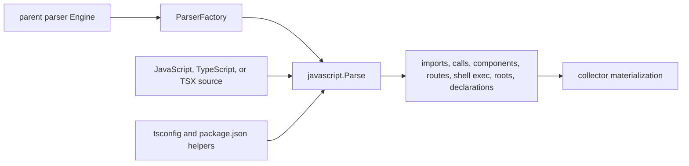

# JavaScript Parser

## Purpose

This package owns the JavaScript-family parser adapter for JavaScript,
TypeScript, and TSX. It reads source files through a caller-provided
`ParserFactory`, builds the legacy parser payload buckets, annotates imports
with tsconfig `resolved_source` evidence, and marks parser-proven dead-code
roots from package, framework, module-contract, route, public API, and
child_process shell-exec evidence.

## JavaScript-family parse flow

Repository-bounded tsconfig and package metadata add evidence to the payload.
They do not give this child package ownership of parent parser dispatch.

## Ownership boundary

The package is responsible for JavaScript-family tree-sitter traversal,
payload assembly, import and re-export extraction, call metadata, component
evidence, TypeScript declaration rows, package.json roots and tsconfig alias
resolution (via the `project` subpackage), Hapi route evidence, framework
callback roots, and deterministic bucket sorting.

The parent `internal/parser` package owns registry dispatch, runtime grammar
caching, Engine.ParsePath, Engine.PreScanRepositoryPathsWithWorkers, and the
thin JavaScript wrapper that converts parent options into shared parser
options. Production files in this package must not import the parent parser
package. External black-box tests may import it to exercise the public engine
without giving child production code a reverse dependency.

## Subpackages

Three leaf packages sit under this one, and none may import it back -- that
would be an import cycle, which the symbol census behind issue #6771 showed
this directory's call graph produces readily. Each has its own README.

- `project/` -- a source file's project context from the repository layout:
  nearest `tsconfig.json` and its `baseUrl`/`paths` aliases, nearest
  `package.json` and the entry points it declares, repo-relative path
  normalization, and the stat-keyed cache that keeps those lookups off the hot
  path.
- `syntax/` -- AST-level extraction primitives: declared names, docstrings and
  function/method kinds, type parameters and references, implemented
  interfaces, member-expression decomposition, parameter counts, and the
  per-parse `ParentLookup` index. It reports what the grammar says; deciding
  what a framework means stays here.
- `jsdataflow/` -- CFG and reaching definitions behind `Options.EmitDataflow`.

`project` and `syntax` are independent of each other; this package imports both.

## Exported surface

The godoc contract is in `doc.go`. Current root-package exports are
`ParserFactory`, `Parse`, `PreScan`, and `ExpressServerSymbols`. Project-context
resolution (`TSConfigImportResolver`, `NewTSConfigImportResolver`,
`TSConfigSourceCandidates`, `PackageFileRootKinds`, `NearestPackageRoot`,
`PackagePublicSourcePaths`) and AST-shape extraction (`ParentLookup`,
`FunctionName`, and the other primitives listed under "Subpackages" below)
moved into the leaf subpackages this package imports and calls into; see their
own `doc.go`/`README.md` for their exported surfaces.

The `embedded_shell_commands` payload bucket records import-backed
`child_process` calls with function, line, API, and language metadata only. It
does not retain command strings, arguments, or environment values.

`PreScan` uses a declaration-only AST walk for functions, classes, interfaces,
function-valued variables, and function-valued object pairs. It intentionally
skips tsconfig/package resolution, framework semantics, shell evidence,
dead-code roots, call rows, variables, and sibling-file parsing because the
collector runs full parse immediately afterward.

## Dependencies

This package imports tree-sitter, the Go standard library, and
`internal/parser/shared` for payload, source, tree, path, and option helpers.
It also imports its own leaf subpackages, `project` and `syntax` (see
Subpackages above); files that moved into either one call `shared.*` directly
instead of this package's local alias names, since those aliases are not
visible outside this package. The local alias file only exposes helper names
with package-local callers. Production code must not import the parent parser
package, collector packages, graph storage, or reducer code. `fastify_threading_bench_test.go` and the
TypeScript implemented-interface regression are external-package tests; both
import the parent parser to exercise the public `Engine.ParsePath` path. The
separate `fastify_threading_characterization_test.go` stays in `package
javascript` and exercises package-local helpers without importing the parent.

## AST extraction and retained within-string regexes

Symbol, edge, and framework-metadata extraction is tree-sitter AST node-walking.
Method getter/setter/async/generator kinds, `child_process` embedded-shell
commands, Hapi route objects, Express routes, Next.js route verbs / metadata /
runtime directives, JSX-return component detection, AWS/GCP service imports, and
the TypeScript public-API re-export / import / declaration surface (including
sibling files parsed through the `ParserFactory`) are all derived from AST
nodes, not from regular expressions over raw source.

A small set of regular expressions is retained deliberately. Each runs only
against the value of a string literal or an identifier token, never as a
source scanner, and each is a documented within-string-content exception:

- `staticComputedMemberNameRe` (unexported, `syntax/names.go`) validates that
  an already-unquoted computed-property string value looks like a static member
  path or numeric literal. It checks within-string content, not source layout.
  It moved with its owning symbol under issue #6771; see `syntax/AGENTS.md` for
  the full residual-regex rationale and `syntax/names_test.go` for its
  characterization tests.
- `javaScriptAWSClientServiceRe` / `javaScriptGCPServiceRe`
  (`semantics_ast.go`) extract the service slug from an
  `@aws-sdk/client-*` or `@google-cloud/*` package specifier. The specifier
  string is isolated from the AST `import_statement`/`require` node first; the
  regex only parses the trailing slug inside that isolated string.

### Intentional parity narrowings (prior regex bug fixes)

The AST conversion deliberately reports a stricter, more accurate set than the
old raw-source regexes in two framework-semantics buckets. The previous regexes
scanned the whole file, so they matched code-shaped tokens inside comments,
string literals, imports, and type annotations. The AST walk only visits real
syntax nodes, so those non-code matches are no longer reported:

- `react.hooks_used` collects hook calls from `call_expression` callees only,
  covering both bare `useState(...)` and member-call `React.useState(...)`
  forms. The legitimate member-call match the old regex produced is preserved;
  the hook-shaped tokens it also matched inside comments and strings are dropped.
- `aws`/`gcp` `client_symbols` collects only `XxxClient` names actually
  constructed with `new`. Import bindings, type annotations, and comment
  mentions of an `XxxClient` token are no longer counted, because the file does
  not instantiate them there.

Both narrowings have engine-level regression tests in
`engine_ast_conversion_test.go`
(`TestDefaultEngineParsePathReactHookMemberCallParity`,
`TestDefaultEngineParsePathAWSClientSymbolConstructorOnly`).

## Telemetry

This package emits no metrics or spans. Parse timing remains owned by the
parent parser engine and runtime instrumentation. It emits two structured
`slog.Warn` lines, both with `component=parser.javascript`:

- `javascript-family parse file bounded` (`action=file_skipped`) when a file
  exceeds the 1 MiB parse cap (`language_helpers.go`, #4766).
- `javascript-family import source exceeds bound` (`action=import_dropped`,
  with `path`, `import_type`, `line_number`, `source_bytes`) when an
  imports-bucket row's module specifier exceeds 1024 bytes and is dropped
  (`import_bound.go`, #7056).

## Gotchas / invariants

Cross-repository call keys (`package_keys.go`, #7601; static member keys in `package_keys_members.go` and `package_keys_closed.go`, #8280) must never name a symbol
they cannot prove; a bare import is keyed only when a manifest declares it. See
`doc.go` for the stamped fields and unkeyed shapes; the `engine_package_*` tests pin each.

`Parse` accepts a `ParserFactory` instead of a parent Engine so the child
package cannot depend on `internal/parser`.

`fastify_threading_bench_test.go` and
`engine_typescript_implements_test.go` use the external `javascript_test`
package. They may import `internal/parser` because Go compiles them only for
tests; production files remain parent-independent. Keep that exception limited
to black-box tests of the public parent engine. The separate
`fastify_threading_characterization_test.go` uses `package javascript` to
compare package-local Fastify computations and does not import the parent.

TypeScript config files use JSONC, so comments and trailing commas are accepted
before unmarshalling.

Resolution is repository-bounded. Absolute `baseUrl` values, absolute path
targets, and candidates outside the repository root return no result.

TSConfigSourceCandidates returns candidates in a stable order: the base path,
then supported JavaScript/TypeScript declaration and runtime extensions, then
index files with the same extension order.

Package helpers use the closest package.json between the source file and
repoRoot. Workspace root manifests must not claim files owned by a nested
package manifest. A `types` target ending in `.d.ts` is treated as a declaration
artifact path, so `lib/index.d.ts` can map back to authored sources such as
`src/index.ts` when generated declaration files are not checked in.

Dead-code roots and route entries are evidence rows, not guesses. Package
entrypoints, CommonJS exports, methods on CommonJS default-exported classes,
Hapi handlers, exact Next.js app-router route handler exports, named Next.js
`pages/api` default handlers, Fastify route-object handlers, framework
callbacks, TypeScript interface implementation methods, module-contract exports,
and public API re-exports must remain grounded in syntax or bounded repository
files. A re-export row needs the grammar's string-literal `source` field, and
`import_bound.go` drops (and logs) any imports-bucket row whose specifier is
over 1024 bytes before it can become a `Module` node name (#7056).
Receiver type metadata is likewise bounded to local syntax: constructor
assignments, typed fields, typed parameters, and simple typed function returns.
Function values passed as call or constructor arguments are emitted as
reference evidence so worker processors and route-handler callbacks do not
look unused only because the framework owns invocation. CommonJS default-export
class method roots apply only to the exported class expression, not helper
classes nested inside another exported expression. Declaration public-surface
walking follows repo-bounded static re-export barrels with a small cycle-safe
depth cap so package `types` surfaces such as
`index.d.ts -> types/index.d.ts -> plugin.d.ts` stay rooted without whole-repo
inference. It also follows declaration entrypoints that import symbols and
export them through local `export type { ... }` clauses, including public
generic defaults that reference imported declaration types.

## Tests

`deadcode/parent_lookup_regression_test.go`, `walk_count_test.go`,
`fastify_threading_characterization_test.go`, and
`residual_regex_characterization_test.go` run in-package
(`package javascript`) and cover package-local helpers directly. The `project`
and `syntax` subpackages carry their own in-package suites instead of sharing
this one: `project/scope_cache_test.go`, `project/tsconfig_test.go`, and
`project/package_json_test.go` (`package project`), and `syntax/names_test.go`
(`package syntax` -- five of the ten residual-regex tests that used to live in
this package's own residual-regex file before issue #6771 moved
`staticComputedMemberNameRe` into `syntax/names.go`; the other five, for the
two regexes that stayed here, remain in `residual_regex_characterization_test.go`).

The Engine-level regressions that used to live in `internal/parser` as
`engine_*_test.go` now run as external black-box tests in `package
javascript_test`, so they exercise JavaScript/TypeScript/TSX extraction the way
callers reach it — through `parser.DefaultEngine().ParsePath` — rather than
through package internals: `engine_ast_conversion_test.go`,
`engine_call_metadata_test.go`,
`engine_computed_property_test.go`, `engine_handler_test.go`,
`engine_koa_fastify_nestjs_route_entries_test.go`,
`engine_koa_router_require_route_entries_test.go`,
`engine_nextjs_route_entries_test.go`,
`engine_package_surface_cache_test.go`,
`engine_reexports_test.go`,
`engine_reexport_boundaries_test.go`,
`engine_repo_config_cache_bench_test.go`,
`engine_repo_config_cache_test.go`, `engine_require_test.go`,
`engine_route_handler_test.go`, `engine_semantics_test.go`,
`engine_tsconfig_baseurl_test.go`, and
`engine_type_parameters_test.go`. `fastify_threading_bench_test.go`
and `engine_typescript_implements_test.go` were already external `javascript_test`
regressions before this relocation.

`engine_test_helpers_test.go` carries the helpers `parsertest` does
not have (`writeTestFile`, `assertStringFieldValue`,
`assertBucketItemByFieldValue`, `assertFunctionByName`,
`assertNoFrameworkOrNoRoutes`, and others) for the relocated suites; the
parent package keeps its own copies of the handful still used by tests that
stay at root (`engine_test.go`, `engine_framework_test_helpers_test.go`).

A second relocation under the same issue moved the parent-level dead-code,
value-flow, and parent-lookup benchmark suites the same way:
`cfg_dataflow_test.go`, `compat_test.go`,
`dead_code_commonjs_class_test.go`,
`dead_code_framework_routes_test.go`,
`dead_code_hapi_alias_test.go`,
`dead_code_hapi_typescript_test.go`,
`dead_code_node_entrypoints_test.go`,
`dead_code_node_roots_test.go`,
`dead_code_node_typescript_fixture_test.go`,
`dead_code_package_scripts_test.go`,
`dead_code_roots_test.go`,
`dead_code_typescript_surface_test.go`, and
`js_parent_lookup_bench_test.go`. `dead_code_roots_test.go` split
into two files at the 500-line cap
(`dead_code_roots_nextjs_migration_test.go` carries the Next.js
app-router and TypeScript migration/module-contract cases). The relocated
parent file `deadcode/typescript_import_exports_test.go` collided
with a pre-existing subdirectory file of the same name (which parses TypeScript
re-export clauses directly against the AST in `package javascript`), so it was
renamed to `engine_dead_code_typescript_import_exports_test.go`.
`engine_test_helpers_test.go` gained `assertFunctionByNameAndClass`,
`assertParserStringSliceFieldValue`, and `repoFixturePath` to cover these
suites; `compat_test.go` keeps its parent-package name for
`javaScriptExpressServerSymbols`, a thin wrapper over the exported
`ExpressServerSymbols` that `dead_code_roots_test.go` calls. The
wrapper is not redundant: it lives in the external `javascript_test` package
while `ExpressServerSymbols` is declared in the non-test `javascript` package
(`deadcode/roots.go`), so the call still needs the `jsparser.`
qualifier. Deleting the wrapper on the assumption that the two sit in one
package would break `dead_code_roots_test.go`.

A third relocation under the same issue moved the last three parent-level files
named for this family: `engine_typescript_advanced_semantics_test.go` (7 tests
on namespace/conditional/mapped type semantics, declaration merging, generic
interface type parameters, and type reference/assertion metadata),
`engine_tsx_advanced_semantics_test.go` (4 tests on fragment shorthand and
`ComponentType` assertion), and `engine_tsx_component_wrapper_test.go` (6 tests
on `React.FC`/`memo`/`forwardRef`/`lazy` wrapper resolution). All three needed
only `parser.DefaultEngine`, `ParsePath`, and `Options`, so they run as
`javascript_test` like their siblings. They reuse this package's existing
helpers rather than adding near-duplicates, take `assertIntFieldValue` from
`parsertest`, and contributed `assertBoolFieldValue` to
`engine_test_helpers_test.go` -- `parsertest` has no bool variant, so
each package that needs one carries its own. Relocating them left
`assertStringSliceFieldValue`, `assertBucketItemByFieldValue`, and
`findAllNamedBucketItems` with no parent-side caller, so those parent copies
were deleted in the same change.

The parent's `assertBoolFieldValue` outlived that sweep because the NuGet
dependency tests were still at root and still called it. #6503 then gave the
NuGet project parser its own package, with its own copy in
`nuget/test_helpers_test.go`, which took the parent's last caller away. Neither
change is wrong alone and neither conflicts with the other in git, so the
orphan reached `main` and `golangci-lint`'s `unused` check failed there until
the parent copy was deleted too.

The external test package may import `internal/parser`; the non-test package
must not. Go compiles `javascript_test` separately, so this keeps the
black-box coverage without making the package depend on the parent dispatcher.

A final #6062 relocation moved the parent-level `equivalence_dump_test.go`
here as external `javascript_test` coverage. `TestDumpJSParseCorpus` is a
guarded, env-gated 0/0-equivalence harness for issue #4868 (JS/TS in-file
multi-walk consolidation): it is a no-op skip unless `JSTS_PARSE_DUMP` names
an output file, in which case it parses every `.ts`/`.tsx`/`.js`/`.jsx` file
under `JSTS_PARSE_CORPUS` (default `../../../../tests/fixtures`, one level
deeper than its old parent-package default of `../../../tests/fixtures`)
through `parser.DefaultEngine().ParsePath` and writes a sorted digest line
per file per `Options` variant. It reaches only the parent's exported
`DefaultEngine`/`Options`/`Engine.ParsePath` surface, so it needed no
package-local helper.

## Related docs

- docs/public/languages/support-maturity.md
