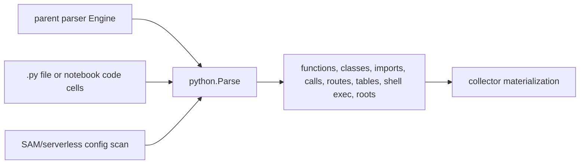

# Python Parser

## Purpose

This package owns the Python language adapter used by the parent parser engine.
It turns Python source and notebook code cells into parser payload buckets for
functions, classes, modules, variables, imports, calls, annotations, framework
metadata, ORM table mappings, shell-exec call-site evidence, and dead-code root
evidence.

## Python parse flow

Notebook extraction and config scans produce parser evidence only. Runtime
ownership, fact storage, and graph writes remain outside this package.

## Ownership boundary

The package is responsible for Python-specific parsing and evidence shaping.
That includes .py input, .ipynb code-cell extraction, import source metadata,
FastAPI, Flask, Django, DRF, aiohttp, and Tornado route summaries, SQLAlchemy
and Django table hints, Lambda handler roots from SAM and serverless config,
generator flags, metaclass data, public API roots, and Python call receiver
inference.

The parent parser package still owns registry dispatch, absolute path
resolution, content metadata, and Engine method signatures. Production files in
this package must not import the parent parser package; shared payload and tree
helpers come from the shared parser package. External black-box tests may import
the parent to exercise its public Engine contract.

## Exported surface

The godoc contract is in doc.go.

- Parse reads one Python or notebook path with a caller-owned tree-sitter parser
  and returns the parser payload. When `Options.EmitDataflow` is set it also emits
  the opt-in `dataflow_functions`, `taint_findings`, and `interproc_findings`
  buckets (see `cfg_emit.go`); the gate is off by default and the payload is
  byte-identical when off.
- PreScan uses a declaration-only AST walk for collector import-map discovery,
  including notebook code-cell extraction and module docstring names, so
  pre-scan does not run framework, route, public-API, call, shell, and
  value-flow extraction before the full parse stage.
- NotebookSource extracts executable Python code cells from notebook JSON.
- ExtractSetupPYRuntimeEvidence reads literal `python_requires` keywords from
  top-level calls proven bound to `setuptools.setup` or
  `distutils.core.setup`. It never executes `setup.py` or evaluates dynamic
  expressions. The Git collector receives guarded, parser-private evidence
  and removes it before durable file facts. More than 1,024 bound
  `python_requires` calls produce a count-only token-cap skip.
- The `embedded_shell_commands` bucket records import-backed `subprocess` and
  `os.system` call sites with function, line, API, and language metadata only.
  It does not retain command strings, arguments, or environment values.

## Dependencies

The package imports the shared parser helper package for Options, BasePayload,
ReadSource, WalkNamed, node text helpers, and bucket helpers. The value-flow
emission (`cfg_emit.go`) imports the `python/pydataflow` lowering, the shared
`internal/parser/dataflowemit` renderer, and the `internal/parser/cfg`/`taint`
engines. It imports the YAML parser child package only to decode SAM and
serverless config candidates when marking Python Lambda handlers.

Production code does not import the parent parser package, collector packages,
storage packages, graph query code, or reducer code. The external
`engine_python_*_test.go` regressions (`package python_test`) import the parent
parser to exercise the full Python surface — framework routes, ORM mappings,
dead-code semantics, call metadata, generators, lambda assignment, metaclass,
rationale comments, and import metadata among them — through
`parser.DefaultEngine().ParsePath`.

## Telemetry

This package emits no telemetry directly. Parser timing and parse failure
context remain owned by the ingester and collector runtime paths that call the
parent Engine.

## Notebook In-Memory Parse (issue #4874)

`Parse` and `PreScan`'s `.ipynb` branches used to convert the notebook to
Python source, write it to a temp file (`os.CreateTemp` + `WriteString`),
read the temp file back (`readSource`, an `os.ReadFile`), then parse that,
and finally remove the temp file in a deferred cleanup — four syscalls of
disk I/O on every notebook parse for source tree-sitter can accept as a
`[]byte` directly. `notebookPythonSource` (`notebook.go`) now converts the
notebook straight to the `[]byte` `Parse`/`PreScan` already hold in memory,
and the temp-file helper (`notebook_temp.go`) is deleted.

## Import flags (issue #7344)

`import_context.go` decides `type_only` (consequence of an `if`/`elif` guarded by
`TYPE_CHECKING` or `x.TYPE_CHECKING`) and `deferred` (a function body
encloses the statement) by climbing the statement's parents. `imports.go` sets
`inferred` when `pythonResolvedImportSource` fell back to the synthesized
`./x` path for a relative import whose module is not on disk. Each flag is
stored only when true, using the `shared.ImportFlag*` keys. The public contract
is in [Python Parser](../../../../docs/public/languages/python.md#import-flags).

## Gotchas / invariants

NotebookSource returns an empty string for notebooks without code cells. Invalid
JSON returns an error so a caller fails the file instead of indexing partial
source.

Parse accepts a caller-owned tree-sitter parser. The caller opens and closes the
parser so the parent Engine can preserve its runtime lifecycle.

The `engine_python_*_test.go` files use the external `python_test` package.
They may import the parent parser because Go compiles that package only for
tests; production files and same-package tests remain parent-independent.

Lambda handler detection scans template.yaml, template.yml, serverless.yaml, and
serverless.yml from the source directory up to the repository root. It only
marks handlers when the runtime is Python.

Script-main guard detection walks parsed if statements and accepts both
`__name__ == "__main__"` and `"__main__" == __name__` forms. Only calls inside
the guard statement become `python.script_main_guard` roots.

Property root detection covers `@property`, `@cached_property`, and
`@functools.cached_property`, including decorators with inline type-checker
comments. Dunder protocol roots cover recognized class protocol methods, module
`__getattr__` and `__dir__` hooks, and nested dunder functions only when source
assignment evidence in the same enclosing function or module installs them onto
a protocol attribute.

The adapter keeps module-scope variables by default. Set the shared
VariableScope option to all when a caller needs local assignment payloads too.

## Tests

`language_test.go`, `notebook_test.go`, `semantics_test.go`,
`aiohttp_tornado_param_apps_test.go`, `django_drf_routes_test.go`, and
`embedded_shell_test.go` run in-package (`package python`) and cover
extraction, framework semantics, and notebook conversion directly. The
Engine-level regressions run as external black-box tests in `package
python_test`, so they exercise Python extraction the way callers reach it —
through `parser.DefaultEngine().ParsePath` — rather than through package
internals:

- `engine_python_semantics_test.go` covers FastAPI/Flask semantics, ORM
  mappings, decorator metadata, async flags, and type-annotation buckets.
- `engine_python_call_semantics_test.go` covers dotted call metadata, method
  context, and self-receiver inference.
- `engine_python_dead_code_semantics_test.go` covers constructor, property, and
  class-reference dead-code evidence.
- `engine_python_ast_parity_test.go` covers multiline class headers, splat
  typed-parameter annotations, and rich embedded-shell parity.
- `engine_python_aiohttp_tornado_routes_test.go`,
  `engine_python_django_drf_routes_test.go`, and
  `engine_python_flask_blueprint_test.go` cover exact framework route entries.
- `engine_python_handler_test.go` covers FastAPI/Flask handler binding after
  stacked or commented decorators.
- `engine_framework_tags_test.go` covers per-function `framework`
  propagation from single-framework route files; multi-framework files stay
  untagged and the dead-code no-root-model notice fires for observed
  frameworks without a root model (django/drf/aiohttp/tornado), while
  fastapi and flask are modeled (#7712).
- `engine_python_generator_test.go`, `engine_python_lambda_assignment_test.go`,
  `engine_python_annotation_assignment_test.go`,
  `engine_python_metaclass_test.go`, `engine_python_rationale_test.go`,
  `engine_python_import_metadata_test.go`, and
  `engine_python_imports_semantics_test.go` cover the remaining semantic
  buckets named in each file.
- `engine_python_module_semantics_test.go` covers module docstring metadata.
- `engine_python_test_helpers_test.go` defines `writeTestFile` and
  `pythonFixturePath`, and the shared-with-root duplicates
  `assertParserStringSliceFieldValue` and `assertBucketItemByFieldValue`.
  Across the external suites, these helpers are used alongside
  `internal/parser/parsertest`.

The external test package may import `internal/parser`; the non-test package
must not. Go compiles `python_test` separately, so this keeps the black-box
coverage without making the package depend on the parent dispatcher.

## Related docs

- docs/public/architecture.md
- docs/public/reference/local-testing.md
- docs/public/languages/support-maturity.md
