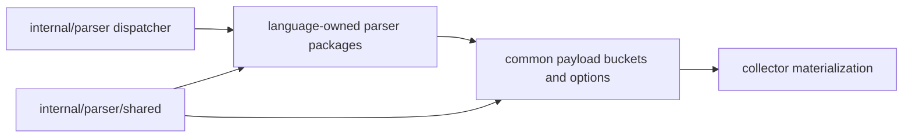

# Shared Parser Helpers

## Purpose

`internal/parser/shared` holds the small contracts language-owned parser
packages need without importing the parent `internal/parser` dispatcher. It
contains common payload bucket helpers, source reads, tree-sitter node helpers,
string utilities, integer coercion, and parser options shared by adapter
packages. Parser options include the `EmitDataflow` gate and the stable
repository identity used by value-flow FunctionIDs. The shared Go semantic-root
options also carry the empty-method-list convention used when an imported
package can reach exported methods through an escaped interface value and the
qualified roots for imported receiver method calls.

`FixtureDirPattern` and `InFixtureDir` are the one path rule for package
manifests that are test scaffolding, not producers (#8223, #8244): whole
directory segments named test, tests, fixtures, testdata, or examples, in any
ASCII letter case, spelled as bracket classes so Go and PostgreSQL agree on a
path such as one holding the long s. The composer and package.json producer
anchors embed the constant in SQL and the composer and JavaScript parsers apply
it, so no side retypes it.

## Dependency boundary

Child parser packages may depend on shared helpers. Shared helpers must stay
language-neutral and must not depend on the parent dispatcher.

## Ownership boundary

This package owns dependency-safe helper contracts for child parser packages.
It does not own registry dispatch, language selection, content metadata
inference, parser runtime caching, or language-specific semantics.

## Exported surface

The godoc contract is in `doc.go` and `shared.go`. Current exports are
`Options`, `GoImportedInterfaceParamMethods`, `GoDirectMethodCallRoots`,
`GoPackageSemanticRoots`, `GoPackageSemanticRootOptions`, `BasePayload`, `ReadSource`,
`ReadSourceWithOriginal`, `NormalizeLineEndings`, `PrimeSource`, `ClearSource`,
`SetReadSourceHookForTest`,
`MaxSourceBytes`, `ErrSourceTooLarge`, `SourceReadCap`, `SetSourceReadCapForTest`,
`ReadFileCapped` (`read_cap.go`, issue #8986), `RuntimeVersionTokenCap`, `WalkNamed`, `NodeText`, `NodeLine`, `NodeEndLine`, `CloneNode`,
`AppendBucket`, `SortNamedBucket`, `SortNamedMaps`, `CollectBucketNames`,
`IntValue`, `LastPathSegment`, `DedupeNonEmptyStrings`, `BranchNodeSet`,
`NewBranchNodeSet`, `CyclomaticComplexity`, and the import-entry flag keys
`ImportFlagTypeOnly`, `ImportFlagDeferred`, and `ImportFlagInferred`
(`import_flags.go`, issue #7344). A parser sets a flag on an `imports` entry
only when it is true. The typed `Import` view in `sdk/go/factschema/codegraph/v1`
decodes them into named fields whose json tags equal these strings, and the
projector folds them onto IMPORTS edges (issue #7345); a test on each side ties
the strings together.

`NormalizeLineEndings` rewrites every carriage return to `\n`, but only in a
source that contains no `\n` at all. Any source with a newline in it comes
back untouched, as the caller's own slice. `ReadSource` applies it to every
buffer it returns, on the cached path as well as the disk path, so no language
parser in this tree ever sees a classic-Mac line ending (#6306). Without it
tree-sitter reports row 0 for every node in such a file and each hand-rolled
`\n` scanner treats the whole file as one line, silently.

The rule is deliberately about the FILE, not the byte. A `\r` means nothing on
its own: the same byte terminates a line in a classic-Mac file and carries
payload inside a Go raw string, a regex, or a wire-format constant. The
absence of `\n` is the only honest signal available -- a file with a newline
already has a working line convention, so its `\r` bytes are data or half a
CRLF pair, while a file without one has no other candidate terminator. Two
things this cannot do, stated plainly:

- A MIXED file (LF or CRLF lines plus a `\r` the author meant as a separator)
  keeps that `\r` and keeps the merged line it produces. That shape is
  byte-for-byte identical to a data `\r` in an LF file, and leaving one line
  of a malformed file merged is a smaller loss than corrupting a literal in a
  healthy one.
- A classic-Mac file that embeds a data `\r` inside a literal has that byte
  rewritten with the separators around it. Such a file parses as a single line
  today, so there is no working behavior to protect.

The rewrite is length-preserving, which is what keeps downstream byte offsets
(the JSONC offset translator, SQL entity spans, `IndexSource` snippets) valid
against the file on disk, and it never mutates its input, which is what keeps
the git collector's content digest stable. A parser that reads a SECOND file
with its own read -- a C/C++ header, a sibling module, a tsconfig, a
Terragrunt include -- does not go through `ReadSource` and must call
`NormalizeLineEndings` itself.

`PrimeSource`/`ClearSource` back the single-physical-read cache
`Engine.ParsePath` uses so the language parser and the engine's
content-metadata inference share one disk read; see the parent package
README's "Single physical read per `ParsePath` call" section for the full
contract. `SetReadSourceHookForTest` is test-only instrumentation for counting
physical `ReadSource` reads without changing its signature; production code
never calls it.

`ReadSource` enforces one per-file read cap, `MaxSourceBytes` (64 MiB, issue
#8986). A file over it, read from disk or primed, returns an error wrapping
`ErrSourceTooLarge`, so it never reaches a parser. `ReadFileCapped` is the
capped read itself: it refuses a file whose reported size is over the cap
before reading, reads at most one byte past the cap so a file that grew is
still refused, and sizes its buffer like `os.ReadFile`. The git collector reads
parse and content-stream bodies through it and skips a parser file over the
cap at discovery, before the import pre-scan, because one pre-scan read failure
fails the whole snapshot. The cap was measured against the largest lock file in
the repository and golden corpus (274,035 bytes); per-parser caps such as the
2 MiB Gradle catalog cap still apply below it. `SourceReadCap` returns the cap
in force; `SetSourceReadCapForTest` lowers it for a test and is never called by
production code. There is no environment variable: no operator need for one
was shown. Side reads of other repository files (C and C++ headers, Python
package `__init__` files and Lambda configs, JavaScript siblings, tsconfig and
package.json, composer manifests and locks, `go.mod`) use `ReadFileCapped` too.
`ReadSourceWithOriginal` uses the same cache, cap, and physical read as
`ReadSource`, returning both the line-normalized parser view and the original
bytes for parsers that bind evidence to a later raw source read.
`TestParserTreeReadsRepositoryFilesThroughTheCap` fails on any other whole-file
read in the parser tree; its allowlist names the Terragrunt include walker (its
own 1 MiB cap), the SCIP index reader, and the golden-audit fixture reader.

`CyclomaticComplexity` is the shared McCabe walker. Each tree-sitter language
adapter passes a `BranchNodeSet` (built with `NewBranchNodeSet`) that names the
node kinds and boolean operator tokens counted as decision points, so adding
complexity for a language is a data table, not new traversal code. The
`defaultCaseKinds` argument names branch kinds that double as a switch `default`
or bare wildcard `_` arm; the walker excludes those catch-all arms because the
implicit else is not a decision point under McCabe.

## Dependencies

This package imports the Go standard library and
`github.com/tree-sitter/go-tree-sitter` for node helper signatures. It must not
import the parent `internal/parser` package or any collector, query, storage,
projector, or reducer package.

## Telemetry

This package emits no metrics, spans, or logs. Parser timing remains owned by
the collector snapshot path.

## Gotchas / invariants

Child parser packages depend on this package to avoid import cycles. Keep it
small and language-neutral; a helper that only one adapter needs belongs in
that adapter package.

`BasePayload`, bucket sorting, and name collection are fact-input contracts.
Changing their shape or ordering changes downstream materialization behavior.

`GoImportedInterfaceParamMethods` uses an empty method list intentionally. It
means the concrete value crossed into another package through an interface
parameter without a known method set, so exported methods on that concrete type
may be valid runtime hooks. Same-repository package contracts should carry
explicit method names from package interface declarations.

`GoDirectMethodCallRoots` uses lower-case qualified import-path receiver keys.
The parent parser decides which package directory receives those roots; child
packages should only carry the typed option.

`Options.EmitDataflow` controls opt-in `dataflow_functions`, `taint_findings`,
`interproc_findings`, and durable `dataflow_summaries` buckets. The gate is off
by default so normal parser payloads remain byte-identical.

`Options.RepositoryID` must be generation-independent and must not contain local
checkout paths, hostnames, IPs, credentials, or commit SHAs. Value-flow-capable
adapters use it with stable language package identity when `EmitDataflow` is
enabled; durable `dataflow_summaries` must be omitted when either identity
component is absent.

`SortNamedMaps` sorts by `line_number` first and `name` second. That preserves
the parent parser ordering contract used before language packages were split.

Utility helpers such as `IntValue`, `LastPathSegment`, and
`DedupeNonEmptyStrings` are intentionally small. Keep language-specific parsing
rules out of this package so shared does not become a second parser package.

`WalkNamed` uses one tree-sitter cursor per traversal and visits only named
direct children recursively. That preserves source-order parser behavior while
avoiding per-node `NamedChildren` slice allocation in repo-scale Go pre-scans.

## Related docs

- `docs/public/languages/support-maturity.md`

`SafeVersionSpec` is the shared bounded version-value guard used when the JSON
parser hands Composer PHP declarations to the runtime fact emitter. Both stages
apply the same grammar so a rejected credential-shaped value does not enter the
parser transport or a runtime fact.

`DotNetRuntimeEvidence` is a bounded, raw-byte-digest-bound private handoff shared by the JSON and NuGet parsers. `Add` detaches only credential-guarded version strings; the collector strips the transport before file facts persist.

## Private runtime evidence

`RuntimeEvidence` carries bounded, source-positioned values from Maven, Gradle,
and sbt parsers to the Git collector. `RuntimeDigest` binds them to the raw
file bytes; `Add` applies the shared version guard and token cap before a value
is retained. The collector removes this transport before file facts persist.
