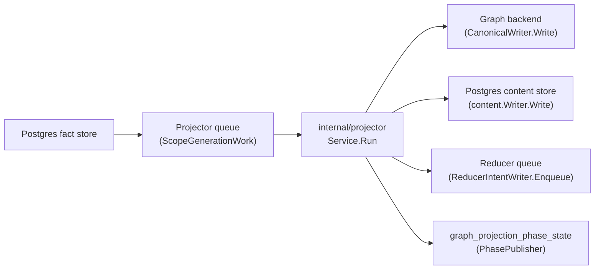
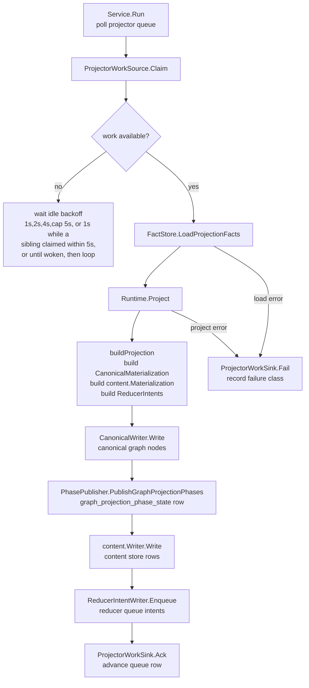

# Projector

## Purpose

`projector` owns source-local projection stages. It turns committed fact
envelopes for one scope generation into canonical graph nodes, content store
rows, source-backed repository ref metadata, and reducer intents for
shared-domain follow-up. It does not make cross-source admission decisions —
those belong to `internal/reducer`.

## Package layout

The root package is the service (claim/lease loop, work-item lifecycle, and
sweepers); projection logic lives in five subpackages forming a strict DAG
(`decode` and `failure` as leaves; `canonical -> decode`;
`runtime -> canonical, decode, failure`; `stage -> canonical, decode, runtime`;
root `projector -> canonical, runtime, failure`). No subpackage imports root;
full-projection tests live in `runtime/` to avoid import cycles.

## Where this fits in the pipeline

## Internal flow

## Lifecycle / workflow

`Service.Run` starts one or more worker goroutines (sequential when `Workers`
≤ 1, concurrent otherwise). Each worker calls `ProjectorWorkSource.Claim` to
pull one `ScopeGenerationWork` from the Postgres projector queue. Empty polls
back off from `PollInterval` (1 s) to a 5 s cap and reset on work (#10869), unless a worker claimed within 5 s: then all poll at the base interval (#11186).

Once a claim is held, the worker loads all fact envelopes for that scope
generation via `FactStore.LoadProjectionFacts` (a delta loads over its #7797 union base, and `ProjectionFacts.ProjectionGeneration` names that base on the generation so the fact boundary accepts it, #8779), then hands them to `Runtime.Project`. A chained delta (diffed over a prior delta, #8780) loads with `ProjectionFacts.UnionChained`, which reaches the `build_projection` stage log as `chained`; a base-missing refusal names both the fence commit and the union-base commit (`DeltaBaseMissingError.UnionBaseCommitSHA`). The
`Runtime` builds a `CanonicalMaterialization` (repository, directory, file,
entity, module, import, parameter, class member, nested-function,
Terraform-state rows, and OCI registry rows) and a content materialization
covering file rows, entity rows, and source-backed repository refs in a single
pass via `buildProjection`. It writes
canonical nodes through `CanonicalWriter.Write`, publishes a
`graph_projection_phase_state` row via the `PhasePublisher` so reducer-owned
edge domains can gate on `canonical_nodes_committed`, writes content store rows,
and enqueues `ReducerIntent` values for shared domains such as
`DomainSemanticEntityMaterialization`.
When a repository fact carries `delta_generation=true`, the canonical
materialization keeps qualified `DeltaFilePaths` and `DeltaDeletedFilePaths` so
the graph writer can scope cleanup to touched files. Delta generations emitted
by the Git collector do not carry repo-wide reducer follow-up facts; shared
projection domains keep their previous truth until they gain a separate
file-scoped delta contract. The source-local delta contract preserves legal Git
path whitespace while rejecting absolute paths and parent traversal.

On success the worker calls `ProjectorWorkSink.Ack`. On any error it calls
`ProjectorWorkSink.Fail` with a `FailureClassification` derived from
`ClassifyFailure`. The classifier preserves the stage that failed, maps Neo4j
transient errors, context cancellation, network errors, input validation, and
resource exhaustion into stable durable queue metadata, and sets retry guidance
for operators. When `ProjectorWorkHeartbeater` returns `ErrWorkSuperseded`, the
service stops the current claim without acking or failing it; this is the
expected cancellation path when a newer same-scope generation replaces a live
older projection. A large-generation semaphore (`largeSem`) limits concurrent
projection of scope generations above `LargeGenThreshold` facts to
`LargeGenMaxConcurrent` workers to prevent memory pressure from many
high-cardinality repositories running at once.

## Exported surface

- `Service` — poll-and-dispatch loop; wire `ProjectorWorkSource`, `FactStore`,
  `ProjectionRunner`, `ProjectorWorkSink`, and optionally `ProjectorWorkHeartbeater`
  and `FactCounter` before calling `Service.Run`
- `Runtime` — implements `ProjectionRunner`; takes a `CanonicalWriter`,
  `content.Writer`, `ReducerIntentWriter`, `PhasePublisher`, and `RepairQueue`
- `CanonicalWriter` — interface for writing a `CanonicalMaterialization` to
  the canonical graph backend; implemented by `storage/cypher.CanonicalNodeWriter`
- `ReducerIntentWriter` — interface for enqueuing `ReducerIntent` rows to the
  reducer queue
- `CanonicalMaterialization` — full set of canonical node writes for one
  scope generation: `RepositoryRow`, `DirectoryRow`, `FileRow`, `EntityRow`,
  `ModuleRow`, `ImportRow`, `ParameterRow`, `ClassMemberRow`,
  `NestedFunctionRow`, Terraform-state resource/module/output rows, and OCI
  registry repository/image/tag/referrer rows. Delta generations also carry
  `DeltaProjection`, `DeltaFilePaths`, and `DeltaDeletedFilePaths`
- `ScopeGenerationWork` — one claimed queue item; carries `scope.IngestionScope`
  and `scope.ScopeGeneration`
- `Result` — output of one projection pass; includes `content.Result` and
  `IntentResult`
- `ReducerIntent` — one pending shared-domain work item emitted after projection
- `FailureClassification` — structured failure metadata (class, disposition,
  stage) used for durable queue persistence
- `ClassifyFailure(err, stage)` — maps a projection error to a
  `FailureClassification`; understands Neo4j transient codes, context
  cancellation, network errors, and sentinel error types
- `ErrWorkSuperseded`, `ErrWorkClaimLost`, `ErrWorkClaimConflict` — sentinels:
  work is obsolete, owned elsewhere, or its claim lost a transient DB conflict
- `StageError`, `InputValidationError`, `ResourceExhaustedError` — typed errors
  the classifier recognizes
- `EntityTypeLabel(entityType)` — maps content-store entity type strings (e.g.
  `"function"`) to Neo4j node labels (e.g. `"Function"`)
- `EntityTypeLabelMap()` — returns a copy of the full entity-type-to-label
  mapping; used in schema conformance tests
- `ProjectFileStage`, `ProjectEntityStage`, `ProjectRelationshipStage`,
  `ProjectWorkloadStage` — stage helpers that project subsets of facts into
  typed results; useful in unit tests and stage-level benchmarks
- `FilterFileFacts`, `FilterEntityFacts`, `FilterRepositoryFacts` — deduplicated
  fact slices by kind
- `NormalizeFactKind` — strips the legacy `Fact` suffix from fact kind strings
- `BuildProjectionDecision`, `BuildProjectionEvidence` — build persisted
  decision rows for audit tracing
- `RetryableError`, `IsRetryable` — typed retry interface and predicate
- `RetryInjector`, `RetryOnceInjector`, `NewRetryOnceInjector` — fault-injection
  seam for controlled retry testing

See `doc.go` for the full godoc contract.

## Dependencies

- `internal/content` — `content.Writer`, `content.Materialization`,
  `content.Record`, `content.EntityRecord`; projector does not own content
  schema, only populates it
- `internal/facts` — `facts.Envelope`; the durable fact model projector reads
- `internal/queue` — `queue.FailureRecord`; `ClassifyFailure.ToFailureRecord`
  converts to this for queue persistence
- `internal/reducer` / `internal/reducer/contract` — `reducercontract.Domain`, `gpphase.PhasePublisher`,
  `gpphase.PhaseRepairQueue`, `gpphase.PhaseState`,
  `reducer.DomainSemanticEntityMaterialization`; projector emits intents and
  phase state that reducer consumes
- `internal/scope` — `scope.IngestionScope`, `scope.ScopeGeneration`; scope
  identity flows through every projection call
- `internal/telemetry` — span, metric, and log helpers

Graph writes route through `internal/storage/cypher.CanonicalNodeWriter` via the
`CanonicalWriter` interface. Terraform-state facts are projected as
`TerraformResource`, `TerraformModule`, and `TerraformOutput` nodes with
lineage, serial, provider, tag hash, and correlation-anchor evidence kept as
properties. `TerraformResource` also carries a bounded, redaction-safe,
allowlisted subset of the resource's classified attributes as prefixed
scalar properties (`tf_attr_instance_type`, `tf_attr_ami`, ...) — see
`internal/storage/cypher/canonical/terraform/attribute_promotion.go` (#5441). OCI
registry facts are projected as digest-addressed image
manifest/index/descriptor rows; tag facts remain weak mutable observations and
do not define image identity. The projector never calls a Neo4j or NornicDB
driver directly.
Package-registry facts are projected only for stable ecosystem identity and
package-native dependency truth: `PackageRegistryPackageRow`,
`PackageRegistryVersionRow`, and `PackageRegistryDependencyRow` create package,
version, and dependency nodes. Those rows preserve package ID, PURL, BOMRef,
package manager, and source-debug fields so reducers and read surfaces can
explain identity joins without re-parsing collector payloads.
`package_registry.source_hint` remains
provenance-only until reducer correlation proves ownership, publication, or
consumption.
Repository content materialization is narrower than source-local projection.
`Runtime.Project` only builds `content.Materialization` rows when the scope
metadata carries a non-empty `repo_id`. Cloud, registry, security-alert, and
other non-repository scopes may still carry fields named `path`, `name`, or
similar provider-native identifiers; those fields must not mint repository
content rows or bypass the content package's non-empty `RepoID` contract.
When a generation contains package identity or source hints,
`packagesource.BuildReducerIntent` emits one
`package_source_correlation` reducer intent for the scope so the reducer can
classify hints and manifest-backed package consumption against active Git facts
once. Package identity also triggers `supply_chain_impact` so vulnerability
impact can be recomputed when package evidence arrives after vulnerability
intelligence.
AWS cloud facts follow the same source-local rule. The projector does not join
AWS resources to Terraform state; when a generation contains one or more
`aws_resource` facts, `awsdrift.BuildReducerIntent` emits one
`aws_cloud_runtime_drift` reducer intent for the AWS scope/generation so the
reducer can run the bounded ARN join after source-local projection succeeds.
The same `aws_resource` generation also emits one
`workload_cloud_relationship_materialization` intent (`workload.BuildReducerIntent`)
keyed by `aws_resource_materialization:<scope>` so the reducer waits for the
CloudResource substrate before projecting exact workload-anchored `USES` edges.
Workload endpoints are still exact `MATCH` anchors in the graph writer; missing
or unmaterialized workload instances leave the row unwritten rather than
fabricating a relationship. The projector never writes those service/cloud
relationships itself; see [workload-cloud-relationship architecture](workload/cloud/README.md).
Provider-neutral multi-cloud runtime drift follows a related but distinct rule
(issue #5759). When a generation contains one or more `gcp_cloud_resource` or
`azure_cloud_resource` facts, `multidrift.BuildReducerIntent` ([architecture](cloud/runtime/drift/multi/README.md)) emits
one `multi_cloud_runtime_drift` reducer intent for the scope/generation so the
reducer can run the bounded `cloud_resource_uid` join shared with the AWS drift
path. `aws_resource` facts alone do NOT trigger this intent: AWS runtime drift
stays exclusively `awsdrift.BuildReducerIntent`'s job, and
`MultiCloudRuntimeDriftHandler.Handle` drops any AWS-provider row its shared
evidence loader also resolves before publishing, so the two domains never
disagree about the same AWS resource. A scope carrying both AWS and GCP/Azure
facts still enqueues this intent, for its GCP/Azure coverage.
GCP cloud facts follow the same source-local rule. When a generation contains
one or more `gcp_cloud_resource` facts,
`gcp.BuildResourceMaterializationReducerIntent` emits one
`gcp_resource_materialization` reducer intent for the scope/generation, keyed to
`gcp_resource_materialization:<scope>` so the reducer materializes GCP
`CloudResource` graph nodes and publishes the canonical-nodes phase the GCP
relationship edge projection (#2348) gates on. The same `gcp_cloud_relationship`
generation also emits one `gcp_relationship_materialization` intent via
`gcp.BuildRelationshipMaterializationReducerIntent`, keyed to the same
`gcp_resource_materialization:<scope>` entity key so the reducer waits for the
GCP CloudResource substrate before projecting `GCP_<TYPE>` edges. The projector
does not create GCP nodes or edges itself. The scope-generation-level intent
builders are assembled in `appendScopeGenerationReducerIntents`.

Live Kubernetes facts follow the same reducer-owned handoff. The child
`kubernetes` package builds correlation, workload-node, image-edge, and
namespace intents from the root-owned lookup. Its workload-node and image-edge
builders share one acceptance key so `RUNS_IMAGE` projection waits for
canonical workload-node readiness. A namespace fact or a valid Kubernetes live
cluster generation marked `FreshnessHint=complete` makes
`kubernetes.BuildNamespaceMaterializationReducerIntent` emit one scope-keyed
intent. Complete snapshots carry cluster identity so the reducer can retract
absent namespaces, including the last one. Partial empty snapshots emit no
work and cannot retract previously observed truth. Root retains assembly,
enqueue, retry, and telemetry ownership.

`appendScopeGenerationReducerIntents` builds one shared, read-only
`reducerIntentFactIndex` (`runtime/reducer_intent_fact_index.go`) over `inputFacts` and
passes it to all 47 reducer-intent builder probes instead of the raw
`inputFacts` slice (issue #4875). Each probe used to independently re-scan the
full generation for its own trigger fact kind(s); the shared index groups fact
positions by `FactKind` once, so a probe that only cares about one or a
handful of kinds looks them up directly instead of walking every fact in the
generation. `inputFacts` is immutable once a scope generation is claimed for
projection, so sharing one read-only index across all 47 probes is
concurrency-safe. Probes that pick their anchor fact from more than one
candidate kind (e.g. `impact.BuildSupplyChainImpactReducerIntent`,
`identity.BuildContainerImageIdentityReducerIntent`) use the index's
`firstAcrossKinds` helper or the seam's `FirstMatchingKindPredicate`, which preserve the
exact same "earliest fact in original `inputFacts` order" anchor selection the
old full scan made — not "earliest fact of the first-checked kind" — so anchor
`FactID`, `Reason`, and `SourceSystem` stay byte-identical.
Root assembly constructs one concrete `intent.FactLookup` per generation and
retains a compatibility wrapper for unmoved family builders. The extracted
`internal/projector/cloud/azure`, `internal/projector/cloud/aws/ec2`, `internal/projector/cloud/gcp`,
`internal/projector/kubernetes`, `internal/projector/cloud/aws/rds`, `internal/projector/cloud/aws/s3`, `internal/projector/security`, `internal/projector/workload/cloud`, `internal/projector/incident/routing`, `internal/projector/cloud/aws/relationship`, `internal/projector/cloud/aws/image`, `internal/projector/cloud/aws/iam/trust`, `internal/projector/cloud/aws/iam/perform`, `internal/projector/cloud/aws/iam/escalation`, `internal/projector/package/source`, `internal/projector/cloud/inventory`, `internal/projector/code/taint/evidence`, `internal/projector/code/interproc/evidence`, `internal/projector/code/function/summary`, `internal/projector/sbom/attestation`, `internal/projector/service/catalog`, `internal/projector/access/posture`, `internal/projector/observability/coverage`, `internal/projector/cloud/aws/iam/instance/profile`, `internal/projector/cicd/run/correlation`, `internal/projector/container/image/identity`, `internal/projector/supply/chain/impact`, `internal/projector/crossplane/satisfaction`, `internal/projector/cloud/runtime/drift/multi`, `internal/projector/cloud/aws/runtime/drift`, `internal/projector/cloud/aws/resource`, and `internal/projector/cloud/aws/ssm`
families import that neutral lookup (semantic/entity does not: it is per-fact);
remaining root builders keep using the private forwarders until they move.
`ReducerIntent` in the root package is a type alias, so existing writer and
command wiring remains source-compatible.
The "47 probes" count above is not a bare claim: `documentedReducerIntentProbeCount`
in `runtime/reducer_intent_fact_index.go` pins it, and
`TestReducerIntentProbeCountMatchesDocumentedCount` parses
`runtime/scope_generation_intents.go` with `go/ast` to count the real distinct
reducer-intent builder calls and fails if that constant (and, by extension,
this prose) ever drifts from the source again — this doc count went stale
silently twice before that guard existed.
### Reducer-owned domain handoffs

Every cross-source or derived domain follows the same boundary: the projector
validates source schema versions and selects the earliest trigger fact via the
shared `reducerIntentFactIndex` (`runtime/reducer_intent_fact_index.go`,
`documentedReducerIntentProbeCount` pinned by AST test
`TestReducerIntentProbeCountMatchesDocumentedCount`); the reducer owns all
cross-scope joins, posture derivation, and canonical edge projection. Key
extracted builder packages (`internal/projector/...`) cover:

- **AWS cloud** (`cloud/aws/rds`, `cloud/aws/ec2`, `cloud/aws/s3`,
  `cloud/aws/relationship`, `cloud/aws/runtime/drift`, `workload/cloud`):
  RDS/EC2/S3 posture, exposure, external-principal grants, `LOGS_TO`,
  `USES_PROFILE`, `USES`, and ARN drift. Posture/exposure intents share the
  relevant CloudResource acceptance key (`aws_resource_materialization:<scope>`
  or `ec2_instance_node_materialization:<scope>`) so the reducer waits for the
  canonical-nodes phase.
- **GCP, Azure, and multi-cloud** (`cloud/gcp`, `cloud/azure`,
  `cloud/runtime/drift/multi`): resource/relationship materialization and
  provider-neutral drift (`aws_resource` stays exclusively on the AWS drift
  domain).
- **Kubernetes live** (`kubernetes`): correlation, workload nodes, `RUNS_IMAGE`,
  and complete-snapshot namespace retraction (partial empty snapshots never
  retract).
- **Supply chain & CI/CD** (`container/image/identity`, `cicd/run/correlation`,
  `sbom/attestation`, `package/source`, `supply/chain/impact`): digest-first
  image identity (including `.github/workflows/*.yml|yaml` file tombstones),
  run/artifact correlation, SBOM/attestation attachment, and package hints.
- **Catalog, security, incidents, observability** (`service/catalog`,
  `security`, `incident/routing`, `observability/coverage`): schema-gated
  trigger selection only; the projector never derives access paths, incident
  truth, or telemetry health.

## Telemetry

- Metrics: `eshu_dp_projector_run_duration_seconds` — duration of one full claim-
  to-ack cycle; `eshu_dp_projections_completed_total` — counter labeled `status`
  (`succeeded`/`failed`/`ack_failed`); `eshu_dp_projector_stage_duration_seconds`
  — labeled by `stage` (`build_projection`, `canonical_write`, `content_write`,
  `intent_enqueue`); `eshu_dp_queue_claim_duration_seconds` labeled `queue=projector`;
  `eshu_dp_canonical_writes_total` and `eshu_dp_canonical_write_duration_seconds` —
  canonical graph write counters; `eshu_dp_reducer_intents_enqueued_total` — intent
  queue output; `eshu_dp_large_repo_semaphore_wait_seconds` — semaphore wait for
  high-fact-count generations; `eshu_dp_projector_ack_deferrals_total` and `eshu_dp_projector_ack_wait_seconds` — Ack waits behind a busy scope (#6803); `eshu_dp_projector_write_marker_deferrals_total` and `eshu_dp_projector_write_marker_wait_seconds` — write-marker waits behind a busy generation row (#7470)
- Spans: `telemetry.SpanProjectorRun` (`projector.run`) wraps each claim cycle;
  `telemetry.SpanCanonicalProjection` (`canonical.projection`) wraps the
  canonical write; `telemetry.SpanReducerIntentEnqueue` (`reducer_intent.enqueue`)
  wraps intent queue writes
- Logs: scope `projector`, phase `telemetry.PhaseProjection` (`projection`).
  Structured log events: `projector work stage completed` (load_facts and
  project_generation stages), `projector runtime stage completed` (build,
  canonical write, content write, intent enqueue), `projection succeeded`,
  `projection failed`, `projector work canceled during shutdown`, `projector
  work superseded by newer generation`, `projector delta refused before projection: baseline is not the active commit` (WARN, #7319, from `PreflightDeltaBaseline`, which every loop runs before `LoadFacts`; see `docs/public/reference/reconciliation-sweep.md#delta-baseline-fence`; since #7389 `MarkProjectionWriteStarted` runs after `LoadFacts` and before `Runner.Project`, a writer runs to Ack, a marker refusal logs the supersede line with `fact_count` 0, and `projector lease heartbeat failed` no longer fires for a routine supersede), `projector work claim lost to another
  attempt` and `projector ack waiting for busy scope` (WARN). Most carry `scope_id`, `generation_id`,
  `source_system`, `worker_id`, `stage`, `duration_seconds`; errors add `failure_class`.

## Operational notes

- If `eshu_dp_projections_completed_total{status="failed"}` is rising, check
  `failure_class` in structured logs — `dependency_unavailable` with a Neo4j
  transient code is retryable; `projection_bug` or `input_invalid` needs
  investigation.
- `eshu_dp_projector_stage_duration_seconds{stage="canonical_write"}` shows
  whether the graph backend write is the bottleneck. If it is elevated, check
  `eshu_dp_canonical_write_duration_seconds` and graph backend metrics before
  raising worker count.
- `eshu_dp_projector_stage_duration_seconds{stage="content_write"}` covers the
  Postgres content-store write. When this stage dominates, check
  `eshu_dp_postgres_query_duration_seconds` for connection-pool pressure.
- `eshu_dp_large_repo_semaphore_wait_seconds` rising means large-generation
  slots are saturated; raise `LargeGenMaxConcurrent` cautiously and watch
  memory (see `eshu_dp_gomemlimit_bytes`).
- `eshu_dp_queue_oldest_age_seconds{queue="projector"}` aging means workers
  cannot keep up with ingest rate. Add projector workers or scale the runtime
  before changing graph-write timeouts.
- On `/admin/status`, `queue_blockages` indicates work is eligible but held due
  to a conflict key; distinguish this from graph backend slowness before
  changing concurrency settings.
- Package-registry canonical writes collect package UIDs from package, version,
  dependency-source, and dependency-target rows. When the runtime is backed by
  Postgres, `PackageRegistryIdentityLocker` takes sorted transaction-scoped
  advisory locks for those UIDs around `CanonicalWriter.Write`. This coordinates
  the ingester embedded projector, standalone projector, and bootstrap-index
  across process boundaries while preserving concurrency for unrelated package
  identities. NornicDB MERGE retry remains the safety net for backend-level
  commit races and changed error formats.

## Extension points

- `CanonicalWriter` — wire a different backend by implementing this interface;
  the projector does not branch on backend brand
- `ProjectionRunner` — `Runtime` is the default implementation; tests substitute
  recording or failing runners
- `ProjectorWorkSource` / `ProjectorWorkSink` — implemented by the Postgres
  projector queue; can be replaced for isolated unit tests
- `RetryInjector` — `RetryOnceInjector` is the only production-shipped injector;
  add new implementations only for bounded fault-injection scenarios, not as a
  general retry mechanism

Do not add backend-conditional logic to `CanonicalWriter.Write` callers.
Backend dialect differences belong only in `internal/storage/cypher` and its
backend-specific adapters.

## Gotchas / invariants

- Projection must be idempotent (`doc.go`). Retries and re-queued items must
  converge on the same graph truth, not create second paths.
- `PhasePublisher.PublishGraphProjectionPhases` must succeed before the projector
  acks a work item. If publish fails and `RepairQueue` is wired, a repair row is
  enqueued so reducer can re-gate on phase state (`runtime/phase.go`).
- Terraform-state snapshot-only and warning-only generations still publish the
  `terraform_resource_uid` and `terraform_module_uid`
  `canonical_nodes_committed` checkpoints. Empty state snapshots and missing
  state warnings may write no graph nodes, but the checkpoints are the durable
  "zero rows projected" signal workflow completion needs.
- `Module` and `Parameter` entity types are excluded from the generic
  `EntityRow` extraction path because they use different MERGE keys in the graph
  schema; they get their own extraction phases (`canonical/builder.go:227`).
- Plain `Variable` content entities are excluded from source-local canonical
  `EntityRow` extraction. They stay in the Postgres content/search surface;
  reducer-owned semantic entity materialization writes the smaller graph-backed
  `Variable` subset for Elixir module attributes and TSX component-type
  assertions. That exclusion stands, and it is why a repo whose variables are
  all plain source variables produces zero `Variable` nodes even though three
  registries name the label (#6206). It is not a claim that the label is
  unreachable: those two semantic shapes come out of ordinary filesystem
  parsing of `.ex` and `.tsx` files, so a repo in either language does get
  `Variable` nodes. `canonicalEntityPhaseSkipOwners` in
  `canonical/unwritten_entity_labels_test.go` pins that set: every label phase E
  refuses is listed there with the phase that covers it instead, and `Variable`
  is the one entry with no *source-local* writer. A new entry means a registered
  label was stranded; deleting `Variable`'s means re-enabling its projection,
  which is a projected-truth change needing golden-corpus evidence and, per
  #6183, makes a B-12 snapshot pin possible for the first time.
- Terraform entity labels from the content store include backends, imports,
  moved blocks, removed blocks, checks, and lockfile providers. `EntityTypeLabel`
  must know each label before canonical graph writes can project it.
- OCI image identity is digest-backed. `oci_registry.image_tag_observation`
  facts can create weak tag evidence only when they include a resolved digest;
  tag-only facts must not mint canonical image identity. The OCI rows live on
  `CanonicalMaterialization` alongside Terraform rows (`canonical/materialization.go:27`), and
  the label map includes the ContainerImage and OciImage labels required by the
  graph schema. OCI registry generations now enqueue
  `DomainContainerImageIdentity` and `DomainSupplyChainImpact` follow-up
  intents so active Git/AWS/Azure/GCP image references, SBOM attachment evidence, and
  package/advisory facts can be joined against the active OCI digest catalog.
- SBOM component-only generations do not enqueue
  `DomainSBOMAttestationAttachment`. A document or attestation statement is the
  subject anchor; components, dependency edges, external references, and
  warnings only enrich reducer decisions once the document-scoped intent exists.
  OCI referrers count as an attachment subject anchor because the referrer
  payload carries both subject and referrer digests.
- File paths in `EntityRow.FilePath` and `FileRow.Path` are repo-qualified
  (`repoPath/relative_path`) to prevent cross-repository MERGE collisions in the
  graph (`canonical/builder.go:112`).
- The `ContentBeforeCanonical` flag on `Runtime` writes the content index before
  graph projection. This is intentional only for local profiles where the graph
  backend may be degraded; do not set it in full-stack deployments
  (`runtime/projection.go:36`).
- Directories in `CanonicalMaterialization.Directories` are sorted root-first
  by `Depth` so parent nodes exist before children during ordered writes
  (`canonical/builder.go:191`).
- `ReducerIntent` values are sorted by `Domain`, `EntityKey`, and `FactID`
  before enqueue to produce a stable queue order.
- `runtime.BuildContentEntityRecord`'s `entity_id` fallback (`runtime/projection.go`) only fires
  for a `content_entity` fact that arrives without a collector-minted
  `entity_id` — version skew, a replayed old cassette, or a non-git producer.
  That fallback and `internal/content/shape`'s per-file mint MUST stay in
  lockstep on `content.CanonicalEntityIDWithMetadata`, including its
  dependency-identity gate over `entity_metadata`'s `config_kind`,
  `package_manager`, `lockfile`, and `section` keys. The fallback is exactly
  the path where a divergent minting scheme would silently corrupt identity,
  so both call sites compute `entityMetadataFromPayload`/`content.EntityRecord
  .Metadata` once and pass the same map into the mint call. See
  `internal/content/README.md`'s Identity section.

- Schema-version admission is centralized in `decode/schema_version_admission.go`:
  `validateFactSchemaVersion` calls `facts.ValidateSchemaVersion` once per fact,
  replacing the seven per-family validators and covering every core fact family
  uniformly. Core-owned facts with an unsupported (or blank) schema version are
  rejected; fact kinds core does not own pass through.

## Curated search-document sweeper (design 430)

`SearchDocumentProjectionSweeper` is a decoupled background loop (wired in
`cmd/reducer`) that enqueues `DomainEshuSearchDocument` reducer intents for
active repository generations that have indexed content but no curated
search-document projection yet. Enqueues key on
`scope_id+generation_id+domain+entity` with `ON CONFLICT (work_item_id) DO NOTHING`,
so concurrent reducers converge idempotently without holding a sweeper lease.

## Dead-letter triage

Failure classification, retry disposition, and dead-letter triage live in
`failure/` ([failure/README.md](failure/README.md)).

## Related docs

- `docs/public/architecture.md` — pipeline and ownership table
- `docs/public/deployment/service-runtimes.md` — local verification runtime lanes
- `docs/public/reference/telemetry/index.md` — metric and span reference
- `docs/public/reference/cypher-performance.md`
- `docs/public/reference/backend-conformance.md`
