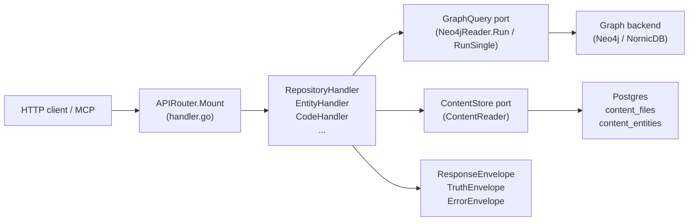
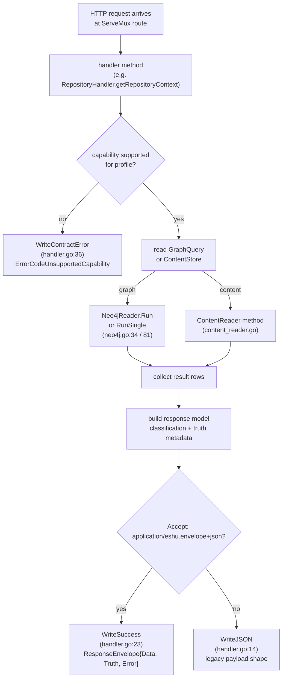

# internal/query

## Purpose

`internal/query` owns the HTTP read surface, OpenAPI assembly, response envelope
contract, and read models backing the public Eshu API. It defines the
`GraphQuery` and `ContentStore` ports through which handlers access the graph
and Postgres content store, and enforces the capability matrix for each runtime
profile.

Core read-surface invariants:
- Entity resolution anchors on indexed `Repository.id`, canonical `uid`, or
  bounded `ContentReader.EntityNameSearcher` lookups — never unlabeled graph
  scans. Missing canonical content rows return an explicit empty result; short
  global substrings (< 3 Unicode chars) and untyped global lookups fail closed.
- `GET /api/v0/graph/entities` reads fixed facet counts in one round trip via
  concrete label-anchored scalar `CALL` subqueries validated in Go.
- `/api/v0/capabilities` and `/api/v0/surface-inventory` serve embedded static
  catalogs with sensitivity classes, collector contracts, and truth profiles.
- Code-quality routes (`code_quality.dead_code`) return candidate evidence,
  language maturity, exclusions, and provenance-weighted reachability (`unused`
  vs `ambiguous`), never raw Cypher cleanup lists.

## Where this fits in the pipeline

## Internal flow

## Lifecycle / workflow

An HTTP request hits one of the routes registered by `APIRouter.Mount`
(`handler.go:140`). The handler method first checks whether the requested
capability is allowed for the current `QueryProfile` using
`querycontract.CapabilityUnsupported` (`querycontract/http.go:132`), which
the profile does not support the capability, `WriteContractError` returns HTTP
501 with a structured `ErrorEnvelope` carrying `ErrorCodeUnsupportedCapability`,
the capability ID, and the `RequiredProfile`.

For permitted requests, the handler reads data through `GraphQuery` (for graph
traversals) or `ContentStore` (for Postgres content). `Neo4jReader.Run` and
`Neo4jReader.RunSingle` (`neo4j.go:34`, `neo4j.go:81`) open a read-only Neo4j
session, execute a Cypher query, and return `[]map[string]any` rows. Row values
are extracted via `StringVal`, `BoolVal`, `IntVal`, `StringSliceVal`
(`neo4j.go:120`). `ContentReader` methods (`content_reader.go:44`,
`content_reader_entity.go:13`) issue parametrized Postgres queries against
`content_files` and `content_entities`.

Read-model details stay package-local but out of the top-level index:

- [read-models.md](read-models.md) covers entity-map traversal, package
  registry bounds, CI/CD, service catalog, Kubernetes, and observability
  coverage correlations, supply-chain read models, OCI deployment trace
  enrichment, and
  investigation-route read models.
- [dead-code-reachability.md](dead-code-reachability.md) covers dead-code
  language reachability, exactness blockers, candidate paging, hydration,
  observed blockers, and the language-specific suppression contract.
- #5563 (retired evidence record)
  records the authorized owner-ledger page boundary, exact graph hydration,
  upgrade backfill, production variant family, interactive SLO, and
  retained/synthetic evidence for cloud resource browsing. API and MCP startup
  run the backfill before mounting routes. It keyset-pages existing
  `CloudResource.uid` values into `graph_node_owner`, then records a durable
  completion marker so later restarts skip the graph scan.

At the package boundary, all query routes stay anchored, bounded, and explicit
about truth level. Graph reads go through `GraphQuery`, content reads go through
`ContentStore`, and response models keep provenance-only evidence separate from
canonical graph or reducer truth.
Import-dependency investigation uses one connected graph pattern per read.
Module filters anchor the exact module name, resolve bounded repository-file
membership, and reject path collisions before import or call paging. Python
cycles are rebuilt from one ordered edge scan, then directional file and module
filters are applied to the completed cycles so reciprocal edges remain visible.
Internal candidate reads stop at 25,000 rows and return HTTP 422 when the caller
must narrow scope. Package pages are distinct and ordered by repository, module,
and language. The
`query.import_dependency_investigation` span records query type, result count,
truncation, and scan overflow.
Call-graph metrics also use one repository-scoped edge pass. The graph query
anchors both `Function` endpoints by indexed `repo_id` and reads each physical
directed `CALLS` edge in one pass, with a 50,001-edge sentinel. Go then
deduplicates caller/callee pairs by canonical `Function.uid` with a legacy `id`
fallback, computes hub degree or reverse-edge recursion, applies the language
filter, sorts exact ties by canonical identity, builds source and partner entity
handles from that identity, and pages the finished result. Repositories with
more than 50,000 physical `CALLS` edges
fail closed with HTTP 422 and no partial metric rows. This avoids unbounded
materialization and avoids backend-specific multi-clause aggregate and
mutual-edge shapes on this path while preserving self-calls and duplicate-edge
semantics within the exact bound.
Semantic and hybrid search freshness reads require both an identity-scoped
`search_vector_ready` watermark, no active document projection in a non-ready
state, and no pending versioned vector scope for a non-empty ready projection.
A stale watermark from an earlier projection therefore fails closed; keyword
mode does not consult the vector signal.
Repository relationship rows and relationship evidence drilldown normalize
correlation confidence provenance with `confidence_basis`. The value is
`evidence_constant` for a single extractor weight, `evidence_aggregate` for
resolver corroboration, or `assertion_override` for explicit relationship
assertions. Code `CALLS`/`REFERENCES` rows keep using `resolution_method`;
correlation readers compare the numeric `confidence` field only after checking
the basis/method field.
Relationship-story rows expose the same distinction through a uniform
`provenance` block with confidence state, method/source family, reason, truth
state, and derived/heuristic/unsupported flags. The block is built from already
returned row metadata and does not change canonical admission, graph writes, or
the answer-level truth envelope.
SQL-table blast radius uses only writer-backed branches for `READS_FROM`,
`REFERENCES_TABLE`, `WRITES_TO`, `TRIGGERS`, `INDEXES`, `MIGRATES`, and embedded
queries. View reads are followed through at most two `READS_FROM` edges, while
the response keeps `MAPS_TO_TABLE` as an explicit unmaterialized coverage gap.
Pre-change impact reads (`POST /api/v0/impact/pre-change`) are a productized
entrypoint over the existing change-surface investigation contract. They accept
repo-relative changed paths or structured file changes, preserve deleted,
renamed, and copied status, reject absolute and parent-traversal paths, and
return the same bounded code surface, graph impact rows, coverage, truncation,
answer metadata, and AnswerPacket-shaped response instead of creating a parallel
impact model. Optional base/head refs are provenance for caller-derived changed
inputs; refs alone do not trigger server-side diff derivation.
Developer change plan reads (`POST /api/v0/impact/developer-change-plan`) reuse
that normalized evidence path and return a read-only `developer_change_plan.v1`
artifact. The handler maps missing evidence, affected entities, recommended
tests, bounded next calls, action steps, and patch guidance from the pre-change
impact response; it never generates or applies source patches, and it marks the
plan blocked when required evidence is absent or partial.
Repository context relationship queries include reducer-owned
`CORRELATES_DEPLOYABLE_UNIT` graph edges so deployable-unit correlation readback
uses the same confidence, evidence kind, reason, resolved id, and
resolution-source fields as other typed repository relationships.
Admission-decision reads (`GET /api/v0/evidence/admission-decisions`) are the
pre- or side-graph explanation layer for reducer correlation domains. They are
bounded by `domain`, `scope_id`, and `generation_id`, can be narrowed by shared
state or by an anchor such as repository, service, workload, cloud resource,
package, or incident, and expose source handles plus recommended next calls.
They explain why a candidate was admitted, rejected, ambiguous, stale, missing
evidence, permission hidden, unsupported, or unsafe; they do not promote a
candidate to canonical graph truth unless the reducer's canonical write block
shows an admitted write.

Live evidence bundle reads (`GET /api/v0/evidence/bundle`, #4045) compose a
share-safe `evidence_bundle.v1` artifact from the same status providers behind
`GET /api/v0/status/index`, `GET /api/v0/status/pipeline`, and `GET
/api/v0/status/collectors` (`evidence/bundle_live.go`), so `eshu evidence
bundle export --live` and this route describe one running stack through the
same `status.Report` and repository-count query. `EvidenceHandler` only maps
that typed report into an `evidencebundle.LiveSnapshot`; it never re-derives
`internal/evidencebundle`'s redaction or composition rules, calling
`BuildLiveBundle -> Validate -> StampValidation` exactly as the CLI does. The
bundle is stack-wide -- none of the composed data carries a repository or
tenant selector -- so the route carries no `x-scoped-token-support` marker and
is absent from `scopedHTTPRouteSupportsTenantFilter`, the same posture as its
full-report source routes; a scoped-bearer-token caller is always rejected
by `AuthMiddleware` before the handler runs. A browser-session caller's
admission is policy-dependent, not a flat reject: off the allowlist, as here,
`browserSessionRouteDenialReason` admits only a tenant-bound all-scopes
session under `BrowserSessionRoutePolicy.AllowTenantBoundAllScopes`, which
`cmd/api` sets for the default, `local_no_policy`, and `hosted_single_tenant`
modes, and rejects a restricted-scope session. On the allowlist it splits by
`scopedRouteClass` (#6450): an all-scope session still needs that policy
unless the route needs no caller grant.

Version resolution selects the strongest eligible concrete claim in deployment-truth
order: runtime-observed evidence, CI-declared provenance, then config evidence.
The unshipped declared-ref tier contributes no claim. A CI-declared digest that
contradicts the finding's subject digest remains corroboration and cannot win.
Same-axis claims are labeled `agrees` or `disagrees`; digest, image-reference,
and package-version claims on different axes are `not_comparable`.
The cloud-runtime owner-ledger read bounds rows per requested digest via a
`CROSS JOIN LATERAL` index scan (200-row page budget, floor 10 per digest) with
active-generation and caller-grant filters inside the lateral so stale or
unauthorized rows do not starve visible digests.

Documentation findings, evidence packets, and semantic-evidence rows surface an
optional bounded `source_acl_state` (`allowed`, `denied`, `partial`, `missing`,
`stale`) kept separate from freshness and binary permission decisions.
`source_acl_disclosure.go` (`applySourceACLDisclosure`) enforces fail-closed
allowlist redaction: `denied` strips protected content (returning `403` on
single-packet reads), `partial` withholds content, `stale` and `missing` remain
explicit, and truth labels are never collapsed into access markers.

Component extension reads (`GET /api/v0/component-extensions*`) read
`component.Registry.Readback` when `ESHU_COMPONENT_HOME` is configured (or
return unavailable) without exposing local manifest paths. CODEOWNERS ownership
reads use one indexed initial-page query and three mutually exclusive cursor
queries merged in Go to avoid pinned NornicDB mixed-`OR` empty-page bugs.

## Exported surface

The package exports four groups of contracts:

- Ports and adapters: root aliases for querycontract's `GraphQuery` and
  `ContentStore`, plus `Neo4jReader`, `ContentReader`, metrics sources, and
  route-specific stores such as
  supply-chain readiness, advisory evidence, IaC reachability, freshness, and
  metrics time-series ports.
- Handler structs: `APIRouter` plus route owners including repository, entity,
  code, content, component-extension, infrastructure, IaC, impact, evidence,
  documentation, semantic-evidence, supply-chain, incident, work-item,
  codeowners-ownership, freshness, status, metrics, compare, and admin
  handlers.
- Response contracts: root aliases for querycontract's `ResponseEnvelope`,
  `TruthEnvelope`, `ErrorEnvelope`, `AnswerPacket`, query playbooks,
  investigation workflows, visualization
  packets, and the typed constants that describe truth level, freshness,
  profile, backend, and errors.
- Helpers: compatibility wrappers over querycontract's response writers,
  JSON/path/query parsers and truth-envelope builder, plus bearer-token
  middleware, OpenAPI assembly, and graph row extraction helpers.

See `doc.go` for the godoc contract, `read-models.md` for route-specific
read-model bounds, and public reference docs for long-lived API/MCP wire
contracts. Keep detailed route evidence near the owning implementation or
scoped `AGENTS.md` entry instead of expanding this index.

## Dependencies

- `internal/query/querycontract` — dependency-neutral profiles, envelopes,
  capability registry, HTTP helpers, ports, and port model types
- `internal/buildinfo` — `AppVersion()` embedded in the OpenAPI spec
- `internal/contentrefs` — content reference utilities used in content query paths
- `internal/correlation/cloudinventory` — `ResolveProviderIdentity`, used by
  `awsCloudRuntimeDriftRowToNeutral` (`cloud_runtime_drift_aggregate.go`) to
  compute the same canonical `cloud_resource_uid` keyspace for an AWS-origin
  finding merged onto the provider-neutral runtime drift surface that GCP/Azure
  findings already carry (#5759 follow-up)
- `internal/iacreachability` — IaC reachability row types consumed by
  `PostgresIaCReachabilityStore`
- `internal/parser` — entity and language classification constants used for
  dead-code root detection
- `internal/recovery` — `RecoveryService` port satisfied by `recovery.Handler`;
  wired into `AdminHandler.Recovery`
- `internal/status` — `status.Reader` consumed by `StatusHandler.StatusReader`
- `internal/storage/postgres` — status, recovery, IaC reachability, AWS
  runtime drift finding, and multi-cloud/AWS aggregate runtime drift finding
  (`MultiCloudRuntimeDriftFindingStore.ListActiveFindingsAcrossProviders`,
  #5759 follow-up) adapters; query handlers never import concrete Postgres
  drivers directly — they go through query package adapters and ports
- `internal/telemetry` — `EventAttr`, `DefaultServiceNamespace`, span constants
  `SpanQueryRelationshipEvidence`, `SpanQueryDeadIaC`,
  `SpanQueryIaCUnmanagedResources`, `SpanQueryIaCTerraformImportPlan`, `SpanQueryInfraResourceSearch`, `SpanQueryCodeTopicInvestigation`,
  `SpanQueryHardcodedSecretInvestigation`, `SpanQueryDeadCodeInvestigation`,
  `SpanQueryChangeSurfaceInvestigation`, `SpanQueryWorkItemEvidence`

Handlers depend on the `GraphQuery` and `ContentStore` ports, not on
`neo4jdriver.DriverWithContext` or `*sql.DB` directly. `Neo4jReader` and
`ContentReader` are wired in `cmd/eshu-local-api/wiring.go`.

### Runtime status projections

Status routes (`/api/v0/status/{semantic-extraction,answer-narration,governance,ingesters,collectors,operations,hosted-readiness,collector-readiness}`)
project redacted, low-cardinality operational state without exposing raw policy
JSON, credentials, prompts, or local paths. Shared-token operators see full
instance detail; scoped-token callers receive aggregate or grant-filtered views
(`completeness_state=scoped_live_activity_only` on `/status/operations`).

## Telemetry

- Spans: `neo4j.query` and `postgres.query` wrap every graph and content read;
  domain handlers wrap multi-stage paths with `telemetry.SpanQuery*` constants
  (relationship evidence, citation packet, documentation findings/packets,
  semantic evidence, code topic/secrets/dead-code/change-surface/resource
  investigations, IaC management/import-plan, AWS runtime drift, supply-chain
  impact, infra search, work-item evidence).
- Metrics: `eshu_dp_neo4j_query_duration_seconds` and
  `eshu_dp_postgres_query_duration_seconds` (`internal/telemetry/instruments.go`).
- Graph-read policy: every `Neo4jReader` call shares one 10-second budget and
  at most one fresh-session retry for typed connectivity errors (see
  [graph-read-deadlines.md](graph-read-deadlines.md)).
- Log events: `repository_query.stage_*` and `service_query.stage_*` record
  `operation`, `stage`, `repo_id`, and `duration_seconds`.
- `answer_metadata` companions on story/investigation payloads are pure
  response shaping over already-built payloads (zero extra DB/graph reads).

## Operational notes

- High latency on `GET /api/v0/repositories/{repo_id}/context` or story routes:
  check the `repository_query.stage_completed` log events for the slow stage
  (`graph_lookup`, `content_hydration`, etc.) before assuming the graph backend
  is the problem.
- `eshu_dp_neo4j_query_duration_seconds` rising across many routes: check graph
  backend health and query plan; do not raise handler timeouts before confirming
  the Cypher query itself is the bottleneck.
- 501 responses with `error.code=unsupported_capability`: the requested
  operation requires a higher `QueryProfile`. Code-only graph capabilities and
  platform-impact queries start at `local_authoritative`; `local_full_stack`
  uses the same handlers with the Compose runtime shape. Check
  `truth.profiles.required` in the response envelope for the minimum profile,
  then verify the ESHU_QUERY_PROFILE env var in the running API.
- `/api/v0/code/complexity` treats `entity_id` as the exact selector. A
  duplicate `function_name` returns `409` with `error.code=ambiguous` and
  bounded `error.details.candidates`; clients should retry with one returned
  `entity_id` rather than accepting the first name match.
- `/api/v0/code/relationships` returns `target_resolution.status=ambiguous`
  with bounded entity candidates when a repo-scoped name matches multiple
  non-test entities. It does not query the graph or fall back to a first match
  until the caller supplies an exact `entity_id`.
- `OpenAPISpec()` panics at startup if a handler calls `BuildTruthEnvelope` with
  a capability string missing from `querycontract/capability.go`'s registry.
  Register missing capability IDs from `go/internal/query/contract/` first.
- `code_quality.dead_code` is a derived query unless the language maturity row
  says otherwise. It scans bounded label-scoped pages under a shared 2,500-row
  window (reporting `display_truncated` separately from
  `candidate_scan_truncated`) and keeps `classification`,
  `dead_code_language_maturity`, and language root exclusions aligned with
  [dead-code-reachability.md](dead-code-reachability.md).
- Ready-state hardcoded-secret reads scan `content_file_secret_lines`
  (migration 138) by primary key before `LIMIT`/`OFFSET`, falling back to
  `content_files` only until ready. Keep SQL suppression in lockstep with
  `hardcoded_secret_migration_binding_test.go`.
- Content reads return `source_backend=unavailable` when Postgres has no cached
  row for a scope.
- Auth & sessions: `AuthMiddleware` (`auth.go`) only skips auth when the token
  is empty (dev mode) or `publicHTTPRoute` matches; RFC 9728 OAuth discovery
  (`auth_oauth_discovery.go`) augments `401` only for unrecognized/missing
  credentials; browser sessions (`auth/session/cookies.go`) hash cookie/CSRF
  secrets, require `X-Eshu-CSRF` on unsafe writes, use `__Host-` names when
  `Secure=true` (`ESHU_AUTH_COOKIE_SECURE=auto` relaxes only loopback HTTP),
  and SAML/OIDC/GitHub callbacks all record `identity_authentication`
  governance audit events.
- `RequestMetricsMiddleware` (`metrics/request.go`) records
  `eshu_dp_api_request_duration_seconds` and `eshu_dp_api_request_errors_total`
  keyed by matched route pattern and `status_class` on API and MCP routers.

## Extension points

- `GraphQuery` — implement this interface to add a new graph adapter; no handler
  code branches on the backend brand.
- `ContentStore` — implement this interface to swap the Postgres content reader
  for a different backing store.
- `IaCReachabilityStore` — implement this interface for custom IaC reachability
  sources; `PostgresIaCReachabilityStore` is the only shipped implementation.
- `AdminStore` — implement this interface to redirect admin queue operations to
  a different storage layer.
- OpenAPI fragments — add an exported string constant under
  `openapi/paths/<family>/` and reference it in `openapi.Spec()`; that order is
  the served JSON path order. Shared fragments go in `openapi/schema/`.

Do not add `if graphBackend == "nornicdb"` branches in handler code. Backend
dialect differences belong in `internal/storage/cypher` adapters behind the
`GraphQuery` port.

## Safe replay (admin recovery)

`POST /api/v0/admin/replay` (`admin_replay.go`) is a guarded recovery action.
It requires an explicit `reason` and `idempotency_key`, gates on an admin
(all-scopes) token, refuses unsafe failure classes (`input_invalid`,
`unsafe_payload`, and the manual-review dead-letter triage classes
`projection_bug` and `resource_exhausted` sourced from
`projector.ManualReviewTriageClasses`) unless forced, records an
`admin_recovery_action` governance audit event for every accepted or refused
attempt, and dedupes concurrent or duplicate delivery through the durable
`admin_replay_requests` ledger. The unsafe set is the single source of truth
for both the targeted-class refusal and the broad-selector SQL exclusion, so a
poison `projection_bug` never drains via a scope-wide replay without force.

- Conflict domain: `admin_replay_requests.idempotency_key` (primary key) is the
  serialization point; exactly one concurrent request wins the
  `INSERT ... ON CONFLICT DO NOTHING` claim and runs the replay, while losers
  return the recorded outcome (`duplicate=true`) or a `409`. The underlying
  `fact_work_items` replay UPDATE is row-level idempotent
  (`WHERE status IN ('dead_letter','failed')`), so it never overwrites in-flight
  or pending work.

## Gotchas / invariants

- `BuildTruthEnvelope` panics if `capability` is missing from the registry
  (`querycontract/capability.go`). All capability strings used in handlers must be
  registered from `go/internal/query/contract/` before the handler runs.
- `querycontract.CapabilityUnsupported` returns true when `maxTruthLevel` returns
  `nil` for the current profile; a nil max-truth means the capability is
  explicitly unsupported at that profile level. Every handler that gates on a
  capability calls it directly (`infra.go:195`, `cloud_resources.go:77`).
- `Neo4jReader` opens a new session per query by calling `NewSession` on the
  driver (`neo4j.go:50`); the session is closed in a `defer`. Do not hold
  sessions across multiple queries in the same handler.
- `/api/v0/code/cypher` and MCP `execute_cypher_query` are an escape hatch, not
  a general write surface. The handler gates `graph_query.read_only_cypher`
  before it touches `GraphQuery`, rejects mutation/admin tokens before execution,
  appends a bounded probe `LIMIT`, keeps the 30 second graph context deadline,
  and returns structured envelope errors when callers request envelopes.
- `/api/v0/code/visualize` and MCP `visualize_graph_query` share that read-only
  Cypher safety path: the handler gates `visualization.graph_query`, rejects
  mutations, bounds the query with `boundedReadOnlyCypher`, executes it under the
  same 30 second deadline against `GraphQuery`, then projects the returned graph
  nodes, relationships, and paths into a bounded `VisualizationPacket`
  (`visualization.BuildGraphQueryVisualizationPacket`) instead of returning
  a hardcoded browser URL. Scalar-only results yield an explicit
  unsupported packet.
- `ContentReader` traces each Postgres call with an OTEL span labeled
  `db.sql.table`; queries that scan multiple tables need per-call spans to avoid
  misleading attribution (`content_reader.go:45`).
- `ContentReader.SearchEntityNames` is the only global entity-name read. Its
  explicit scope enum prevents an empty repository grant from becoming an
  all-repository query, and `db.operation=search_entity_names` identifies the
  bounded Postgres call in traces. `/api/v0/code/search` asks this store for
  `limit+1`, returns at most the public 200-row ceiling, and reports exact
  `count` / `limit` / `truncated` page metadata. Repository display names are
  hydrated once for the distinct repository IDs in the bounded page; a
  per-result `LATERAL` scan over `ingestion_scopes` is forbidden.
- `/api/v0/code/language-query` treats `entity_type=variable` as pure
  content-backed (`contentBackedEntityTypes`), not graph-first. The
  canonical-graph skip in the projector's `canonical_builder.go` removes plain
  `Variable` nodes from the graph projection but leaves ALL `Variable` rows —
  plain and semantic — in `content_entities`. Routing `variable` through the
  graph-first path (`graphFirstContentBackedEntityTypes`) is unsafe: a FEW
  semantic `Variable` graph nodes still exist (module attributes, TSX/Elixir
  component-type-assertion variables), and any non-empty graph result there
  short-circuits the content fallback in
  `queryGraphFirstContentByLanguageWithSemanticFilter`, silently omitting the
  plain variables the query is meant to surface. `entity_type=module_attribute`
  keeps the graph-first route since it legitimately wants the semantic graph
  node first.
- Repository-language inventory reads use the Postgres content index through
  `CountRepositoriesByLanguage`, `ReadRepositoriesByLanguage`, and
  `RepositoryLanguageInventory`. The by-language route uses one statement for
  the aggregate and bounded page when `limit > 0`; `limit=0` remains a
  count-only read without per-repository coverage fan-out.
- Repository source browsing reads optional `ListRepositoryRefs` support from
  the content store. `/branches` prefers those source-backed refs, while
  `/tree` and `/content` reject a selected ref that is unknown, unavailable, or
  not equal to the indexed commit instead of falling back silently.
- `queryContentStoreCoverage` uses `ContentReader.RepositoryCoverage` as the
  bounded count source when content rows are available. The graph count in
  `queryRepositoryGraphCoverageStats` is a no-content fallback, so
  `graph_gap_count` and `content_gap_count` stay zero when graph parity was not
  checked.
- `WriteSuccess` branches on `AcceptsEnvelope(r)` at `querycontract/http.go:38`;
  callers that do not send `Accept: application/eshu.envelope+json` receive the
  legacy payload shape. MCP tool dispatch relies on the envelope format; do not
  break this negotiation logic.
- Repository story and stats handlers use `WriteSuccess` so MCP can preserve
  `ResponseEnvelope` truth metadata while plain HTTP clients keep the legacy
  JSON body.
- Component extension inventory and diagnostics read only the configured local
  component registry on explicit API/MCP request.
- The OpenAPI spec is assembled from string fragments in Go source, not from
  runtime reflection. When a handler changes its request or response shape,
  update the matching `openapi/paths/<family>/` fragment in the same PR.

## Related docs

- [read-models.md](read-models.md) for route-specific read-model bounds,
  evidence, and investigation-route contracts.
- [dead-code-reachability.md](dead-code-reachability.md) for dead-code language roots, exactness blockers, and candidate paging rules.
- retired evidence record and dashboard correctness evidence (#5244)
  for issue-specific no-regression, performance, and observability proof.
- `docs/public/reference/http-api.md` for the public HTTP and envelope contract.
- `docs/public/reference/dead-code-reachability-spec.md` for the dead-code
  language maturity contract.
