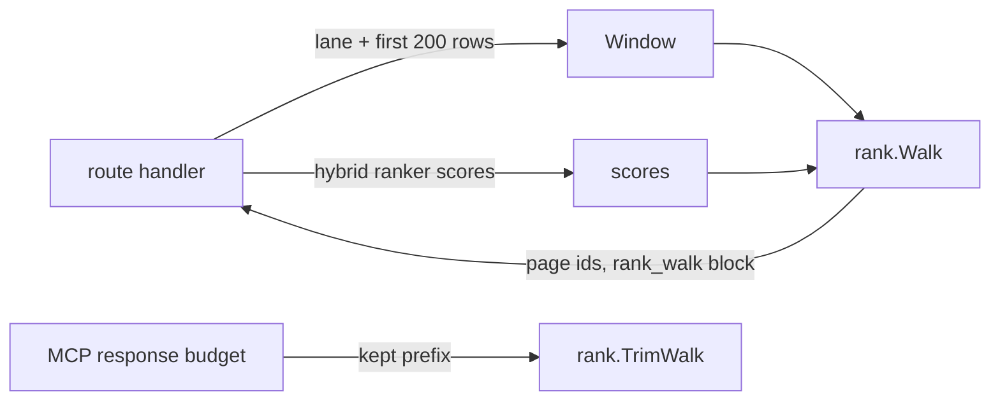

# rank

Stateless relevance walk over a bounded search window for `find_code` and
`search_entity_content` (#7746). Read `doc.go` for the contract.

## Where it sits

The route handlers (`query/codequery`, `query/contentread`) fetch the window
and score it. This package holds no I/O: it orders, checks the cursor, cuts
the page, and mints the next cursor.

## Wire contract

| Field | Where | Meaning |
| --- | --- | --- |
| `rank_cursor` | request | `"start"` opens a walk; any other value must be a `next_cursor`. |
| `rank_walk.lane` | response | `graph` or `content`: the lane page 1 picked. |
| `rank_walk.order` | response | `graph_name`, `hybrid`, or `lexical`. |
| `rank_walk.ranked` | response | True only for `hybrid`. |
| `rank_walk.page_cursor` | response | Cursor this page was served from. |
| `rank_walk.next_cursor` | response | Resumes after this page; absent at the window end. |
| `rank_walk.position` | response | Rows served by the walk through this page. |
| `rank_walk.window_rows` | response | Walkable rows in the window (at most 200). |
| `rank_walk.window_end` | response | This page served the last window row. |
| `rank_walk.lexical_truncated` | response | More matches exist past the window; the walk does not read them. |
| `rank_walk.excluded_rows` | response | Window rows without an id or duplicated, left out of the walk. |

Errors: 400 `rank_cursor_invalid`, 400 `rank_cursor_unsupported`, and 409
`rank_cursor_basis_mismatch` (`basis_changed` or `order_changed`), each with
`details.reason`. `ErrorCodes` and `ErrorReasons` feed the OpenAPI
`RankCursorError` enums.

## Cost

A hybrid walk page does the scoring work of one `limit=200` ranked offset
page, once per page, so a walk at page size L pays it about 200/L times. The
scorer reads full stored bodies, so the cost grows with body size:
`BenchmarkFindCodeRankWalkPage` (`query/codequery`) measured a whole page at
about 18.8 ms and 23.7 MB with 3 KB bodies, and 23.7 ms and 31.6 MB with
4,090-byte bodies, on linux/arm64. The walk work alone, all a `graph_name` or
`lexical` page pays, is about 0.9 ms and 2.5 MB. Bounding the scoring input
is a possible follow-up. See `docs/internal/evidence/7746-rank-cursor.md`.

## Telemetry

`eshu_dp_query_rank_cursor_total{tool,outcome,reason}` and the request-span
attributes `search.rank_cursor.outcome`, `search.rank_cursor.reason`,
`search.rank_cursor.position`, `search.rank_cursor.lane`, and
`search.rank_cursor.order`. The scoring pass also emits the
`query.hybrid_rerank` span with `search.rerank.rows` equal to the window size.
