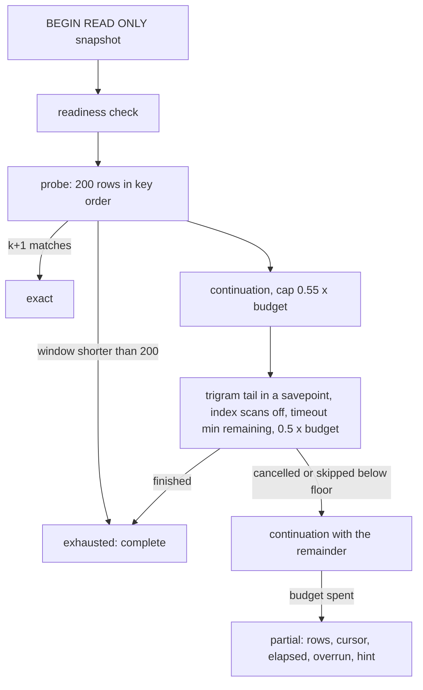

# unscoped

Budgeted file-content and entity-content substring search with no repository
filter (#7730). It replaces the single `ILIKE ... ORDER BY ... LIMIT ...
OFFSET` statement the API and MCP `search_file_content` and
`search_entity_content` tools ran across all repositories, whose cost depended
on a planner row estimate and on the total size of the trigram candidate set.

## Engine and shapes

The walker is one engine over a table shape (#7009). The engine (`walk.go`,
the generic `search` in `searcher.go`, `telemetry.go`) owns the phases, the
savepoints and statement timeouts, the cursor rule, the partial result and the
operator signals. It never names a table; `Searcher.Search` is the file route
and walks the file shape, `Searcher.SearchEntities` is the entity route and
walks the entity shape. A shape (`shape.go`) supplies what differs between
tables: the four bounded statements (step and tail, each from the start and
after a key), the key columns the cursor binds, the row scanner, the span's
`db.sql.table`, `db.operation` and optional `search.content_kind`, its error
and partial-log texts, and its window sizes and phase figures at the default budget (`figures` in
`budget.go`). All four statements of every shape take the same leading
arguments, so the engine binds them without knowing the table.

There are two shapes:

| Shape | File | Key order | Figures |
|---|---|---|---|
| `content_files` | `files.go` | `repo_id, relative_path` | the #7730 figures below |
| `content_entities` | `entities.go` | `repo_id, relative_path, start_line, entity_id` | the same values, copied by #8036, not measured on this table |

A shape needs its own measured figures: the file split does not transfer to
another table's cost structure. PR-B of #7009 replaces the entity figures with
figures measured on `content_entities`. The entity cursor binds `start_line`
saturated to the int32 range of the column.

`TestFileRouteGolden` and `TestEntityRouteGolden` pin each route's observable
output byte for byte (page rows, partial object, every statement text and
argument, the span, the metrics, the partial log line) in
`testdata/file_route.golden.json` and `testdata/entity_route.golden.json`. An
engine change that is meant to change nothing must leave both unchanged.
Rewrite one with `go test ./internal/query/search/unscoped -run
TestFileRouteGolden -args -update-golden` (or `TestEntityRouteGolden`) only
for an intended contract change of that route.

## Flow

The 0.55 cap (440 ms at the default budget) comes from the #7730
continuation shim of 2026-10-11 on the QA environment's corpus: the common
tokens that ended partial at 0.15 have their 11th match within one 289-409 ms
key-ordered window, and the 360 ms left after the cap still pays for the
measured 268 ms zero-match and 300 ms selective tails. Caps from 0.50 to 0.60
keep every modelled class exact that was exact before; 0.65 turns the
selective class partial. `TestPolicyClasses` pins each class.

Window timeouts: the probe's statement timeout is the remaining budget and a
continuation step's is the room left in its phase. One document's recheck
cannot be interrupted, so a fixed timeout under a window's cost only cancels
the window after its work is done, and a resume chain then meets the same
window on every call (a dead end, `progressed: false`). With the room as the
timeout a window completes whenever its phase can pay for it. The dead end
remains only for a window that costs more than the whole budget. A window
whose cost is spread over its rows and exceeds the budget minus the tail's
cost now completes and leaves the tail less room, so a call that was exact in
one call can end partial and resumable; the evidence note has the figures and
`TestSpreadProbeWindowTrade` pins them. On the QA
environment's corpus of 2026-10-11 the two costliest windows measured
0.47-0.52 s (33.2 MB document) and 0.72-0.78 s (54.9 MB document), both under
the 800 ms default.

At the default ratios (cap 0.55, tail cap 0.5) a cancelled tail leaves less
budget than the after-tail continuation's next predicted step, so that phase
issues no statement; it stays in the order for other ratios.

Cursor rules: the cursor is the last visited key; only a completed window
advances it; every statement reads strictly after it; `offset` is served by
reading `offset + limit + 1` matches under the same budget.

## Contract

- `Searcher.SearchEntities` returns `EntityPage` (hits with raw metadata,
  `More`, `Partial`) with the same partial and resume rules; its cursor carries
  all four key parts, because several entities share one file.
- `Searcher.Search` returns `querycontract.FileSearchPage`. `Partial` is set
  when the budget ended the search first; `Files` is then an ordered prefix of
  the exact answer. A client resumes with `Partial.Cursor` and
  `offset = max(0, offset - Partial.RowsMatched)`. `Partial.Progressed` is false when the call
  completed no window: its cursor is the request cursor and resuming repeats the
  request, so the hint then says to scope with repo_id or ask the operator to raise the server budget.
- `overrun_ms` is how far a cancelled statement ran past its own timeout.
  PostgreSQL cannot interrupt the lowercase copy and the TOAST decompression
  of one value, so a single large candidate adds to the wall time. Above
  100 ms the partial reason is `budget_exceeded_on_large_document`.
- A pattern with no three-character alphanumeric run (for example `db_`)
  yields no extractable trigram, so the tail is skipped and the whole budget
  goes to the key-ordered walk; the partial reason is then
  `pattern_has_no_trigram` (unless the large-document reason above applies).
  Measured on the QA environment read replica: the skipped tail would plan a
  parallel sequential scan at 3,930 ms warm against the 400 ms tail cap
  (#8002).
- `ESHU_CONTENT_SEARCH_BUDGET_MS` (100..10000, default 800) sets the budget.
  An invalid value fails startup. Every internal timeout scales with it.

## Telemetry

Span `postgres.query` (`db.operation=search_file_content_any_repo_page`) with
`search.scope`, `search.budget_ms`, `search.elapsed_ms`, `search.overrun_ms`,
`search.probe_rows_visited`, `search.continuation_steps`,
`search.continuation_rows`, `search.tail_ran`, `search.tail_cancelled`,
`search.outcome`, `search.cursor_present`, `search.phase_one_cap_ms`,
`search.ended_in` (`probe`, `continuation`, `tail`, `continuation_after_tail`,
`budget` when the tail was skipped under its floor, or
`tail_skipped_no_trigram` when the pattern yields no trigram),
`search.steps_cancelled`
and `search.progressed`. Counters
`eshu_dp_content_search_unscoped_total{outcome}`,
`eshu_dp_content_search_tail_cancel_total`,
`eshu_dp_content_search_step_cancel_total` (cancelled probe and continuation
windows) and `eshu_dp_content_search_no_progress_total` (partials that did not
advance the cursor); histograms
`eshu_dp_content_search_unscoped_duration_seconds{outcome}` and
`eshu_dp_content_search_unscoped_overrun_seconds`. One `content_search.unscoped_partial`
log line per partial result, with `progressed`, `steps_cancelled` and
`ended_in`. No pattern text is recorded anywhere.

The entity route records the same span attributes plus
`search.content_kind=entity`, with `db.operation=search_entity_content_any_repo_page`
and `db.sql.table=content_entities`, and logs
`content_search.unscoped_entity_partial`. The counters and histograms are
shared with the file route and carry no table label yet; only the span and
the log line tell the routes apart.

## Gotchas

- The tail's plan is not the planner's choice: `enable_indexscan = off` leaves
  the trigram bitmap as the only cheap path. The live plan test pins that.
- SET LOCAL of the statement timeout is made outside the savepoint and tracked;
  `enable_indexscan` is set inside it, so a cancel reverts it.
- All statements use pgx `QueryExecModeExec` so the planner sees bound values.
