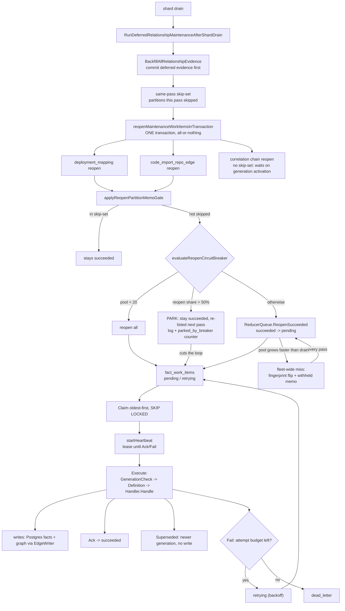

# Reducer Queue, Intent, And Runner Internals

Split from `README.md` (issue #5786). Intent lifecycle, the queue
claim/execute/ack loop, concurrency and phase-coordination detail,
and bootstrap ordering live here; keep the package overview in
`README.md`.

## End-to-end workflow diagram

One picture of how work enters the queue, how the reducer drains it,
and how the periodic maintenance pass reopens finished work for replay.
Every box names the code that runs it, so agents and humans can jump
from the picture to the source. (Refs #10880; storm breaker #11595.)
The Mermaid chart below renders on GitHub; the plain-text version after
it carries the same flow for terminal readers. The canonical standalone
source lives at `docs/diagrams/eshu-reducer-workflow.mmd` — keep the two
in sync when the flow changes.



```text
INGESTER SIDE (periodic maintenance pass, one goroutine per shard drain)
========================================================================

  RunDeferredRelationshipMaintenanceAfterShardDrain
  (deferred_maintenance_barrier.go:121: runs on every shard drain)
        |
        v
  1. BACKFILL: commit deferred evidence first
     BackfillAllRelationshipEvidence
        |
        |  same-pass skip-set: partitions this pass skipped
        |  (issue #4770: in-memory set, never re-derived)
        v
  2. REOPEN: one transaction replays what the new evidence unlocks
     reopenMaintenanceWorkItemsInTransaction
     (ingestion_reopen_deployment_mapping.go:97 — all-or-nothing:
      a mid-pass failure leaves the queue exactly as before)
        |
        +---> deployment_mapping reopen ............. goto 3
        +---> code_import_repo_edge reopen .......... goto 3
        +---> correlation chain reopen
              (container_image_identity, ci_cd_run_correlation,
               supply_chain_impact — NO skip-set: they wait on
               generation activation, not backfill evidence)

  3. PER-DOMAIN GATE (same shape in both relationship reopens)
     applyReopenPartitionMemoGate
     (ingestion_reopen_partition_memo_gate.go)
        |
        +---> partition in same-pass skip-set --> stays 'succeeded'
        |
        +---> partition NOT skipped --> candidate for reopen
                    |
                    v
              +------------------------------------------+
              | CIRCUIT BREAKER (#11595)                 |
              | evaluateReopenCircuitBreaker             |
              | (ingestion_reopen_circuit_breaker.go)    |
              |                                          |
              | pool < 20 candidates: reopen all (tiny   |
              |   pools and one-shots never stall)       |
              |                                          |
              | reopen share > 50% of pool: PARK — rows  |
              |   stay 'succeeded', next pass re-lists   |
              |   them; logs                            |
              |   maintenance_reopen_circuit_breaker_open|
              |   + counter                             |
              |   eshu_dp_maintenance_reopen_parked_     |
              |   by_breaker_total                       |
              |                                          |
              | otherwise: reopen (succeeded -> pending) |
              | via ReducerQueue.ReopenSucceeded         |
              +------------------------------------------+

REDUCER SIDE (drain loop, ESHU_REDUCER_WORKERS goroutines)
=========================================================

  fact_work_items rows in 'pending' / 'retrying'
        |
        v
  CLAIM: oldest-first, SKIP LOCKED so workers never wait on
         each other (reducer_queue_claim_query.go,
         reducer_queue_batch_query.go for the batch path)
        |
        v
  HEARTBEAT: lease renewed until Ack/Fail (service_heartbeat.go:65)
        |
        v
  EXECUTE: GenerationCheck -> Registry.Definition -> Handler.Handle
        |
        +---> writes go to Postgres facts + graph backend
        |     via storage/cypher EdgeWriter
        |
        +---> OK --> ACK --> 'succeeded'
        |
        +---> SUPERSEDED (newer generation active) --> skip, no write
        |
        +---> FAIL --> attempt budget left? --> 'retrying' (backoff)
                     --> budget spent? -------> 'dead_letter'
```

### The storm loop this picture used to hide (fixed by #11595)

```text
  fingerprint flip + withheld memo publication
        |  (redundancy signal collapses fleet-wide)
        v
  every maintenance pass "misses" nearly the whole pool
        |  (QA Nov 27: 64 -> 3 -> 50 -> 442 -> 670 reopen waves,
        |   0 memo writes in 36h so misses never healed)
        v
  whole floor pool reopened: succeeded -> pending
        |
        v
  reducer cannot drain it before the next pass fires
        |
        +---> back to top: next pass reopens everything again
              (queue grows on its own; workers starve on replays)

  THE BREAKER CUTS THIS LOOP AT STEP 3 ABOVE: a pass that would
  reopen more than half of a 20+ pool parks instead of reopening.
  Parked rows lose one pass of delay, nothing is dropped, and the
  alertable log line says which domain tripped.
```

### How to read a stuck queue with this picture

- `pending` climbing while `succeeded` stalls: drain side is behind —
  look at worker count, claim latency, handler timeouts.
- `pending` climbing in waves on pass cadence with a
  `maintenance_reopen_circuit_breaker_open` log line: the breaker is
  parking a collapsed signal — find the fingerprint flip or withheld
  publication, do not add workers.
- Reopens with no breaker line and no memo writes: the memo gate's
  signal path is broken upstream of this picture.

## Intent lifecycle

`Intent` (declared in `intent.go:138`) carries the durable queue contract.
States: `pending` → `claimed` → `running` → `succeeded` / `failed`.

- `IntentStatusPending`, `IntentStatusClaimed`, `IntentStatusRunning`,
  `IntentStatusSucceeded`, `IntentStatusFailed` — `intent.go:65–74`.
- `ResultStatusSucceeded`, `ResultStatusFailed`, `ResultStatusSuperseded` —
  `intent.go:81–87`.
- `ResultStatusSuperseded` short-circuits execution when
  `GenerationCheck` confirms a newer generation is active for the scope.

## Queue claim / execute / ack loop

`Service` (declared in `service.go:69`) coordinates the main loop:

- **Sequential** (`Workers <= 1`): `Claim` → `executeWithTelemetry` →
  `Ack` or `Fail` in order.
- **Concurrent** (`Workers > 1`): N goroutines compete. When `WorkSource`
  implements `BatchWorkSource` and `WorkSink` implements `BatchWorkSink`,
  the batch path reduces Postgres round-trips.
- **Ack retry**: a single-item `Ack` (sequential and per-item concurrent
  paths) and `AckBatch` both retry a Postgres 40P01 or 40001 up to five
  attempts with doubling backoff from 50 ms capped at 2 s
  (`retryTransientAck` in `service_observability.go`). An exhausted budget is
  recorded as `ack_abandoned_to_lease_expiry` and leaves the claim to expire
  for reclaim without ending the run; any other ack error still ends it.
- **Heartbeat**: `startHeartbeat` (`service.go:401`) spawns a goroutine
  that calls `Heartbeat` at `HeartbeatInterval`; the heartbeat is stopped
  before `Ack` or `Fail` to avoid lease extension after the transaction
  commits. A handler that never returns is abandoned at shutdown instead of
  holding its item (see below).

`Service.Run` also starts `SharedProjectionRunner`, `CodeCallProjectionRunner`,
`RepoDependencyProjectionRunner`, and `GraphProjectionPhaseRepairer` as
concurrent goroutines. Any runner error cancels the shared context.

### Handler release: bound expiry and abandonment at shutdown (#10866)

The worker runs `Executor.Execute` in a goroutine (`executeHandler` in
`service_heartbeat.go`) and waits for its return, for shutdown, or — when the
intent's domain has a configured bound (`ESHU_REDUCER_HANDLER_TIMEOUT`,
`ESHU_REDUCER_HANDLER_TIMEOUT_OVERRIDES`) — for the bound to expire. The
bound is enforced in two layers: the execution context derives from it, so a
context-cooperating handler aborts at the next query, and a deadline branch
mirroring the shutdown branch frees the worker for handlers that ignore
cancellation. A handler that returns `context.DeadlineExceeded` is relabeled
to the timeout class only when our own timer fired — never for a downstream
store or query timeout, which keeps its own class.

Either release stops the lease heartbeat and then fails the intent through
the normal `Fail` triage, under a counting retryable class: the item is
retried under the normal attempt budget, never dead-lettered on the spot,
and dead-letters with its class preserved when the budget is spent.
Deterministic race rules: a buffered outcome beats shutdown, and shutdown
beats the bound. The two classes stay separate:
`reducer_handler_abandoned_at_shutdown` for a shutdown release,
`reducer_handler_timeout` for an expired bound (counter
`eshu_dp_reducer_handler_timed_out_total`, bound gauge
`eshu_dp_reducer_handler_timeout_seconds`, alert
`eshu_dp_reducer_batch_worker_execution_age_seconds > on(domain)
eshu_dp_reducer_handler_timeout_seconds`). A cooperative timeout — the
handler returning at the bound — additionally records its duration on
`eshu_dp_reducer_handler_duration_seconds`.

Residual risk: a released handler that later returns may still commit graph
writes after `Fail` released the item. Queue mutations are rejected by the
lease fence (#7142), but graph writes are only safe when the handler writes
idempotently or under a fencing token. The per-domain audit lives in
(#10866); domains without
an audited write path get no shipped bound.

`code_import_repo_edge` audit (#10866 prerequisite for its 2m per-domain
bound, #11082): the handler does one end-of-handler transactional
`UpsertIntents` of deterministic rows after both loads
(`code_import_repo_edge_handler.go` `Handle`, `BuildCodeImportRepoDependencyIntents`
intent IDs are deterministic across builds per
`code_import_repo_edge_test.go`). The shared-intent upsert is
`ON CONFLICT (intent_id) DO UPDATE` last-writer-wins with an advance-only
`completed_at` that never reopens a completed row
(`shared_intents_upsert.go` `upsertSharedIntentBatchSuffix`, pinned by
`TestSharedIntentUpsertCreatedAtLastWriterWinsLive`); the acceptance upsert
is `ON CONFLICT (scope_id, acceptance_unit_id, source_run_id) DO UPDATE`
with an advance-only generation guard that skips stale writes
(`shared_projection_acceptance.go`
`upsertSharedProjectionAcceptanceBatchSuffix`); repo-dependency rows take
`SortedUniqueRepoKeys` locks in a single transaction
(`shared_intent_acceptance_writer.go` `UpsertIntents`); queue mutations after
release are rejected by the lease fence (#7142). A repeat execution therefore
refreshes the same rows in place and never duplicates or reopens them, so an
abandoned attempt that later commits is idempotent and the bound ships. A
canceled attempt cannot leave a burning backend either: context cancel closes
the pgx connection and the backend exits (observed on disposable Postgres 18,
#11082 decision-5 probe).

The #7816 runtime fence is untouched: it still treats a heartbeating producer
row as live, and this step adds no deadline that would change its bound.

## Cross-scope producer completion

`container_image_identity` and `ci_cd_run_correlation` ACKs append one durable
producer-completion event in the same Postgres statement that marks the work
item batch succeeded. `CrossScopeCompletionRunner` leases those events with an
owner plus monotonic claim epoch, coalesces an exact bounded event set, updates
current-generation canonical consumer rows in place, and deletes only the
captured event set in the same transaction. A succeeded consumer returns to
pending; an already claimed or running consumer records
`cross_scope_replay_required` so its ACK must reopen it once. Pending and
retrying rows already guarantee a future execution, and dead-letter rows remain
terminal.

The dependency edges are identity -> CI/CD, identity -> supply-chain impact,
and CI/CD -> supply-chain impact. The direct identity -> supply-chain edge lets
new image truth refresh findings promptly; the later CI/CD completion refreshes
the supply-chain consumer again so an early supply-chain run cannot strand a
partial identity snapshot. Fanout never clones a work item, so retained queue
history cannot multiply the replay workload.

Failures persist as one bounded-backoff queued retry per producer domain,
merged with any event that arrived while the failed lease was live.
Expired leases are reclaimable, but every heartbeat, retry, and fanout is
fenced by the exact event, producer domain, owner, and claim epoch. The generic
queue gauges expose a bounded name such as
`queue=cross_scope_completion.container_image_identity`; a growing depth or
oldest age means convergence is delayed even if the main reducer queue is
otherwise empty. Successful cycle logs include the producer domain, coalesced
producer item count, scheduled consumer count, and fanout duration.

## Repo-dependency acceptance-unit concurrency

`RepoDependencyProjectionRunner` shards work by the source-repository
acceptance-unit identity, not by individual edge rows. The fixed shard mapping
keeps a repository's complete retract-then-rewrite cycle on one worker. That is
the per-repo safety gate: work for the same source repository remains serialized
and ordered, while unrelated repositories assigned to different shards can run
concurrently.

The command runtime exposes this lane through
`ESHU_REPO_DEPENDENCY_PROJECTION_WORKERS`. Only `1`, `2`, and `4` are supported;
the backend-aware default is the remotely proven `4` on NornicDB and the
unscaled `1` on Neo4j. Invalid values fall back to that backend default. Values
`1` and `2` remain explicit NornicDB resource-constrained fallbacks. Each
process derives a distinct lease owner by appending its hostname, PID, and a
boot-unique nonce to the
configured owner prefix. The default `45s` whole-cycle deadline covers the
Postgres repository lock, active-lease validation, graph replacement, intent
completion, and Postgres commit. The `5m` lease must exceed that deadline plus
the canonical graph-write timeout and a `30s` margin. Errors, cycle deadlines,
and ambiguous commits retain the shard lease until expiry and force the same
owner to wait out the quarantine. Cancellation of the runner's own context
(process shutdown) that lands before the acceptance-unit transaction opened
(during the claim, the selection scan, or the empty-cycle exit) is not a
partition fault: nothing has been mutated, so the cycle releases its lease
through a context that survives the cancellation and exits without a
quarantine. Because every owner is process-unique, a lease a stopping process
kept would never be reclaimed by "the same owner"; it would only hold the
partition shut for the next process until the `5m` TTL ran out (#6747). A
shutdown that lands after the gate opened keeps the quarantine: the graph
write or Postgres commit may still be settling, and the TTL is the quiescence
window the safety proof reserves for exactly that. A claim refused because
another owner still holds the partition is logged once per contention
episode. Independent shards continue to run, so this safety
contract does not globally serialize repo-dependency work. Changing the worker
count does not weaken acceptance-unit atomicity and does not inherit the main
reducer's `ESHU_REDUCER_WORKERS` value.

An acceptance unit containing `RUNS_ON` waits for an exact token-scoped
`workload_materialization` phase before any repo-dependency retract, upsert, or
completion. The token hashes the sorted RUNS_ON intent identities and their
current acceptance epochs. A missing token phase durably replays workload
materialization with that token in the queue payload and leaves the entire
repository unit pending; a legacy same-generation phase cannot satisfy it.
Replaying an older active claim sets the existing cross-scope dirty bit without
stealing its lease, so its ACK returns the token-bearing work to pending. The
workload handler publishes the token phase only after graph writes commit.
Unrelated repository shards continue concurrently. A replay that cannot be
scheduled, including conflict with a dead-lettered workload item, fails the
cycle and quarantines its partition lease instead of polling a permanently
closed gate. The readiness block is logged with the acceptance-unit identity
and remains visible through `BlockedReadiness` plus shared-intent queue
age/depth.

## Graph projection phase coordination

`graph_projection_phase_state` is the durable readiness coordination table.
Phases and keyspaces are declared in `internal/reducer/gpphase`, aliased at
the root in `graph_projection_phase.go`.

Key phases:

| Phase constant | Meaning |
| --- | --- |
| `GraphProjectionPhaseCanonicalNodesCommitted` | Projector canonical node writes committed |
| `GraphProjectionPhaseSemanticNodesCommitted` | Semantic entity reducer writes committed |
| `GraphProjectionPhaseDeployableUnitCorrelation` | Deployable-unit correlation pass finished |
| `GraphProjectionPhaseDeploymentMapping` | `deployment_mapping` domain finished one bounded slice |
| `GraphProjectionPhaseWorkloadMaterialization` | `workload_materialization` domain finished |
| `GraphProjectionPhaseCrossSourceAnchorReady` | Reserved for DSL cross-source anchor publication |

`GraphProjectionPhasePublisher` (interface at `graph_projection_phase.go:117`)
is the only write path for phase rows. Use `publishIntentGraphPhase`
(`graph_projection_phase_publish.go`) inside handlers rather than calling the
publisher directly.

Canonical-node materializers publish `GraphProjectionPhaseCanonicalNodesCommitted`
on a per-node-type keyspace so an edge slice can gate on the exact node family it
joins: `GraphProjectionKeyspaceCloudResourceUID` (AWS resource nodes, issue #805)
and `GraphProjectionKeyspaceKubernetesWorkloadUID` (live `KubernetesWorkload`
nodes, issue #388). The durable claim/blockage gate in
`go/internal/storage/postgres` fences each *edge* domain on its node keyspace's
phase; that gate clause is added when the edge domain ships, so this prerequisite
slice publishes the `kubernetes_workload_uid` phase but adds no edge-gate clause.

`GraphProjectionPhaseRepairQueue` (`graph_projection_phase_repair.go:36`) and
`GraphProjectionPhaseRepairer` (`graph_projection_phase_repair_runner.go:58`)
handle the case where a graph write commits but the subsequent phase
publication fails; the repairer retries exact rows durably.

## Code-call materialization

`ExtractCodeCallRows` turns parser `function_calls` and SCIP call facts into
canonical `CALLS` or `REFERENCES` edge intents. Resolution stays evidence
bounded: same-file and parser-proven language metadata win before broader
repository matching, type and reflection references stay `REFERENCES`, and
duplicate facts for the same caller, callee, and reference line collapse before
graph writes.

Keep the detailed resolver ordering, language metadata rules, JavaScript
static-alias cache contract, SCIP bypass, and handler timing log in
[`code-call-materialization.md`](code-call-materialization.md).

No-Regression Evidence: `go test ./internal/reducer/code/call ./internal/reducer/code/call/materialization ./internal/reducer/code/call/shared -run 'TestCodeCallMaterializationHandlerLoadsActiveCrossRepoSymbolDefinitions|TestExtractCodeCallRowsResolvesCrossRepo|TestCodeCallDefinitionSymbolKeysIgnoreGenerationFields' -count=1` failed before the production handler loaded active cross-scope definition facts, then passed after definition rows supplied stable symbol keys and calls matched those keys before repo-unique fallback. `go test ./internal/storage/postgres -run TestFactStoreLoadActiveCodeCallSymbolDefinitionFacts -count=1` proves the Postgres loader is active-generation, non-tombstone, file-kind, symbol-allowlist, and keyset-page bounded. Ambiguous symbol keys with more than one target are deliberately not indexed, preserving the existing unique-or-unresolved rule.

Observability Evidence: the existing `code call materialization completed` log now includes stable symbol key count, active definition fact count, and active symbol-definition load duration beside the existing fact count, repository count, row counts, and load/extract/intent/upsert timings. The change adds no metric instrument, metric label, span, route, runtime knob, queue table, or graph backend branch.

## Shared projection runner

`SharedProjectionRunner` (`shared_projection_runner.go:95`) iterates
shared-projection domains by domain and partition. `CodeCallProjectionRunner`
owns `code_calls` separately because it preserves repo-wide retraction
semantics while processing large accepted units in capped chunks. Edge domains
stay readiness-gated; the local-authoritative code-call drain gate schedules
work only and never changes admitted graph truth.

Keep the runner loop, back-off behavior, `LoadSharedProjectionConfig`
configuration contract, SQL trigger `EXECUTES` reachability rule, and
inheritance/SQL entity-type filters in
[`shared-projection.md`](shared-projection.md).

## Facts-First Bootstrap Ordering

The bootstrap pipeline in `go/cmd/bootstrap-index/main.go` enforces a
multi-pass ordering that the reducer must honor:

```text
Phase 1 — Collection + First-Pass Reduction
  Projector drains and emits canonical nodes. deployment_mapping can remain
  pending because resolved_relationships do not yet exist.

Phase 2 — Backfill
  BackfillAllRelationshipEvidence() (bootstrap-index/main.go:236)
  populates relationship_evidence_facts and publishes readiness rows.

Phase 3 — Deployment Mapping Reopen
  ReopenDeploymentMappingWorkItems() (bootstrap-index/main.go:273)
  reopens deployment_mapping so the reducer can create resolved_relationships.

Phase 4 — Second-Pass Consumers
  Any domain consuming resolved_relationships must have a re-trigger
  mechanism after Phase 3.
```

**Critical rule**: any reducer domain or sub-package that consumes
`resolved_relationships` must have a post-Phase-3 reopen or re-trigger
mechanism. Adding a new consumer without that mechanism creates an E2E-only
bug that is invisible in unit and integration tests.
