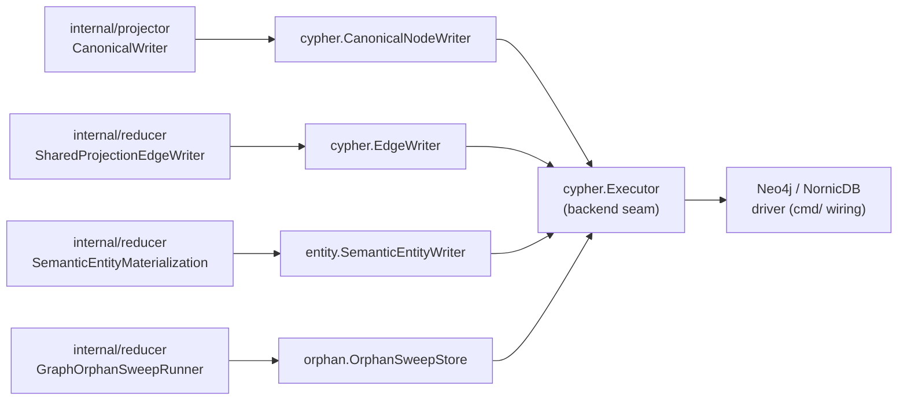
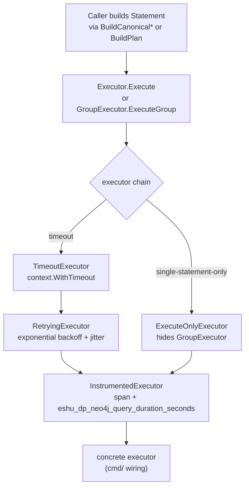

# storage/cypher

`storage/cypher` owns backend-neutral Cypher write contracts, canonical writers,
edge helpers, statement metadata, retry/timeout wrappers, and write instrumentation
for Eshu's canonical graph, including fault-injection restart evidence.
Every write path that touches the graph backend goes through this package.

## Where this fits in the pipeline

## Internal flow

## Lifecycle / workflow

Callers build `Statement` values via statement builder functions
(`BuildCanonicalWorkloadUpsert` and related, `BuildRetractRepoDependencyEdges` and
related, `BuildPlan`) and pass them to a writer
(`CanonicalNodeWriter`, `EdgeWriter`, `entity.SemanticEntityWriter`) or directly to
an `Executor`.

`RetractableNodeEntityLabels()` exposes the canonical retract phase's node label
set (the union of the per-domain retract sets) as a stable, sorted slice. It is
the lockstep source the replay depth-coverage gate (C-13, #4366) mirrors so every
retractable node type is required to have a delta/tombstone replay scenario;
adding a label to a retract set makes that gate demand a new scenario for it.

`node.RetractInfraEntityLabels` retains `CrossplaneClaim` even though
no writer has emitted that label since #5347 (a Crossplane Claim is edge-only:
it stays a `K8sResource` node, and the `SATISFIED_BY` edge to its
`CrossplaneXRD` is the classification). The entry is a legacy-node reaper, not
dead code: a graph provisioned before #5347 can still hold nodes carrying the
literal `CrossplaneClaim` label, and only this retract entry's `DETACH DELETE`
sweeps them once a full reconciliation generation re-projects the Claim as a
`K8sResource` node plus a `SATISFIED_BY` edge. Dropping the entry would orphan
those legacy nodes forever for a deployment that upgrades straight from a
pre-#5347 binary to a post-#5478 one with no intervening release that still
retracted the label. Issue #5478 removed the label from every registry that
only affects live query classification (infra category/family lookups,
resource-investigation label fanout, repository infrastructure listings, the
collector/content-shape/projector bucket-to-label projection tables, and the
`claim_unique`/uid/fulltext graph schema entries stay untouched pending a
future change once no legacy nodes remain) but kept it in this retract
registry and its lockstep specs (`specs/replay-depth-requirements.v1.yaml`,
`specs/replay-coverage-manifest.v1.yaml`) for exactly this reason.

`OrphanSweepStore` cleans disconnected nodes across the closed label set
(`Repository`, `Platform`, `EvidenceArtifact`, `File`, `Directory`, `Module`)
without relationship-existence predicates (`NOT (n)--()` / `COUNT { (n)--() } = 0`
mis-evaluate on pinned NornicDB). It computes `orphans = candidates - connected`
in Go from two bounded reads per label: S1 (`BuildCandidateOrphanNodesQuery`,
cursor-paged by identity key, excluding `Repository` nodes owned by
`projector/canonical` and requiring `uid IS NULL` on `Module`) and S2
(`BuildConnectedKeysQuery`, 500-key chunked concrete-relationship `MATCH`).
Key-anchored writes then clear reconnected markers, mark new orphans, and
re-verify connectivity (TOCTOU guard) before deleting TTL-aged orphans.

`CanonicalNodeWriter.Write` executes canonical writes in ordered phases
(`retract`, `repository_cleanup`, `repository`, `directories`, `files`,
`entities`, `entity_retract`, `entity_containment`, `terraform_state`,
`oci_registry`, `package_registry_*`, `modules`, `structural_edges`, and
deferred `package_registry_*_edges` after commit). `repository_cleanup` only
retires a different-id `Repository` at the same path and reports dropped edges
via `eshu_dp_canonical_repository_retired_relationships_total` and
`RetiredRepositoryObserver`. Delta materializations skip `repository_cleanup`
and negative full cleanup, removing deleted files via `IN $file_paths` chunks
and leaf-first empty-directory pruning.

Domain-specific canonical and edge write contracts:
- **Code & inheritance edges**: `EdgeWriter` writes `CALLS`, `REFERENCES`,
  `USES_METACLASS`, and `INHERITS`/`OVERRIDES`/`ALIASES`/`IMPLEMENTS` using
  whitelisted label-anchored endpoints (`Function`, `Class`, `File`, `Interface`,
  `Struct`, `TypeAlias`) and label+`repo_id`/`path` retract seeds.
- **SQL & shell edges**: `DomainSQLRelationships` writes `QUERIES_TABLE`,
  `TRIGGERS`, `EXECUTES`, `INDEXES`, `REFERENCES_TABLE`, `WRITES_TO`, and
  `MIGRATES` (auto-commit on NornicDB via `SQLRelationshipSequentialWrites`);
  `DomainShellExec` writes `EXECUTES_SHELL` metadata without raw arguments/env.
- **Repo dependencies**: retracts run repository-edge, `RUNS_ON`, and
  evidence-artifact cleanup sequentially (`projection/code-imports` omits
  impossible `RUNS_ON` retracts).
- **Terraform state**: writes `TerraformResource`, `TerraformModule`, and
  `TerraformOutput` nodes keyed by `uid` with allowlisted `tf_attr_*` scalar
  properties (`canonical/terraform/attribute_promotion.go`).
- **OCI registry**: writes digest-addressed `ContainerImage`/`Index`/`Descriptor`
  and `ContainerImageTagObservation` nodes (`first_observed_at` written via
  `ON CREATE SET` so it stays set-once without self-reference).
- **Package registry**: writes `Package`, `PackageVersion`, `PackageDependency`,
  `PackageArtifact`, and `RegistryEvent` nodes serialized per sorted package UID
  with deferred `HAS_VERSION`/`HAS_ARTIFACT`/`HAS_REGISTRY_EVENT` edges.
- **Workload, incident, and secrets/IAM writers**: `DomainRunsIn` binds
  entrypoint functions to workloads via `Repository.id` anchor with conservative
  ambiguity; `IncidentRoutingEvidenceWriter` and `SecretsIAMGraphWriter`
  (default-off behind `ESHU_REDUCER_SECRETS_IAM_GRAPH_PROJECTION_ENABLED`) use
  batched `UNWIND` `MERGE`/`MATCH` templates with zero dynamic Cypher tokens.

The executor chain in `cmd/` wraps concrete drivers with
`TimeoutExecutor` -> `RetryingExecutor` -> `InstrumentedExecutor`.
`RetryingExecutor` retries typed transient driver errors, NornicDB MERGE unique
conflicts, and replay-safe relationship snapshot conflicts with exponential
backoff, leaving `CommitFailedDeadError` (unknown commit outcome) to durable
queue replay.

## Exported surface

See `doc.go` for the full godoc contract. Key exported groups:

- **Executors and middleware**: `Executor`, `GroupExecutor`, `PhaseGroupExecutor`,
  `TimeoutExecutor`, `RetryingExecutor`, `InstrumentedExecutor`, `ExecuteOnlyExecutor`.
- **Canonical node and edge writers**: `CanonicalNodeWriter`, `EdgeWriter`,
  `entity.SemanticEntityWriter`, `orphan.OrphanSweepStore`,
  `CloudResourceEdgeWriter`, `WorkloadNodeWriter`, `WorkloadCloudRelationshipWriter`,
  `IncidentRoutingEvidenceWriter`, `SecretsIAMGraphWriter`.
- **Statement builders & registries**: `BuildCanonical*`, `BuildRetract*`,
  `BuildPlan`, `RetractableNodeEntityLabels`, `SanitizeStatement*` (`phase/group/sanitize.go`),
  and materialized-edge registries (`CodeCallMaterializedEdgeTypes`,
  `inheritance.MaterializedEdgeTypes`, `RepoDependencyMaterializedEdgeTypes`,
  `SingleTypeMaterializedEdgeTypes`, `MaterializedEdgeEndpointLabels`,
  `MaterializedEdgeIdentityProperties`).
- **Errors**: `GraphWriteTimeoutError` and `WrapRetryableNeo4jError`.

## Dependencies

- `internal/graph` — `graph.Materialization`, `graph.Record`, `graph.Result`
  for source-local plan building
- `internal/projector` — `projector.CanonicalMaterialization` and row types
  consumed by `CanonicalNodeWriter`
- `internal/reducer` / `internal/reducer/contract` — `reducercontract.Domain` constants — and
  `internal/reducer/sharedintent` — `sharedintent.Row` consumed by `EdgeWriter`
- `internal/telemetry` — `telemetry.Instruments`, span and attribute helpers

Concrete Neo4j/NornicDB driver adapters live in `cmd/` wiring packages, not in
this package. This package owns the backend-neutral writer contracts; `cmd/`
owns the wiring. NornicDB owns the promoted runtime path. Any additional
Cypher/Bolt backend must run these shared statements or use a small, documented
adapter seam.

## Telemetry

- `eshu_dp_neo4j_query_duration_seconds` — histogram per statement;
  `operation=write`, `operation=write_group`, or `operation=probe` (the #5998
  guard's bounded existence read, recorded in `InstrumentedExecutor.ExecuteProbe`)
- `eshu_dp_neo4j_batch_size` — batch row count per `UNWIND` statement; grouped
  Neo4j/Bolt execution records one point per statement with bounded
  `operation`, `write_phase`, and `node_type` labels when metadata is present
- `eshu_dp_neo4j_batches_executed_total` — counter labeled by `operation` plus
  bounded statement metadata when available
- `eshu_dp_neo4j_deadlock_retries_total` — legacy counter in
  `RetryingExecutor` labeled by `write_phase` and bounded `reason`; counts
  transient graph-write retries, including deadlocks, lock timeouts, retryable
  driver connectivity errors, retryable NornicDB commit conflicts, and the Neo4j parser interval race (`reason=neo4j_parser_interval_race`, #8190)
- `eshu_dp_canonical_atomic_writes_total` / `eshu_dp_canonical_atomic_fallbacks_total`
  — whether `CanonicalNodeWriter` used the group or sequential path
- `eshu_dp_canonical_phase_duration_seconds` — labeled by phase name
- `eshu_dp_canonical_projection_duration_seconds` / `eshu_dp_canonical_retract_duration_seconds`
  — canonical write and retract totals
- `eshu_dp_shared_edge_write_groups_total` / `eshu_dp_shared_edge_write_group_duration_seconds`
  / `eshu_dp_shared_edge_write_group_statement_count` — edge writer group metrics
- `eshu_dp_shared_edge_runs_on_retract_omissions_total` — impossible `RUNS_ON`
  retracts omitted by bounded source-capability reason and projection domain
- `eshu_dp_code_call_edge_batches_total` / `eshu_dp_code_call_edge_batch_duration_seconds`
  — code-call-specific edge metrics
- `eshu_dp_graph_orphan_nodes` — reducer-registered observable gauge labeled
  by closed `node_label` values for bounded zero-relationship node counts
- Spans: `neo4j.execute` and `neo4j.execute_group` from `InstrumentedExecutor`

## Operational notes

- Manual Neo4j or NornicDB production-profile performance runs must apply
  `eshu-bootstrap-data-plane` before indexing. `eshu-bootstrap-index` applies the
  Postgres bootstrap schema, but it does not apply graph indexes or constraints;
  runs that skip the data-plane schema step are setup diagnostics, not backend
  acceptance evidence.
- `eshu_dp_neo4j_deadlock_retries_total` rising signals transient graph-write
  retry pressure. Check structured retry logs first: deadlocks or NornicDB
  unique conflicts usually point at concurrent MERGE contention on shared nodes
  (Repository, Directory, Module), while driver `ConnectivityError` points at
  backend reachability, pool pressure, restart, or network churn. Check worker
  concurrency before raising `RetryingExecutor.MaxRetries`. `reason=neo4j_parser_interval_race` is not contention: it is the false ``Variable `U` not defined`` SyntaxError from an ANTLR data race in the pinned Neo4j image on weakly ordered CPUs (antlr/antlr4#4901). It retries regardless of statement shape (parse-time, inside one transaction), and after the budget the original SyntaxError surfaces terminal, so a real undefined one-character variable costs at most `MaxRetries` retries; see #8190 (retired evidence record).
- `eshu_dp_canonical_atomic_fallbacks_total` > 0 means the executor does not
  implement `GroupExecutor`; write ordering relies on sequential phase execution
  which is slower and non-atomic.
- `eshu_dp_canonical_phase_duration_seconds{phase="retract"}` elevated for
  non-first generations indicates stale node volume or an unselective cleanup
  shape; source-local entity retractions and containment refreshes must stay
  anchored on concrete labels (`Function`, `Class`, `K8sResource`, etc.) so
  graph backends can use the schema indexes instead of scanning all canonical
  nodes.
- Repository-scoped cleanup runs only when the materialization carries a
  repository id. Non-repository collectors such as OCI registry and package
  registry write their own canonical nodes and must not issue `File`,
  `Directory`, or repo-bound entity cleanup against a populated graph.
- `GraphWriteTimeoutError` surfaces as `failure_class=graph_write_timeout` in
  projector/reducer queue rows; the `TimeoutHint` field names the env var to
  tune.

### AWS relationship edge writer (issue #805 PR 2)

`CloudResourceEdgeWriter` projects resolved `aws_relationship` facts into
relationship-type-specific
`(:CloudResource)-[:AWS_<raw relationship_type>]->(:CloudResource)` edges while
keeping the original `relationship_type` property for readback. Both endpoints
anchor on the `CloudResource.uid` uniqueness constraint (the separate lookup index
PR 1 added retired in #11535; the constraint's 1.5.x backing index serves it), so
the two `MATCH`es are schema-backed lookups, not label scans; the logical identity remains
`(source, relationship_type, target)`, including case. Full design and decision
record: `docs/internal/aws-relationship-edge-materialization-design.md`
§5–§11.

### Kubernetes live-workload node writer (issue #388)

`WorkloadNodeWriter` (`go/internal/storage/cypher/kubernetes`) materializes `kubernetes_live.pod_template` facts
into canonical `KubernetesWorkload` nodes for the live-workload materialization
reducer domain. The write is a batched `UNWIND $rows AS row` +
`MERGE (w:KubernetesWorkload {uid: row.uid})` on the collector-emitted
`object_id` only, with mutable properties `SET` separately, so duplicate facts
and reducer retries converge on one node rather than fabricating or duplicating
graph state. The node `uid` is the live object identity (`object_id`); the raw
Kubernetes `metadata.uid` is carried as the `workload_uid` property only, never
the node identity. The MERGE anchors on the `kubernetes_workload_uid_unique`
constraint (the separate lookup index retired in #11535; the constraint's 1.5.x
backing index serves the lookup), so the upsert is a schema-backed uid lookup,
not a label scan. The #388 edge slice (PR3) resolves its workload endpoint
against these nodes exactly as the AWS relationship edge resolves against
`CloudResource` nodes. Design and decision record:
#388.

## Extension points

- `Executor` — implement this interface for any new graph backend; no changes
  to writers or callers are needed
- `GroupExecutor` / `PhaseGroupExecutor` — optional extensions; writers detect
  them at runtime and prefer the grouped path
- `CanonicalNodeWriter` builder options — `WithFileBatchSize`,
  `WithEntityBatchSize`, `WithEntityLabelBatchSize`,
  `WithEntityContainmentInEntityUpsert`,
  `WithBatchedEntityContainmentInEntityUpsert` — tune per-backend without
  branching callers
- New statement builders — add a `BuildCanonicalWorkloadUpsert`-style function
  or a `BuildRetractRepoDependencyEdges`-style function for each new canonical
  domain node or edge type; no writer changes needed

## Gotchas / invariants

- All writes must be idempotent (`doc.go`). `MERGE`-based Cypher and
  `ON CONFLICT DO NOTHING` patterns enforce this; do not replace MERGE with
  CREATE.
- `OperationCanonicalUpsert` is for canonical domain nodes (workloads, files,
  entities). `OperationUpsertNode` / `OperationDeleteNode` are for
  source-local `SourceLocalRecord` writes. Do not mix them.
- `CanonicalNodeWriter` phase order is strict: parent nodes (Repository,
  Directory) must exist before child nodes (File, Entity) because later phases
  use MATCH on these nodes. Identity cleanup phases run immediately before the
  corresponding MERGE phase, and `directories` are sorted by `Depth` ascending
  (`canonical_node_writer_phases.go`).
- OCI registry writes must keep `MERGE` anchored on concrete labels plus `uid`.
  Tags are mutable observations; do not use `tag` or `source_tag` as the
  manifest/index identity key. OCI labels participate in the stale-entity
  retract family, and `canonicalNodeRetractEntityLabels` includes that family in
  the generated cleanup list. OCI registry repository truth is derived from the
  `repository_id` property on digest, descriptor, index, tag-observation, and
  referrer nodes. Do not reintroduce `PUBLISHES_*` or `OBSERVED_*`
  relationships in the canonical writer without same-corpus performance proof
  that the relationship writer no longer dominates `phase=oci_registry`.
- Package-registry writes must keep `MERGE` anchored on `uid` for `Package`,
  `PackageVersion`, and `PackageDependency` labels. Do not add `Repository`
  matches or ownership edges to `package/registry/canonical_writer.go`; source
  hints need reducer admission first.
- Orphan sweep statements must stay on the closed label set and must never
  contain a relationship-existence predicate (`NOT (n)--()`, `(n)--()`, or
  `COUNT { (n)--() } = 0` are all mis-evaluated on the pinned NornicDB
  backends -- see `docs/public/reference/nornicdb-pitfalls.md`). Orphan status
  must be computed as a Go-side anti-join between a label+evidence_source scan
  (S1) and a concrete-relationship-variable MATCH anchored on caller-supplied
  identity keys (S2); the clear/mark/sweep writes must stay key-anchored
  (`UNWIND $keys AS candidate_key MATCH (n:Label {key: candidate_key}) ...`)
  and keep the TTL marker before deletion. Do not replace the sweep with
  `DETACH DELETE`, dynamic labels, an unlabelled graph scan, or any relationship
  pattern-existence predicate; dangling relationships are owned by the
  relationship retractors, not this cleanup runner. Immediately before the
  sweep delete, re-verify connectivity for exactly the keys about to be
  deleted (TOCTOU guard) rather than trusting the top-of-cycle read.

- Repository-root `File` rows are the exception to the Directory parent rule:
  they must attach directly to `Repository` through `REPO_CONTAINS` because
  `buildDirectoryChain` intentionally does not create a synthetic Directory for
  the repository root.
- Canonical entity containment refreshes prune stale `CONTAINS` edges from
  current `Class` and `Function` parents. Keep those cleanup statements
  label-anchored on `uid`; unlabelled UID anchors are portable Cypher but can
  miss the NornicDB and Neo4j hot path for this package's schema.
- Code reference writes must allow type targets (`Struct`, `Interface`,
  `TypeAlias`) as well as callable targets. Do not route Go composite-literal
  or TypeScript type references through `CALLS`; dead-code queries depend on
  incoming `REFERENCES` to model type usage without inventing invocation truth.
- Code-call endpoint labels are whitelist values, not caller-controlled Cypher.
  `EdgeWriter` accepts exact `Function`, `Class`, `File`, `Interface`,
  `Struct`, and `TypeAlias` labels for code relationship endpoints. This keeps
  Java, Go, Python, and TypeScript rows on NornicDB's bounded label-plus-`uid`
  lookup path instead of the broader label-family fallback. Unknown or missing
  labels still fall back to the older query shape for legacy rows.
- SQL relationship endpoint labels are also whitelist values. `EdgeWriter`
  routes `Function` to `SqlTable` with `QUERIES_TABLE`, `SqlTrigger` to
  `SqlTable` with `TRIGGERS`, `SqlTrigger` to `SqlFunction` with `EXECUTES`,
  `SqlIndex` to `SqlTable` with `INDEXES`,
  `SqlMigration` to `SqlTable`/`SqlView`/`SqlFunction`/`SqlTrigger`/`SqlIndex`
  with `MIGRATES` (#5346),
  `SqlFunction`/`SqlView` to `SqlTable`/`SqlView` with `READS_FROM`,
  `SqlFunction` to `SqlTable` with `WRITES_TO`, and `SqlTable` to `SqlTable`
  with `REFERENCES_TABLE` (#5410). Keep
  `EXECUTES` in both write and retract paths, or trigger-bound stored routines
  can look unreachable to dead-code queries.
- Canonical stale entity retractions run after current entity upserts and are
  emitted per projectable label, not as broad label-family `MATCH (n)` scans or
  giant `uid IN` exclusion filters. Current nodes have already been stamped with
  the new `generation_id`, so stale cleanup can use generation-only deletion
  while keeping each graph lookup bounded to one schema label.
- Terraform backend, import, moved, removed, check, and lockfile-provider
  labels are part of the projectable Terraform cleanup set. New Terraform
  parser buckets need an explicit entry there before stale-node cleanup can
  retract old facts.
- Stale File-to-entity `CONTAINS` edges are removed when stale entity nodes are
  retracted. Do not add a separate per-file relationship refresh unless a future
  ADR changes the canonical entity lifecycle; that shape is easier to make slow
  or backend-specific than the current label-anchored retraction path.
- Repository cleanup first deletes an existing `Repository` found by unique
  `path` when its `id` differs from the current repository id, then the
  `repository` phase runs the normal id-based MERGE. Keeping this in a separate
  `PhaseGroupExecutor` phase lets NornicDB validate the unique `path` after the
  delete commits and before the new id owns that path.
- `RetryingExecutor.Execute` retries commit-time UNIQUE conflicts for a
  MERGE-shaped statement. `ExecuteGroup` retries those and typed NornicDB
  relationship-update snapshot conflicts only for replay-safe groups; both
  use the `runWithRetry` loop in `retrying_executor.go`. Driver-level
  `session.ExecuteWrite` handles Neo.TransientError.* codes. The Eshu layer
  recognizes exact NornicDB commit-UNIQUE bodies, including the pinned
  backend's Statement.SyntaxError compatibility shape, under the MERGE guard.
  Mixed non-MERGE groups stay terminal except the two exact atomic RUNS_ON
  groups proven replay-safe by `isCanonicalRunsOnReplaySafeGroup`. For those
  groups only, a typed rollback-complete transaction timeout defers once to
  the bounded queue as `graph_write_timeout`, without another local attempt:
  NornicDB v1.3.3's, or Neo4j's TransactionTimedOutClientConfiguration and
  TransactionTimedOut. Elsewhere these stay terminal, never retried locally;
  nested under a connectivity or driver-limit wrapper they stay terminal too.
  Neo4j's LockClientStopped is not a timeout (any termination during a lock
  wait: timeout, operator kill, shutdown); `lockClientStoppedRequeue` requeues it.
- `ExecuteOnlyExecutor` intentionally hides `GroupExecutor`. Use it when the
  caller must not hold a large atomic transaction (e.g., during source-local
  ingestion that runs concurrently with canonical projection).
- `isNornicDBMergeUniqueConflict` treats commit-time unique constraint
  violations on MERGE Cypher as retryable because a concurrent writer may have
  created the intended node between match and commit
  (`retrying_executor.go`). `isNornicDBCommitTimeUniqueConflict`
  matches both the older `failed to commit implicit transaction:...`
  wrapping and the v1.0.45+ `commit failed: constraint violation:...` /
  `TransactionCommitFailed` wrapping so the classifier stays current
  across pinned binaries (`retryable_error.go`).
- The compatibility commit-UNIQUE classifier requires the commit-failure prefix,
  `constraint violation`, `UNIQUE on`, `already exists`, and MERGE-shaped
  Cypher; only losing concurrent MERGE batches pay the bounded retry backoff.
- Backend dialect differences (Cypher syntax, transaction shape, constraint
  behavior) belong in documented seams here or in `cmd/` wiring. Do not add
  product-specific branches in callers, and do not create a separate writer
  stream for Neo4j unless a future ADR explicitly rejects the shared contract.
- Performance work should first improve this package's shared writer/query
  shape. Only add backend-specific behavior after proving the shared Cypher
  contract cannot express the needed correctness or performance property.

`WorkloadCloudRelationshipWriter` writes reducer-owned `USES` edges from
existing workload instances to existing cloud resources. Its write shape is
batched `UNWIND`, `MATCH (resource:CloudResource {uid})`, `MATCH
(workload:Workload {id})<-[:INSTANCE_OF]-(instance:WorkloadInstance)` plus an
exact `instance.environment = row.environment` filter, then
`MERGE (instance)-[:USES]->(resource)` with mutable evidence and source
provenance fields in `SET`. It never creates endpoint nodes; a missing workload
instance, missing environment match, or missing CloudResource is a graph no-op
for that row. Retract matches only
`(:WorkloadInstance)-[rel:USES]->(:CloudResource)` with the reducer evidence
source and scope filter.

- **Statement-parameter sanitization (`phase/group/sanitize.go`)**: strip `_eshu_*` diagnostic metadata before Bolt execution; unreferenced parameters on grouped `DETACH DELETE` silently no-op on NornicDB.
- **Shared-writer row-key defaults**: `WriteCloudResourceNodes` default-fills every `row.<key>` referenced by its `SET` clause (`cloudResourceRowKeyDefaults`, pinned by `TestCloudResourceRowKeyDefaultsCoversEverySetKey`) so NornicDB never persists stringified `"row.<key>"` literals on heterogeneous `UNWIND` batches.
- **Restart error classification (`retryable_error.go`)**: begin-side (`wal: closed`, `engine is closed`) and commit-side (`Writes are blocked`, `allocating mvcc commit version: DB Closed`, `materializing mvcc commit state: DB Closed`) teardown spellings stay strictly paired with their Neo4j error codes so real schema conflicts remain terminal.
- **Determinism teeth (`ifadeterminismteeth` build tag)**: non-idempotent stamp clauses are compiled out of all normal/CI/production builds (`!ifadeterminismteeth`, pinned by `TestCanonicalCloudResourceUpsertCypherExcludesTeethClauseByDefault`).

## Related docs

- `docs/public/architecture.md` — pipeline and ownership table
- `docs/public/reference/telemetry/index.md` — metric and span reference
- `docs/public/reference/backend-conformance.md`
- `docs/public/reference/cypher-performance.md`
- `go/internal/projector/README.md` — how `CanonicalNodeWriter` is wired
