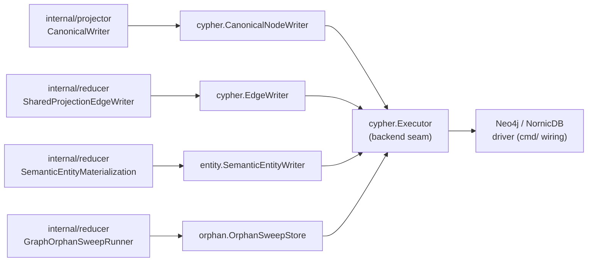
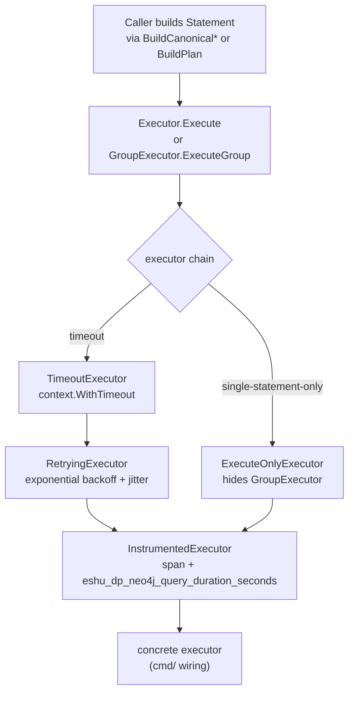

# storage/cypher

`storage/cypher` owns backend-neutral Cypher write contracts, canonical writers,
edge helpers, statement metadata, retry/timeout wrappers, and write instrumentation
for Eshu's canonical graph, including fault-injection restart evidence.
Every write path that touches the graph backend goes through this package.

## Where this fits in the pipeline



## Internal flow



## Lifecycle / workflow

Callers build `Statement` values via statement builder functions
(`BuildCanonicalWorkloadUpsert` and related, `BuildRetractRepoDependencyEdges` and
related, `BuildPlan`) and pass them to a writer
(`CanonicalNodeWriter`, `EdgeWriter`, `entity.SemanticEntityWriter`) or directly to
an `Executor`.

`RetractableNodeEntityLabels()` exposes the canonical retract phase's node label
set (the union of the per-domain retract sets) as a stable, sorted slice. It is
the lockstep source the replay depth-coverage gate (C-13, #4366) mirrors so every
retractable node type is required to have a delta/tombstone replay scenario;
adding a label to a retract set makes that gate demand a new scenario for it.

`node.RetractInfraEntityLabels` retains `CrossplaneClaim` even though
no writer has emitted that label since #5347 (a Crossplane Claim is edge-only:
it stays a `K8sResource` node, and the `SATISFIED_BY` edge to its
`CrossplaneXRD` is the classification). The entry is a legacy-node reaper, not
dead code: a graph provisioned before #5347 can still hold nodes carrying the
literal `CrossplaneClaim` label, and only this retract entry's `DETACH DELETE`
sweeps them once a full reconciliation generation re-projects the Claim as a
`K8sResource` node plus a `SATISFIED_BY` edge. Dropping the entry would orphan
those legacy nodes forever for a deployment that upgrades straight from a
pre-#5347 binary to a post-#5478 one with no intervening release that still
retracted the label. Issue #5478 removed the label from every registry that
only affects live query classification (infra category/family lookups,
resource-investigation label fanout, repository infrastructure listings, the
collector/content-shape/projector bucket-to-label projection tables, and the
`claim_unique`/uid/fulltext graph schema entries stay untouched pending a
future change once no legacy nodes remain) but kept it in this retract
registry and its lockstep specs (`specs/replay-depth-requirements.v1.yaml`,
`specs/replay-coverage-manifest.v1.yaml`) for exactly this reason.

`OrphanSweepStore` is the cleanup seam for disconnected graph nodes that remain
after owned retractions. It only handles the closed labels
`Repository`, `Platform`, `EvidenceArtifact`, `File`, `Directory`, and
`Module`. On both pinned NornicDB backends every relationship-existence
predicate is mis-evaluated (`NOT (n)--()` always false, `(n)--()` always true,
`COUNT { (n)--() } = 0` always true regardless of relationship state -- see
`docs/public/reference/nornicdb-pitfalls.md`), so the store never issues one.
Instead it computes orphan status as a Go-side
anti-join between two bounded reads per label:

- **S1 candidates** (`BuildCandidateOrphanNodesQuery`): every node matching
  `evidence_source IS NOT NULL` (plus the Repository-only exclusion below),
  with its identity key and current `eshu_orphan_observed_at_unix` marker.
  Contains no relationship clause at all. The read is `ORDER BY` the identity
  key and takes only keys `> $cursor`, and the store advances a process-local
  per-label cursor every cycle, so a label with more nodes than the count limit
  is paged deterministically across cycles. This guarantees forward progress
  past a candidate window that happens to be entirely connected (the cursor
  wraps back to the label start once a short page signals the end) instead of
  re-reading the same window and never discovering orphans beyond it.
- **S2 connected keys** (`BuildConnectedKeysQuery`): `UNWIND $keys AS
  candidate_key MATCH (n:Label {key: candidate_key})-[r]-(m) RETURN DISTINCT
  n.key AS key` -- the only relationship primitive proven reliable on both
  pinned backends: a concrete relationship variable in a MATCH anchored on
  caller-supplied identity keys, never a negated or counted pattern-existence
  predicate. The UNWIND binding variable is deliberately not named `key`:
  reusing the RETURN alias as the UNWIND variable silently returns zero rows
  on the pinned NornicDB backends instead of erroring. `readConnectedKeys`
  splits the key list into
  `defaultOrphanSweepConnectedKeysChunkSize`-sized (500) round trips rather
  than anchoring one statement on an arbitrarily large key list: this
  statement's own cost scales super-linearly with key-list size on both
  pinned backends (measured ~4.7s at 5,000 keys unchunked vs ~0.6s chunked at
  500/round trip -- see #5147 (retired evidence record) and
  `docs/public/reference/cypher-performance.md`). Below the chunk size this
  is exactly one round trip, unchanged from before chunking was added.

`orphans = candidates - connected` is computed in Go. The store then issues at
most three key-anchored writes per label, each `UNWIND $keys AS candidate_key
MATCH (n:Label {key: candidate_key}) ...`, never a relationship predicate or
`DETACH DELETE`: **clear** (`REMOVE eshu_orphan_observed_at_unix` for marked
nodes that are now connected), **mark** (`SET eshu_orphan_observed_at_unix`
for unmarked orphans, capped at the batch limit), and **sweep** (`DELETE n`
for marked orphans aged past the TTL cutoff, capped at the batch limit).
Immediately before sweep, the store re-runs the S2 read restricted to the
keys about to be deleted and drops any that reconnected between the
top-of-cycle read and the delete (a TOCTOU guard against a concurrent
projector). Each clear/mark/sweep write **re-applies** the same
evidence/ownership guard (and the appropriate marker/age predicate) that S1
used, rather than matching on label+key alone: a key whose ownership changed
between the read and the write -- for example a `Repository {id}` re-created by
canonical projection as `evidence_source='projector/canonical'` in the window
before its relationships attach -- is then skipped by the write, not deleted.

The per-label identity key mirrors the canonical writers' MERGE identity:
`id` for Repository/Platform/EvidenceArtifact, `path` for File/Directory,
`name` for Module. Repository's reads and writes exclude
`evidence_source='projector/canonical'` so active source-local repository
nodes remain owned by the canonical writer even when a repository has no graph
relationships yet. `Module.name` is not unique across node classes (canonical
imported modules are MERGEd on `{import_key}` with no `uid`, #8168; semantic
module entities are MERGEd on `{uid}` and carry a name), so the Module sweep -- which owns
only the canonical imports -- additionally restricts S1, S2, and its writes to
`n.uid IS NULL`; without this a connected same-name semantic module would mask
a canonical orphan and the writes would target the semantic node too.

The steady no-orphan state (a label whose S1 candidates are all connected,
none marked) issues exactly two reads (S1, S2) and zero writes; a label with
no matching nodes at all skips S2 entirely (one read, zero writes). A label
with unmarked orphans, reconnected markers, or aged markers issues the S1/S2
reads plus only the clear/mark/sweep writes whose key set is non-empty.

`CanonicalNodeWriter.Write` executes all canonical writes in named phases:
`retract`, `repository_cleanup`, `repository`, `directories`, `files`,
`entities`, `entity_retract`, `entity_containment`, `terraform_state`,
`oci_registry`, `package_registry_*`, `modules`, `structural_edges`, and
`package_registry_*_edges`. When the executor
implements `GroupExecutor`, all phases are sent in a single atomic transaction
EXCEPT the deferred `package_registry_*_edges`
phases, which are partitioned into a second `ExecuteGroup` dispatched only
after the first commits (`partitionDeferredPackageRegistryEdgePhases`). When it
implements
`PhaseGroupExecutor`, each phase executes as a bounded group. Otherwise phases
run sequentially.

`repository_cleanup` only retires a different-id `Repository` at this path (skipped for first-generation and delta scopes); it never deletes the node the upsert re-MERGEs, whose reducer and cross-scope edges a retry cannot rebuild (#7285, (#7285)).
A retirement that deleted a node is reported from the backend write summary on `eshu_dp_canonical_repository_retirements_total{outcome}` and the `canonical repository retired` log (contract A, #7324, `docs/internal/design/7324-cross-scope-writer-rearm.md`); `TestRepositoryIncomingEdgesAreDeletedOnlyByTheirOwners` pins that no other statically visible statement deletes a projector-owned `Repository` or drops edges with one, and that every incoming `Repository`-edge delete is `evidence_source`-scoped; the orphan sweep's plain `DELETE n` of disconnected, non-projector `Repository` stubs (runtime-built label) is the documented exception it cannot see. The retirement statement collects its incident edges before the delete and binds the retired id (`RETURN retired_id, dropped`) and the report splits them per direction and owner class on `eshu_dp_canonical_repository_retired_relationships_total{direction,class}` with `dropped_incoming`/`dropped_outgoing` and the capped per-type map on the log; executors that never consumed the record (notably the NornicDB phase-group path, which stays unattributed) log `attribution=false` and move only the outcome counter (#7324). The retired ids reach the writer's `RetiredRepositoryObserver` port (projector, ingester, and bootstrap-index wiring inject the `deployable_unit_correlation` fingerprint invalidation, #8316); the bare NornicDB shape reports no id and relies on the gap reconciliation instead.
Directory rows
use depth-ordered `MERGE` after the
repository is present. File rows update current nodes in place with
`MATCH (f:File {path: row.path})`, then send only missing rows through an
index-backed `OPTIONAL MATCH ... WHERE existing IS NULL` guard (#6798) before `MERGE`.
Nested files require a parent `Directory` match for the directory containment
edge. Repository-root files use a separate Repository-contained statement shape
so package entrypoint files can materialize without inventing a root
`Directory`. This avoids NornicDB's expensive `DETACH DELETE` cost for current
directories or files. Entity property filtering also keeps high-volume analysis
metadata such as `dead_code_root_kinds` and `exactness_blockers` out of
canonical graph rows; the dead-code API merges that evidence from the content
store by entity ID.

Current-file structural edge refresh statements `UNWIND` the bounded file-path
chunk and then seed from indexed `File.path` with
`MATCH (f:File {path: file_path})` before expanding `IMPORTS` or directory
`CONTAINS` relationships. This keeps the cleanup candidate set path-first
instead of relationship-scan-first on NornicDB while preserving the same Cypher
semantics for Neo4j-compatible backends. The file-path list is de-duplicated
before chunking so duplicate input rows cannot repeat the same relationship
delete inside one statement.
Positive string-slice retract statements can be chunked through
`ChunkPositiveStringSliceRetractStatement`; negative `NOT IN` stale cleanup is
intentionally excluded from chunking.
Stale-file retracts anchor on `Repository {id}` and traverse `REPO_CONTAINS`
before applying the generation and keep-list predicates. This avoids starting
from the full `File` label population when a webhook-triggered re-index needs
to remove files that disappeared from one repository.
Delta canonical materializations skip `repository_cleanup` and negative
full-generation stale cleanup. Deleted files are removed by positive
`IN $file_paths` worklist chunks (the prior `UNWIND $file_paths AS file_path`
seed plus compound WHERE cost 87–216s per execution on NornicDB v1.3.3 at
600k-node scale; see (#6715)),
changed files update in
place, now-empty deleted-file ancestor directories are removed leaf-first, and
post-upsert entity cleanup is label-scoped plus `n.path IN $file_paths` so
unchanged files and entities survive a file-scoped resync.

Code-call shared projection routes `CALLS`, `REFERENCES`, and `USES_METACLASS`
through label-scoped batched edge statements when endpoint labels are known.
Each code-call statement carries a bounded route summary with relationship,
source label, target label, and row count so slow shared-edge logs can be tied
back to the exact Cypher shape without exposing file paths or entity IDs.

Inheritance shared projection retracts seed cleanup from the child entity label
and indexed `repo_id` or `path`, then expand only that child's outgoing
`INHERITS`, `OVERRIDES`, `ALIASES`, and `IMPLEMENTS` relationships. Do not
collapse these back to `MATCH (child)-[rel:...]->() WHERE child.repo_id IN ...`
or `child.path IN ...`; that relationship-scan-first shape was measured as the
dominant `inheritance_edges` shared-projection cost on NornicDB.

Repo-dependency retract executes repository relationship edge cleanup,
`RUNS_ON` cleanup, and evidence-artifact cleanup as separate sequential
statements because grouped deletes under-apply on NornicDB v1.1.11. The
`projection/code-imports` producer is capability-limited to repo-to-repo
`DEPENDS_ON`, so its retract executes only repository relationship and evidence
artifact cleanup; it never opens the impossible `RUNS_ON` transaction. Exact
source equality owns the omission: prefix lookalikes and every other evidence
source retain all three roles. A mismatched code-import write fails closed
before backend execution. Single-repository cycles retain direct `$repo_id`
anchors, and the repo-dependency runner remains one repo-owned partition.

Terraform-state rows are written as `TerraformResource`, `TerraformModule`, and
`TerraformOutput` nodes keyed by `uid`. The rows keep lineage, serial, provider
binding, tag-key hashes, and hashed correlation anchors on the node without
creating cloud-resource joins. Those joins are reducer work after the
Terraform-state readiness checkpoints exist. `TerraformResource` also gets a
bounded, allowlisted subset of the resource's classified attributes flattened
onto prefixed scalar node properties (`tf_attr_*`) via an additive
`r += row.attrs` merge on the existing upsert template — see
`canonical/terraform/attribute_promotion.go` and its redaction guard against the full
IAM policy documents the drift package's attribute allowlist also carries
(#5441).

OCI registry rows are written as `OciRegistryRepository`,
`ContainerImage`/`OciImageManifest`, `ContainerImageIndex`/`OciImageIndex`,
`ContainerImageDescriptor`/`OciImageDescriptor`,
`ContainerImageTagObservation`/`OciImageTagObservation`, and
`OciImageReferrer` nodes keyed by `uid`. OCI image, descriptor, tag, and
referrer rows carry `repository_id` as the durable repository join key instead
of writing repository publication or observation relationships in the canonical
hot path. Manifests, indexes, and descriptors keep their image-family labels
because API queries anchor on those labels. Digest-backed descriptor identity is
the stable image key; tag observations keep `identity_strength=weak_tag` and
point at a resolved digest without making the tag the stable image key.

A `ContainerImageTagObservation` node's `first_observed_at` property (issue
#5459, the first queryable node-property timestamp in the canonical graph) is
written with `ON CREATE SET t.first_observed_at = row.observed_at` inside the
identity MERGE (`canonicalOCIImageTagObservationUpsertCypher`), so it is fixed
once at node creation and never overwritten by a later observation.
`oci_tag_first_observed_prove_theory_live_test.go` records three shapes that
were disproven live on NornicDB first: a self-referencing `CASE`/`coalesce`
guard inside the same `UNWIND ... MERGE ... SET` regresses to last-write-wins
(the MERGE binding shadows the persisted property as null for any
same-statement self-read), and even a separate DEFERRED
`MATCH ... WHERE t.first_observed_at IS NULL SET ...` failed the live
golden-corpus pipeline because the deferred MATCH did not surface the
multi-label node across the write group's transaction boundary. `ON CREATE`
reads no persisted property, so it is genuine set-once in one statement with no
self-reference and no cross-transaction dependency — idempotent under replay
and concurrency-safe (a re-MERGE never re-fires `ON CREATE`).
`go/internal/query`'s `TagHistoryHandler` reads this property to
answer "what digest was `repo:tag` first observed as, and in what order did
its digests change" over the existing `container_image_tag_observation_ref`
index on `image_ref`.

Package-registry rows are written as `Package`/`PackageRegistryPackage`,
`PackageVersion`/`PackageRegistryPackageVersion`, and
`PackageDependency`/`PackageRegistryPackageDependency` nodes keyed by `uid`.
Package and package-version nodes carry PURL, BOMRef, package manager, and
source-debug identity fields; dependency nodes carry the same fields for the
target package identity.
This phase emits `HAS_VERSION`, `DECLARES_DEPENDENCY`, and
`DEPENDS_ON_PACKAGE` for package-native dependency metadata only; source
repository hints are not promoted to ownership or publication edges until
reducer correlation supplies corroborating evidence. NornicDB phase-group
execution commits package, version, dependency target package, and dependency
writes in separate ordered phase groups because later statements `MATCH`
identities created by earlier package-registry statements. Dependency target
packages and primary package rows are deduplicated before the `UNWIND MERGE`
batch so repeated rows for the same package cannot attempt the same
`Package.uid` create more than once in a NornicDB transaction. The canonical
writer also gates package-registry package identity writes by sorted package
UID across primary packages, package versions, dependency source packages, and
dependency target packages before dispatching to the backend. Same-UID package
observations therefore serialize inside one projector process while distinct
package UIDs still reach the backend concurrently. Primary package duplicates
keep the newest observed source fact and use source fact id, then stable fact
key, as deterministic tie-breakers before sorting by UID.

Package-version artifact rows (#5458) are written as
`PackageArtifact`/`PackageRegistryPackageArtifact` nodes keyed by `uid` (the
artifact fact's `stable_fact_key`), carrying `artifact_key`, `artifact_type`,
`artifact_url`, `size_bytes`, `classifier`, `platform_tags`, and `hashes` — a
sorted `algorithm:digest` string list (`package/registry/artifact_writer.go`'s
`packageRegistryHashPairs`), since Cypher node properties cannot hold a nested
map. This closes the gap the owning `PackageVersion` node's
`checksum_algorithms` property left: that property keeps only algorithm
NAMES, dropping the actual digest. `packageRegistryHashPairs`
backslash-escapes every literal `\`/`:` in the algorithm and digest before
joining them, so the split stays unambiguous even for a colon-bearing
algorithm name (`packageRegistrySplitHashPair` is the proven decode-side
counterpart) — an earlier version instead rejected such a name at decode
(`DecodePackageRegistryPackageArtifact`), which silently narrowed the public
v1 contract (#5820 P2 review finding). The deferred `HAS_ARTIFACT` edge (same
NornicDB read-your-writes deferral as `HAS_VERSION`/`DECLARES_DEPENDENCY`)
attaches each artifact to its owning `PackageVersion`, MATCHing the version on
BOTH `uid` and `package_id` (not `uid` alone) so a malformed-but-schema-valid
artifact fact whose `package_id` disagrees with its `version_id`'s actual
owning package cannot attach to the wrong package's version (#5820 P2 review
finding). Artifact rows join the same package-identity lock gate as version
and dependency rows (locked by `PackageID`), so same-package artifact
observations serialize with other package-registry writes for that package.

Package-version registry-event rows (#5458 registry_event slice) are written
as `RegistryEvent`/`PackageRegistryRegistryEvent` nodes keyed by `uid` (the
event fact's `stable_fact_key`), carrying `event_key`, `event_type`,
`artifact_key`, `actor`, `message`, and `occurred_at` — the per-version
publish/yank/unyank/deprecate/delete/unlist lifecycle timeline the epic
names. Unlike the artifact row, this row's identity gate requires BOTH
`package_id` AND `version_id` even though the schema declares both optional:
a registry-wide event with no version to anchor on is a valid decode the row
builder drops rather than materializing an edge-less orphan node (see
`packageRegistryEventRow`'s doc comment in
`go/internal/projector/canonical/package_registry_event.go`). The deferred
`HAS_REGISTRY_EVENT` edge (same NornicDB read-your-writes deferral as
`HAS_VERSION`/`HAS_ARTIFACT`) attaches each event to its owning
`PackageVersion`. Event rows join the same package-identity lock gate as
version, dependency, and artifact rows (locked by `PackageID`), so
same-package event observations serialize with other package-registry writes
for that package.

`EdgeWriter.WriteEdges` maps a `reducercontract.Domain` to a batched UNWIND Cypher
template and dispatches rows in batches of `BatchSize` (default
`DefaultBatchSize` = 500). Domain-specific sub-batch sizes are available for
`DomainCodeCalls`, `DomainInheritanceEdges`, `DomainSQLRelationships`, and
`DomainShellExec`.
`DomainCodeCalls` writes direct call evidence as `CALLS`, JSX component plus Go
and TypeScript type-reference evidence as `REFERENCES`, and Python metaclass
evidence as `USES_METACLASS`. When reducer rows include
`caller_entity_type` and `callee_entity_type`, code-call and code-reference
writes use the exact endpoint label plus `uid`; incomplete legacy rows still
use the label-family fallback.
`DomainSQLRelationships` writes SQL table, column, view, function, index,
trigger, and embedded-query evidence with label-scoped endpoints. Function rows
can emit `QUERIES_TABLE` to a `SqlTable`; trigger rows can emit both `TRIGGERS`
to a `SqlTable` and `EXECUTES` to a `SqlFunction`; index rows emit `INDEXES` to
a `SqlTable` (#5330); table rows emit FK-correct `REFERENCES_TABLE` to another
`SqlTable`, and function/procedure rows emit `WRITES_TO` to a `SqlTable`
(#5410); `SqlMigration` rows emit `MIGRATES` to the
`SqlTable`/`SqlView`/`SqlFunction`/`SqlTrigger`/`SqlIndex` objects a migration
file touches (#5346). `EXECUTES` remains part of
dead-code reachability for stored routines and must stay in the relationship
retraction set.
`DomainShellExec` writes `Function-[:EXECUTES_SHELL]->ShellCommand` from parser
command-call evidence. The ShellCommand node is keyed by a deterministic uid and
stores API, language, source path, and line number only; raw command text,
arguments, and environment values are not graph properties.

On NornicDB, reducer wiring sets `SQLRelationshipSequentialWrites`: SQL edge
statements use auto-commit `Execute` even when the shared executor supports
managed groups. The pinned backend acknowledges the managed-transaction shape
without persisting its relationships. This does not serialize workers or reduce
row batching; production already grouped one SQL statement per transaction. A
concurrency regression holds two reducer calls inside auto-commit execution at
the same time, while the live backend proof repeats each MERGE to lock duplicate
delivery at one edge.

`DomainRunsIn` writes `Function-[:RUNS_IN]->Workload` edges that bind a proven
route-handler Function to the deployed runtime it runs in (#2722, under epic
#2703/#2710). The reducer scopes the source to exactly the entrypoint Functions
`handles_route` resolves, so a binding is produced only for an exact, unambiguous
handler resolution and never for every Function in the repo. The upsert is
MATCH-anchored through the handler's Repository:
`MATCH (func:Function {uid: row.function_id}) MATCH (repo:Repository {id:
row.repo_id})-[:DEFINES]->(workload:Workload) MERGE (func)-[rel:RUNS_IN]->
(workload)`. The traversal is bounded by the indexed `Repository.id` anchor and
fans out only to the workloads that one repository DEFINES, so no unused index is
added — the bounded-anchor reasoning mirrors `handles_route`. Expected
cardinality is at most one edge per (handler Function, Workload the repo
DEFINES); a handler serving many routes still produces one intent per
(Function, repo).

Ambiguity is represented, not collapsed. The code-call materialization stage that
builds these intents loads only repository and file facts and never runs the
workload admission/correlation that decides how many Workload nodes a repo
ultimately DEFINES, so it cannot count them at intent-build time. It therefore
marks every edge `rel.ambiguous = true` with a deliberately conservative
`rel.confidence` (0.5): each edge is a candidate member of the repo's workload
set, never an asserted single-workload binding. A repo that DEFINES exactly one
Workload still yields exactly one edge, and a consumer derives exactness by
counting the MATCH fan-out at query time. `RUNS_IN` shares the
`workload_materialization` readiness phase and `service_uid` keyspace with
`handles_route` because Workload nodes commit in that phase under that keyspace.
Operators see the domain in the shared-projection partition worker telemetry
alongside the other drained domains, and retraction removes only edges owned by
`evidence_source='reducer/runs-in'` for the re-projected repositories, anchored on
the source `Function.repo_id`.

`IncidentRoutingEvidenceWriter` is a reducer-owned graph writer for PagerDuty
incident routing. It writes only `IncidentRoutingEvidence` nodes and static
`HAS_INTENDED_ROUTING`, `HAS_APPLIED_ROUTING`, or `HAS_LIVE_ROUTING`
relationships between evidence nodes. The writer rejects out-of-vocabulary or
unsafe slot values before building Cypher, uses batched `UNWIND` statements,
and retracts only rows owned by `evidence_source='reducer/incident-routing'`
for the current scope.

`SecretsIAMGraphWriter` is the reducer-owned secrets/IAM graph projection writer
(ADR #1314): four `SecretsIAM*` node families (uid-only `MERGE`) and five
resolvable `SECRETS_IAM_*` edge families (`MATCH`/`MATCH`/`MERGE`, so a missing
endpoint is a no-op never a fabricated node), plus scope+evidence-scoped retract.
It interpolates no data-driven Cypher token: identity is always the uid (nodes)
or the two endpoint uids plus the static relationship token (edges). The live
reducer projection that drives it stays OFF by default behind
`ESHU_REDUCER_SECRETS_IAM_GRAPH_PROJECTION_ENABLED`; ADR #1314 §14 sign-off and
repo-local proofs exist, but #2430 must bind activation to one target deployment
and record flag-on proof before production enablement.

The executor chain is composed in `cmd/` wiring. A typical production chain
wraps a concrete driver executor with `TimeoutExecutor` → `RetryingExecutor` →
`InstrumentedExecutor`.

`RetryingExecutor` detects transient Neo4j and driver connectivity errors, NornicDB MERGE unique conflicts, and relationship snapshot conflicts.
Raw legacy errors require bounded `conflict:`; typed NornicDB conflicts require `conflict detected:` with an edge or node identity and transaction-age suffix, or
an exact relationship create failure naming a non-empty missing start/end node. A driver `ConnectivityError`
wrapping `CommitFailedDeadError` is not retried in place because its commit
outcome is unknown. Durable callers may later replay still-pending idempotent
work after backoff. The same exponential-backoff loop covers `Execute` and
`ExecuteGroup`. Typed driver transients replay the managed transaction body;
message-derived conflicts require all statements to be replay-safe, including `MERGE` and bounded retracts.

## Exported surface

**Materialized-edge family registries (#5543)**

- `CodeCallMaterializedEdgeTypes` - the code_calls family's four types (CALLS,
  REFERENCES, USES_METACLASS, INSTANTIATES), keyed by type
- `inheritance.MaterializedEdgeTypes` - the inheritance_edges family's four
  (INHERITS, OVERRIDES, ALIASES, IMPLEMENTS)
- `RepoDependencyMaterializedEdgeTypes` - the repo_dependency family's seven:
  the six repo-to-repo alternatives split out of the live retract's alternation,
  plus RUNS_ON, which a separate retract role reaps
- `SingleTypeMaterializedEdgeFamilyNames`, `SingleTypeMaterializedEdgeTypes` -
  the ten families that materialize exactly one relationship type
- `MaterializedEdgeEndpoint`, `MaterializedEdgeEndpointLabels` - per-edge-type
  endpoint label constraints for families whose types are shared. DEPENDS_ON is
  written Repository->Repository by repo_dependency and Workload->Workload by
  workload_dependency, so type alone cannot partition them. A family with no
  constraints is matched by type alone, never by nothing.
- `MaterializedEdgeIdentityProperties` - the relationship properties, beyond a
  type's two endpoint nodes, that participate in its MERGE identity, keyed by
  relationship type. Ten of the fourteen families MERGE on endpoints alone;
  `codeowners_ownership_edges`
  (`DECLARES_CODEOWNER`: `pattern`, `source_path`) and `submodule_pin_edges`
  (`PINS_SUBMODULE`: `path`) fold a property into their MERGE key because two
  distinct source rows can otherwise collide onto the same (source, target)
  relationship pattern. `workload_dependency` declares `DEPENDS_ON.identity_key`;
  `repo_dependency` declares `RUNS_ON.identity_key`. Concurrent writers converge.
  Unknown families fail closed; reads return copies. The identity drift test
  (`edge/materialized/families_test.go`) holds each single-type family's real
  write-path Cypher const by reference and extracts its MERGE property map
  from it, so a declared identity can never drift from what the writer
  actually keys on.

All of these are read by `materializededges.MaterializedEdgeDomainEdgeTypes` (edge types and
endpoint constraints) or `materializededges.LoadExpectedEdges` (identity properties) to scope
the live `assert-edges` check, and each is pinned against what its production
write and retract templates actually do.

**Core types**

- `Statement` — one executable Cypher statement: `Operation`, `Cypher`,
  `Parameters`
- `Plan` — deterministic write plan for one source-local materialization; built
  by `BuildPlan`
- `Operation` — string constant for write type; defined variants:
  `OperationUpsertNode`, `OperationDeleteNode`, `OperationCanonicalUpsert`,
  `OperationCanonicalRetract`, `OperationCanonicalProbe`. The value is not
  cosmetic: it is the backpressure wait label, the retry-counter key for the
  statements that retry (`OperationCanonicalProbe` is the exception --
  `ExecuteProbe` does not retry, so a probe never reaches that counter), and it
  routes graph writes. `go/internal/storage/nornicdb/phase_group_executor_retract.go`
  (a different package) flushes the pending
  group and dispatches a statement standalone, never through `ExecuteGroup`,
  the moment it sees `OperationCanonicalRetract`; `statement_chunk.go` only
  chunks a statement carrying that same value. A statement that reuses another
  operation's value blurs the metric and can also land on the wrong write
  path.
- `Executor` — the backend seam: `Execute(ctx, Statement) error`; every
  concrete backend implements this
- `GroupExecutor` — extension of `Executor` for atomic multi-statement writes
- `PhaseGroupExecutor` — extension for bounded phase-grouped writes
- `ProbeExecutor` — extension for read-only existence probes:
  `ExecuteProbe(ctx, Statement) (bool, error)`. Used to guard a retract whose
  cost is disproportionate to the rows it removes (see the rationale retract
  guard below).
- `Adapter` — source-local record writer that builds and executes a `Plan`

**Executor wrappers** (composable chain links)

- `InstrumentedExecutor` — OTEL span, query-duration histogram, and the #7058
  oversized index-key guard on every write (`GuardStatementIndexKeys`; unread write shapes counted and logged; see graph README)
- `RetryingExecutor` — wraps `Executor` with exponential backoff/jitter for
  transient Neo4j and NornicDB errors
- `TimeoutExecutor` — bounds individual statements with a child context;
  returns `GraphWriteTimeoutError` on deadline
- `BackpressureExecutor` — bounds in-flight statements against a shared permit
  gate; also forwards `ExecuteProbe` so probing cannot bypass the ceiling
- `ExecuteOnlyExecutor` — hides `GroupExecutor` and `ProbeExecutor` from callers
  that must not use large atomic groups

**Wrapper capability rule.** Every wrapper here that forwards `GroupExecutor` to
its `Inner` MUST forward `ProbeExecutor` the same way, and the `ExecuteOnly*`
wrappers MUST hide both. A wrapper that forwards one but not the other is the
worst failure shape available: wrappers above it still satisfy `ProbeExecutor`,
so a caller's type assertion succeeds and every probe dead-ends in the middle of
the chain while all tests stay green. `probe_follows_group_test.go` enumerates
the wrappers and asserts the rule rather than leaving it to review.

**Rationale retract guard.** The whole-repository rationale `EXPLAINS` retract
runs behind a `ProbeExecutor` existence check, because on the pinned NornicDB
build that DELETE costs proportional to store size even when it removes zero
rows (`ledger:5998-zero-row-explains-delete-large-store` versus
`ledger:5998-zero-row-explains-delete-empty-store` from the retired #5998
measurement ledger, same statement, same zero-row result), while
the identical MATCH as a bounded read stays fast on both. The probe mirrors
whichever retract shape
`BuildRetractRationaleEdges` selects, so the two always ask the same question.
The fail-safe direction is deliberate: no `ProbeExecutor`, or a probe error,
runs the DELETE unconditionally. A redundant delete is only slow; a skipped one
leaves stale edges.

The delta path -- a repository's incremental sync, retracting only the
`EXPLAINS` edges for files that changed -- gets the same guard, and it is the
path that fires far more often: it runs on every incremental sync rather than
once per generation. `ledger:5998-delta-per-label-retract-seeded-rerun` /
`ledger:5998-delta-per-label-retract-empty` from the retired #5998 measurement ledger
show its seven per-label statements costing 12.589s together on a
190,000-relationship store against 0.291s on an empty one, both measured on the
same host -- the same store-size term the whole-repository shape carries, proven
on its own pair rather than by comparison against figures from a different host.
The empty-store half of that pair comes from an earlier session than the seeded
figure; the evidence doc records which session each came from and why the
direction is conservative.
The seven probes guarding them cost 0.31s and do not grow with the store
(`ledger:5998-delta-per-label-probe-seeded` /
`ledger:5998-delta-per-label-probe-empty`). Each statement
targets a different `EXPLAINS` target label, so `executeGuardedRationaleDeltaRetracts`
pairs every retract with its own probe from the same label list in the same
order (`BuildProbeRationaleEdgeStatementsByFilePath` mirrors
`BuildRetractRationaleEdgeStatementsByFilePath`) -- a single shared probe would
answer a narrower question than six of the seven deletes it guarded. The
per-label statements already run sequentially, each in its own transaction,
for the NornicDB managed-transaction reason `executeCodeCallRetractStatements`
documents; edge writes carrying the `retract_via_refresh` marker are fenced
behind the same refresh that owns the retract, so a marked writer cannot insert
a matching `EXPLAINS` edge between a label's probe and that label's delete.
Unmarked legacy rows bypass that fence
(`shared_projection_worker_refresh_fence.go`); the residual is stated rather
than denied on `executeGuardedRationaleDeltaRetracts`, which explains why an
unmarked row landing inside that window is no worse under the guard than
without it. Both scopes emit
`eshu_dp_rationale_retract_probe_outcomes_total`, labeled `scope=whole_scope`
or `scope=delta_by_file_path` so an operator can tell which path a spike in
`probe_error` or `unsupported` outcomes came from -- collapsing the two into
one label would make the delta path's much higher call volume invisible.

**Canonical writers**

- `CanonicalNodeWriter` — writes `projector.CanonicalMaterialization` in strict
  phase order; constructed with `NewCanonicalNodeWriter`; configure per-label
  batch sizes via `WithEntityLabelBatchSize` and containment mode via
  `WithEntityContainmentInEntityUpsert`
- `EdgeWriter` — writes shared-domain edge rows for
  `reducer.SharedProjectionEdgeWriter`; constructed with `NewEdgeWriter`
- `EdgeWriter` also materializes deployable-unit correlation rows from
  `reducer.DomainDeployableUnitEdges` into
  `(:Repository)-[:CORRELATES_DEPLOYABLE_UNIT]->(:Repository)` edges. The query
  shape is batched `UNWIND` + `MATCH` source repository + `MATCH` deployment
  repository + static-token `MERGE`; missing endpoints are no-ops and stale
  rows retract only evidence source `reducer/deployable-unit-correlation`.
- `OrphanSweepStore` — counts, marks, clears, and deletes aged
  zero-relationship graph nodes from the closed cleanup label set; constructed
  with `NewOrphanSweepStore`
- `CloudResourceEdgeWriter` — writes canonical AWS relationship edges between
  `CloudResource` nodes for the AWS relationship materialization reducer domain
  (issue #805 PR 2); constructed with `NewCloudResourceEdgeWriter`. Uses batched
  `UNWIND` + `MATCH` source / `MATCH` target / static-type `MERGE` edge so a
  missing endpoint is a no-op, idempotent on
  `(source_uid, relationship_type, target_uid)`, with an evidence-source-scoped
  retract
- `CloudResourceContainerImageEdgeWriter` — writes canonical
  `(:CloudResource)-[:AWS_lambda_function_uses_image]->(:ContainerImage)` edges
  for the additive `DomainAWSCloudImageMaterialization` reducer domain (issue
  #5450); constructed with `NewCloudResourceContainerImageEdgeWriter`. Same
  batched `UNWIND` + `MATCH` source `CloudResource` / `MATCH` target
  `ContainerImage` / static-token `MERGE` shape as `CloudResourceEdgeWriter`,
  but the Cypher relationship-type token is a fixed constant validated against
  a closed single-member vocabulary (mirroring `IAMCanAssumeEdgeWriter`'s
  `CAN_ASSUME`) rather than `CloudResourceEdgeWriter`'s open per-relationship-type
  `AWS_<raw type>` derivation, because this domain only ever resolves one raw
  AWS relationship type (`lambda_function_uses_image`); idempotent on
  `(source_uid, target_uid)`, with an evidence-source-scoped
  (`reducer/aws-cloud-image`) retract that never touches either endpoint's node

- `S3InternetExposureNodeWriter` — writes reducer-owned S3 internet-exposure
  properties onto existing S3 `CloudResource` nodes (issue #1232); constructed
  with `NewS3InternetExposureNodeWriter(executor, reader, batchSize)`. Uses
  batched `UNWIND` + `MERGE (resource:CloudResource {uid})` (issue #5652: a
  bare `MATCH` anchor here silently drops its `SET` on the pinned production
  NornicDB v1.1.11 image). Never-create is enforced in Go instead of at the
  anchor clause: `PostureExistenceReader` confirms a candidate uid already
  exists via a separate read before the row ever reaches the write, so a
  missing bucket node is dropped before the statement runs rather than
  fabricated by `MERGE`. See `posture_node_existence.go` and
  (#5652). Unknown
  exposure rows set `s3_internet_exposure_state=unknown` and remove the
  boolean `s3_internet_exposed` property. Retract removes only
  `s3_internet_exposure_*` properties scoped by reducer evidence source and
  scope id.
- `EC2InternetExposureNodeWriter` — writes reducer-owned EC2 internet-exposure
  properties onto existing EC2 `CloudResource` nodes (issue #1301); constructed
  with `NewEC2InternetExposureNodeWriter(executor, reader, batchSize)`. Same
  MERGE-plus-existence-read fix as `S3InternetExposureNodeWriter` above
  (issue #5652): a missing EC2 instance node is dropped in Go before the
  write, never fabricated. Unknown exposure rows set
  `ec2_internet_exposure_state=unknown` and remove the boolean
  `ec2_internet_exposed` property. Retract removes only
  `ec2_internet_exposure_*` properties scoped by reducer evidence source and
  scope id.

- `EC2BlockDeviceKMSPostureNodeWriter` — writes reducer-owned EC2 block-device
  KMS posture properties onto existing EC2 `CloudResource` nodes (issue #1304);
  constructed with `NewEC2BlockDeviceKMSPostureNodeWriter(executor, reader,
  batchSize)`. Same MERGE-plus-existence-read fix as `S3InternetExposureNodeWriter`
  above (issue #5652): a missing EC2 node is dropped in Go, before the write,
  via `PostureExistenceReader`, rather than fabricated. Scoped retract removes
  only `ec2_block_device_*` posture fields owned by
  `reducer/ec2-block-device-kms-posture`.
- `S3ExternalPrincipalGrantWriter` — writes metadata-only S3 bucket-policy
  access evidence as `(:CloudResource)-[:GRANTS_ACCESS_TO]->(:ExternalPrincipal)`
  graph truth for issue #1231; constructed with
  `NewS3ExternalPrincipalGrantWriter`. Uses batched `UNWIND` + `MATCH
  (source:CloudResource {uid})` so missing source buckets cannot be fabricated,
  `MERGE (principal:ExternalPrincipal {uid})` on a stable principal kind/value
  identity, and a static `GRANTS_ACCESS_TO` relationship token validated against
  a closed vocabulary before interpolation. Optional principal account,
  partition, and service metadata update only when the incoming row carries a
  non-empty value, so partial later facts cannot clear bounded identity
  metadata. Retract deletes only reducer-owned edges scoped by edge `scope_id`
  and `evidence_source`, leaving global `ExternalPrincipal` identities in place.

- `WorkloadNodeWriter` (`k8snodewriter`, `go/internal/storage/cypher/kubernetes`) — writes canonical `KubernetesWorkload` nodes
  for the live-workload materialization reducer domain (issue #388);
  constructed with `NewWorkloadNodeWriter`. Batched `UNWIND` +
  `MERGE (w:KubernetesWorkload {uid: row.uid})` on the collector-emitted
  `object_id` only, mutable properties `SET` separately, idempotent under
  retries and duplicate facts. Mirrors the proven CloudResource node writer so
  it engages the same schema-backed uid lookup; the #388 edge slice (PR3)
  resolves its workload endpoint against these nodes
- `NamespaceNodeWriter` (`k8snodewriter`, `go/internal/storage/cypher/kubernetes`) — writes canonical `KubernetesNamespace` nodes
  for the namespace environment-alias binding reducer domain (issue #5434);
  constructed with `NewNamespaceNodeWriter`. Batched `UNWIND` +
  `MERGE (n:KubernetesNamespace {uid: row.uid})` on the collector-emitted
  `object_id` only. Routes each row to one of two Cypher variants purely by
  whether `row.environment` is non-empty:
  `canonicalKubernetesNamespaceUpsertCypher` (no `Environment` node, clears
  stale `environment`/`evidence_class` from a prior bound generation) or
  `canonicalKubernetesNamespaceWithEnvironmentUpsertCypher` (also `MERGE`s
  `(:Environment {name: row.environment})` and a `TARGETS_ENVIRONMENT` edge —
  the same edge type `batchCanonicalRepoEvidenceArtifactWithEnvironmentUpsertCypher`
  uses for the repo-manifest environment-alias path). A namespace with no
  alias-recognized label NEVER reaches the with-environment variant, so it can
  never fabricate environment truth. Both upsert variants stamp the current
  generation. After a complete cluster snapshot, the writer runs a
  cluster- and evidence-source-scoped stale-node retract; an empty complete
  snapshot therefore removes the last namespace, while partial snapshots never
  enter the absent-node retract path.
- `EC2InstanceNodeWriter` — writes canonical EC2 instance `:CloudResource` nodes
  for the EC2 instance node materialization reducer domain (issue #1146 PR-A);
  constructed with `NewEC2InstanceNodeWriter`. Batched `UNWIND` +
  `MERGE (r:CloudResource {uid: row.uid})` on the canonical
  `cloud_resource_uid` identity only, with the ten derived posture
  booleans/scalars (IMDS, user-data presence, monitoring, public-IP,
  `instance_profile_arn`, tenancy, Nitro) `SET` separately. Reuses the existing
  `:CloudResource` label + `cloud_resource_uid_unique` constraint (no new schema
  DDL); the only difference from the #805 CloudResource node writer is the extra
  posture `SET` properties. NEVER carries user-data content (only the
  `user_data_present` boolean), the raw public IP, or per-volume block devices.
  The future `USES_PROFILE` edge (#1146 PR-B) resolves its instance endpoint
  against these nodes
- `KubernetesCorrelationEdgeWriter` — writes canonical `RUNS_IMAGE` edges from a
  `KubernetesWorkload` node to the digest-addressed OCI source node it runs, for
  the live-workload correlation materialization reducer domain (issue #388 PR3);
  constructed with `NewKubernetesCorrelationEdgeWriter`. Batched `UNWIND` +
  `MATCH (w:KubernetesWorkload {uid})` / `MATCH (img:<OciImage*> {uid})` /
  static-type `MERGE (w)-[rel:RUNS_IMAGE]->(img)` so a missing endpoint is a
  no-op (never a fabricated node), grouped by the source-node label which is
  validated against the closed OCI source vocabulary
  (`OciImageManifest`/`OciImageIndex`/`OciImageDescriptor`) before
  interpolation. Idempotent on `(workload_uid, RUNS_IMAGE, source_uid)`, with an
  evidence-source-scoped, edge-`scope_id`-filtered retract

- `IAMEscalationEdgeWriter` — writes canonical `CAN_ESCALATE_TO` privilege-
  escalation edges between an IAM principal `CloudResource` node and the IAM
  target `CloudResource` node it can escalate to, for the IAM escalation
  materialization reducer domain (issue #1134 PR3); constructed with
  `NewIAMEscalationEdgeWriter`. Batched `UNWIND` +
  `MATCH (p:CloudResource {uid})` / `MATCH (t:CloudResource {uid})` /
  static-type `MERGE (p)-[rel:CAN_ESCALATE_TO]->(t)` so a missing endpoint is a
  no-op (never a fabricated node). Both endpoints are the uniform `CloudResource`
  label and the relationship type is the static `CAN_ESCALATE_TO` token, so the
  writer interpolates no data-driven token. The escalation primitive set lives in
  an edge property (`rel.primitives`), never in the MERGE key — so the MERGE keys
  on the stable `(principal_uid, CAN_ESCALATE_TO, target_uid)` identity and stays
  on NornicDB's relationship hot path. Idempotent on that triple, with an
  evidence-source-scoped, edge-`scope_id`-filtered retract. Security-sensitive: it
  persists only the conservatively-resolved rows the extractor produced.

- `IAMCanPerformEdgeWriter` — writes canonical `CAN_PERFORM`
  effective-permission edges between an IAM principal `CloudResource` node and the
  resource `CloudResource` node an identity or resource policy grants a catalogued
  sensitive action on, for the IAM CAN_PERFORM materialization reducer domain
  (issue #1134 PR4a/PR4b reducer); constructed with
  `NewIAMCanPerformEdgeWriter`. Batched `UNWIND` +
  `MATCH (p:CloudResource {uid})` / `MATCH (r:CloudResource {uid})` /
  static-type `MERGE (p)-[rel:CAN_PERFORM]->(r)` so a missing endpoint is a no-op
  (never a fabricated node). Both endpoints are the uniform `CloudResource` label
  and the relationship type is the static `CAN_PERFORM` token, so the writer
  interpolates no data-driven token. The granted action set lives in an edge
  property (`rel.actions`), never in the MERGE key — so the MERGE keys on the
  stable `(principal_uid, CAN_PERFORM, resource_uid)` identity and stays on
  NornicDB's relationship hot path; the edge also carries `rel.action_count`,
  `rel.grant_sources`, and the honesty label `rel.evaluation_scope`. Idempotent
  on that triple, with an evidence-source-scoped, edge-`scope_id`-filtered
  retract. Security-sensitive: it persists only the conservatively-resolved rows
  the extractor produced.

- `RDSPostureNodeWriter` — stamps RDS security and operations posture properties
  onto existing RDS DB instance and Aurora cluster `CloudResource` nodes for the
  RDS posture materialization reducer domain (issue #1233); constructed with
  `NewRDSPostureNodeWriter(executor, reader, batchSize)`. Batched `UNWIND` +
  `MERGE (r:CloudResource {uid})` + `SET` (issue #5652: a bare `MATCH` anchor
  here silently drops its `SET` on the pinned production NornicDB v1.1.11
  image). Node-property-only is preserved in Go, not at the anchor clause: the
  writer reads which candidate uids already exist via `PostureExistenceReader`
  before writing and drops rows for uids that do not, so a missing RDS node is
  a no-op and the writer never fabricates a CloudResource. The scoped retract
  matches only nodes with `rds_posture_scope_id` and
  `rds_posture_evidence_source`, then `REMOVE`s only reducer-owned `rds_*`
  posture fields.

- `EC2InstanceIdentityNodeWriter` — stamps the #5448 `ami_id` property (plus
  `ec2_identity_*` provenance) onto existing EC2 instance `CloudResource`
  nodes for the EC2 instance identity materialization reducer domain;
  constructed with `NewEC2InstanceIdentityNodeWriter(executor, reader,
  batchSize)`. Same MERGE-anchored `UNWIND` + `SET` shape as
  `RDSPostureNodeWriter` (issue #5652), with the identical never-create
  contract via `PostureExistenceReader`: the EC2 instance CloudResource node
  is owned by `EC2InstanceNodeWriter` (`cloud/aws/ec2/instance_node_writer.go`), never
  by this writer. Its SET clause is proven disjoint from
  `EC2InstanceNodeWriter`'s SET clause
  (`TestEC2InstanceIdentityWriterDisjointFromEC2InstancePostureWriter`), so
  the two writers commute on the same uid regardless of dispatch order. The
  scoped retract matches only nodes with `ec2_identity_scope_id` and
  `ec2_identity_evidence_source`, then `REMOVE`s only `ami_id` and the
  `ec2_identity_*` properties.

- `EC2BlockDeviceKMSPostureNodeWriter` — stamps bounded EC2 block-device KMS
  posture properties (`ec2_block_device_kms_state`, reason, volume counts,
  unresolved count, sorted volume ids, and sorted KMS key ids) onto existing EC2
  `CloudResource` nodes for issue #1304. It is node-property-only: a missing EC2
  node is dropped in Go via `PostureExistenceReader` before the write runs, so
  the writer never creates CloudResource nodes even though its statement is
  MERGE-anchored (issue #5652), and the scoped retract removes only
  reducer-owned `ec2_block_device_*` properties.

  Tests cover empty-row no-op behavior, MERGE-anchored SET on a
  confirmed-existing uid, never-create for an unconfirmed uid,
  scope/evidence annotation, and property-only retract. Statement
  summaries and operation metadata (`phase=ec2_block_device_kms_posture`,
  `label=CloudResource:EC2BlockDeviceKMSPosture`) ride each statement for the
  existing graph query duration and batch-size metrics. Durable benchmark
  evidence lives in `docs/public/reference/local-performance-envelope.md`.
- `entity.SemanticEntityWriter` (semantic/entity leaf) — writes semantic entity (Annotation, Module, etc.)
  nodes; five constructors select the Cypher row shape

**Statement builders**

- `BuildPlan(materialization)` — converts a `graph.Materialization` to a
  source-local `Plan`
- `BuildCanonical*Upsert` functions — construct `Statement` values for canonical
  domain nodes: `BuildCanonicalWorkloadUpsert`,
  `BuildCanonicalWorkloadInstanceUpsert`, `BuildCanonicalRuntimePlatformUpsert`,
  `BuildCanonicalInfrastructurePlatformUpsert`,
  `BuildCanonicalDeploymentSourceUpsert`, `BuildCanonicalRepoDependencyUpsert`,
  `BuildCanonicalWorkloadDependencyUpsert`, `BuildCanonicalCodeCallUpsert`,
  `BuildCanonicalRepoRelationshipUpsert`, `BuildCanonicalRunsOnUpsert`
- Statement retraction builders — produce edge and node retraction statements:
  `BuildRetractInfrastructurePlatformEdges`, `BuildRetractRepoDependencyEdges`,
  `BuildRetractWorkloadDependencyEdges`, `BuildRetractCodeCallEdgeStatements`,
  `BuildRetractCodeCallEdgeStatementsByFilePath`,
  `BuildRetractInheritanceEdgeStatements`, `BuildRetractInheritanceEdgeStatementsByFilePath`,
  `BuildRetractSQLRelationshipEdgeStatements`,
  `BuildRetractSQLRelationshipEdgeStatementsByFilePath`

**Read / check**

- `node.CypherReader` — interface for read-only existence queries
- `node.Checker` — short-circuit guard built from `node.CypherReader`;
  `HasCanonicalCodeTargets` avoids expensive label-free MATCH scans when no
  canonical code nodes exist

**Errors**

- `GraphWriteTimeoutError` — emitted by `TimeoutExecutor`; implements
  `Retryable() bool` and `FailureClass() string`
- `WrapRetryableNeo4jError(err)` — wraps transient errors for the edge writer

## Dependencies

- `internal/graph` — `graph.Materialization`, `graph.Record`, `graph.Result`
  for source-local plan building
- `internal/projector` — `projector.CanonicalMaterialization` and row types
  consumed by `CanonicalNodeWriter`
- `internal/reducer` / `internal/reducer/contract` — `reducercontract.Domain` constants — and
  `internal/reducer/sharedintent` — `sharedintent.Row` consumed by `EdgeWriter`
- `internal/telemetry` — `telemetry.Instruments`, span and attribute helpers

Concrete Neo4j/NornicDB driver adapters live in `cmd/` wiring packages, not in
this package. This package owns the backend-neutral writer contracts; `cmd/`
owns the wiring. NornicDB owns the promoted runtime path. Any additional
Cypher/Bolt backend must run these shared statements or use a small, documented
adapter seam.

## Telemetry

- `eshu_dp_neo4j_query_duration_seconds` — histogram per statement;
  `operation=write`, `operation=write_group`, or `operation=probe` (the #5998
  guard's bounded existence read, recorded in `InstrumentedExecutor.ExecuteProbe`)
- `eshu_dp_neo4j_batch_size` — batch row count per `UNWIND` statement; grouped
  Neo4j/Bolt execution records one point per statement with bounded
  `operation`, `write_phase`, and `node_type` labels when metadata is present
- `eshu_dp_neo4j_batches_executed_total` — counter labeled by `operation` plus
  bounded statement metadata when available
- `eshu_dp_neo4j_deadlock_retries_total` — legacy counter in
  `RetryingExecutor` labeled by `write_phase` and bounded `reason`; counts
  transient graph-write retries, including deadlocks, lock timeouts, retryable
  driver connectivity errors, retryable NornicDB commit conflicts, and the Neo4j parser interval race (`reason=neo4j_parser_interval_race`, #8190)
- `eshu_dp_canonical_atomic_writes_total` / `eshu_dp_canonical_atomic_fallbacks_total`
  — whether `CanonicalNodeWriter` used the group or sequential path
- `eshu_dp_canonical_phase_duration_seconds` — labeled by phase name
- `eshu_dp_canonical_projection_duration_seconds` / `eshu_dp_canonical_retract_duration_seconds`
  — canonical write and retract totals
- `eshu_dp_shared_edge_write_groups_total` / `eshu_dp_shared_edge_write_group_duration_seconds`
  / `eshu_dp_shared_edge_write_group_statement_count` — edge writer group metrics
- `eshu_dp_shared_edge_runs_on_retract_omissions_total` — impossible `RUNS_ON`
  retracts omitted by bounded source-capability reason and projection domain
- `eshu_dp_code_call_edge_batches_total` / `eshu_dp_code_call_edge_batch_duration_seconds`
  — code-call-specific edge metrics
- `eshu_dp_graph_orphan_nodes` — reducer-registered observable gauge labeled
  by closed `node_label` values for bounded zero-relationship node counts
- Spans: `neo4j.execute` and `neo4j.execute_group` from `InstrumentedExecutor`

## Operational notes

- Manual Neo4j or NornicDB production-profile performance runs must apply
  `eshu-bootstrap-data-plane` before indexing. `eshu-bootstrap-index` applies the
  Postgres bootstrap schema, but it does not apply graph indexes or constraints;
  runs that skip the data-plane schema step are setup diagnostics, not backend
  acceptance evidence.
- `eshu_dp_neo4j_deadlock_retries_total` rising signals transient graph-write
  retry pressure. Check structured retry logs first: deadlocks or NornicDB
  unique conflicts usually point at concurrent MERGE contention on shared nodes
  (Repository, Directory, Module), while driver `ConnectivityError` points at
  backend reachability, pool pressure, restart, or network churn. Check worker
  concurrency before raising `RetryingExecutor.MaxRetries`. `reason=neo4j_parser_interval_race` is not contention: it is the false ``Variable `U` not defined`` SyntaxError from an ANTLR data race in the pinned Neo4j image on weakly ordered CPUs (antlr/antlr4#4901). It retries regardless of statement shape (parse-time, inside one transaction), and after the budget the original SyntaxError surfaces terminal, so a real undefined one-character variable costs at most `MaxRetries` retries; see #8190 (retired evidence record).
- `eshu_dp_canonical_atomic_fallbacks_total` > 0 means the executor does not
  implement `GroupExecutor`; write ordering relies on sequential phase execution
  which is slower and non-atomic.
- `eshu_dp_canonical_phase_duration_seconds{phase="retract"}` elevated for
  non-first generations indicates stale node volume or an unselective cleanup
  shape; source-local entity retractions and containment refreshes must stay
  anchored on concrete labels (`Function`, `Class`, `K8sResource`, etc.) so
  graph backends can use the schema indexes instead of scanning all canonical
  nodes.
- Repository-scoped cleanup runs only when the materialization carries a
  repository id. Non-repository collectors such as OCI registry and package
  registry write their own canonical nodes and must not issue `File`,
  `Directory`, or repo-bound entity cleanup against a populated graph.
- `GraphWriteTimeoutError` surfaces as `failure_class=graph_write_timeout` in
  projector/reducer queue rows; the `TimeoutHint` field names the env var to
  tune.

### AWS relationship edge writer (issue #805 PR 2)

`CloudResourceEdgeWriter` projects resolved `aws_relationship` facts into
relationship-type-specific
`(:CloudResource)-[:AWS_<raw relationship_type>]->(:CloudResource)` edges while
keeping the original `relationship_type` property for readback. Both endpoints
anchor on the `CloudResource.uid` uniqueness constraint (the separate lookup index
PR 1 added retired in #11535; the constraint's 1.5.x backing index serves it), so
the two `MATCH`es are schema-backed lookups, not label scans; the logical identity remains
`(source, relationship_type, target)`, including case. Full design and decision
record: `docs/internal/aws-relationship-edge-materialization-design.md`
§5–§11.

### Kubernetes live-workload node writer (issue #388)

`WorkloadNodeWriter` (`go/internal/storage/cypher/kubernetes`) materializes `kubernetes_live.pod_template` facts
into canonical `KubernetesWorkload` nodes for the live-workload materialization
reducer domain. The write is a batched `UNWIND $rows AS row` +
`MERGE (w:KubernetesWorkload {uid: row.uid})` on the collector-emitted
`object_id` only, with mutable properties `SET` separately, so duplicate facts
and reducer retries converge on one node rather than fabricating or duplicating
graph state. The node `uid` is the live object identity (`object_id`); the raw
Kubernetes `metadata.uid` is carried as the `workload_uid` property only, never
the node identity. The MERGE anchors on the `kubernetes_workload_uid_unique`
constraint (the separate lookup index retired in #11535; the constraint's 1.5.x
backing index serves the lookup), so the upsert is a schema-backed uid lookup,
not a label scan. The #388 edge slice (PR3) resolves its workload endpoint
against these nodes exactly as the AWS relationship edge resolves against
`CloudResource` nodes. Design and decision record:
`docs/internal/design/388-kubernetes-workload-node.md`.

## Extension points

- `Executor` — implement this interface for any new graph backend; no changes
  to writers or callers are needed
- `GroupExecutor` / `PhaseGroupExecutor` — optional extensions; writers detect
  them at runtime and prefer the grouped path
- `CanonicalNodeWriter` builder options — `WithFileBatchSize`,
  `WithEntityBatchSize`, `WithEntityLabelBatchSize`,
  `WithEntityContainmentInEntityUpsert`,
  `WithBatchedEntityContainmentInEntityUpsert` — tune per-backend without
  branching callers
- New statement builders — add a `BuildCanonicalWorkloadUpsert`-style function
  or a `BuildRetractRepoDependencyEdges`-style function for each new canonical
  domain node or edge type; no writer changes needed

## Gotchas / invariants

- All writes must be idempotent (`doc.go`). `MERGE`-based Cypher and
  `ON CONFLICT DO NOTHING` patterns enforce this; do not replace MERGE with
  CREATE.
- `OperationCanonicalUpsert` is for canonical domain nodes (workloads, files,
  entities). `OperationUpsertNode` / `OperationDeleteNode` are for
  source-local `SourceLocalRecord` writes. Do not mix them.
- `CanonicalNodeWriter` phase order is strict: parent nodes (Repository,
  Directory) must exist before child nodes (File, Entity) because later phases
  use MATCH on these nodes. Identity cleanup phases run immediately before the
  corresponding MERGE phase, and `directories` are sorted by `Depth` ascending
  (`canonical_node_writer_phases.go`).
- OCI registry writes must keep `MERGE` anchored on concrete labels plus `uid`.
  Tags are mutable observations; do not use `tag` or `source_tag` as the
  manifest/index identity key. OCI labels participate in the stale-entity
  retract family, and `canonicalNodeRetractEntityLabels` includes that family in
  the generated cleanup list. OCI registry repository truth is derived from the
  `repository_id` property on digest, descriptor, index, tag-observation, and
  referrer nodes. Do not reintroduce `PUBLISHES_*` or `OBSERVED_*`
  relationships in the canonical writer without same-corpus performance proof
  that the relationship writer no longer dominates `phase=oci_registry`.
- Package-registry writes must keep `MERGE` anchored on `uid` for `Package`,
  `PackageVersion`, and `PackageDependency` labels. Do not add `Repository`
  matches or ownership edges to `package/registry/canonical_writer.go`; source
  hints need reducer admission first.
- Orphan sweep statements must stay on the closed label set and must never
  contain a relationship-existence predicate (`NOT (n)--()`, `(n)--()`, or
  `COUNT { (n)--() } = 0` are all mis-evaluated on the pinned NornicDB
  backends -- see `docs/public/reference/nornicdb-pitfalls.md`). Orphan status
  must be computed as a Go-side anti-join between a label+evidence_source scan
  (S1) and a concrete-relationship-variable MATCH anchored on caller-supplied
  identity keys (S2); the clear/mark/sweep writes must stay key-anchored
  (`UNWIND $keys AS candidate_key MATCH (n:Label {key: candidate_key}) ...`)
  and keep the TTL marker before deletion. Do not replace the sweep with
  `DETACH DELETE`, dynamic labels, an unlabelled graph scan, or any relationship
  pattern-existence predicate; dangling relationships are owned by the
  relationship retractors, not this cleanup runner. Immediately before the
  sweep delete, re-verify connectivity for exactly the keys about to be
  deleted (TOCTOU guard) rather than trusting the top-of-cycle read.

- Repository-root `File` rows are the exception to the Directory parent rule:
  they must attach directly to `Repository` through `REPO_CONTAINS` because
  `buildDirectoryChain` intentionally does not create a synthetic Directory for
  the repository root.
- Canonical entity containment refreshes prune stale `CONTAINS` edges from
  current `Class` and `Function` parents. Keep those cleanup statements
  label-anchored on `uid`; unlabelled UID anchors are portable Cypher but can
  miss the NornicDB and Neo4j hot path for this package's schema.
- Code reference writes must allow type targets (`Struct`, `Interface`,
  `TypeAlias`) as well as callable targets. Do not route Go composite-literal
  or TypeScript type references through `CALLS`; dead-code queries depend on
  incoming `REFERENCES` to model type usage without inventing invocation truth.
- Code-call endpoint labels are whitelist values, not caller-controlled Cypher.
  `EdgeWriter` accepts exact `Function`, `Class`, `File`, `Interface`,
  `Struct`, and `TypeAlias` labels for code relationship endpoints. This keeps
  Java, Go, Python, and TypeScript rows on NornicDB's bounded label-plus-`uid`
  lookup path instead of the broader label-family fallback. Unknown or missing
  labels still fall back to the older query shape for legacy rows.
- SQL relationship endpoint labels are also whitelist values. `EdgeWriter`
  routes `Function` to `SqlTable` with `QUERIES_TABLE`, `SqlTrigger` to
  `SqlTable` with `TRIGGERS`, `SqlTrigger` to `SqlFunction` with `EXECUTES`,
  `SqlIndex` to `SqlTable` with `INDEXES`,
  `SqlMigration` to `SqlTable`/`SqlView`/`SqlFunction`/`SqlTrigger`/`SqlIndex`
  with `MIGRATES` (#5346),
  `SqlFunction`/`SqlView` to `SqlTable`/`SqlView` with `READS_FROM`,
  `SqlFunction` to `SqlTable` with `WRITES_TO`, and `SqlTable` to `SqlTable`
  with `REFERENCES_TABLE` (#5410). Keep
  `EXECUTES` in both write and retract paths, or trigger-bound stored routines
  can look unreachable to dead-code queries.
- Canonical stale entity retractions run after current entity upserts and are
  emitted per projectable label, not as broad label-family `MATCH (n)` scans or
  giant `uid IN` exclusion filters. Current nodes have already been stamped with
  the new `generation_id`, so stale cleanup can use generation-only deletion
  while keeping each graph lookup bounded to one schema label.
- Terraform backend, import, moved, removed, check, and lockfile-provider
  labels are part of the projectable Terraform cleanup set. New Terraform
  parser buckets need an explicit entry there before stale-node cleanup can
  retract old facts.
- Stale File-to-entity `CONTAINS` edges are removed when stale entity nodes are
  retracted. Do not add a separate per-file relationship refresh unless a future
  ADR changes the canonical entity lifecycle; that shape is easier to make slow
  or backend-specific than the current label-anchored retraction path.
- Repository cleanup first deletes an existing `Repository` found by unique
  `path` when its `id` differs from the current repository id, then the
  `repository` phase runs the normal id-based MERGE. Keeping this in a separate
  `PhaseGroupExecutor` phase lets NornicDB validate the unique `path` after the
  delete commits and before the new id owns that path.
- `RetryingExecutor.Execute` retries commit-time UNIQUE conflicts for a
  MERGE-shaped statement. `ExecuteGroup` retries those and typed NornicDB
  relationship-update snapshot conflicts only for replay-safe groups; both
  use the `runWithRetry` loop in `retrying_executor.go`. Driver-level
  `session.ExecuteWrite` handles Neo.TransientError.* codes. The Eshu layer
  recognizes exact NornicDB commit-UNIQUE bodies, including the pinned
  backend's Statement.SyntaxError compatibility shape, under the MERGE guard.
  Mixed non-MERGE groups stay terminal except the two exact atomic RUNS_ON
  groups proven replay-safe by `isCanonicalRunsOnReplaySafeGroup`. For those
  groups only, a typed rollback-complete transaction timeout defers once to
  the bounded queue as `graph_write_timeout`, without another local attempt:
  NornicDB v1.3.3's, or Neo4j's TransactionTimedOutClientConfiguration and
  TransactionTimedOut. Elsewhere these stay terminal, never retried locally;
  nested under a connectivity or driver-limit wrapper they stay terminal too.
  Neo4j's LockClientStopped is not a timeout (any termination during a lock
  wait: timeout, operator kill, shutdown); `lockClientStoppedRequeue` requeues it.
- `ExecuteOnlyExecutor` intentionally hides `GroupExecutor`. Use it when the
  caller must not hold a large atomic transaction (e.g., during source-local
  ingestion that runs concurrently with canonical projection).
- `isNornicDBMergeUniqueConflict` treats commit-time unique constraint
  violations on MERGE Cypher as retryable because a concurrent writer may have
  created the intended node between match and commit
  (`retrying_executor.go`). `isNornicDBCommitTimeUniqueConflict`
  matches both the older `failed to commit implicit transaction:...`
  wrapping and the v1.0.45+ `commit failed: constraint violation:...` /
  `TransactionCommitFailed` wrapping so the classifier stays current
  across pinned binaries (`retryable_error.go`).
- Historical No-Regression Evidence (#6003 follow-up): the baseline workload determinism
  run on former source-built NornicDB revision `3722b483c02c` dead-lettered one losing
  Platform batch and retained one nonterminal fact row. After the classifier
  change, the opt-in live contract executes two production-sized 500-row
  implicit batches that share one `Platform.id` and observes the exact typed
  commit-UNIQUE loser retry; the full N=1/2/4 matrix reaches zero terminal queue
  residual and the same graph digest at every worker count. The compatibility
  path still requires the commit-failure prefix, `constraint violation`,
  `UNIQUE on`, `already exists`, and MERGE-shaped Cypher. Its no-contention path
  is unchanged; only a losing concurrent MERGE pays the existing bounded retry
  backoff, with no worker, batch, query, or conflict-key setting change.
- Backend dialect differences (Cypher syntax, transaction shape, constraint
  behavior) belong in documented seams here or in `cmd/` wiring. Do not add
  product-specific branches in callers, and do not create a separate writer
  stream for Neo4j unless a future ADR explicitly rejects the shared contract.
- Performance work should first improve this package's shared writer/query
  shape. Only add backend-specific behavior after proving the shared Cypher
  contract cannot express the needed correctness or performance property.

`WorkloadCloudRelationshipWriter` writes reducer-owned `USES` edges from
existing workload instances to existing cloud resources. Its write shape is
batched `UNWIND`, `MATCH (resource:CloudResource {uid})`, `MATCH
(workload:Workload {id})<-[:INSTANCE_OF]-(instance:WorkloadInstance)` plus an
exact `instance.environment = row.environment` filter, then
`MERGE (instance)-[:USES]->(resource)` with mutable evidence and source
provenance fields in `SET`. It never creates endpoint nodes; a missing workload
instance, missing environment match, or missing CloudResource is a graph no-op
for that row. Retract matches only
`(:WorkloadInstance)-[rel:USES]->(:CloudResource)` with the reducer evidence
source and scope filter.

## Code-edge resolution provenance (#2224)

The batched `CALLS`, `REFERENCES`, and `USES_METACLASS` templates
(`canonical_code_call_edges.go`) and the label-scoped builders now read
`rel.confidence`, `rel.reason`, and `rel.resolution_method` from the row instead
of stamping a literal `confidence = 0.95`. `applyCodeCallProvenance` derives the
tiered confidence and reason from the reducer-emitted `resolution_method` (ADR
[#2222](../../../docs/internal/design/2222-resolution-provenance-code-edges.md))
via `go/internal/codeprovenance`. Rows without a method read as `unspecified`
and keep the legacy `0.95`, so freshly reprojected edges carry an explicit
method while un-reprojected legacy edges keep prior behavior.

## INVOKES_CLOUD_ACTION cloud-action edges (#2723)

`canonical_invokes_cloud_action_edges.go` projects
`Function-[:INVOKES_CLOUD_ACTION]->CloudAction` for the `invokes_cloud_action`
shared-projection domain. The reducer
(`go/internal/reducer/code/call/materialization/cloud_actions.go`) emits an intent only when
a Go AWS SDK call site carries a non-empty `receiver_sdk_service`, its method
maps to an action via the explicit `cloudActionByServiceMethod` table, that
action is in the closed CAN_PERFORM catalog, and the call's containing entity is
a `Function`. The batched `UNWIND` upsert `MATCH`es the caller `Function` by
`uid` and creates the `CloudAction` target inline with
`MERGE (action:CloudAction {id: row.action_id})`, so there is no
cross-acceptance-unit `MATCH` dependency the way `HANDLES_ROUTE` waits on
`Endpoint` materialization. The `CloudAction` label is `id`-keyed by the
`cloud_action_id` constraint (and the `nornicdb_cloud_action_id_lookup` index on
NornicDB), so the inline `MERGE` is an O(1) lookup rather than a label scan. The
retract deletes only the `INVOKES_CLOUD_ACTION` edges whose source
`Function.repo_id IN $repo_ids` and `rel.evidence_source = $evidence_source`,
leaving the shared id-keyed `CloudAction` node in place.

## Statement-parameter sanitization (`phase/group/sanitize.go`)

`SanitizeStatement`/`SanitizeStatements`/`SanitizeStatementParameters` strip the
`_eshu_*` diagnostic parameters (`StatementMetadataPhaseKey` and siblings) that
`annotateCanonicalWritePhases` and the per-writer phase taggers attach for
grouping, ordering, and logging. Those keys are never referenced by a Cypher
template and MUST NOT reach the Bolt driver: on NornicDB an unreferenced
parameter on a grouped `DETACH DELETE` makes the delete silently no-op.
`StatementsAllUseOperation` lets an executor detect an all-retract phase, which
must run as sequential auto-commit statements rather than one managed
transaction. These are the single source of truth for the backend executors in
`cmd/ingester` (`nornicDBPhaseGroupExecutor`) and `cmd/bootstrap-index`, and for
the offline replay tier's `livePhaseGroupExecutor`; see issue #4186.

## Ifá P3 determinism-matrix teeth: `ifadeterminismteeth` build tag (#4396)

`canonicalCloudResourceUpsertCypher` (cloud_resource_node_writer.go) is now
`baseCloudResourceUpsertCypher + teethCloudResourceUpsertExtraSet`, both
untyped string constants, so the concatenation is itself a compile-time
constant. `teethCloudResourceUpsertExtraSet` is `""` in every normal, CI, and
production build (build tag `!ifadeterminismteeth`,
`cloud/resource/node_writer_teeth_off.go`), making
`canonicalCloudResourceUpsertCypher` byte-identical to the statement this
package executed before this change — see
`TestCanonicalCloudResourceUpsertCypherExcludesTeethClauseByDefault`, which
fails the default build if that ever stops being true.

Only `go build -tags ifadeterminismteeth` (never a normal/CI/production
build) links `cloud/resource/node_writer_teeth.go`'s two extra SET clauses,
persisting `go/internal/reducer`'s `ifaTeethStampCloudResourceRow` values onto
the committed node as `r.ifa_teeth_seq` (a process-global monotonic counter,
reintroduced in issue #4396 slice 6b after slice 5 found it inert on the
single-scope demo-org cassette alone — a multi-scope synthetic cassette now
makes it interleaving-sensitive again) and `r.ifa_teeth_write_order`
(wall-clock nanoseconds, the fault's guaranteed-red floor) —
`scripts/verify-ifa-determinism.sh --teeth` uses at least one of these two
deliberately non-idempotent values to prove the graph-determinism matrix
actually catches a real non-idempotent write. See
(#4396) for the
fuller writeup of why these values diverge across worker counts.

## Shared-writer row-key default-fill backstop (#5714/#5055)

`WriteCloudResourceNodes` now default-fills every `row.<key>`
`baseCloudResourceUpsertCypher`'s `SET` clause reads before dispatch
(`defaultFillCloudResourceRow`, driven by the authoritative
`cloudResourceRowKeyDefaults` list next to the Cypher). This is a shared
defense-in-depth backstop, not a replacement for builder-level correctness:
the AWS (`applyCloudResourceServiceAnchorFields`), Azure
(`azureCloudResourceNodeRow`), and GCP (`gcpCloudResourceNodeRow`) row
builders all already supply every key explicitly (the #4995/#5450/#5714
precedent), so this defaulting is normally a no-op — it exists so a *future*
row builder that forgets one cannot reproduce the class of bug this issue
fixed: the pinned NornicDB backend does not evaluate a key MISSING from one
row of a heterogeneous `UNWIND $rows` batch as `null` in a `SET` clause, it
persists a stringified `"row.<key>"` literal instead (a non-empty string a
query/join consumer would treat as real data).

Prove-theory-first: before choosing between an in-Cypher `coalesce` rewrite
(Option B) and this Go-side default-fill (Option A), both were measured live
against the pinned NornicDB image — see
(#5714) for the shim,
its output, and why Option A was chosen even though both were proven viable.
`TestCloudResourceRowKeyDefaultsCoversEverySetKey` is the static lockstep
guard keeping `cloudResourceRowKeyDefaults` and the Cypher's `SET` clause from
drifting apart; `TestCloudResourceNodeWriterLiveHeterogeneousBatchNeverPersistsLiteral`
is the live-backend, non-vacuous regression proof (skips without
`ESHU_CLOUDRESOURCE_NODE_WRITER_LIVE=1`).

## GitHub Actions @ref pin signal (#5372)

`batchCanonicalRepoEvidenceArtifactUpsertCypher` (`canonical_relationships.go`)
gains two `SET` lines, `artifact.ref_value = row.ref_value` and
`artifact.ref_pinned = row.ref_pinned`, following the same pattern as the
existing `start_line`/`end_line`/`commit_sha` properties. `repoEvidenceArtifactRowsFromIntent`
(`edge/writer/row_metadata.go`) carries the two fields through from the reducer's
evidence-artifact map onto the graph-write row when present; it does not
compute them -- `go/internal/reducer/crossrepo/cross_repo_evidence_artifacts.go` is the
sole place `ref_pinned` is classified (via `go/internal/ghactionsref`'s
`Pinned`), scoped to `GITHUB_ACTIONS_*` evidence kinds. Both fields are
omitted together when the row carries no `ref_value`.

## Retract helper split (#5528)

`edge/writer/retract.go` was split along a move-only seam to keep headroom under
the 500-line source cap: the `RetractEdges` dispatch, its
`execute*RetractStatements` helpers, and `buildRetractStatement` stay in
`edge/writer/retract.go`; the pure, receiverless row/scope-collection helpers
(`collectRepoIDs`, `collectScopeIDs`, `collectDeltaFilePaths`,
`documentationRetractScope`, `collectDocumentationDeltaScope`,
`buildDocumentationDeltaRetractStatements`) moved verbatim to
`edge/writer/retract_scope.go`.

## Related docs

- `docs/public/architecture.md` — pipeline and ownership table
- `docs/public/reference/telemetry/index.md` — metric and span reference
- `docs/public/reference/backend-conformance.md`
- `docs/public/reference/cypher-performance.md`
- `go/internal/projector/README.md` — how `CanonicalNodeWriter` is wired

## Materialized-edge identity registry: performance and observability

`MaterializedEdgeIdentityProperties` reads the same kind of package-level map
literal `SingleTypeMaterializedEdgeTypes` already reads, folded into
`singleTypeMaterializedEdgeFamilies` in `edge/materialized/families.go`. Its
callers are `materializededges.LoadExpectedEdges` and `cmd/ifa/assert_edges.go`'s
`assertMaterializedEdges`, both `cmd/ifa` gate-tool read paths, same as the
edge-type and endpoint-label registries above: no fact is emitted, no work
item enqueued, no graph statement written or retracted by this lookup.
`BenchmarkExpectedEdgeKey` (`go/internal/ifa/materializededges/assert_test.go`)
measures the one per-edge identity lookup: the eleven endpoint-only families
take the pre-identity `Key()` path (21.6 ns/op, 1 alloc); its measured
two-property case takes 107.0 ns/op and 3 allocations. The one-property
`repo_dependency.RUNS_ON` and `submodule_pin_edges` cases are not separately
measured; all run only in the CI gate, never a request or write path.

## Backend-restart begin failures: second message spelling (#5995-#6003 precursor)

`isNornicDBRestartTransactionStartFailure` (`retryable_error.go`) recognises the
begin-side half of a NornicDB restart, where the transaction never starts and
replay is therefore safe. It matched one exact message,
`failed to write WAL tx begin: wal: closed`. NornicDB reports the same condition
a second way when the engine itself is closed rather than only its WAL, and that
spelling fell through to terminal:

```
Neo.ClientError.Transaction.TransactionStartFailed
(failed to start transaction: engine is closed)
```

The change is safe because both messages describe the same state: no transaction
body has run, so both immediate and durable queue replay are valid. The match
stays scoped to the two known teardown bodies under
`Neo.ClientError.Transaction.TransactionStartFailed` — an unrelated body under
the same code remains terminal, which
`TestBackendRestartEngineClosedTransactionStartIsRetryable` pins directly so the
fix cannot widen into swallowing genuine begin-time faults.

## Backend-restart commit failures: the closed-store spellings (#6162)

`isNornicDBStoreClosingCommitFailure` (`retryable_error.go`) is the commit-side
twin of the begin-side guard above, and it had the same gap. It matched one
body, Badger's `Writes are blocked, possibly due to DropAll or Close`, which the
store reports while it is still *closing* and refusing new writes. Once the
store is already *closed* under the open transaction, NornicDB reports the same
commit-side teardown differently, and those spellings fell through to terminal.
#6162 took it from one body to three (below); `retryable_error.go` lists all later bodies:

| Body | Store state | Where NornicDB v1.1.11 wraps it |
|---|---|---|
| `Writes are blocked, possibly due to DropAll or Close` | closing | Badger's `ErrBlockedWrites` |
| `allocating mvcc commit version: DB Closed` | closed | `pkg/storage/badger_transaction.go:1680` |
| `materializing mvcc commit state: DB Closed` | closed | `pkg/storage/badger_transaction.go:1685` |

The live dead-letter caught the materialize half:

```
Neo.ClientError.Transaction.TransactionCommitFailed
commit failed: materializing mvcc commit state: DB Closed
```

`BadgerTransaction.Commit` (`badger_transaction.go:1610`) makes both store calls
back to back and gives each its own operation prefix, so the allocation half is
the same failure one call earlier. It only reaches the store on a namespace
cache miss: `allocateMVCCVersion` (`pkg/storage/badger.go:1007`) serves a cached
`namespaceMVCCState` from memory, and only the first write to a namespace in a
process falls through to `loadPersistedNamespaceSequence`
(`pkg/storage/badger_mvcc_per_namespace.go:251`) and `recoverNamespaceMVCCFloor`
(`:275`), whose `b.db.View` answers `DB Closed`. That rarity is why the live
dead-letter surfaced its sibling first, and it is not a reason to leave it
terminal — the first write to a namespace during a restart hits it. The
`DB Closed` tail is Badger's `ErrDBClosed`
(`dgraph-io/badger/v4 v4.9.2 errors.go:116`); the outer `commit failed: ` comes
from `pkg/cypher/executor.go:2168`, which calls that substring a wire contract
for downstream Bolt classifiers. Those citations are what let the constants and
their test literals be checked against the pinned backend without a live run.

This shape is the cross-product of the two guards #6142 added: the commit code
belongs to this guard, the `DB Closed` body belongs to
`isNornicDBStoreClosedStatementFailure`. Each requires its own (code, message)
pairing, so a message from one and a code from the other matched neither.
Observed in eshu-hq/eshu run 32665272053, `fault-injection (shard 4/4)`: it
dead-lettered `gcp_resource_materialization` for
`gcp:project:acme-demo-gcp-00:seed:4580` as `failure_class=projection_bug` and
blew the `restart-backend-between-phase-groups` cell's 4-minute drain budget at
`residual=2`.

The widening is bounded two ways: both the code and the body are still
required, and the body matched is the full operation prefix, never the bare
`DB Closed` tail. The second point is what the re-push changed. A genuine
constraint violation arrives under this same commit code with the conflicting
identity inlined, identities are evidence-derived, and one carrying the tail —
a path like `repos/acme/DB Closed/schema.sql` — is plausible where one carrying
a whole `materializing mvcc commit state:` prefix is not. Matching the tail
here would read a terminal schema conflict as a backend restart and retry it
until the attempt budget was spent, turning a loud stop into a slow one. The
statement-side guard can still match the bare constant, because its code is
`Statement.SyntaxError`, which a schema conflict never carries.

`TestBackendRestartCommitStoreClosedClassifies` pins five directions for the
materialize body: the closed-store and blocked-writes bodies both classify,
while an unrelated body under the commit code, a conflicting identity carrying
the bare tail, and the closed-store body under a code this guard does not own
all stay terminal.
`TestBackendRestartCommitVersionAllocationStoreClosedClassifies` pins the
allocation body and repeats the bare-tail conflict against it. Neither is proof
against a forged operation prefix; that is the same trade the materialize half
already accepted, not a new one.

Retry stays bounded. `GraphWriteTimeoutFailureClass` is not enrolled in
`nonCountingReducerRetryFailureClasses`
(`go/internal/storage/postgres/reducer_queue_readiness_sql.go`), so a backend
that never returns still dead-letters once `maxAttempts` is spent. A
misclassification here is delayed-terminal, not an infinite retry.

| Mutation (`subs=1` each) | `go vet` | `go test` | Went red |
|---|---|---|---|
| drop `nornicDBStoreClosedCommitMsg` from the predicate | 0 | 1 | `TestBackendRestartCommitStoreClosedClassifies`, `TestBackendRestartCommitStoreClosedRemainsQueueRetryable` |
| drop `nornicDBStoreClosedCommitAllocMsg` from the predicate | 0 | 1 | `TestBackendRestartCommitVersionAllocationStoreClosedClassifies` |

Restoring the file returned the package to green (exit 0) after each. The
allocation body reds one test where the materialize body reds two, and that is
a real difference in coverage rather than a wording choice: the materialize
body has an end-to-end twin that walks `CloudResourceNodeWriter` through to
`reducer.IsRetryable`
(`TestBackendRestartCommitStoreClosedRemainsQueueRetryable`) and the allocation
body has none. Both bodies feed the same predicate and the same dispatch after
it, so the second walk would re-prove the dispatch rather than the
classification.

Not claimed, and still owed: no live `scripts/verify-ifa-fault-injection.sh` run
was made on this branch, so unlike the begin-side section above there is no
before/after cell evidence here. The restart cell also cannot go green on this
change alone — #6162's second variant (a `dead_letter=0` canonical-digest
divergence, unrelated to error classification) keeps it intermittently red — so
a green cell would not have proven this fix either.
