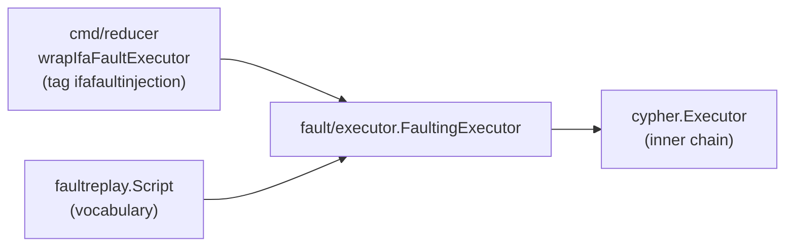

# storage/cypher/fault/executor

Test-only fault-injection decorator for the Cypher `Executor` seam.

## What lives here

- `fault.go` (build tag `ifafaultinjection`) — `FaultingExecutor`, which
  wraps a parent-package `cypher.Executor` and applies three scripted faults
  from the `faultreplay` vocabulary: fail-graph-write-once-then-succeed
  (queue-retry and executor-retry lanes),
  restart-backend-between-phase-groups, and hold-statement-before-delegation
  (see `hold.go`). Unscripted capabilities delegate to
  the inner executor; an inner that lacks a grouped, phase-grouped, or
  probe surface fails closed instead of silently skipping.
- `hold.go` (same tag) — the hold-statement-before-delegation seam (#8539):
  one-shot engage on an operation substring, synchronous marker write naming
  the matched statement, then block on sentinel-removal/`ctx.Done()` without
  ever delegating while held. Split from `fault.go` to hold the repo's
  500-line file cap.
- `marker.go` (same tag) — the once-fired marker and restart trigger
  record: how an out-of-process gate learns the once-fault fired and on
  which statement. Same cap split as `hold.go`.
- `off.go` (build tag `!ifafaultinjection`) — `NewFaultingExecutor` as a
  no-op returning the inner executor unchanged, so default builds link no
  fault machinery (including no hold: a hold blocking outside the tag would
  hang production writes).

## Where this fits



The only production caller is `go/cmd/reducer/ifa_fault_wiring.go`, which
constructs the decorator from `ESHU_IFA_FAULT_SCRIPT` and arms its
executor-retry lane below the reducer's persistent `RetryingExecutor`.
The deferred Docker gate `scripts/verify-ifa-fault-injection.sh` is the
live proof; unit proof is the tagged tests in this directory.

## Invariants

- No Cypher text lives here: the decorator matches on statement ordinals
  and substrings (the hold's `operation_match` included) but never authors
  statements, so a move cannot change projected graph truth.
- The hold's marker (`<sentinel>.statement-held`) and the once marker
  (`<sentinel>.once-fired`) both derive from the wiring's sentinel path, so
  the gate derives each from the fault-script path the same way; the
  Go/shell write-failure prefix mirror is pinned by
  `scripts/test-verify-ifa-fault-injection.sh`.
- `HoldFired()` turns true only after the hold marker write returns (#9063).
  A separate `holdEngaged` flag carries the one-winner CompareAndSwap, so an
  in-process observer that sees the hold as fired can always read the
  marker. `TestFaultingExecutorHoldFiredWaitsForMarkerWrite` pins this with a
  FIFO marker path that blocks the write.
- No production, CI, or default-tag build links `FaultingExecutor` — only
  the `off.go` stub. The `test-verify-ifa-fault-injection.sh` gate asserts
  both files exist and carry their build tags.
- `cypher` (the parent package) never imports this package. The dependency
  runs one way — `fault/executor -> cypher` for the `Executor`,
  `Statement`, and capability interfaces — so the seam stays cycle-free.

## Proof

```sh
cd go
go test ./internal/storage/cypher/fault/executor/... -count=1
go test -tags ifafaultinjection ./internal/storage/cypher/fault/executor/... -count=1
```

## No-Regression Evidence (#8539): per-statement hold is tag-gated test machinery

No-Regression Evidence: the hold seam (hold.go, fault.go paths, the
faultreplay hold-statement-before-delegation kind) ships only behind the
ifafaultinjection build tag; default builds link the off.go stub, proven by
off_test. No Cypher is authored here (ordinal and substring match only), and
no node-write, retract, or trust-chain files change in this diff, so default
builds project identical graph truth.

- Baseline: origin/main before this change (no hold kind; off stub only).
- After: go test -race ./internal/replay/faultreplay/ ok; go test
  ./internal/storage/cypher/fault/executor/ ok (default and -race -tags
  ifafaultinjection); go test -race ./internal/reducer/ ok; bash
  scripts/test-verify-ifa-fault-injection.sh passes 73/73 cells across 4
  shards with exact cover; go vet, gofmt, and git diff --check clean.
- Backend/version: hermetic (no live backend in this proof); the live kill
  cell on pinned Neo4j runs in the CI fault-injection matrix.
- Input shape: fault scripts with operation_match anchors; 73-cell corpus.
- Terminal counts: 73/73 cells, 0 unexplained; derived-pins 27 families
  totality ok.

No-Observability-Change: no spans, metrics, logs, or status fields added.
Hold and fail surfaces report through the existing failgraphwrite path and
cell assertions, so current gate signals are unchanged.

## No-Regression Evidence (#9063): hold publish order

No-Regression Evidence: #9063 moves the hold's one-winner CompareAndSwap to
a new holdEngaged flag and stores holdFired after writeHoldMarker returns.
Only the ifafaultinjection build links this code; default builds still link
the off.go stub. No Cypher is authored and no graph write changes.

- Before: TestFaultingExecutorHoldBlocksExecuteUntilSentinelRemoval failed
  18 of 3000 runs at -cpu=4 (read hold marker while held: no such file or
  directory). TestFaultingExecutorHoldFiredWaitsForMarkerWrite, which blocks
  the marker write on a FIFO, failed every run.
- After: both tests passed 3000 of 3000 runs at -cpu=4 (-tags
  ifafaultinjection, Go 1.26.10), and the package passes -race with and
  without the tag.

No-Observability-Change: no spans, metrics, logs, or status fields change.
A failed marker write still prints the HoldMarkerWriteFailedPrefix line.
