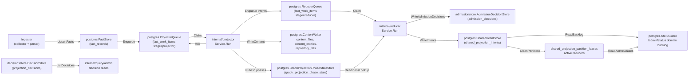
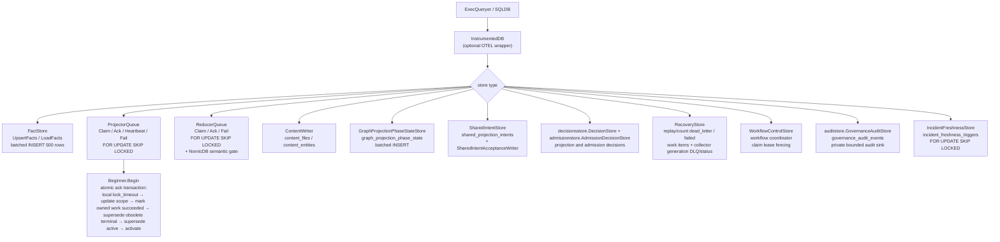

# storage/postgres

`storage/postgres` owns Eshu's relational persistence layer: facts, queue state,
content store, status, recovery data, projection and admission decisions,
webhook refresh triggers, shared projection intents, AWS scan status, and
workflow coordination tables. It is the single durable source of truth for
pipeline state that projector, reducer, ingester, collectors, and the API
surface all share.

## Where this fits in the pipeline

## Internal flow

## Lifecycle / workflow

The detailed lifecycle contract lives in
[`lifecycle-and-workflow-guide.md`](lifecycle-and-workflow-guide.md). Keep that
guide current when changing bootstrap DDL ordering, fact persistence, projector
or reducer queue behavior, workflow fencing, graph projection phase state,
webhook triggers, AWS scan status, or runtime drift evidence loading.

How retired, removed, tombstoned, and superseded evidence is kept out of active-generation reads — the candidate-case matrix,
the two retirement mechanisms, and the index/pointer-bounded retraction shape — is documented in
[`retirement-proof-matrix.md`](retirement-proof-matrix.md) and proven by `proof_domain_retirement_test.go` here plus
`retirement_retract_proof_test.go` in `internal/reducer`.
Operator retirement also removes the repository's derived scopes and refuses a scan still in flight:
[`derived-scope-retirement.md`](derived-scope-retirement.md) (#10054).

High-signal invariants for this package:

- Bootstrap DDL is idempotent and ordered through `BootstrapDefinitions`.
- `TestDDLMigrationParity` (`ddl_migration_parity_test.go`) scans non-test Go
  DDL string literals and requires every declared table, column, index, named
  constraint, trigger, function, sequence, view, type, and domain to appear in
  a numbered `migrations/*.sql` file (unreadable dynamic DDL must be listed in
  `ddlParityDynamicDDL`). Keep Go `EnsureSchema` DDL in lockstep with
  `migrations/*.sql`.
- Cold-bootstrap content search indexing (`content_substring_index_state`)
  defers the four trigram GIN indexes during cold bootstrap until projection
  drains, then builds, `ANALYZE`s, verifies catalog shape, and publishes `ready`.
- Fact writes batch at 500 rows, deduplicate `fact_id` per batch, strip JSONB
  control bytes (`sanitizeJSONB`), and skip unchanged pending/active generations.
- `VulnerabilitySuppressionStore` serializes operator scope mutations with a
  row lock, clones the latest pending/active/failed full set into an immutable
  generation ordered by lock-acquisition timestamp, and commits identical
  payloads as no-ops unless the lineage head failed.
- Canonical impact winners denormalize `suppression_expires_at` (migration 083)
  so expired suppressions fail open without scanning all winners.
- Projector claims enforce one active source-local generation per `scope_id`,
  reclaim expired leases first, coalesce stale work, and atomically activate
  generations (`ProjectorQueue.Ack`). Superseded work preserves prior failure
  metadata in `failure_details.prior_failure` (`priorFailure*SQL`). Delta
  generations are fenced at preflight and Ack against the active commit
  (`deltaBaselineFenceQuery`); marked writing generations and full generations
  are spared from premature supersede by the claim sweep and oldest-ready hold.
- Under `ESHU_CHANGED_SINCE_LINK_ENABLED` (dark), `ProjectorQueue.Ack` journals
  activations into `changed_since_activations` under the try-only shared gate
  (`linksfreshnessstore.AckJournalGateSQL`) and records
  `eshu_dp_changed_since_ack_journal_total`.
- Generation liveness reopens `source_local` only for non-progressing blockage
  (`generationIntentProgressingPredicate`), excluding `repo_dependency` runs
  owned by the shared resolver.
- Reducer claims fence unleased older-generation rows read-only at hand-out
  (`reducer_claim_stale_gate_sql.go`) while `ReducerStaleGenerationSweeper`
  supersedes them out of band. Supply-chain holder fan-out rules live in
  [`HOLDER_FANOUT.md`](../../reducer/supplychain/core/HOLDER_FANOUT.md) and
  [`HOLDER_FANOUT_INFLIGHT.md`](../../reducer/supplychain/core/HOLDER_FANOUT_INFLIGHT.md).
- Workflow, AWS pagination, AWS scan-status, webhook, incident freshness, and
  hosted tenant/workspace grant stores use fencing, coalescing, or idempotent
  conflict keys so stale workers or replayed deliveries cannot overwrite newer
  durable truth.
- Identity, session, grant, and SSO storage (`GovernanceAuditStore`, tenant/workspace
  grants, scoped API tokens, hash-only browser sessions with OIDC staleness and
  policy-revision rechecks, local identity bootstrap/invites/MFA/break-glass,
  and hash-only SAML SSO) never store raw secrets, cookies, tokens, or IdP XML.
  Active reads enforce status, tombstone, expiry, and policy revision in SQL.
- Repository refs (`repository_refs`) stay bounded by `(repo_id, ref_kind, name)`
  and replace only fresh ref sets. Documentation finding reads retain three
  partial indexes (migrations 065, 066, and 003 for ACL-filtered aggregates).
- Curated search-document projection persists BM25 documents, terms, and stats
  (`eshu_search_index_*`) plus write-fenced derived vector metadata/values
  (`EshuSearchVectorScopeStateStore`), keeping startup seeding fast without
  corpus-wide fact scans.
- Deferred relationship maintenance coordinates sharded ingesters through
  `deferred_maintenance_barriers` / `deferred_maintenance_barrier_arrivals`,
  commits per-repository batches under sorted per-repo advisory locks, reopens
  follow-up work in one separate transaction without fleet locks, and keeps
  non-committing shard arrivals join-only (`HasCommitted`) after each shard's
  one startup pass.
- `value_flow_fixpoint_components` caches solved value-flow components by
  content-derived key across restarts and replicas.

### Current IaC inventory index (#5262)

Migration `067_iac_active_inventory_index.sql` adds a concurrent partial
expression index for active-generation Terraform resource, module, and data
source discovery. It leads with `(scope_id, generation_id)` and carries only
entity kind, name, and id; source bodies and other large payload fields remain
outside the index. `PostgresIaCInventoryStore` uses this shape to select exact
current identities before graph hydration and to compute caller-authorized
search and bounded facets.

### Deferred maintenance lock partitioning (issue #3482)

Deferred relationship maintenance commits bounded per-repository-batch
transactions keyed with two-argument transaction advisory locks
(`hashtext(namespace), hashtext(repo)`), while normal generation commits take the
matching shared lock for their repository partition. Locks are acquired in sorted
repository order, evidence/readiness writes are idempotent, open barrier epochs
are recoverable by later shard arrivals, and non-repository scopes no longer wait
on repository maintenance.

### Multi-cloud runtime drift evidence loader (issues #1997, #1998)

`PostgresMultiCloudRuntimeDriftEvidenceLoader` backs
`DomainMultiCloudRuntimeDrift` by joining observed cloud inventory, active
Terraform state, and Terraform config through one canonical `cloud_resource_uid`
keyspace. The reads are bounded by `(scope_id, generation_id)`, observed-identity
allowlists, active generation joins, and tombstone filters; Azure ARM ids are
case-folded only for `/subscriptions/` identities, while AWS/GCP identity casing
stays exact.

This is the WRITE-side join; the READ-side sibling
(`cloud_runtime_drift_aggregate_findings.go`, #5759 follow-up) is a different
concern living on `MultiCloudRuntimeDriftFindingStore`:
`ListActiveFindingsAcrossProviders`/`CountActiveFindingsAcrossProviders` query
BOTH `reducer_multi_cloud_runtime_drift_finding` and
`reducer_aws_cloud_runtime_drift_finding` (the fact kind
`AWSCloudRuntimeDriftFindingStore` also reads) in one SQL query, so the
provider-neutral runtime drift readback genuinely covers all three providers
instead of silently returning nothing for `provider=aws`. The write-side
partition is untouched: `DomainAWSCloudRuntimeDrift` is still the sole writer
of `reducer_aws_cloud_runtime_drift_finding`, and
`MultiCloudRuntimeDriftHandler.Handle`'s `excludeAWSOwnedRows` still drops any
AWS-provider row before publication. The fact_kind set to scan is chosen
BEFORE the query is built (`cloudRuntimeDriftAggregateFactKinds`): `aws`
selects only the AWS fact kind, `gcp`/`azure` select only the provider-neutral
one (narrowed by its stored `payload->>'provider'` column, unchanged from
before this aggregation), and an unfiltered request selects both with no
provider predicate at all -- so ordering (`observed_at DESC, fact_id ASC`)
and `LIMIT`/`OFFSET` are computed once, globally, by Postgres, and a deep
page stays correct across the merged set rather than requiring the caller to
over-fetch and re-sort in Go.

### Graph node owner ledger (#5007)

`ownerstore.GraphNodeOwnerStore` (`graph/owner/store.go`, migration
`056_graph_node_owner.sql`) is the
Postgres-atomic resolver for cross-scope same-uid node ownership. When two
ingestion scopes carry the same resource identity, both project the same
canonical node uid and race to write its scope-derived properties; NornicDB does
not reliably detect concurrent property-write conflicts on a shared existing
node (#5062), so the graph write alone cannot pick a deterministic winner.
`ResolveOwnedUIDs` runs the per-uid critical section against a caller
transaction: it acquires all per-uid transaction-scoped advisory locks in one
sorted statement (deadlock-free), batch-upserts the `graph_node_owner` ledger
keeping the max `(observed_at, source_fact_id)` order key
(`ON CONFLICT (uid) DO UPDATE ... WHERE excluded.source_order_key >
graph_node_owner.source_order_key`), reads the winning order key back, and
returns the uid set the batch currently owns plus a contended-lost count. The
caller (`internal/graphowner`) writes only the owned rows to the graph and
commits to release the locks. The table is keyed on uid alone (canonical uids
are globally unique across labels) and stores the winning row as JSONB for the
Stage 2 provenance foundation.

Migrations `070` through `073` add four concurrent, partial ordered indexes over
the winning row's resource type and the optional provider, region, or account
prefix. Each concurrent index is its own bootstrap definition so Postgres can
build it in autocommit mode. `PostgresCloudResourceListStore` uses them
to select an authorized `limit+1` CloudResource identity page before graph
hydration. The indexes intentionally do not `INCLUDE (winning_row)`: copying
every JSONB document into four indexes would multiply write and storage cost for
fields the page order does not need.

Migration `086_cloud_resource_owner_runtime_digest_index.sql` adds the ordered
`(running_image_digest, arn, uid)` read path used by supply-chain runtime
evidence. Its strict partial predicate admits only CloudResource rows with
nonblank, non-whitespace digest and ARN anchors. On a representative
200,000-row, mostly-empty owner ledger this kept 10,000 entries instead of
200,000, reduced index size from 8,536,064 B to 1,720,320 B, and reduced
concurrent build time from 71.065 ms to 39.480 ms. Identical 20,000-row inserts
improved from 61.638 ms to 44.413 ms and unrelated JSON updates from 78.884 ms
to 50.167 ms, with `EXCEPT ALL` reporting `0/0` table differences. The query
repeats the exact trim-aware predicate so Postgres can prove partial-index
eligibility, then materializes at most 200 deterministic candidates before
freshness and authorization checks.

Migration `074_graph_node_owner_backfill_state.sql` records completion of the
one-time CloudResource upgrade backfill. `ownerstore.GraphNodeOwnerBackfillStore`
(`graph/owner/backfill.go`) seeds
graph rows written before migration 056 in 500-row transactions, using the same
sorted per-uid advisory locks and monotonic max-upsert as the reducer gate. Each
seed uses a year-1 order key. It can populate an empty ledger, but it cannot
displace any real reducer owner, including one committed while the backfill is
running. The completion marker is written only after every graph page commits;
a failed or interrupted run retries idempotently on the next API or MCP startup.
See `graph/owner/README.md` for the package's own documentation.

## Exported surface

The full exported store inventory lives in
[`exported-surface-guide.md`](exported-surface-guide.md). Keep that guide in
lockstep with public constructors, schema helpers, reducer/query adapters, and
callable store contracts.

Primary groups:

- Database adapters: `db.ExecQueryer`, `db.Transaction`, `db.Beginner`,
  `SQLDB`, `SQLTx`, `InstrumentedDB` (`db.*` in `storage/postgres/db`).
- Fact, queue, recovery, status, workflow, and webhook stores. `FactStore` also
  provides a bounded CI/CD source-snapshot rebuild for artifact-only correlation
  patches. The history read selects the newest older generation containing
  `ci.run`, unions exact live artifact keys, and reloads tombstone-aware
  workflow-image and deployment evidence at or after that normal snapshot. A
  live artifact may recover only an older omitted run's `ci.run` anchor; its
  pre-baseline ancillary evidence stays absent. Payload-empty artifact
  tombstones are negative stable-key controls, never run-routing inputs. The
  reducer applies current non-artifact facts by exact typed stable identity,
  removes valid tombstone controls before classification, and fails closed only
  when a tombstone has no stable identity.
  For static workflow correlation, `ListActiveCICDWorkflowImageFacts` resolves
  the CI runs' canonical repository owners through the indexed Git scope
  `partition_key`, admits active default and explicit-ref scopes only, excludes
  tombstones and inactive generations, and returns deterministic rows with a
  12,000-fact cap-plus-sentinel failure. The reducer applies a second typed
  owner fence before using those facts.
- Governance audit store for validation-safe private event persistence,
  authorized bounded detailed reads, retention pruning, and aggregate-only
  status readback.
- Generation retention store for bounded superseded-generation cleanup,
  hashed retention events, changed-since expiry proof, identity-safe content
  pruning, and the pruned generations' changed-since ledger rows (#7127).
  Each pass first pre-deletes its candidates' `eshu_search_index_terms` and
  `eshu_search_index_documents` rows in committed 20,000-row batches through
  `search/index/retention` (#7427), bounded by
  `GenerationRetentionPolicy.SearchIndexPredeleteRowCap` (default 2,000,000)
  and `SearchIndexPredeleteDeadline`, and admits to its prune only drained
  generations whose advisory lock (class 7427) it takes; the rest are skipped
  as `search_index_undrained` or `advisory_lock_busy`. Migration 191 (#7427
  PR3) dropped the terms generation key, so no terms statement runs under the
  scope lock; late orphan terms are read-invisible and swept by the census.
- Service-scoped incident evidence loader for the incidents service-evidence
  family. It resolves PagerDuty provider service ids to catalog service ids
  through active exact/derived reducer correlation facts and fails closed for
  ambiguous repository ownership.
- Installed advisory target readers for active OS package and active attached
  SBOM component evidence used by vulnerability-intelligence planning.
- Content stores and content writers, including bounded entity-batch
  concurrency and Postgres pool-budget notes.
- Graph projection phase, shared projection intent, acceptance, freshness, and
  readiness helpers used by reducer domains. Exact intent retries preserve
  completion; the repo-refresh history lookup includes `generation_id` so a
  reused source run cannot open a later generation's fence. Acceptance rows
  are advance-only (#6679): each row stores its generation's ordering key,
  `generation_ingested_at` (migration 125, no backfill), and an upsert
  carrying a generation that sorts before the stored one by
  `(generation_ingested_at, generation_id)` is skipped and counted in
  `eshu_dp_shared_acceptance_stale_writes_total`. A same-generation retry still
  refreshes the row. A NULL stored key (a row from before #6679) is resolved
  from `scope_generations` inside the guard and filled by the next applied
  write. Batches are written in primary-key order so overlapping writers
  cannot deadlock.
- Hosted isolation and dashboard auth stores, including tenant/workspace
  grants, scoped API tokens, browser sessions, OIDC login state and group-role
  mappings, and dormant identity subject tables.
- Projection and admission decision stores for reducer-owned write decisions
  and scope/generation/domain-bounded correlation admission explanations.
- Fact indexes for reducer-owned package and service-catalog correlations,
  including service-catalog candidate repository IDs used by ambiguous
  repository-scoped API/MCP readbacks.
- Terraform and AWS drift adapters that keep reducer joins bounded by scope,
  generation, ARN allowlists, backend ownership, and active read-model indexes.
  `AWSCloudRuntimeDriftAdmissionBeginner` (#5848) adapts the shared `Beginner`
  into `awscloud.AWSCloudRuntimeDriftBeginner` / `awscloud.AWSCloudRuntimeDriftTx`, wiring
  `PostgresAWSCloudRuntimeDriftWriter`'s begin-before-mutate insert-admission
  check, versioned upsert, and generation-authoritative retire into one
  transaction — mirroring `servicecatalog.ServiceMaterializationBeginner`.
  `PostgresAWSCloudRuntimeDriftReadinessChecker` reports whether a Terraform
  `state_snapshot:*` scope is still mid-ingestion, backing the reducer's bounded
  readiness defer for #5837's cross-scope activation race.
- `EshuSearchDocumentStore` reads curated design-430 search documents
  (`reducer_eshu_search_document`) for a scope's active generation, bounded by
  repository, source kind, and a capped page.
- `EshuSearchVectorScopeStateStore` reads only ready active projection scopes
  whose vector state is missing, building, failed, or on an older projection
  revision. The scope list stays bounded by the requested limit and vector
  identity.
- `FunctionSummaryStore`, `FunctionSourceStore`, `FunctionGraphIDStore`, and
  `ValueFlowFixpointComponentStore` persist the durable value-flow inputs and
  solved component results used by the reducer's post-summary fixpoint.

## Dependencies

- `internal/facts` — `facts.Envelope`
- `internal/projector` — `projector.ScopeGenerationWork`, `projector.Result`,
  `projector.IsRetryable`
- `internal/reducer` — `gpphase.ReadinessLookup`, `reducer.AcceptedGenerationLookup`; `internal/reducer/sharedintent` — `sharedintent.Row`; `internal/reducer/contract` — `reducercontract.Domain`
- `internal/recovery` — recovery store interface contracts
- `internal/scope` — `scope.ScopeKind`, `scope.GenerationStatus`,
  `scope.TriggerKind`
- `internal/status` — status store interface contracts
- `internal/telemetry` — `telemetry.Instruments` for `InstrumentedDB`
- `internal/workflow` — `workflow.ClaimSelector`, `workflow.ClaimMutation`; with `IngestionStore.ClaimPlane` set, claimed commits whose claim the extracted claim plane holds are fenced across services (pin before BEGIN, `generation_commit_fences` row, Go-clock deadline before COMMIT; migration 270, #9376) instead of `HeartbeatClaim` on the fact transaction, see `claim/fence/README.md` and `ingestion_claim_fence.go`
- `database/sql` — standard library

## Telemetry

- `eshu_dp_postgres_query_duration_seconds` — histogram per SQL operation,
  labeled `operation=read|write` and `store=<StoreName>`; recorded by
  `InstrumentedDB`
- Spans: `postgres.exec` and `postgres.query` from `InstrumentedDB`; carry
  `db.system=postgresql`, `db.operation`, and `eshu.store` attributes
- `InstrumentedDB.Begin` (#5848 adjacent fix) wraps the returned transaction
  (`instrumented_transaction.go`) so `ExecContext`/`QueryContext` calls issued
  through it still record `eshu_dp_postgres_query_duration_seconds` — before
  this the transaction was returned unwrapped and every statement inside it
  bypassed the histogram silently. Any caller that opens a transaction over an
  `InstrumentedDB`-wrapped connection (`PostgresServiceMaterializationWriter`,
  `PostgresAWSCloudRuntimeDriftWriter`) now keeps the same observability
  non-transactional writes get.
- `awsstore.AWSPaginationCheckpointStore` records AWS checkpoint load, save,
  resume, expiry, and failure events through
  `eshu_dp_aws_pagination_checkpoint_events_total`.
- `PostgresAWSCloudRuntimeDriftEvidenceLoader` and
  `PostgresMultiCloudRuntimeDriftEvidenceLoader` label reads on `postgres.query`
  spans (`aws_runtime_drift_resources`, `aws_runtime_drift_active_state_by_arn`),
  log malformed rows with fingerprints only (`state_resource_payload_decode`,
  `state_resource_arn_redacted`), and drop redacted comparable attributes (and
  image-packaged Lambdas missing `image_uri`) per-attribute via
  `valueAttributeDecode`/`DegradedAttributes` so readable attributes still report
  drift while unreadable pairs report `value_comparison_inconclusive` instead of
  silently converging.

To add instrumentation to a store, wrap the `ExecQueryer` passed to its
constructor with `InstrumentedDB{Inner: db, StoreName: "my_store", ...}`.

## Operational notes

- `eshu_dp_postgres_query_duration_seconds{store="queue", operation="read"}`
  elevated means claim latency is high; check `FOR UPDATE SKIP LOCKED`
  contention and index coverage on `fact_work_items`.
- `eshu_dp_postgres_query_duration_seconds{store="facts", operation="write"}`
  elevated means fact batch writes are slow; check connection pool and batch
  size (default 500).
- Dead-letter items accumulate in `fact_work_items` when a retry budget is
  spent; replay with `RecoveryStore` after investigating `failure_class`. A
  replay grants a new row's retries via `replay_attempt_baseline` (#11182).
- An unbounded `ReplayFailedWorkItems` locks rows first in
  `work_item_id COLLATE "C"` order (`FOR NO KEY UPDATE`), matching `AckBatch`,
  own-gate wake, poison recovery, retention cascade, admin skip, and projector
  Ack obsolete supersede so overlapping sweeps stay deadlock-free; bounded
  replays keep `SKIP LOCKED`.
- A `*_producer_dead_lettered` or `*_producer_missing` dead letter on
  `deployable_unit_correlation` or `workload_materialization` means the scope's
  `deployment_mapping` producer is dead-lettered or absent; replay the producer
  first. `RelationshipStore.activateWithConsumerWake` reopens matching consumers
  in the activation transaction and records `eshu_dp_reducer_own_gate_wake_total`.
- `ErrProjectorClaimRejected` or `ErrReducerClaimRejected` in logs means a
  heartbeat or ack arrived after lease expiry; the original worker must stop and
  not retry the ack.
- `graph_projection_phase_state` rows gate reducer edge domains. If missing
  for a scope generation, check `GraphProjectionPhaseRepairQueueStore` depth and
  projector logs for `publish_phases` stage errors.
- `graph_endpoint_presence` (migration `024`, `GraphEndpointPresenceStore`) is
  the uid-exact, **cross-scope** endpoint-readiness primitive for the secrets/IAM
  graph projection (issue #1380). Keyed by `(keyspace, uid)`, it is written
  idempotently by the CloudResource and KubernetesWorkload node materializers
  only when the projection feature is enabled, and read via `MissingUIDs` (one
  bounded `uid = ANY(...)` query). Unlike `graph_projection_phase_state` it proves
  a *specific node* committed, which the scope/generation-keyed phase table
  cannot express across scopes.
- `secrets_iam_endpoint_not_ready` is a non-counting reducer retry class. It
  stays `retrying` with normal backoff and preserves the specific failure class,
  but single and batch claims do not increment `attempt_count` while that class
  is pending. This lets cross-scope endpoint readiness wait past
  `ESHU_REDUCER_MAX_ATTEMPTS` without terminally dropping edges.

- The package-consumption sidecar backfill
  (`package_manifest_consumption_backfill.go`) rebuilds each scope through
  `consumption.Rebuilder`. A short start transaction clears the scope's
  sidecar rows and fences it dirty. Then one transaction per 500-fact page
  re-derives the keys, and the last page clears the dirty row only when its
  `xmin` is unchanged. Each transaction holds the scope row `FOR NO KEY
  UPDATE`, so foreign-key inserts for the scope never wait, and a lock wait
  over 5 s fails the pass with SQLSTATE 55P03 so the scope retries on the next
  pass. Per-scope `package_manifest_consumption_keys.backfill.progress` and
  `.scope_failed` log lines carry pages, facts, transactions, the longest
  transaction, and scope-row lock wait.
  `eshu_dp_package_manifest_backfill_page_duration_seconds`,
  `eshu_dp_package_manifest_backfill_scope_lock_wait_seconds`, and
  `eshu_dp_package_manifest_backfill_scope_rebuilds_total` carry the same
  signals as metrics. Migration 181's partial index keeps every page an
  ordered index range scan. Evidence:
  (#7663).

## Extension points

- New store — implement against `db.ExecQueryer`; wrap with `InstrumentedDB` for
  observability; add a `*SchemaSQL()` function and register in
  `BootstrapDefinitions` if the store needs a new table.
- New queue domain — extend `ReducerQueue.Claim` domain filter; add the domain
  constant in `internal/reducer`.
- New schema table — add a `Definition` to `bootstrapDefinitions` in
  `schema.go`; keep DDL idempotent; place FK-dependent tables after their
  referenced tables in the slice.

## Gotchas / invariants

Key sidecar deletes (#7420): every statement that deletes `fact_records`
rows, directly or through the `scope_generations` cascade, either deletes
only kinds that own no key sidecar rows or first deletes the three key
sidecars (`relationship_reference_candidate_keys`,
`package_manifest_consumption_keys`, `package_registry_identity_keys`)
explicitly, in that order, keyed by `(scope_id, generation_id)` and, on the
over-limit chunk path, the page's fact ids
(`facts/keys`, migrations 182 and 183 for the package
key partition indexes). `TestFactRecordDeleteSitesAreKeySidecarSafe` fails
on an unclassified or unpaired fact delete. Retention refuses the cycle with
`ErrGenerationRetentionKeyIndexUnavailable` when a partition index or a generation index
(intents, migration 292, #10512; work-items count arm and lock, migration 294, #10525)
is missing, invalid or misshapen, as for the #7279 key indexes. Migrations 188 to 190 drop
the per-fact foreign keys, so these deletes alone remove key rows with their
facts; `factkeys.OrphanCensusSQL` counts any orphan (see `facts/keys/README.md`).
Evidence: (#7420).

Detailed query, queue, fact-readback, runtime, and fencing invariants live in
[`gotchas-and-invariants.md`](gotchas-and-invariants.md). Keep that companion
note current when changing storage behavior that touches those contracts. Producer-terminal wake locality (#11114): an Ack reopens a narrowed same-scope wait (`same_scope_generation`, the #8827 reconciliation and #11105 impact waits) only through the keyed wake for its own scope, generation, and domain; only `cross_scope` classes (the #7816 catalog runtime wait, whose fence reads other repository scopes) ride the cross-scope leg, so a foreign Ack no longer costs every parked waiter a claim, probe, and re-park. A commit that refuses or skips a generation still returns nil and says so on the caller's `collector.CommitDisposition` box (#10037): the destructive-successor guard and the retirement gate mark it refused, and the duplicate check and a finalized replay mark it `unchanged_skip`. The ingestion commit's #7926 destructive-successor guard sizes like for like (#8750): collector rows only, and a git delta by its file union against the anchor the projector also overlays on; see the guard bullet there.

- A `fact_records` write whose `fact_id` is already held by another scope or another generation never changes that row (#11203): the upsert's conflict WHERE requires the stored `scope_id` and `generation_id` to match, `selectUnchangedFactIDs` classifies the skipped ids as unchanged, owner conflict, or fenced out in one statement, and the streaming save returns `*FactIDOwnerConflictError` at the first conflicting batch. `IngestionStore` answers by refusing the whole generation (rolled back, the prior generation keeps serving) with the closed reason `fact_id_owner_conflict`, `eshu_dp_fact_id_scope_conflicts_total{reason}`, and one ERROR log of ids, never payloads. See [AGENTS.md](AGENTS.md).

## Related docs

- `docs/public/architecture.md` — pipeline and ownership table
- `docs/public/deployment/service-runtimes.md` — runtime lanes and Postgres config
- `docs/public/reference/telemetry/index.md` — metric and span reference
- `docs/public/reference/local-testing.md` — Postgres verification gates
- ADR: `docs/public/reference/backend-conformance.md`
- ADR: `docs/public/reference/graph-backend-operations.md`
