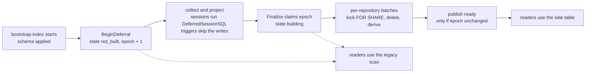

# lines

## Purpose

`lines` owns the bulk-load lifecycle of `content_file_secret_lines`, the
Postgres side table that holds one row per hardcoded-secret finding line
(#7125). Migration 138 derives those rows inside Postgres with statement-level
triggers on `content_files`. This package lets a bulk load (bootstrap-index)
skip that derivation and rebuild the table once at the end.

## Why it exists

The trigger adds about 0.6 ms of Postgres time per new file on an idle 16 vCPU
host (measured on 12,000 real files), 58 percent of the `upsert_files`
statement on a bootstrap-shaped load. The bootstrap stage budget cannot absorb
that. The bootstrap path already treats the content substring indexes the same
way (deferred, then built by a finalizer behind `content_substring_index_state`),
so the side table follows the same shape.

## Lifecycle

## Exported surface

- `DeferredSessionSQL`, `SessionSetting` - the per-session setting migration
  138's triggers test in their `WHEN` clause
- `BeginDeferral` - opens an epoch and takes readiness away before the first
  deferred write
- `Finalize`, `Options`, `Result`, `Database` - the repository-partitioned,
  restart-safe rebuild that publishes ready
- `AcquireBulkLoadLock`, `BulkLoadLock`, `LockOptions`, `Conner`,
  `BulkLoadLockClass`, `BulkLoadLockID` - the run-scoped exclusivity of one
  deferred bulk load (session advisory lock `(5318,1)`)
- `Repairer`, `NewRepairer`, `RepairOptions`, `RepairOutcome` and its values -
  the steady-state rebuild the reducer runs whenever the state is not ready
  (#8833); `TryAcquireBulkLoadLock` - its non-waiting form of the run lock
- `Ready`, `RowQueryer` - the existing SQL readers' gate
- `ReadyWithRowQueryer` - the same readiness check through a guarded read port
- `StateNotBuilt`, `StateBuilding`, `StateReady`, `StateFailed` - the bounded
  states of `content_file_secret_lines_state`

## Operations

- Inserts, content or language changes, and key moves re-derive a file's
  findings in the statement-level triggers. Deletes, including retention
  prune, cascade through the foreign key. Go code must not write the side
  table; `TRUNCATE content_files` must name it or use `CASCADE`.
- The detection pattern, classification CASE, and `suppressed` expression are
  bound to `internal/query`'s Go definitions by tests. Change them only with
  a new migration that re-derives the table. Only bootstrap-index may run
  `DeferredSessionSQL`; never disable the triggers with `ALTER TABLE`.

- Check readiness:
  `SELECT state, epoch, build_started_at, build_completed_at, failure_class FROM content_file_secret_lines_state;`
- `state = 'ready'` is the only state readers serve from the side table.
  `not_built`, `building`, and `failed` all send reads to the legacy scan; the
  investigation response then carries `coverage.read_path = "legacy_scan"` and a
  limitation, the span attribute `eshu.hardcoded_secret.read_source`, and the
  counter `eshu_dp_hardcoded_secret_reads_total{source="legacy_scan"}`.
- Finalizer signals: log events `secret_lines.finalize_started`,
  `secret_lines.finalize_progress` (every 10 s), `secret_lines.finalize_complete`
  and `secret_lines.finalize_failed`; the run lock's
  `secret_lines.bulk_load_lock_acquired`, `_refused`, `_released` and
  `_release_failed`, and `bootstrap.postgres.ownership.waiting` with
  `lock=bulk_load` while a second run waits; counters
  `eshu_dp_secret_lines_backfill_batches_total{outcome}` and
  `eshu_dp_secret_lines_backfill_files_total`; the phase histogram
  `eshu_dp_bootstrap_pipeline_phase_seconds{bootstrap_phase="secret_lines_finalization"}`.
- A state that is not `ready` is repaired by the reducer's `Repairer` (#8833):
  each poll reads the state and, for a state that is not `ready`, calls
  `TryAcquireBulkLoadLock` on a dedicated one-connection pool: a non-waiting
  try of `(5318,1)` and then of `(5318,2)` exclusive. It runs `Finalize` for the
  current epoch only while holding both, then releases both. It skips (counted
  `skipped_locked`, event `secret_lines.repair_skipped` with `reason=locked`
  or `reason=deferred_writers`, `lock=` and `holder=`) while a bootstrap-index
  run holds either lock, and backs off after a failure. A cancelled context
  (shutdown) is `outcome=cancelled` with a Warn `secret_lines.repair_cancelled`
  that carries the `error` text, not a failure. It also logs `_started`, `_complete`, and `_failed`, and counts
  `eshu_dp_secret_lines_repair_runs_total{outcome}`. On 150,000 files in 677
  repositories it published in about 42 s with no concurrent writer. Rerunning
  `bootstrap-index` also repairs it; both paths are idempotent.
- Two locks, because one is not enough. `(5318,1)` is the run lock, held on one
  pinned session; that session can die while the pool sessions keep writing
  deferred rows (an idle session timeout, a failover, a terminated backend), and
  a Repairer that only checked `(5318,1)` would then publish `ready` over rows
  nobody derived. `(5318,2)` is held shared by every deferred-writer session
  from birth (`RunFence.Hook`, installed in the pool's connect options after
  `DeferredSessionSQL`), so the Repairer, which needs it exclusive, yields while
  any writer lives. The hook then checks, through `pg_locks`, that the run's own
  pinned session still holds `(5318,1)` and returns `ErrDeferredSessionRefused`
  when it does not, so a connection born after every session died cannot write
  under a `ready` the Repairer already published. The hook waits for `(5318,2)`
  behind a rebuild; the rebuild holds nothing else and waits on nothing, so there
  is no cycle. The pinned session sends `SELECT 1` every 30 s (`LockOptions.
  KeepAliveInterval`) so `idle_session_timeout` does not end it; a failed ping
  logs ERROR `secret_lines.bulk_load_lock_lost`. A session whose unlock or try
  is uncertain is discarded (`driver.ErrBadConn`), never returned to a pool.
- One `bootstrap-index` at a time, enforced. `AcquireBulkLoadLock` takes the
  session advisory lock `(5318,1)` on a pinned connection from before
  `BeginDeferral` until after `Finalize`; a second run waits up to
  `ESHU_SCHEMA_BOOTSTRAP_OWNERSHIP_WAIT` (default 3 m), then fails naming the
  holder's pid, application name, connection age, lock and mode. The holder is
  normally another bootstrap-index run: a reducer rebuild is waited out earlier,
  because the probe below holds `(5318,2)` shared and the pool's connections
  keep it from then on, so a Repairer meets `(5318,1)` only in a non-waiting
  try. A bootstrap-index that starts during a rebuild first waits for
  `(5318,2)` the same way, on a probe session (`OpenDeferredWriterPool`, logged
  `lock=deferred_writers`); the rebuild is not an orphan, it ends when it
  publishes. The schema-bootstrap ownership wait uses the
  same bound too, so the worst case before work starts is three sequential
  ownership waits (probe, run lock, schema lock), 9 m by default. The epoch fence covers the
  remaining ordering: a finalizer that outlives its epoch after a crash and a
  rerun cannot publish over the newer load. Without the lock, two overlapping
  loads could publish `ready` over rows the second was still writing without
  derivation.
- Each lock dies with its backend, so a killed pod releases both at once. After
  a node death without a TCP close they linger until keepalive fires. Find the
  holders with
  `SELECT l.pid, l.objid, l.mode, a.application_name, a.backend_start FROM pg_locks l JOIN pg_stat_activity a USING (pid) WHERE l.locktype='advisory' AND l.classid=5318 AND l.objid IN (1,2) AND l.granted;`
  and clear a bootstrap-index orphan with `SELECT pg_terminate_backend(<pid>)`.
  Wait for a reducer rebuild instead.
- `bootstrap-index` must not run through a transaction-mode connection pooler.
  Such a pooler does not reset session settings between clients, so
  `DeferredSessionSQL` can stay on a server connection later handed to another
  binary, whose writes then skip derivation while the state is `ready`. A pooler
  that merely drops the setting only makes that session derive, slower but
  correct.
- A live writer blocked on a row a batch holds waits until that batch commits
  (lock, delete, and derive). A batch is bounded by `BatchSize` files (500) and
  by `MaxBatchBytes` of content (4 MiB, at least one file; the window scan adds a
  running `sum(octet_length(content))`), because the cost tracks bytes: 500
  large generated sources took 11.3 s, 4 MiB takes about 0.5 s. `LockTimeout` bounds only the finalizer's own waits,
  which is what makes the finalizer, not a writer, yield.

## Related

- `go/internal/storage/postgres/migrations/138_content_file_secret_lines.sql`
- `go/internal/query/content_reader_security_secrets.go` (the gated read)
- `go/cmd/bootstrap-index/bootstrap_finalize.go` (the caller)
- `docs/internal/evidence/7125-secret-lines-side-table.md`

## Shared pool composition

`BootstrapDeferredPoolOptions` is the one place that composes the probe pool
(plain, no hook) and the writer pool (`RunFence.Hook` plus
`DeferredSessionSQL`) for `OpenDeferredWriterPool`. bootstrap-index's
`openBootstrapDB` and the enrolled live tests both call it, so a test cannot
drift from production. Its opener is a `PostgresOpener`: production uses
`RuntimePostgresOpener`, and the unit tests use a recorder to pin that a dropped
hook (F1) or a hooked probe (F8) fails in CI-run tests.
