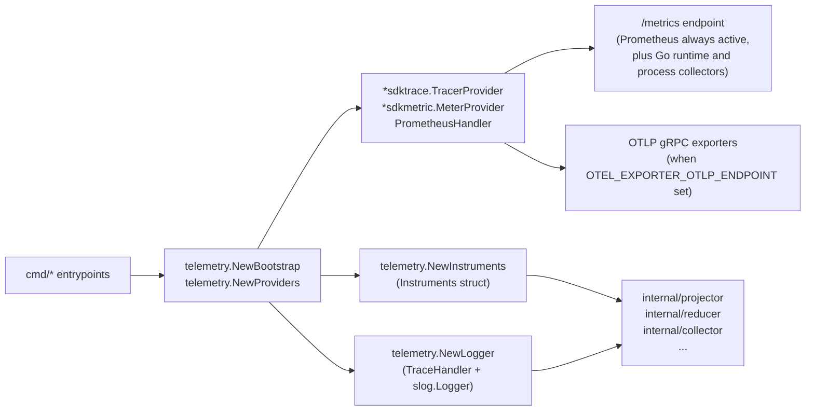

# Telemetry

## Purpose

`telemetry` owns Eshu's frozen Go data-plane OpenTelemetry contract: metric instruments, span names,
structured log keys, pipeline phase constants, attribute helpers, OTEL provider
initialization, and the trace-injecting `slog` handler. Every runtime-affecting
package in the data plane imports this package and nothing imports it back.

## Ownership boundary

`RuntimeStatusSnapshotAvailableMetric` names a per-response Prometheus gauge assembled by `internal/runtime`. It is intentionally not registered on the OTEL meter: concurrent scrapes can have different status outcomes. `RuntimeStatusSummaryStaleMetric` and `RuntimeStatusSummaryAgeSecondsMetric` are the same kind of gauge for the stored active-work summary served on the scrape (`model_key` label).

This package is the single source of truth for all `eshu_dp_*` metric names, span names, and log key constants. New names are registered here before being used anywhere else.
It does not own queue workers, graph writers, or HTTP handlers — it only defines the naming contract and the bootstrapping seams those packages call at startup.
Pipeline stage, graph-backend, and failure-class labels stay here so runtime packages do not invent local observability vocabularies.

See `docs/public/reference/telemetry/index.md` for the project-wide rules that
flow from this package.

## Package layout

The frozen per-family declarations (span names, metric dimensions, log keys,
and their bounded values) live one file per family under three leaf
subpackages so no single directory holds an unbounded, unreviewable pile of
files (issue #6777):

- `contract/` — most families: admission decisions, Azure relationships, bootstrap ingestion, CI/CD,
  collector runs and snapshot stages, graph-read outcomes, Kubernetes, language and language-query,
  package registry, prompt-facing query and code-topic partition spans, S3 external-principal
  grants, scanner-worker, security alerts, semantic extraction, service catalog, source-tool
  provenance, supply-chain/vulnerability findings, vulnerability intelligence, incident context,
  observability coverage, secrets/IAM, work-item evidence, generation lifecycle, changed-since
  reads, and config-artifact derives.
- `contract/observability/` — Grafana, Loki, Prometheus/Mimir, Tempo.
- `contract/thirdparty/` — Jira, PagerDuty, the live Vault collector's
  redaction dimension.

Root `contract.go` (untouched by #6777) still holds the majority-share frozen contract and is the
file to read first. `registration.go` and `registration_steps.go` hold the ONE explicit, ordered
`registrationSteps` list that splices every subpackage family into the root `spanNames`,
`metricDimensionKeys`, and `logKeys` slices — replacing the 23 independent, filename-sort-ordered
`func init()` bodies the flat `contract_*.go` layout relied on. That order is load-bearing
(anchor-based inserts) and pinned by `TestSpanNames`, `TestMetricDimensionKeys`, and `TestLogKeys`
in `contract_test.go`; see `registration.go`'s own comment before reordering it. Every identifier
the subpackages export is still available as a root `telemetry.*` name via `compat_contract.go`,
`compat_observability.go`, and `compat_thirdparty.go`, so no caller outside this package needed to
change.

## Where this fits in the runtime

## Exported surface

See `doc.go` for the godoc contract. Key groups:

### Bootstrap and providers

- `Bootstrap` — minimum OTEL runtime settings (service name, namespace, meter
  name, tracer name, logger name); built by `NewBootstrap`
- `Providers` — holds `*sdktrace.TracerProvider`, `*sdkmetric.MeterProvider`,
  `PrometheusHandler`, and a combined `Shutdown` function; built by `NewProviders`
- `NewProviders` — configures OTLP gRPC trace and metric exporters when OTEL_EXPORTER_OTLP_ENDPOINT is set; always creates a Prometheus exporter
- `RecordGOMEMLIMIT` — registers `eshu_dp_gomemlimit_bytes`; `NewProviders`
  calls it, so every runtime exports the gauge without its own call (#9567)

### Metric instruments

`Instruments` holds all pre-registered OTEL metric instruments. Create with `NewInstruments(meter)`.
Observable gauges require a separate `RegisterObservableGauges` call once the queue and worker observers are wired.
`RegisterAcceptanceObservableGauges` adds the `eshu_dp_shared_acceptance_rows` gauge when a shared-acceptance observer is available.
`RegisterGraphOrphanObservableGauge` adds `eshu_dp_graph_orphan_nodes` when the reducer has a graph orphan observer. Graph-backed gauge callbacks must
not read the graph on the collection goroutine; `telemetry/snapshot` refreshes them off the scrape path (#7062).

#### Counters (Int64)

| Field | Metric name |
| --- | --- |
| `FactsEmitted` | `eshu_dp_facts_emitted_total` |
| `FactsCommitted` | `eshu_dp_facts_committed_total` |
| `ProjectionsCompleted` | `eshu_dp_projections_completed_total` |
| `ProjectorAckDeferrals` | `eshu_dp_projector_ack_deferrals_total` |
| `ProjectorWriteMarkerDeferrals` | `eshu_dp_projector_write_marker_deferrals_total` |
| `QueueDeadLetters` | `eshu_dp_queue_dead_letters_total` |
| `ReducerIntentsEnqueued` | `eshu_dp_reducer_intents_enqueued_total` |
| `ReducerAdmissionDeferrals` | `eshu_dp_reducer_admission_deferrals_total` |
| `ReducerReadinessWaits` | `eshu_dp_reducer_readiness_waits_total` |
| `ReducerExecutions` | `eshu_dp_reducer_executions_total` |
| `ReducerHeartbeatMissed` | `eshu_dp_reducer_heartbeat_missed_total` |
| `SearchIndexMutations` | `eshu_dp_search_index_mutations_total` |
| `SearchIndexErrors` | `eshu_dp_search_index_errors_total` |
| `CanonicalWrites` | `eshu_dp_canonical_writes_total` |
| `CanonicalAtomicWrites` | `eshu_dp_canonical_atomic_writes_total` |
| `CanonicalAtomicFallbacks` | `eshu_dp_canonical_atomic_fallbacks_total` |
| `GraphOversizedIndexKeysSkipped` | `eshu_dp_graph_oversized_index_keys_skipped_total` |
| `GraphIndexKeyGuardUnanalyzed` | `eshu_dp_graph_index_key_guard_unanalyzed_total` |
| `SharedProjectionCycles` | `eshu_dp_shared_projection_cycles_total` |
| `SharedProjectionStaleIntents` | `eshu_dp_shared_projection_stale_intents_total` |
| `SharedProjectionPartitionHeartbeatMissed` | `eshu_dp_shared_projection_partition_heartbeat_missed_total` |
| `SharedProjectionLeaseQuarantines` | `eshu_dp_shared_projection_lease_quarantines_total` |
| `SharedAcceptanceUpserts` | `eshu_dp_shared_acceptance_upserts_total` |
| `SharedAcceptanceLookupErrors` | `eshu_dp_shared_acceptance_lookup_errors_total` |
| `SharedAcceptanceStaleWrites` | `eshu_dp_shared_acceptance_stale_writes_total` |
| `PackageManifestBackfillPasses`, `PackageManifestBackfillScopeRebuilds`, `PackageManifestBackfillPageDuration`, `PackageManifestBackfillScopeLockWait` | `eshu_dp_package_manifest_backfill_passes_total` (bounded `outcome`: contended, failed, incomplete, ready); `eshu_dp_package_manifest_backfill_scope_rebuilds_total` (bounded `phase`: initial, dirty_repair; `outcome`: cleared, left_dirty, skipped, disappeared, lock_timeout, failed); `eshu_dp_package_manifest_backfill_page_duration_seconds` (bounded `outcome`: committed, lock_timeout, failed) and `eshu_dp_package_manifest_backfill_scope_lock_wait_seconds`, one observation per scope-rebuild transaction (#7663) |
| `GenerationRetentionPruned` | `eshu_dp_generation_retention_generations_pruned_total` |
| `GenerationRetentionRowsPruned` | `eshu_dp_generation_retention_rows_pruned_total` |
| `GenerationRetentionFailures` | `eshu_dp_generation_retention_failures_total` |
| `GenerationRetentionSkipped` | `eshu_dp_generation_retention_skipped_total` |
| `GenerationLivenessRecovered` | `eshu_dp_generation_liveness_recovered_total` |
| `GenerationLivenessSuperseded` | `eshu_dp_generation_liveness_superseded_total` |
| `GenerationLivenessFailures` | `eshu_dp_generation_liveness_failures_total` |
| `DocumentationEntityMentions` | `eshu_dp_documentation_entity_mentions_extracted_total` |
| `ReconciliationDriftRetractions` | `eshu_dp_reconciliation_drift_retractions_total` |
| `DocumentationClaimCandidates` | `eshu_dp_documentation_claim_candidates_extracted_total` |
| `DocumentationClaimsSuppressed` | `eshu_dp_documentation_claim_candidates_suppressed_total` |
| `DocumentationDriftFindings` | `eshu_dp_documentation_drift_findings_total` |
| `CodeFingerprintEntities` | `eshu_dp_code_fingerprint_entities_total` (labels: bounded `language`, `outcome` — `fingerprinted`, `skipped`; bounded `reason` — `below_floor`, `has_error`, `no_body`) |
| `CodeFingerprintDuration` | `eshu_dp_code_fingerprint_duration_seconds` (labels: bounded `language`) |
| `SharedEdgeWriteGroups` | `eshu_dp_shared_edge_write_groups_total` (labels: bounded `domain`, `execution_mode` — `group`, `artifact-sequential`) |
| `SharedEdgeTargetMiss` | `eshu_dp_shared_edge_target_miss_total` (labels: bounded `domain`; one count per deferred batch) |
| `SharedEdgeRunsOnRetractOmissions` | `eshu_dp_shared_edge_runs_on_retract_omissions_total` (labels: bounded `domain`, `reason`) |
| `SharedEdgeUnroutableRows` | `eshu_dp_shared_edge_unroutable_rows_total` (labels: bounded `domain`, `reason`; one count per rejected row) |
| `RationaleRetractProbeOutcomes` | `eshu_dp_rationale_retract_probe_outcomes_total` (labels: bounded `outcome` — `skipped`, `deleted`, `unsupported`, `probe_error`; bounded `scope` — `whole_scope`, `delta_by_file_path`) |
| `CodeCallEdgeBatches` | `eshu_dp_code_call_edge_batches_total` |
| `Neo4jBatchesExecuted` | `eshu_dp_neo4j_batches_executed_total` |
| `Neo4jDeadlockRetries` | `eshu_dp_neo4j_deadlock_retries_total` (labels: bounded `write_phase`, `reason`) |
| `ReposSnapshotted` | `eshu_dp_repos_snapshotted_total` |
| `FilesParsed` | `eshu_dp_files_parsed_total` |
| `SCIPSnapshotAttempts` | `eshu_dp_scip_snapshot_attempts_total` |
| `DiscoveryDirsSkipped` | `eshu_dp_discovery_dirs_skipped_total` |
| `DiscoveryFilesSkipped` | `eshu_dp_discovery_files_skipped_total` |
| `LargeRepoClassifications` | `eshu_dp_large_repo_classifications_total` |
| `EvidenceFactsDiscovered` | `eshu_dp_evidence_facts_discovered_total` |
| `WorkflowClaimFactsEmitted` | `eshu_dp_workflow_claim_facts_emitted_total` (labels: `collector_kind`, `source_system`) |
| `ProducerGrantDecisions` | `eshu_dp_component_producer_grant_decisions_total` (labels: `decision`, `stage`, `reason`, `fact_kind`; record through `ProducerGrantDecisionRecorder`; log keys `producer_grant.*` and span event `component.producer_grant.decision` are in `contract/producer_grant.go`; producer id is never a label) |
| `ComponentExtension*` (six instruments) | `eshu_dp_component_extension_{results_total,status_records_total,reported_facts_total,reported_warnings_total,source_latency_seconds,retry_after_seconds}` (#8908; labels: `collector_kind`, `state`, `status_class`, `failure_class`; record through `ComponentExtensionStatusRecorder`, which folds every label to a bounded set; log keys `extension_status.*` in `contract/component_extension.go`) |
| `OCRRecognitions`, `OCRExtractions`, `OCRRedactedRegions` | `eshu_dp_ocr_recognitions_total` (labels: `outcome`), `eshu_dp_ocr_extractions_total` (labels: `status`), `eshu_dp_ocr_redacted_regions_total` (#9728; recorded by `collector/document/ocr/tesseract`; spans `ocr.extract` and `ocr.recognize` in `contract/ocr.go`) |
| `DeferredBackfillEvidence` | `eshu_dp_deferred_backfill_evidence_total` |
| `DeferredBackfillBatchesCompleted` | `eshu_dp_deferred_backfill_batches_completed_total` |
| `DeferredBackfillPartitionsSkipped` | `eshu_dp_deferred_backfill_partitions_skipped_total` (labels: `reason`) |
| `DeferredBackfillPartitionsLoaded` | `eshu_dp_deferred_backfill_partitions_loaded_total` (labels: `reason`) |
| `DeploymentMappingReopened` | `eshu_dp_deployment_mapping_reopened_total` |
| `IaCReachabilityRows` | `eshu_dp_iac_reachability_rows_total` |
| `TerraformStateSnapshotsObserved` | `eshu_dp_tfstate_snapshots_observed_total` |
| `TerraformStateResourcesEmitted` | `eshu_dp_tfstate_resources_emitted_total` |
| `TerraformStateOutputsEmitted` | `eshu_dp_tfstate_outputs_emitted_total` |
| `TerraformStateModulesEmitted` | `eshu_dp_tfstate_modules_emitted_total` |
| `TerraformStateWarningsEmitted` | `eshu_dp_tfstate_warnings_emitted_total` |
| `TerraformStateRedactionsApplied` | `eshu_dp_tfstate_redactions_applied_total` |
| `TerraformStateS3ConditionalGetNotModified` | `eshu_dp_tfstate_s3_conditional_get_not_modified_total` |
| `OCIRegistryAPICalls` | `eshu_dp_oci_registry_api_calls_total` |
| `OCIRegistryTagsObserved` | `eshu_dp_oci_registry_tags_observed_total` |
| `OCIRegistryManifestsObserved` | `eshu_dp_oci_registry_manifests_observed_total` |
| `OCIRegistryReferrersObserved` | `eshu_dp_oci_registry_referrers_observed_total` |
| `PackageRegistryRequests` | `eshu_dp_package_registry_requests_total` |
| `PackageRegistryFactsEmitted` | `eshu_dp_package_registry_facts_emitted_total` |
| `PackageRegistryRateLimited` | `eshu_dp_package_registry_rate_limited_total` |
| `PackageRegistryParseFailures` | `eshu_dp_package_registry_parse_failures_total` |
| `VulnerabilityIntelligenceObservations` | `eshu_dp_vulnerability_intelligence_observations_total` |
| `VulnerabilityIntelligenceFactsEmitted` | `eshu_dp_vulnerability_intelligence_facts_emitted_total` |
| `VulnerabilityIntelligenceRateLimited` | `eshu_dp_vulnerability_intelligence_rate_limited_total` |
| `SecurityAlertProviderRequests` | `eshu_dp_security_alert_provider_requests_total` |
| `SecurityAlertFactsEmitted` | `eshu_dp_security_alert_facts_emitted_total` |
| `SecurityAlertRateLimited` | `eshu_dp_security_alert_rate_limited_total` |
| `SecurityAlertTruncatedReads`, `SecurityAlertOrgFanoutRepositories` | `eshu_dp_security_alert_truncated_reads_total`, `eshu_dp_security_alert_org_fanout_repositories_total` (#8805; see `docs/public/reference/telemetry/security-alert-org-fanout.md`) |
| `CICDRunProviderRequests` | `eshu_dp_ci_cd_run_provider_requests_total` |
| `CICDRunWebhookHandoffs`, `CICDRunWebhookReaps`, `CICDRunPollFallback` | `eshu_dp_ci_cd_run_webhook_handoffs_total`, `eshu_dp_ci_cd_run_webhook_reaps_total`, `eshu_dp_ci_cd_run_poll_fallback_total` |
| `CICDRunFactsEmitted` | `eshu_dp_ci_cd_run_facts_emitted_total` |
| `CICDRunRateLimited` | `eshu_dp_ci_cd_run_rate_limited_total` |
| `CICDRunPartialGenerations` | `eshu_dp_ci_cd_run_partial_generations_total` |
| `PagerDutyProviderRequests` | `eshu_dp_pagerduty_provider_requests_total` |
| `PagerDutyFactsEmitted` | `eshu_dp_pagerduty_facts_emitted_total` |
| `PagerDutyRateLimited` | `eshu_dp_pagerduty_rate_limited_total` |
| `PagerDutyConfigResourcesObserved` | `eshu_dp_pagerduty_config_resources_observed_total` |
| `PagerDutyConfigDriftCandidates` | `eshu_dp_pagerduty_config_drift_candidates_total` |
| `PagerDutyConfigPartialFailures` | `eshu_dp_pagerduty_config_partial_failures_total` |
| `PagerDutyConfigRedactions` | `eshu_dp_pagerduty_config_redactions_total` |
| `JiraProviderRequests` | `eshu_dp_jira_provider_requests_total` |
| `JiraFactsEmitted` | `eshu_dp_jira_facts_emitted_total` |
| `JiraRateLimited` | `eshu_dp_jira_rate_limited_total` |
| `GrafanaProviderRequests` | `eshu_dp_grafana_provider_requests_total` |
| `GrafanaFactsEmitted` | `eshu_dp_grafana_facts_emitted_total` |
| `GrafanaRateLimited` | `eshu_dp_grafana_rate_limited_total` |
| `GrafanaRetries` | `eshu_dp_grafana_retries_total` |
| `GrafanaRedactions` | `eshu_dp_grafana_redactions_total` |
| `PrometheusMimirProviderRequests` | `eshu_dp_prometheus_mimir_provider_requests_total` |
| `PrometheusMimirFactsEmitted` | `eshu_dp_prometheus_mimir_facts_emitted_total` |
| `PrometheusMimirRateLimited` | `eshu_dp_prometheus_mimir_rate_limited_total` |
| `PrometheusMimirRetries` | `eshu_dp_prometheus_mimir_retries_total` |
| `PrometheusMimirRedactions` | `eshu_dp_prometheus_mimir_redactions_total` |
| `PrometheusMimirStale` | `eshu_dp_prometheus_mimir_stale_total` |
| `LokiProviderRequests` | `eshu_dp_loki_provider_requests_total` |
| `LokiFactsEmitted` | `eshu_dp_loki_facts_emitted_total` |
| `LokiRateLimited` | `eshu_dp_loki_rate_limited_total` |
| `LokiRetries` | `eshu_dp_loki_retries_total` |
| `LokiRedactions` | `eshu_dp_loki_redactions_total` |
| `LokiHighCardinalityRejected` | `eshu_dp_loki_high_cardinality_rejected_total` |
| `LokiStale` | `eshu_dp_loki_stale_total` |
| `TempoProviderRequests` | `eshu_dp_tempo_provider_requests_total` |
| `TempoFactsEmitted` | `eshu_dp_tempo_facts_emitted_total` |
| `TempoRateLimited` | `eshu_dp_tempo_rate_limited_total` |
| `TempoRetries` | `eshu_dp_tempo_retries_total` |
| `TempoRedactions` | `eshu_dp_tempo_redactions_total` |
| `TempoHighCardinalityRejected` | `eshu_dp_tempo_high_cardinality_rejected_total` |
| `TempoStale` | `eshu_dp_tempo_stale_total` |
| `ScannerWorkerClaims` | `eshu_dp_scanner_worker_claims_total` |
| `ScannerWorkerRetries` | `eshu_dp_scanner_worker_retries_total` |
| `ScannerWorkerDeadLetters` | `eshu_dp_scanner_worker_dead_letters_total` |
| `ScannerWorkerFactsEmitted` | `eshu_dp_scanner_worker_facts_emitted_total` |
| `PackageSourceCorrelations` | `eshu_dp_package_source_correlations_total` |
| `PackageConsumptionRepoEdges` | `eshu_dp_package_consumption_repo_edges_total` (labels: bounded `domain`, `outcome`) |
| `CodeImportRepoEdges` | `eshu_dp_code_import_repo_edges_total` (labels: bounded `domain`, `outcome`) |
| `ContainerImageIdentityDecisions` | `eshu_dp_container_image_identity_decisions_total` |
| `ContainerImageIdentityRetirements` | `eshu_dp_container_image_identity_retirements_total` (labels: bounded `domain`, `outcome`; outcomes `retirement_attempted`, `legacy_deleted`, `held_<reason>`) |
| `CICDRunCorrelations` | `eshu_dp_ci_cd_run_correlations_total` |
| `ServiceCatalogCorrelations` | `eshu_dp_service_catalog_correlations_total` |
| `ServiceCatalogCorrelationGuardrails` | `eshu_dp_service_catalog_correlation_guardrails_total` (labels: bounded `domain`, `guardrail`) |
| `SearchDecayPolicyApplications` | `eshu_dp_search_decay_policy_applications_total` (labels: bounded `policy_id`, `evidence_class`, `outcome`) |
| `SecretsIAMReducerTrustChains` | `eshu_dp_secrets_iam_reducer_trust_chains_total` (labels: bounded `result`, `confidence`) |
| `SecretsIAMPostureObservations` | `eshu_dp_secrets_iam_posture_observations_total` (labels: bounded `risk_type`, `severity`) |
| `SBOMAttestationAttachments` | `eshu_dp_sbom_attestation_attachments_total` |
| `SupplyChainImpactFindings` | `eshu_dp_supply_chain_impact_findings_total` |
| `SupplyChainImpactFindingsRetracted` | `eshu_dp_supply_chain_impact_findings_retracted_total` (superseded finding rows tombstoned by a replace-set pass, #6831; label: `domain`); with `SupplyChainImpactFanOut`, `eshu_dp_supply_chain_impact_fanout_total` (one-hop holder fan-out after a supply_chain_impact write, #9695; labels: `domain`, `outcome` in reopened/replay_flagged/pending_noop/enqueued/crash_recovery/deferred/read_error/read_timeout/reopen_error/state_error; span `supply_chain_impact.fanout`) |
| `SupplyChainSuppressionDecisions` | `eshu_dp_supply_chain_suppression_decisions_total` (per-finding VEX/operator-policy suppression outcomes, labels: `domain`, `outcome` in active/not_affected/accepted_risk/false_positive/ignored/expired/provider_dismissed/scope_mismatch/advisory_retracted) |
| `SupplyChainRemediationDecisions` | `eshu_dp_supply_chain_remediation_decisions_total` (per-finding advisory-only safe-upgrade decisions, labels: `domain`, `outcome` in exact/partial/unknown, `reason` in direct_upgrade_allowed/direct_range_blocked/transitive_parent_upgrade_required/no_patched_version/multiple_patched_branches/package_manager_unsupported/manifest_range_missing/manifest_range_malformed/installed_version_missing/installed_version_malformed); also `SupplyChainSeverityDecisions` / `eshu_dp_supply_chain_severity_decisions_total` (per-finding severity provenance, #9693, labels: `domain`, `outcome` in source_reported/derived_from_vector/label_only/none) |
| `ConfluenceHTTPRequests` | `eshu_dp_confluence_http_requests_total` |
| `ConfluencePermissionDeniedPages` | `eshu_dp_confluence_permission_denied_pages_total` |
| `ConfluenceDocumentsObserved` | `eshu_dp_confluence_documents_observed_total` |
| `ConfluenceSectionsEmitted` | `eshu_dp_confluence_sections_emitted_total` |
| `ConfluenceLinksEmitted` | `eshu_dp_confluence_links_emitted_total` |
| `ConfluenceSyncFailures` | `eshu_dp_confluence_sync_failures_total` |
| `AWSAPICalls` | `eshu_dp_aws_api_calls_total` |
| `AWSThrottles` | `eshu_dp_aws_throttle_total` |
| `AWSAssumeRoleFailed` | `eshu_dp_aws_assumerole_failed_total` |
| `AWSBudgetExhausted` | `eshu_dp_aws_budget_exhausted_total` |
| `AWSCheckpointEvents` | `eshu_dp_aws_pagination_checkpoint_events_total` |
| `AWSResourcesEmitted` | `eshu_dp_aws_resources_emitted_total` |
| `AWSRelationshipsEmitted` | `eshu_dp_aws_relationships_emitted_total` |
| `AWSTagObservationsEmitted` | `eshu_dp_aws_tag_observations_emitted_total` |
| `AWSFreshnessEvents` | `eshu_dp_aws_freshness_events_total` |
| `AWSOrgAccessSkipped` | `eshu_dp_aws_org_access_skipped_total` |
| `CrossRepoEvidenceLoaded` | `eshu_dp_cross_repo_evidence_loaded_total` |
| `CrossRepoEdgesResolved` | `eshu_dp_cross_repo_edges_resolved_total` |
| `CrossRepoActivationFenced` | `eshu_dp_cross_repo_activation_fenced_total` |
| `FluxCrossRepoURLResolution` | `eshu_dp_flux_cross_repo_url_resolution_total` |
| `CorrelationRuleMatches` | `eshu_dp_correlation_rule_matches_total` |
| `CorrelationDriftDetected` | `eshu_dp_correlation_drift_detected_total` |
| `CorrelationDriftIntentsEnqueued` | `eshu_dp_correlation_drift_intents_enqueued_total` |
| `CorrelationOrphanDetected` | `eshu_dp_correlation_orphan_detected_total` |
| `CorrelationUnmanagedDetected` | `eshu_dp_correlation_unmanaged_detected_total` |
| `AWSRelationshipEdges` | `eshu_dp_aws_relationship_edges_total` |
| `AWSCloudImageEdges` | `eshu_dp_aws_cloud_image_edges_total` (labels: `resolution_mode`; counts AWS `CloudResource`->`ContainerImage` edges materialized per generation, issue #5450) |
| `CrossScopeOwnershipContendedRows` | `eshu_dp_cross_scope_ownership_contended_rows_total` |
| `LockOnlyGateLockedRows` | `eshu_dp_lock_only_gate_locked_rows_total` (labels: `family`; #5101 graphowner LockOnlyGate rows written per chunk under the advisory-lock critical section) |
| `LockOnlyGateLockWaitDuration` | `eshu_dp_lock_only_gate_lock_wait_seconds` (labels: `family`; #5101 full lock-wait distribution, not only the slow-wait log's >=100ms tail) |
| `GCPRelationshipEdges` | `eshu_dp_gcp_relationship_edges_total` |
| `GCPMaterializationFacts` | `eshu_dp_gcp_materialization_facts_total` |
| `GCPMaterializationGraphWrites` | `eshu_dp_gcp_materialization_graph_writes_total` |
| `IAMCanAssumeEdges` | `eshu_dp_iam_can_assume_edges_total` |
| `IAMCanPerformEdges` | `eshu_dp_iam_can_perform_edges_total` |
| `IAMCanPerformSkipped` | `eshu_dp_iam_can_perform_skipped_total` |
| `IAMCanPerformConditioned` | `eshu_dp_iam_can_perform_conditioned_total` |
| `IAMCanPerformCrossScopeTargets` | `eshu_dp_iam_can_perform_cross_scope_targets_total` |
| `S3LogsToEdges` | `eshu_dp_s3_logs_to_edges_total` |
| `S3LogsToSkipped` | `eshu_dp_s3_logs_to_skipped_total` |
| `EC2UsesProfileEdges` | `eshu_dp_ec2_uses_profile_edges_total` |
| `EC2UsesProfileSkipped` | `eshu_dp_ec2_uses_profile_skipped_total` |
| `IAMInstanceProfileRoleEdges` | `eshu_dp_iam_instance_profile_role_edges_total` |
| `IAMInstanceProfileRoleSkipped` | `eshu_dp_iam_instance_profile_role_skipped_total` |
| `EC2InternetExposureDecisions` | `eshu_dp_ec2_internet_exposure_decisions_total` |
| `EC2InternetExposureSkipped` | `eshu_dp_ec2_internet_exposure_skipped_total` |
| `S3InternetExposureDecisions` | `eshu_dp_s3_internet_exposure_decisions_total` |
| `S3InternetExposureSkipped` | `eshu_dp_s3_internet_exposure_skipped_total` |
| `DriftUnresolvedModuleCalls`, `DriftSchemaUnknownComposite` | `eshu_dp_drift_unresolved_module_calls_total`; `eshu_dp_drift_schema_unknown_composite_total` |
| `WebhookRequests`, `WebhookTriggerDecisions` | `eshu_dp_webhook_requests_total`; `eshu_dp_webhook_trigger_decisions_total` |
| `WebhookStoreOperations`, `WebhookTriggerClaimReaps`, `WebhookTriggerStaleClaims`, `WebhookTriggerIgnoredDecisions`, `WebhookTriggerClaimWait`, `CollectorSweepYields` | `eshu_dp_webhook_store_operations_total`; `eshu_dp_webhook_trigger_claim_reaps_total` (label: `outcome` = `requeued` \| `exhausted` \| `ignored_decision`) and `eshu_dp_webhook_trigger_stale_claims` (#7661 claim lease); `eshu_dp_webhook_trigger_ignored_decisions_total` (#7795 non-accepted terminal; counts rows actually terminated, not attempts); `eshu_dp_webhook_trigger_claim_wait_seconds` (no labels; accepted rows only, claimed_at − received_at at claim time) and `eshu_dp_collector_sweep_yields_total` (no labels) (#8123 sweep yield) |
| `QueryScopeGrantInlineCapped` | `eshu_dp_query_scope_grant_inline_capped_total` |
| `QueryScopedGrantDenied` | `eshu_dp_query_scoped_grant_denied_total` (labels: `operation`, `reason` = `grant_denied` \| `backend_anchor_mismatch`; #6786 R2-4 Go-side scoped-grant decision seams in entity/handler.go, entity/workload_context.go, entity/workload_lookup.go, deployment/workload_selection.go; `grant_denied` counts once per request, only when no lookup admitted a workload) |
| `EntityContextResolution` | `eshu_dp_entity_context_resolution_total` (label: `resolved_by` = `anchor` \| `fallback` \| `content` \| `none`; #7212; emitted by `GET /api/v0/entities/{entity_id}/context` in `go/internal/query/entity/context_resolution.go`; an errored request is not counted) |
| `LanguageQueryMetadataRows` | `eshu_dp_language_query_metadata_rows_total` (labels: `metadata_path` = `anchored` \| `page_read`, `outcome` = `enriched` \| `missing`; #7247; emitted by `POST /api/v0/code/language-query` content-metadata enrichment in `go/internal/query/language/metadata_anchored.go`) |
| `QueryImpactScopedPathsWithheld`, `QueryImpactOwnershipCheckDuration` | `eshu_dp_query_impact_scoped_paths_withheld_total` (labels: `route`, `reason` = `ungranted_node` \| `unchecked_over_cap` \| `withheld_sink_class` \| `anchor_ungranted`) and `eshu_dp_query_impact_ownership_check_duration_seconds` (labels: `route`, `node_label`, `outcome`; one ownership statement chunk); #5167 impact/ownership |
| `QuerySecurityAlertEmptyAnswers` | `eshu_dp_query_security_alert_empty_answers_total` (labels: `coverage_state` = `complete` \| `target_incomplete` \| `not_configured`, `reason` = `none` or a closed `coverage.reasons` token; #8803; emitted once per classified empty security-alert reconciliation answer in `go/internal/query/supply/chain/security_alert_coverage_truth.go`) |
| `ContentFileUpserts`, `ContentFileUpsertBodyBytes`, `ContentFileUpsertUnclassifiedRows`, `ContentFileUpsertUnclassifiedBodyBytes` | `eshu_dp_content_file_upserts_total` (labels: `outcome` = `inserted` \| `unchanged_skipped` \| `metadata_only` \| `content_changed`, `snapshot` = `full` \| `delta`, `batch_class` = `small` \| `large`); `eshu_dp_content_file_upsert_body_bytes_total` (same labels); `eshu_dp_content_file_upsert_unclassified_rows_total` and `_unclassified_body_bytes_total` (labels: `reason` = `sampled_out` \| `classify_failed`, `snapshot`, `batch_class`); #8950; emitted per batch by `ContentWriter` after the `content_files` upsert; registered in `instruments_content_store_policy.go` |
| `InfraInventoryReads`, `InfraInventoryDerives` | `eshu_dp_infra_inventory_reads_total`; `eshu_dp_infra_inventory_derives_total` |
| `ReducerOwnGateWake` | `eshu_dp_reducer_own_gate_wake_total` (labels: `site` = `activation` \| `fail`, `outcome` = `reopened` \| `noop` \| `error`; #7597; emitted once per wake statement by `go/internal/storage/postgres` `activateWithConsumerWake` and `wakeAfterProducerTerminalDeadLetter`) |
| `InfraInventoryBackfillRuns` | `eshu_dp_infra_inventory_backfill_runs_total` |
| `InfraInventoryReconcile` | `eshu_dp_infra_inventory_reconcile_total` |
| `InfraInventoryReconcileDuration` | `eshu_dp_infra_inventory_reconcile_duration_seconds` |
| `InfraInventoryDirtyRepos` | `eshu_dp_infra_inventory_dirty_repos` |
| `InfraInventoryDirtyOldestAge` | `eshu_dp_infra_inventory_dirty_oldest_age_seconds` |

`DriftUnresolvedModuleCalls` uses
`MetricDimensionDriftUnresolvedModuleReason` with the bounded reasons
`external_registry`, `external_git`, `external_archive`, `cross_repo_local`,
`cycle_detected`, `depth_exceeded`, and `module_renamed`. The first six
classify module calls the drift loader cannot resolve locally; `module_renamed`
classifies prior-config projection where the same callee path has different
module prefixes across generations.

#### Histograms

The histogram inventory (fields, metric names, bucket ranges, and the
`Neo4jQueryDuration` and `WorkflowClaim*` notes) lives in
[histograms.md](histograms.md).

#### Observable gauges

| Field | Metric name | Dimensions |
| --- | --- | --- |
| `QueueDepth` | `eshu_dp_queue_depth` | `queue`, `status` |
| `QueueOldestAge` | `eshu_dp_queue_oldest_age_seconds` | `queue` |
| `SourceQueueDepth` | `eshu_dp_queue_source_depth` | `queue`, `source_system`, `status` |
| `SourceQueueOldestAge` | `eshu_dp_queue_source_oldest_age_seconds` | `queue`, `source_system` |
| `WorkerPoolActive` | `eshu_dp_worker_pool_active` | `pool` |
| `SharedAcceptanceRows` | `eshu_dp_shared_acceptance_rows` | none |
| `GraphOrphanNodes` | `eshu_dp_graph_orphan_nodes` | `node_label` |
| `ActiveGenerationsByAge` | `eshu_dp_active_generations` | `age_bucket` |
| (via `RecordGOMEMLIMIT`) | `eshu_dp_gomemlimit_bytes` | none |

### Span name constants

Defined in root `contract.go` plus the per-family files under `contract/`,
`contract/observability/`, and `contract/thirdparty/` described in
"Package layout" above. Use `telemetry.SpanXxx` rather than string literals;
new query routes such as hardcoded-secret investigation register their span
name in the owning family file, then add a `registerXxx` step (or extend an
existing one) in `registration.go`/`registration_steps.go` before handlers
use it. The full frozen, ordered list is accessible at runtime via
`SpanNames()` and is not duplicated here; each family file's doc comment says what it covers.

`SpanQueryVulnerabilitySuppressionMutation` uses
`SpanAttrVulnerabilitySuppressionMutationOutcome`
(`eshu.mutation.outcome`) with the closed values `created`, `unchanged`,
`rejected`, and `store_error`. The dimension is intentionally low-cardinality;
suppression ids, authors, anchors, and reasons must not be attached.

Work-item evidence query spans use bounded `SpanAttrWorkItemEvidence*` integer
and boolean attributes for query count, result count, stale evidence,
permission-hidden evidence, rejected unsafe payloads, unsupported link types,
missing evidence, and page truncation.

Jira fetch spans use bounded integer attributes for page counts, emitted object
counts, redactions, partial failures, rate limits, and stale windows.

Dependency spans: `SpanPostgresExec`, `SpanPostgresQuery`, `SpanNeo4jExecute`.

`SpanQuerySemanticEvidence` covers the opt-in semantic documentation
observation and code-hint list routes. The underlying Postgres read still emits
`SpanPostgresQuery` with `db.operation=list_semantic_evidence`, so operators can
separate semantic provenance inspection from deterministic documentation, code,
and graph-truth reads without adding a metric label.

### Log keys and phase constants

Core log keys (frozen in `contract.go`): `LogKeyScopeID`, `LogKeyScopeKind`,
`LogKeySourceSystem`, `LogKeyGenerationID`, `LogKeyCollectorKind`,
`LogKeyDomain`, `LogKeyPartitionKey`, `LogKeyRequestID`, `LogKeyFailureClass`,
`LogKeyRefreshSkipped`, `LogKeyPipelinePhase`, `LogKeyAcceptanceScopeID`,
`LogKeyAcceptanceUnitID`, `LogKeyAcceptanceSourceRunID`,
`LogKeyAcceptanceGenerationID`, `LogKeyAcceptanceStaleCount`,
`LogKeyResourceFingerprint`, `LogKeyResourceIdentityKind`, and
`LogKeyResourceType`.

File-group diagnostic keys (frozen in `logging.go`): `LogKeyFileGroupCallID`,
`LogKeyFileGroupAttempt`, `LogKeyFileGroupStatementIndex`,
`LogKeyFileGroupStatementCount`, `LogKeyFileGroupTemplateID`,
`LogKeyFileGroupRowCount`, `LogKeyFileGroupRunDuration`,
`LogKeyFileGroupConsumeDuration`, `LogKeyFileGroupOutcome`,
`LogKeyFileGroupAttempts`, `LogKeyFileGroupDuration`, and
`LogKeyFileGroupPostCallbackDuration`.

Semantic-extraction log keys (`LogKeySemanticExtractionStatus`,
`...SourceClass`, `...ProviderKind`, `...ProviderProfileClass`,
`...BudgetState`, `...BudgetReason`) are declared in
`contract/semantic_extraction.go` and appended by `registerSemanticExtraction`
in `registration_steps.go`. `LogKeys()` returns all three groups.

Drift-specific log keys (also frozen in `contract.go`):
`LogKeyDriftPriorConfigDepth`, `LogKeyDriftPriorConfigAddresses`,
`LogKeyDriftStateOnlyAddresses`, `LogKeyDriftAddressesPromoted` carry the
prior-config walk summary emitted by `PostgresDriftEvidenceLoader`.
`LogKeyDriftMultiElementPrefix`, `LogKeyDriftMultiElementCount`, and
`LogKeyDriftMultiElementSource` flag the first-wins truncation policy applied
to multi-element repeated nested blocks — emitted at debug level from both
`flattenStateAttributes` (`internal/storage/postgres/tfstate/drift_evidence_state_row.go:90`)
and `walkBlockAttributes` (`internal/parser/hcl/terraform_resource_attributes.go:132`).

Pipeline phase constants (defined in `logging.go`): `PhaseDiscovery`,
`PhaseParsing`, `PhaseEmission`, `PhaseProjection`, `PhaseReduction`,
`PhaseShared`, `PhaseQuery`, `PhaseServe`.

See [operational helpers and invariants](operations.md) for logger setup,
attribute helpers, and runtime gotchas.
