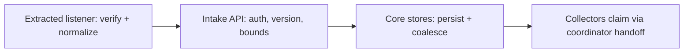

# Webhook Intake Package

Core's authenticated, versioned webhook intake API (`#9377`). The extracted
webhook listener verifies provider signatures, normalizes payloads, and
submits normalized triggers here over HTTP. Core retains durable trigger
storage and lifecycle through the store interfaces; the listener never
touches core tables on this path.

## Flow

## Exported Surface

- `Server` serves five versioned routes plus unauthenticated `/healthz`:
  `POST /api/v1/webhook/intake/{repository,incident,aws,gcp,actions}`.
- `NewServerChecked` fails closed on an empty bearer token.
- `Stores` bundles the five core durable stores behind the routes.
- Wire request types (`RepositoryIntakeRequest`, `IncidentIntakeRequest`,
  `AWSIntakeRequest`, `GCPIntakeRequest`, `ActionsIntakeRequest`) carry
  `api_version` and convert to domain triggers with fail-closed validation.

## Invariants

- Absent `api_version` means the oldest v1 client; any other value is
  rejected with `unsupported_api_version` before storage.
- Unknown JSON fields are ignored so a newer client still submits.
- Bodies are capped (default 1 MiB): 413 only on cap exceed, else 400.
- Validation failures are 400, conflicting Actions identities are 409,
  missing stores are 503, and store failures are 500 so providers redeliver.
- Bearer secrets never appear in logs; only route, provider family, status,
  and machine-readable reason are logged.

## Telemetry

`ServerConfig.Instruments` (nil disables metrics) makes every intake route
emit, in `metrics.go`: `eshu_dp_webhook_requests_total` and
`eshu_dp_webhook_request_duration_seconds` (`provider`, `outcome`, `reason`),
plus `eshu_dp_webhook_store_operations_total`,
`eshu_dp_webhook_store_duration_seconds` (`provider`, `outcome`, `status`) and
`eshu_dp_webhook_trigger_decisions_total` (`provider`, `event_kind`,
`decision`, `reason`, `status`) around the store call. Outcome is `stored`,
`rejected`, or `failed`. `status` is the stored lifecycle state. A failed write
(or a route with no store) is counted as `status="failed"`, the value the
EshuTriggerHandoffFailed alert selects; a delivery that coalesces into an
already-failed row also reads `failed`, so tell the two apart with
`store_operations_total{outcome="failed"}` or `requests_total{reason="store_failed"}`.
`/healthz` is not counted. The AWS and GCP routes also feed the freshness
counters the runbook queries select (#9814):
`eshu_dp_aws_freshness_events_total{kind,action}` and
`eshu_dp_gcp_freshness_events_total{kind,action,auth_path}`, with action
`intake_stored` (store ok, no coalesced delivery), `intake_coalesced` (store ok,
`DuplicateCount > 0`), or `intake_failed` (store error or no store configured).
`auth_path` is always `n/a` (`telemetry.AuthPathNotApplicable`): the host's caller
is the satellite presenting the intake bearer, so the host did not observe the
provider's auth. The host never emits `intake_rejected` or `intake_ignored`;
provider-edge rejects and ignores happen in the satellite, and a host-side
rejection is on `eshu_dp_webhook_requests_total{outcome="rejected"}`. Labels are
fixed sets: a free-text wire `reason` or incident `event_kind` outside the
known values becomes `other`, and no delivery id or repository name is a label.

## Operational Notes

The listener presents `Authorization: Bearer <token>` per request. Core
stamps `received_at` server-side; listener clocks are untrusted. Receipts
carry `trigger_id`, `status`, and duplicate signals the listener maps back
onto its handler contracts.

## Performance And Observability Evidence

No-Regression Evidence: `BenchmarkIntakeRepositoryRequest` in
`metrics_bench_test.go` (#9811), run with
`go test ./internal/webhook/intake/ -run xxx -bench IntakeRepositoryRequest -benchtime=20000x -count=6`.
Input shape: one valid repository intake POST per iteration through the
production mux and bearer auth, an in-memory fake store, an `httptest`
recorder, a fixed 202 receipt; no network and no Postgres. Backend: Go 1.26
with the OpenTelemetry Go SDK manual reader, on a shared arm64 Linux host.
Baseline (before the series, the handler-move commit `16dabbbd24`, first in this
PR, a pure move): 8.0-8.2 us/op, 67 allocs/op, measured with a nil-config copy of
the benchmark backported to that commit because the benchmark did not exist there.
Uninstrumented (nil `Instruments`): 8.2-8.7 us/op, 68 allocs/op. Instrumented:
11.0-13.7 us/op, 83 allocs/op, so the series cost 15 allocations (exact) and
roughly 2.5 to 5 us per stored request, against a Postgres upsert that costs
milliseconds. Terminal counts: every iteration returns 202 and the benchmark
fails on any other status. Safe because the added work on a stored request is three
counter adds (requests, store operations, decisions) and two histogram records
(request and store duration), no extra locks or goroutines, and no change
to the store call, its ordering, or its transaction. The
`go/internal/telemetry/instruments.go` edit in this PR is godoc and metric HELP
text only, so it changes no runtime behavior.

No-Regression Evidence (#9814): `BenchmarkIntakeGCPRequest` in
`metrics_bench_test.go`, run with
`go test ./internal/webhook/intake/ -run '^$' -bench IntakeGCPRequest -benchtime=20000x -count=6`.
Same input shape, backend, and host as above, on the GCP freshness route.
Uninstrumented: 7.3-7.5 us/op, 60 allocs/op. Instrumented: 11.1-12.0 us/op,
79 allocs/op, 11,740 B/op. Before the freshness counter (the same code with
`freshnessEvent` returning early): instrumented 10.8-11.4 us/op, 75 allocs/op,
11,314 B/op, so the counter costs 4 allocations and about 426 B (both exact).
The ns/op swing on this shared host between runs (the same uninstrumented case
read 7.3 us in one run and 8.1-11.9 us in the other) is larger than the
counter's cost, so no timing delta is claimed. Safe because the added work is
one counter add with 2-3 attributes on the AWS and GCP routes only, no lock,
goroutine, or change to the store call. The `go/internal/telemetry/instruments.go`
and `contract.go` edits are godoc and one string constant.

No-Regression Evidence (#9815): `BenchmarkIntakeRepositoryRequest` gained the
`traced-never-sampled` and `traced-always-sampled` cases (SDK tracer provider,
no exporter), same command and host as above, base = the #9814 commit.
Base: uninstrumented 9.0-10.8 us/op, 68 allocs/op, 11,701 B/op; instrumented
11.5-13.0 us/op, 83 allocs/op, 13,586 B/op. With the span change and a nil
`Tracer`: uninstrumented 8.7-9.3 us/op, 68 allocs/op, 11,799 B/op; instrumented
11.3-12.5 us/op, 83 allocs/op, 13,677-13,684 B/op (a few bytes of run-to-run variation). A nil tracer therefore adds zero
allocations; the only change is about 98 B per request for the larger request
state (exact). With a tracer: never sampled 12.4-13.0 us/op, 97 allocs/op,
15,079 B/op (+14 allocs, +1,396 B over instrumented); always sampled 14.3-15.6
us/op, 101 allocs/op, 16,938 B/op (+18 allocs, +3,255 B over instrumented), on a
shared host whose run-to-run swing is of the same order as the time difference. Production sampling is the OTEL environment's decision, and the
request is dominated by the Postgres round trip, which costs milliseconds. Safe
because spans add no lock or goroutine and no change to the store call except
that it now runs under the store span's context. Terminal counts: every
iteration returns 202.

Observability Evidence (#9815): `TestIntakeStoredRequestEmitsNestedSpans` posts a
stored delivery to each of the five routes and asserts one `webhook.handle` with
one `webhook.store` child, that the store call received the store span's context
(so the stores' `postgres.exec` spans nest), and that the attribute keys equal
the allow-list exactly. `TestIntakeStoreFailureMarksSpans` pins status Error with
a fixed description and no recorded error; `TestIntakeRejectedRequestEmitsHandleSpanOnly`,
`TestIntakeUnconfiguredStoreEmitsHandleSpanOnly`,
`TestIntakeActionsConflictMarksStoreSpanRejected` and
`TestIntakeWithoutTracerEmitsNoSpans` pin the other paths.
`TestIntakeLogsCarryTheHandleSpan` runs a stored and a store-failed request on each of the five routes
through the production telemetry logger and finds the handle span's `trace_id`
and `span_id` on the intake log line (a nil-tracer request logs no trace field),
`TestIntakeRejectionsEndTheHandleSpanOnce` covers every pre-store rejection,
`TestIntakeStorePanicStillEndsBothSpans` pins that a panicking store leaves no
open span (the request counter then reads `outcome="failed"`, `reason="store_failed"`),
and `TestIntakeStoreContextKeepsRequestCancellation` pins that the
store context still carries the request's cancellation. `TestIntakeHostEmitsRequestAndStoreSpans`
(`go/cmd/webhook-intake`) builds through `buildIntakeServer` with a recording
tracer. A live trace backend was not queried.

Observability Evidence (#9814): `TestIntakeFreshnessActionsFollowTheStoreOutcome`
forces stored, coalesced, store-failure and no-store outcomes on both routes and
reads exact label sets; `TestIntakeFreshnessRejectionsEmitNoActions` pins that
rejections emit nothing on the freshness counters;
`TestIntakeHostEmitsFreshnessActionSeries` (`go/cmd/webhook-intake`) scrapes the
production providers and finds `intake_coalesced` with `auth_path="n/a"`.
The runbook query on a live environment is not evaluated.

Observability Evidence: the intake routes now emit
`eshu_dp_webhook_requests_total`, `eshu_dp_webhook_request_duration_seconds`,
`eshu_dp_webhook_store_operations_total`,
`eshu_dp_webhook_store_duration_seconds`, and
`eshu_dp_webhook_trigger_decisions_total`, so the EshuTriggerHandoffFailed
alert and the freshness dashboard have data from the intake host.
`TestIntakeHostEmitsFreshnessAlertSeries` (`go/cmd/webhook-intake`) builds the
server through the production `buildIntakeServer` over the production
telemetry providers and scrapes the Prometheus handler: a forced store failure
exposes `trigger_decisions_total{...status="failed"...}` and a healthy store
does not. Labels are fixed sets, pinned by `TestIntakeMetricLabelsStayBounded`
(an unknown decision reason or incident event kind becomes `other`, and no
delivery id or repository name is a label) and
`TestIntakeUnknownStoredStatusIsBounded` (an unknown stored status becomes
`unknown`). Logs are unchanged. The deployed alert query is not yet evaluated on a
test environment.
