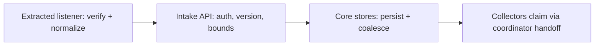

# Webhook Intake Package

Core's authenticated, versioned webhook intake API (`#9377`). The extracted
webhook listener verifies provider signatures, normalizes payloads, and
submits normalized triggers here over HTTP. Core retains durable trigger
storage and lifecycle through the store interfaces; the listener never
touches core tables on this path.

## Flow

## Exported Surface

- `Server` serves five versioned routes plus unauthenticated `/healthz`:
  `POST /api/v1/webhook/intake/{repository,incident,aws,gcp,actions}`.
- `NewServerChecked` fails closed on an empty bearer token.
- `Stores` bundles the five core durable stores behind the routes.
- Wire request types (`RepositoryIntakeRequest`, `IncidentIntakeRequest`,
  `AWSIntakeRequest`, `GCPIntakeRequest`, `ActionsIntakeRequest`) carry
  `api_version` and convert to domain triggers with fail-closed validation.

## Invariants

- Absent `api_version` means the oldest v1 client; any other value is
  rejected with `unsupported_api_version` before storage.
- Unknown JSON fields are ignored so a newer client still submits.
- Bodies are capped (default 1 MiB): 413 only on cap exceed, else 400.
- Validation failures are 400, conflicting Actions identities are 409,
  missing stores are 503, and store failures are 500 so providers redeliver.
- Bearer secrets never appear in logs; only route, provider family, status,
  and machine-readable reason are logged.

## Telemetry

`ServerConfig.Instruments` (nil disables metrics) makes every intake route
emit, in `metrics.go`: `eshu_dp_webhook_requests_total` and
`eshu_dp_webhook_request_duration_seconds` (`provider`, `outcome`, `reason`),
plus `eshu_dp_webhook_store_operations_total`,
`eshu_dp_webhook_store_duration_seconds` (`provider`, `outcome`, `status`) and
`eshu_dp_webhook_trigger_decisions_total` (`provider`, `event_kind`,
`decision`, `reason`, `status`) around the store call. Outcome is `stored`,
`rejected`, or `failed`. `status` is the stored lifecycle state. A failed write
(or a route with no store) is counted as `status="failed"`, the value the
EshuTriggerHandoffFailed alert selects; a delivery that coalesces into an
already-failed row also reads `failed`, so tell the two apart with
`store_operations_total{outcome="failed"}` or `requests_total{reason="store_failed"}`.
`/healthz` is not counted. Labels are
fixed sets: a free-text wire `reason` or incident `event_kind` outside the
known values becomes `other`, and no delivery id or repository name is a label.

## Operational Notes

The listener presents `Authorization: Bearer <token>` per request. Core
stamps `received_at` server-side; listener clocks are untrusted. Receipts
carry `trigger_id`, `status`, and duplicate signals the listener maps back
onto its handler contracts.

## Performance And Observability Evidence

No-Regression Evidence: `BenchmarkIntakeRepositoryRequest` in
`metrics_bench_test.go` (#9811), run with
`go test ./internal/webhook/intake/ -run xxx -bench IntakeRepositoryRequest -benchtime=20000x -count=6`.
Input shape: one valid repository intake POST per iteration through the
production mux and bearer auth, an in-memory fake store, an `httptest`
recorder, a fixed 202 receipt; no network and no Postgres. Backend: Go 1.26
with the OpenTelemetry Go SDK manual reader, on a shared arm64 Linux host.
Baseline (before the series, commit `4b97a0e6b0`): 8.0-8.2 us/op, 67 allocs/op.
Uninstrumented (nil `Instruments`): 8.2-8.7 us/op, 68 allocs/op. Instrumented:
11.0-13.7 us/op, 83 allocs/op, so the series cost 15 allocations (exact) and
roughly 2.5 to 5 us per stored request, against a Postgres upsert that costs
milliseconds. Terminal counts: every iteration returns 202 and the benchmark
fails on any other status. Safe because the added work is two counter adds and
two histogram records per request, no extra locks or goroutines, and no change
to the store call, its ordering, or its transaction. The
`go/internal/telemetry/instruments.go` edit in this PR is godoc and metric HELP
text only, so it changes no runtime behavior.

Observability Evidence: the intake routes now emit
`eshu_dp_webhook_requests_total`, `eshu_dp_webhook_request_duration_seconds`,
`eshu_dp_webhook_store_operations_total`,
`eshu_dp_webhook_store_duration_seconds`, and
`eshu_dp_webhook_trigger_decisions_total`, so the EshuTriggerHandoffFailed
alert and the freshness dashboard have data from the intake host.
`TestIntakeHostEmitsFreshnessAlertSeries` (`go/cmd/webhook-intake`) builds the
server through the production `buildIntakeServer` over the production
telemetry providers and scrapes the Prometheus handler: a forced store failure
exposes `trigger_decisions_total{...status="failed"...}` and a healthy store
does not. Labels are fixed sets, pinned by `TestIntakeMetricLabelsStayBounded`
(an unknown decision reason or incident event kind becomes `other`, an unknown
stored status becomes `unknown`, and no delivery id or repository name is a
label). Logs are unchanged. The deployed alert query is not yet evaluated on a
test environment.
