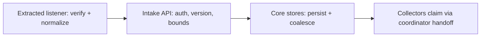

# Webhook Intake Package

Core's authenticated, versioned webhook intake API (`#9377`). The extracted
webhook listener verifies provider signatures, normalizes payloads, and
submits normalized triggers here over HTTP. Core retains durable trigger
storage and lifecycle through the store interfaces; the listener never
touches core tables on this path.

## Flow

## Exported Surface

- `Server` serves five versioned routes plus unauthenticated `/healthz`:
  `POST /api/v1/webhook/intake/{repository,incident,aws,gcp,actions}`.
- `NewServerChecked` fails closed on an empty bearer token.
- `Stores` bundles the five core durable stores behind the routes.
- Wire request types (`RepositoryIntakeRequest`, `IncidentIntakeRequest`,
  `AWSIntakeRequest`, `GCPIntakeRequest`, `ActionsIntakeRequest`) carry
  `api_version` and convert to domain triggers with fail-closed validation.

## Invariants

- Absent `api_version` means the oldest v1 client; any other value is
  rejected with `unsupported_api_version` before storage.
- Unknown JSON fields are ignored so a newer client still submits.
- Bodies are capped (default 1 MiB): 413 only on cap exceed, else 400.
- Validation failures are 400, conflicting Actions identities are 409,
  missing stores are 503, and store failures are 500 so providers redeliver.
- Bearer secrets never appear in logs; only route, provider family, status,
  and machine-readable reason are logged.

## Operational Notes

The listener presents `Authorization: Bearer <token>` per request. Core
stamps `received_at` server-side; listener clocks are untrusted. Receipts
carry `trigger_id`, `status`, and duplicate signals the listener maps back
onto its handler contracts.
